# Báo cáo kiểm thử NÉT Fashion — 1920×1080

Ngày thực hiện: **29/10/2026** · Môi trường local: **http://localhost:8788** · API Java: **http://localhost:8081**.

Đã kiểm tra các chức năng chính của cửa hàng và quản trị, thực hiện một luồng đặt hàng → thanh toán giả lập → xử lý → xuất kho → giao thành công. Báo cáo có **54 ca kiểm tra giao diện/nghiệp vụ**, **62 ảnh chụp thật 1920×1080**, cùng kết quả kiểm tra API và dữ liệu.

## 1. Kết quả tổng hợp

| Phạm vi | Kết quả |
|---|---|
| Ca giao diện/nghiệp vụ đạt | 41 |
| Kiểm tra một phần hoặc còn hạn chế | 11 |
| Ca lỗi chức năng rõ ràng | 2 |
| Frontend unit tests | 15/15 đạt, 5 file test |
| Typecheck, lint, production build | Đạt; lint 0 lỗi và 0 cảnh báo |
| Smoke test ứng dụng | 4/4 đạt |
| API và trang quản trị | 34 kiểm tra: 33 đúng kỳ vọng, 1 sai mã HTTP quyền truy cập |
| Toàn vẹn bộ dữ liệu mẫu và kho | Đạt |
| Kích thước ảnh | 62/62 ảnh JPEG đúng 1920×1080 |

“Đạt” chỉ áp dụng cho thao tác và dữ liệu đã ghi trong từng ca. “Một phần” nghĩa là giao diện/luồng đã kiểm tra được nhưng còn chức năng chưa làm, chưa thử hoặc có hạn chế. Các lỗi nằm trong mục Một phần vẫn được liệt kê ở danh sách lỗi; không diễn giải tổng này thành toàn bộ website đã đạt.

### Môi trường và tài khoản

- Repository: git@github.com:ltdungg/net-project-1.git, nhánh master, có thay đổi local chưa commit.
- Cửa hàng và API chạy trong stack Docker net-pj1, sử dụng PostgreSQL và Redis của dự án.
- Khách thử nghiệm: customer01@example.test. Quản trị: demo.admin@example.test. Phân quyền API còn dùng demo.manager@example.test và demo.staff@example.test.
- Đây là các tài khoản và liên hệ mẫu. Hướng dẫn dữ liệu/tài khoản: [Dữ liệu mẫu](du-lieu-mau.md).
- Kiểm thử trợ lý trên cơ chế dự phòng hiện có vì chưa cấu hình khóa nhà cung cấp mô hình. Chưa xác nhận phản hồi từ mô hình bên ngoài.
- Ảnh chụp từ giao diện website đang chạy, mỗi ảnh là một vùng nhìn 1920×1080; trang dài có ảnh phần đầu hoặc phần nội dung liên quan. Không phải ảnh dựng hay ảnh ghép giao diện.
- Một số ảnh biểu mẫu và chi tiết vận chuyển được chụp lại sau giao dịch để rõ bố cục; mục Thực tế ghi rõ trường hợp này. Giá trị giữa các ảnh có thể tăng do dữ liệu thử được tạo trong lúc kiểm tra.

## 2. Mục lục ca kiểm thử

| Mã | Chức năng | Kết quả | Ảnh |
|---|---|---|---|
| [KH-01](#kh-01) | Trang chủ | Đạt | [01](images/kiem-thu-1920x1080/01-trang-chu.jpg) |
| [KH-02](#kh-02) | Đăng nhập và đăng xuất | Đạt | [02](images/kiem-thu-1920x1080/02-dang-nhap.jpg), [05](images/kiem-thu-1920x1080/05-tai-khoan.jpg) |
| [KH-03](#kh-03) | Đăng ký thành viên | Một phần | [03](images/kiem-thu-1920x1080/03-dang-ky.jpg) |
| [KH-04](#kh-04) | Quên mật khẩu | Một phần | [04](images/kiem-thu-1920x1080/04-quen-mat-khau.jpg) |
| [KH-05](#kh-05) | Cập nhật hồ sơ | Đạt | [06](images/kiem-thu-1920x1080/06-ho-so.jpg) |
| [KH-06](#kh-06) | Sổ địa chỉ và sửa địa chỉ | Đạt | [07](images/kiem-thu-1920x1080/07-so-dia-chi.jpg), [08](images/kiem-thu-1920x1080/08-sua-dia-chi.jpg) |
| [KH-07](#kh-07) | Danh sách đơn của khách | Một phần | [09](images/kiem-thu-1920x1080/09-don-hang-ca-nhan.jpg) |
| [KH-08](#kh-08) | Chi tiết đơn đã mua | Đạt | [10](images/kiem-thu-1920x1080/10-chi-tiet-don-khach.jpg) |
| [KH-09](#kh-09) | Danh mục sản phẩm | Đạt | [11](images/kiem-thu-1920x1080/11-danh-muc-san-pham.jpg) |
| [KH-10](#kh-10) | Lọc theo giá | Đạt | [12](images/kiem-thu-1920x1080/12-loc-san-pham.jpg) |
| [KH-11](#kh-11) | Tìm kiếm cửa hàng | Đạt | [27](images/kiem-thu-1920x1080/27-tim-kiem.jpg) |
| [KH-12](#kh-12) | Chi tiết sản phẩm và chọn size | Một phần | [13](images/kiem-thu-1920x1080/13-chi-tiet-san-pham.jpg) |
| [KH-13](#kh-13) | Giỏ hàng và số lượng | Đạt | [14](images/kiem-thu-1920x1080/14-them-gio-hang.jpg) |
| [KH-14](#kh-14) | Từ chối voucher hết hạn | Đạt | [15](images/kiem-thu-1920x1080/15-voucher-het-han.jpg) |
| [KH-15](#kh-15) | Áp dụng voucher hợp lệ | Đạt | [16](images/kiem-thu-1920x1080/16-voucher-hop-le.jpg) |
| [KH-16](#kh-16) | Checkout, địa chỉ và phương thức thanh toán | Đạt | [17](images/kiem-thu-1920x1080/17-checkout.jpg), [60](images/kiem-thu-1920x1080/60-checkout-phuong-thuc.jpg) |
| [KH-17](#kh-17) | Thanh toán giả lập thất bại và thử lại | Đạt | [18](images/kiem-thu-1920x1080/18-thanh-toan-gia-lap.jpg), [19](images/kiem-thu-1920x1080/19-thanh-toan-that-bai.jpg), [20](images/kiem-thu-1920x1080/20-thanh-toan-thanh-cong.jpg) |
| [KH-18](#kh-18) | Theo dõi đơn mới qua toàn bộ quy trình | Đạt | [21](images/kiem-thu-1920x1080/21-don-hang-vua-tao.jpg), [62](images/kiem-thu-1920x1080/62-khach-theo-doi-da-giao.jpg) |
| [KH-19](#kh-19) | Danh sách yêu thích | Đạt | [22](images/kiem-thu-1920x1080/22-yeu-thich.jpg) |
| [KH-20](#kh-20) | Tư vấn mua sắm theo giá và size | Đạt | [23](images/kiem-thu-1920x1080/23-tu-van-mua-sam.jpg) |
| [KH-21](#kh-21) | Tư vấn theo loại chân váy | Lỗi | [24](images/kiem-thu-1920x1080/24-loi-goi-y-chan-vay.jpg) |
| [KH-22](#kh-22) | Gợi ý sản phẩm tự động | Đạt | [61](images/kiem-thu-1920x1080/61-goi-y-tu-dong.jpg) |
| [KH-23](#kh-23) | Hướng dẫn chọn size | Đạt | [25](images/kiem-thu-1920x1080/25-huong-dan-size.jpg) |
| [KH-24](#kh-24) | Câu chuyện thương hiệu | Đạt | [26](images/kiem-thu-1920x1080/26-cau-chuyen.jpg) |
| [QT-01](#qt-01) | Tổng quan quản trị | Một phần | [28](images/kiem-thu-1920x1080/28-admin-tong-quan.jpg) |
| [QT-02](#qt-02) | Danh sách sản phẩm | Một phần | [29](images/kiem-thu-1920x1080/29-admin-san-pham.jpg) |
| [QT-03](#qt-03) | Tìm sản phẩm trong quản trị | Lỗi | [30](images/kiem-thu-1920x1080/30-admin-tim-san-pham.jpg) |
| [QT-04](#qt-04) | Tạo sản phẩm nháp | Một phần | [31](images/kiem-thu-1920x1080/31-admin-them-san-pham.jpg), [32](images/kiem-thu-1920x1080/32-admin-san-pham-da-tao.jpg) |
| [QT-05](#qt-05) | Danh sách đơn quản trị | Một phần | [33](images/kiem-thu-1920x1080/33-admin-don-hang.jpg) |
| [QT-06](#qt-06) | Chi tiết đơn quản trị | Đạt | [34](images/kiem-thu-1920x1080/34-admin-chi-tiet-don.jpg) |
| [QT-07](#qt-07) | Cập nhật xử lý đơn | Đạt | [35](images/kiem-thu-1920x1080/35-admin-cap-nhat-don.jpg) |
| [QT-08](#qt-08) | Hàng đợi vận chuyển | Đạt | [36](images/kiem-thu-1920x1080/36-admin-van-chuyen.jpg) |
| [QT-09](#qt-09) | Chi tiết phiếu giao | Đạt | [37](images/kiem-thu-1920x1080/37-admin-chi-tiet-van-chuyen.jpg) |
| [QT-10](#qt-10) | Lưu thông tin vận đơn | Đạt | [38](images/kiem-thu-1920x1080/38-admin-luu-van-don.jpg) |
| [QT-11](#qt-11) | Chuẩn bị, xuất kho và chuyển đang giao | Đạt | [39](images/kiem-thu-1920x1080/39-admin-xuat-kho.jpg) |
| [QT-12](#qt-12) | Giao thành công | Đạt | [40](images/kiem-thu-1920x1080/40-admin-giao-thanh-cong.jpg) |
| [QT-13](#qt-13) | Khách hàng và phân khúc | Đạt | [41](images/kiem-thu-1920x1080/41-admin-khach-hang.jpg) |
| [QT-14](#qt-14) | Hồ sơ khách hàng 360 độ | Đạt | [42](images/kiem-thu-1920x1080/42-admin-ho-so-khach.jpg) |
| [QT-15](#qt-15) | Tổng hợp tồn kho đa kho | Đạt | [43](images/kiem-thu-1920x1080/43-admin-ton-kho.jpg) |
| [QT-16](#qt-16) | Nhập kho | Đạt | [44](images/kiem-thu-1920x1080/44-admin-nhap-kho.jpg) |
| [QT-17](#qt-17) | Chuyển kho | Đạt | [45](images/kiem-thu-1920x1080/45-admin-chuyen-kho.jpg) |
| [QT-18](#qt-18) | Kiểm kê | Đạt | [46](images/kiem-thu-1920x1080/46-admin-kiem-ke.jpg) |
| [QT-19](#qt-19) | Điều chỉnh tồn kho | Đạt | [47](images/kiem-thu-1920x1080/47-admin-dieu-chinh-ton.jpg) |
| [QT-20](#qt-20) | Sổ cái và đối chiếu số dư | Đạt | [48](images/kiem-thu-1920x1080/48-admin-so-cai.jpg) |
| [QT-21](#qt-21) | Danh sách khuyến mãi | Đạt | [49](images/kiem-thu-1920x1080/49-admin-khuyen-mai.jpg) |
| [QT-22](#qt-22) | Tạo voucher | Đạt | [50](images/kiem-thu-1920x1080/50-admin-tao-khuyen-mai.jpg), [51](images/kiem-thu-1920x1080/51-admin-voucher-da-tao.jpg) |
| [QT-23](#qt-23) | Báo cáo kinh doanh | Một phần | [52](images/kiem-thu-1920x1080/52-admin-bao-cao.jpg) |
| [QT-24](#qt-24) | Tài chính và đối soát | Một phần | [53](images/kiem-thu-1920x1080/53-admin-tai-chinh.jpg) |
| [QT-25](#qt-25) | Tư vấn vận hành | Đạt | [54](images/kiem-thu-1920x1080/54-admin-tu-van-van-hanh.jpg) |
| [QT-26](#qt-26) | Tạo bản xem trước dashboard | Đạt | [55](images/kiem-thu-1920x1080/55-admin-dashboard-xem-truoc.jpg) |
| [QT-27](#qt-27) | Lưu, mở lại và làm mới dashboard | Đạt | [56](images/kiem-thu-1920x1080/56-admin-dashboard-da-luu.jpg) |
| [QT-28](#qt-28) | Biểu đồ và bảng bán chạy | Đạt | [57](images/kiem-thu-1920x1080/57-admin-dashboard-bieu-do.jpg) |
| [QT-29](#qt-29) | Cài đặt hệ thống | Một phần | [58](images/kiem-thu-1920x1080/58-admin-cai-dat.jpg) |
| [QT-30](#qt-30) | Nhật ký backend và bộ lọc | Đạt | [59](images/kiem-thu-1920x1080/59-admin-nhat-ky.jpg) |

## 3. Lỗi và phần cần hoàn thiện

| Mã | Mức ưu tiên | Phát hiện | Ca liên quan | Hướng xử lý |
|---|---|---|---|---|
| L-01 | Cao | Tư vấn chân váy trả cả đầm | KH-21 | Phân biệt chân váy với đầm trước khi xếp hạng; kiểm tra lại ngữ cảnh câu hỏi tiếp nối. |
| L-02 | Vừa | Ô tìm kiếm sản phẩm quản trị không lọc | QT-03 | Nối từ khóa vào truy vấn hoặc bộ lọc; kiểm tra tên/SKU/slug. |
| L-03 | Vừa | Sản phẩm draft mang nhãn Đang chạy | QT-04 | Truyền trạng thái thực vào StatusBadge; DB đã xác nhận sản phẩm thử là draft. |
| L-04 | Cao | Tổng quan còn ngày và chỉ số cố định | QT-01/QT-23 | Thay ngày 31/08/2026, mục tiêu 486,2/520 triệu và thẻ ưu tiên cố định bằng dữ liệu. Funnel chưa có tracking phải được xem là minh họa. |
| L-05 | Vừa | Một số nút quản trị chưa được triển khai | QT-02/QT-23/QT-24/QT-29 | Hoàn thiện thao tác sản phẩm, xuất CSV/báo cáo, đối soát và lưu cài đặt; hiện có các nút không handler hoặc bị disable. |
| L-06 | Vừa | Staff gọi metrics nhận HTTP 500 | API | Kỳ vọng HTTP 403 cho quyền bị từ chối. Không có dữ liệu được trả, nhưng mã lỗi đang sai; cần ánh xạ AccessDenied đúng. |
| L-07 | Thấp | Nhãn trạng thái chưa thống nhất | KH-07/QT-21/QT-05 | Dịch delivered/expired/refunded; tránh dùng Giao thất bại cho payment failed. |
| L-08 | Thấp | SKU chi tiết sản phẩm không đổi theo size | KH-12 | Dòng SKU đang lấy product.variants[0], trong khi ProductActions quản lý biến thể riêng; cần đồng bộ. |
| L-09 | Vừa | Danh sách đơn bị giới hạn 50 nhưng chưa phân trang | QT-05 | Hiển thị tổng thực và phân trang/tải thêm; thẻ Tất cả hiện chỉ phản ánh mảng 50 dòng. |

Đối chiếu mã nguồn đã xác nhận: trang danh sách sản phẩm dùng nhãn active cố định; ô tìm sản phẩm, nút thao tác và các nút xuất chưa có handler; trang Báo cáo và Tài chính có dữ liệu mô phỏng/đơn giản hóa; danh sách đơn dùng giới hạn mặc định 50. Những phát hiện này không được sửa trong lượt lập báo cáo.

## 4. Kịch bản và ảnh minh chứng

### KH-01 — Trang chủ

**Kết quả: Đạt.**

- Thao tác: Mở cửa hàng khi chưa đăng nhập.
- Mong đợi: Hiển thị bộ sưu tập, điều hướng và lời kêu gọi mua sắm.
- Thực tế: Trang tải được, ảnh sản phẩm và các liên kết chính xuất hiện.

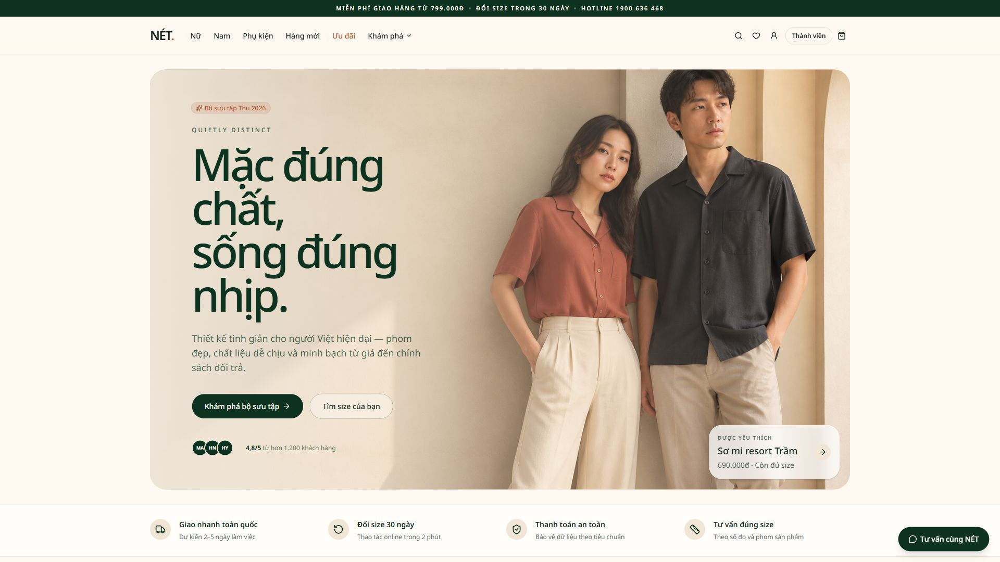

### KH-02 — Đăng nhập và đăng xuất

**Kết quả: Đạt.**

- Thao tác: Đăng nhập customer01@example.test; mở tài khoản; đăng xuất. Sau đó đăng nhập tài khoản quản trị mẫu.
- Mong đợi: Nhận đúng phiên và quyền của từng tài khoản; đăng xuất đưa về trạng thái khách.
- Thực tế: Khách hàng thấy Nguyễn Minh Anh; quản trị vào được khu vực admin; đăng xuất thành công.

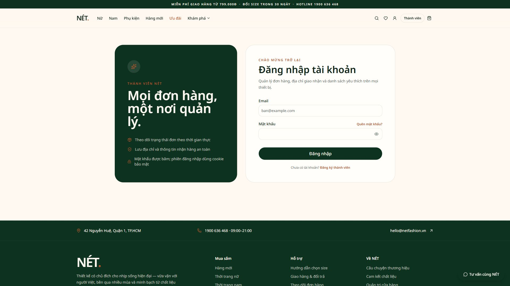

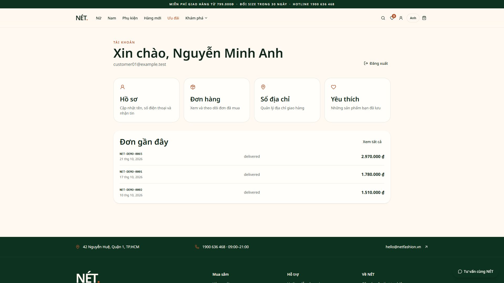

### KH-03 — Đăng ký thành viên

**Kết quả: Một phần.**

- Thao tác: Mở trang đăng ký.
- Mong đợi: Biểu mẫu có thông tin tài khoản và đồng ý điều khoản.
- Thực tế: Biểu mẫu hiển thị đủ. Chưa gửi đăng ký, xác minh email hay kiểm thử trùng email trong lượt này.

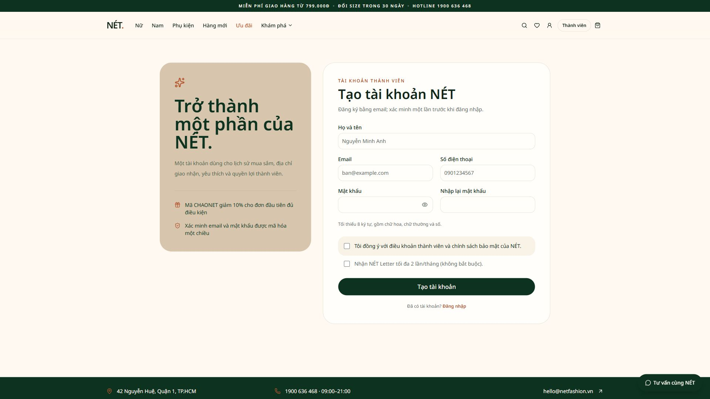

### KH-04 — Quên mật khẩu

**Kết quả: Một phần.**

- Thao tác: Mở liên kết Quên mật khẩu từ đăng nhập.
- Mong đợi: Hiển thị trường email và nút gửi hướng dẫn.
- Thực tế: Giao diện tải đúng. Chưa gửi email, mở token hoặc đặt lại mật khẩu.

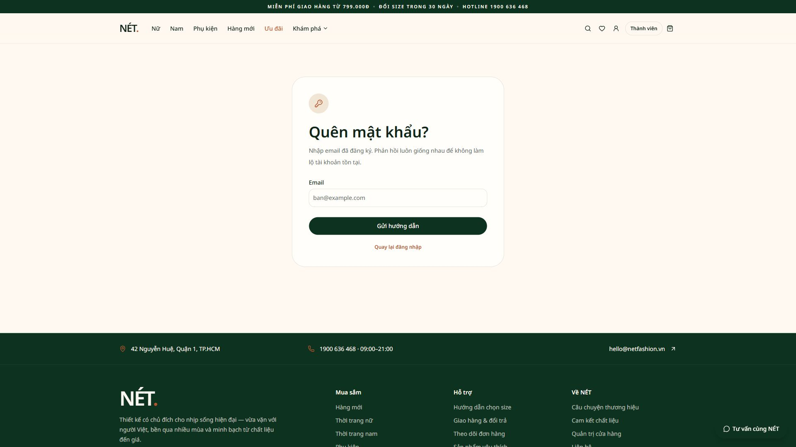

### KH-05 — Cập nhật hồ sơ

**Kết quả: Đạt.**

- Thao tác: Mở Hồ sơ và bấm Lưu hồ sơ với dữ liệu mẫu hiện có.
- Mong đợi: Lưu thành công và giữ nguyên thông tin nhập.
- Thực tế: Thông báo cập nhật thành công xuất hiện; tên và số điện thoại mẫu được giữ nguyên. Chưa kiểm thử thay đổi từng trường.

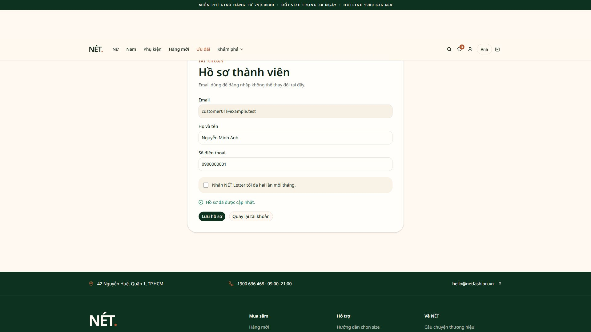

### KH-06 — Sổ địa chỉ và sửa địa chỉ

**Kết quả: Đạt.**

- Thao tác: Mở sổ địa chỉ; sửa địa chỉ Nhà riêng; lưu lại các giá trị hiện có.
- Mong đợi: Nạp đúng địa chỉ, người nhận và trạng thái mặc định; lưu được.
- Thực tế: Địa chỉ được điền sẵn và lưu thành công; checkout dùng được địa chỉ này.

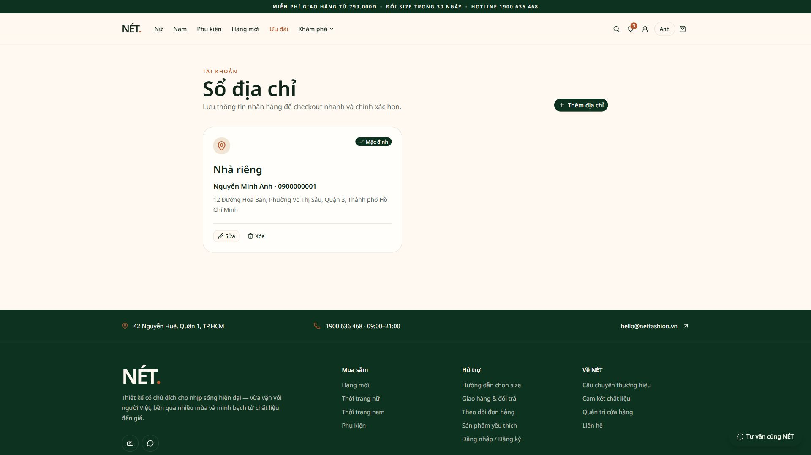

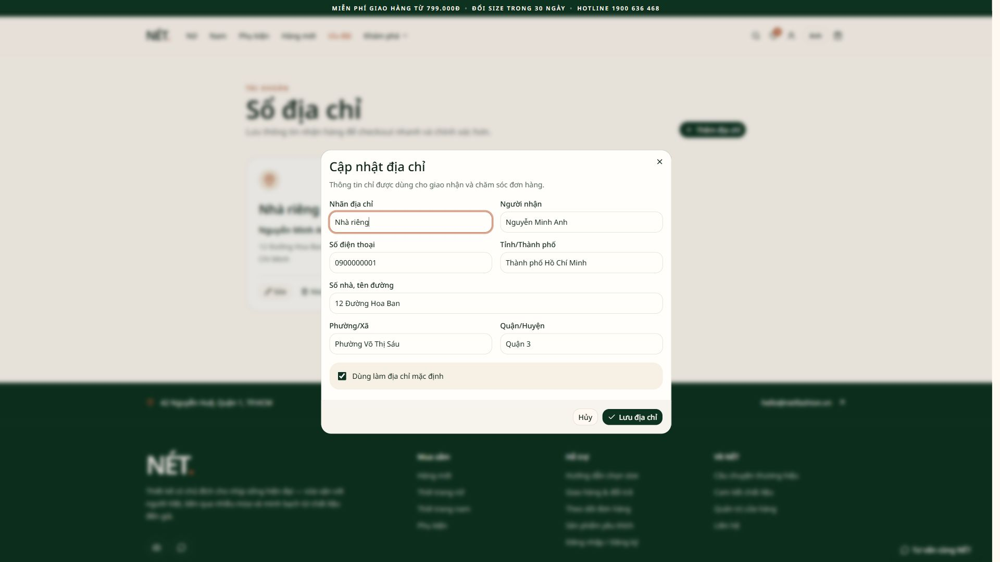

### KH-07 — Danh sách đơn của khách

**Kết quả: Một phần.**

- Thao tác: Mở Đơn hàng trong tài khoản customer01.
- Mong đợi: Chỉ hiển thị đơn của tài khoản và tên trạng thái tiếng Việt.
- Thực tế: Danh sách đơn tải đúng; một số nhãn vẫn là delivered. Xem lỗi L-07.

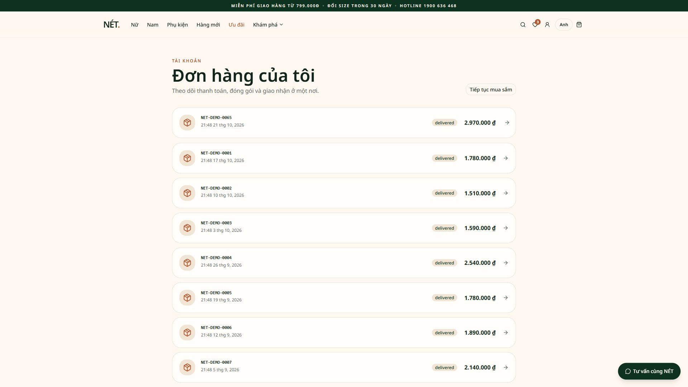

### KH-08 — Chi tiết đơn đã mua

**Kết quả: Đạt.**

- Thao tác: Mở đơn mẫu NET-DEMO-0001 từ lịch sử mua hàng.
- Mong đợi: Hiển thị hành trình, sản phẩm và tổng tiền.
- Thực tế: Chi tiết đơn đã giao hiển thị; tổng tiền 1.780.000 ₫.

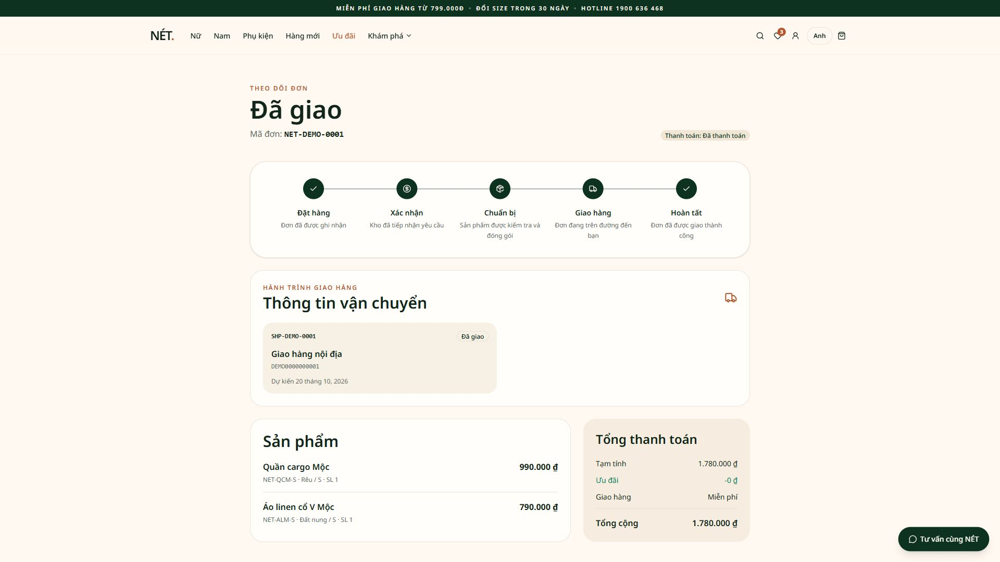

### KH-09 — Danh mục sản phẩm

**Kết quả: Đạt.**

- Thao tác: Mở danh mục Nữ.
- Mong đợi: Hiển thị sản phẩm thuộc danh mục với ảnh và giá.
- Thực tế: Danh mục có 10 sản phẩm, thẻ sản phẩm và bộ lọc xuất hiện.

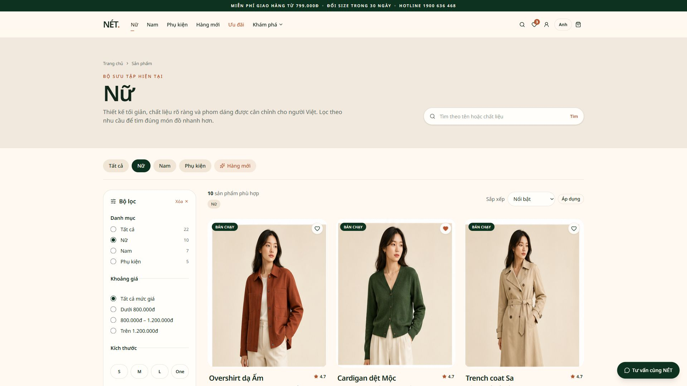

### KH-10 — Lọc theo giá

**Kết quả: Đạt.**

- Thao tác: Trong danh mục Nữ, chọn mức giá dưới 800.000 ₫.
- Mong đợi: Chỉ giữ sản phẩm dưới ngưỡng giá.
- Thực tế: Còn Áo linen cổ V Mộc giá 790.000 ₫.

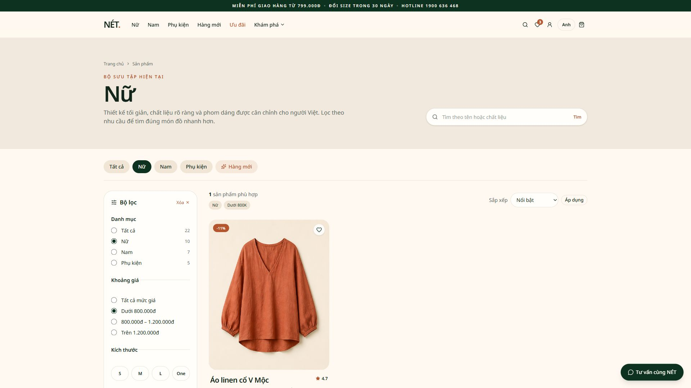

### KH-11 — Tìm kiếm cửa hàng

**Kết quả: Đạt.**

- Thao tác: Tìm từ khóa linen.
- Mong đợi: Kết quả phù hợp từ khóa.
- Thực tế: Hiển thị 4 sản phẩm phù hợp và tiêu đề kết quả cho linen.

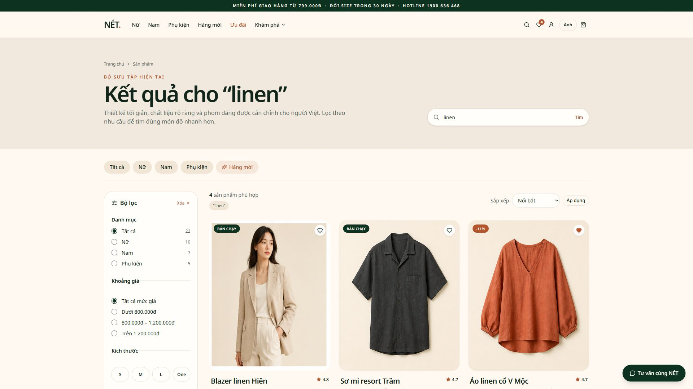

### KH-12 — Chi tiết sản phẩm và chọn size

**Kết quả: Một phần.**

- Thao tác: Mở Áo linen cổ V Mộc; chọn size M.
- Mong đợi: Giá, tồn khả dụng và SKU tương ứng size được cập nhật.
- Thực tế: Chọn M và thêm đúng biến thể M vào giỏ được; dòng SKU trên trang vẫn lấy biến thể đầu tiên. Xem L-08.

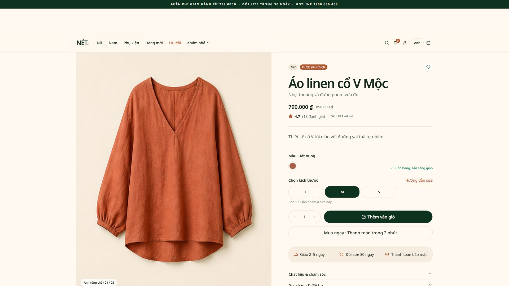

### KH-13 — Giỏ hàng và số lượng

**Kết quả: Đạt.**

- Thao tác: Thêm áo size M; tăng từ 1 lên 2; cuối lượt chụp lại đã xóa sản phẩm thử khỏi giỏ.
- Mong đợi: Tổng tiền và phí vận chuyển đổi theo số lượng; xóa được dòng hàng.
- Thực tế: 1 áo: 790.000 ₫ + 35.000 ₫ giao hàng. 2 áo: 1.580.000 ₫, miễn phí giao hàng. Giỏ cuối cùng trống.

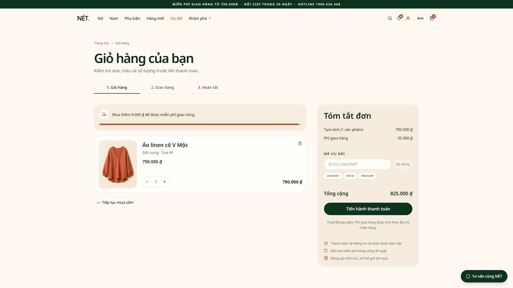

### KH-14 — Từ chối voucher hết hạn

**Kết quả: Đạt.**

- Thao tác: Nhập DEMOHE vào giỏ 2 áo và bấm Áp dụng.
- Mong đợi: Không áp dụng giảm giá; báo lý do hết hạn.
- Thực tế: Hiển thị lỗi mã không còn hiệu lực; tổng chưa giảm là 1.580.000 ₫.

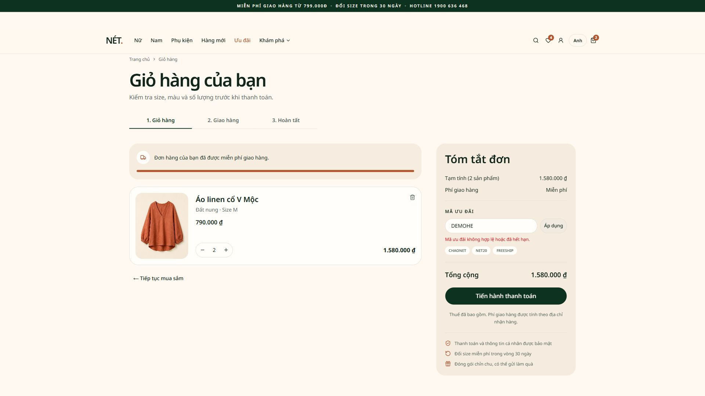

### KH-15 — Áp dụng voucher hợp lệ

**Kết quả: Đạt.**

- Thao tác: Nhập DEMO10 vào giỏ 2 áo.
- Mong đợi: Giảm 10%, tối đa 150.000 ₫.
- Thực tế: Giảm 150.000 ₫; tổng thanh toán 1.430.000 ₫.

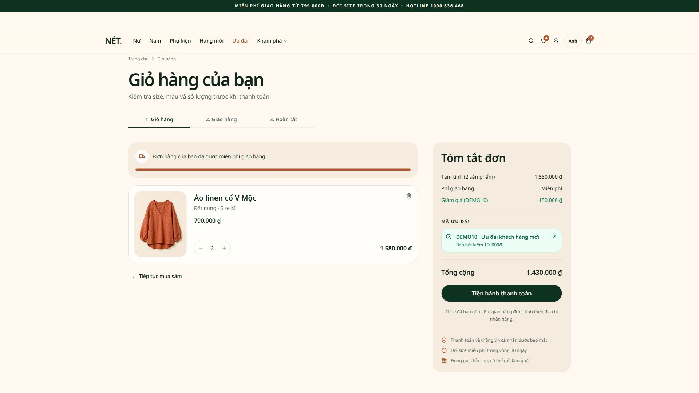

### KH-16 — Checkout, địa chỉ và phương thức thanh toán

**Kết quả: Đạt.**

- Thao tác: Mở checkout từ giỏ; dùng Nhà riêng; chọn thanh toán giả lập; đặt đơn thử.
- Mong đợi: Địa chỉ tự điền, tổng tiền đúng, tạo được đơn thử.
- Thực tế: Đã tạo NET-261029-724620 tổng 1.430.000 ₫. Ảnh checkout được chụp lại sau đó với cùng giỏ mẫu để có bố cục rõ; lần chụp lại không đặt thêm đơn.

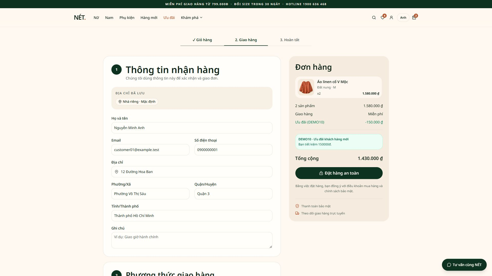

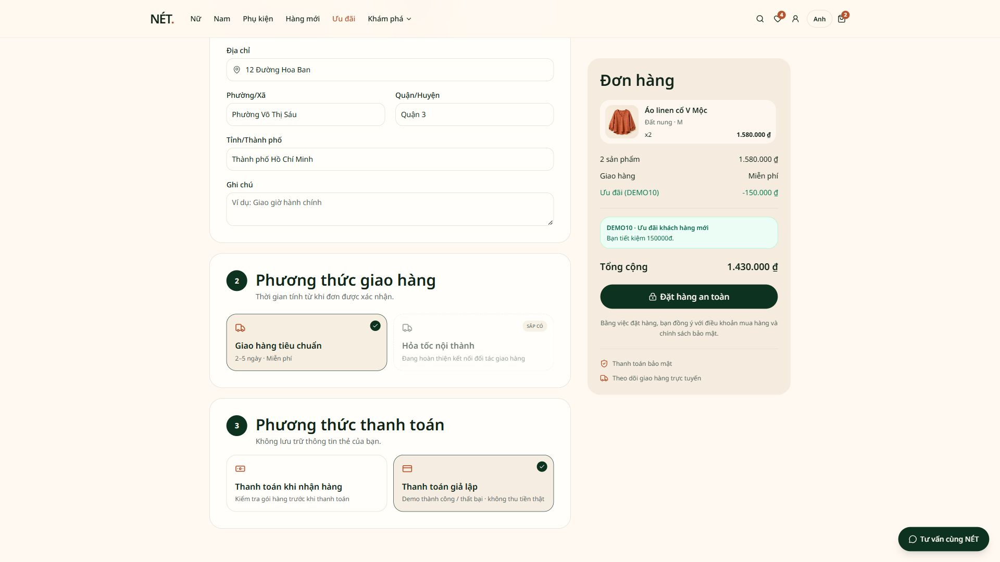

### KH-17 — Thanh toán giả lập thất bại và thử lại

**Kết quả: Đạt.**

- Thao tác: Trên trang thanh toán của đơn thử, chọn mô phỏng thất bại, sau đó mô phỏng thành công.
- Mong đợi: Lần thất bại cho phép thử lại; lần thành công cập nhật trạng thái thanh toán.
- Thực tế: Đã quan sát trạng thái thất bại rồi thông báo thành công. Đơn cuối cùng có payment_status=paid. Không có giao dịch tiền thật.

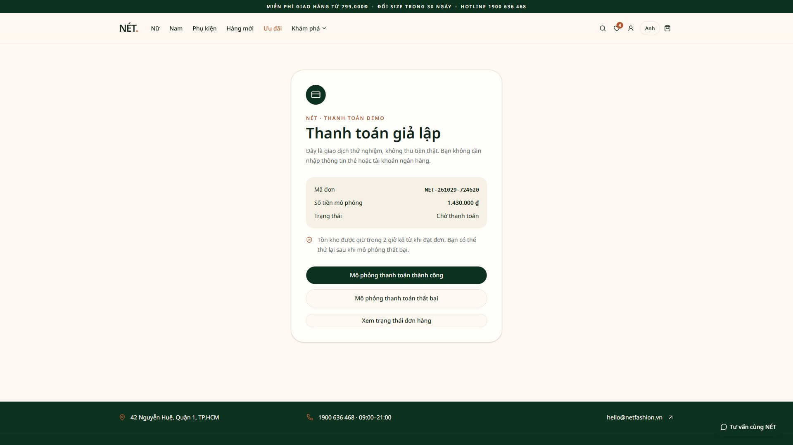

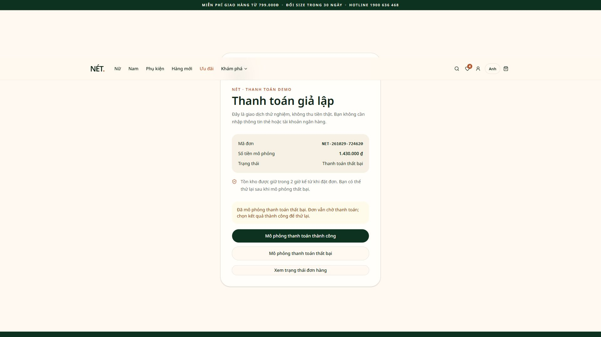

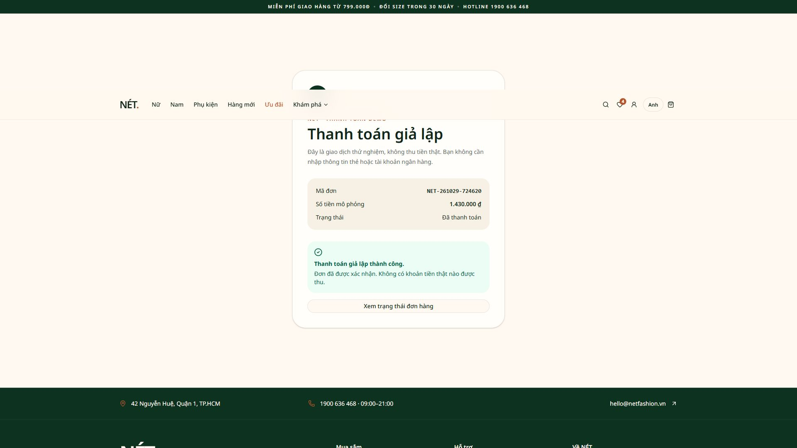

### KH-18 — Theo dõi đơn mới qua toàn bộ quy trình

**Kết quả: Đạt.**

- Thao tác: Mở đơn sau thanh toán; sau khi quản trị giao thành công, mở lại phía khách.
- Mong đợi: Khách thấy trạng thái đồng bộ với quản trị.
- Thực tế: Ban đầu Đã xác nhận; cuối quy trình Đã giao, cùng mã đơn và tổng tiền.

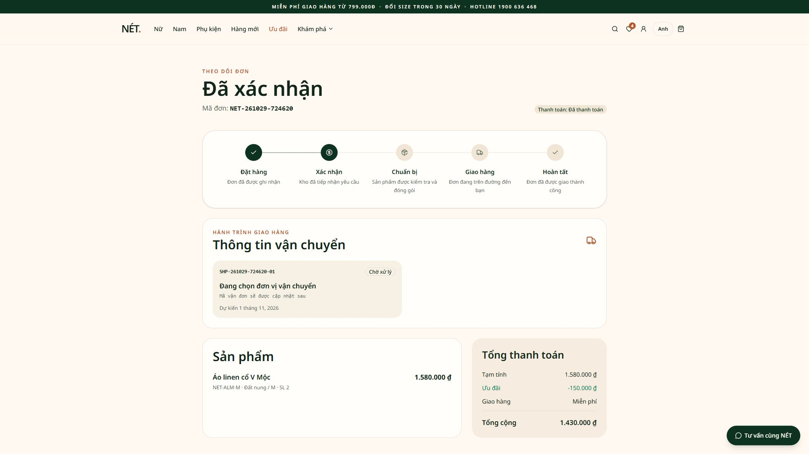

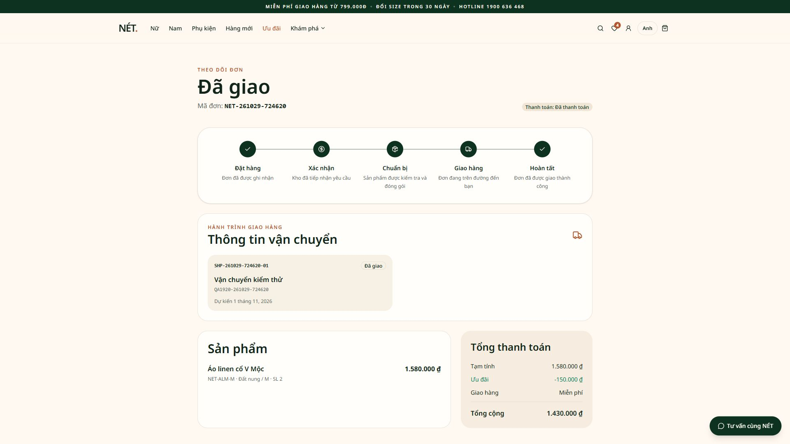

### KH-19 — Danh sách yêu thích

**Kết quả: Đạt.**

- Thao tác: Bấm yêu thích Áo linen cổ V Mộc và mở danh sách yêu thích.
- Mong đợi: Sản phẩm được lưu vào tài khoản.
- Thực tế: Số sản phẩm yêu thích tăng từ 3 lên 4; áo xuất hiện trong danh sách.

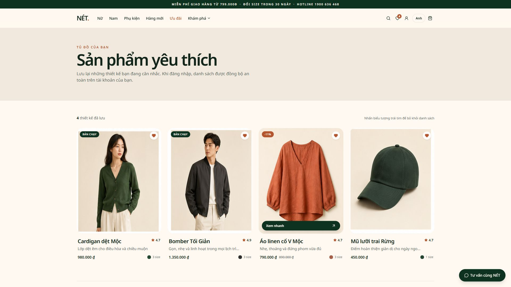

### KH-20 — Tư vấn mua sắm theo giá và size

**Kết quả: Đạt.**

- Thao tác: Hỏi trợ lý: Áo nữ dưới 800k, size M.
- Mong đợi: Gợi ý đúng loại hàng, ngân sách và size.
- Thực tế: Trả về Áo linen cổ V Mộc giá 790.000 ₫ với size M. Kết quả kiểm thử trên cơ chế dự phòng hiện có.

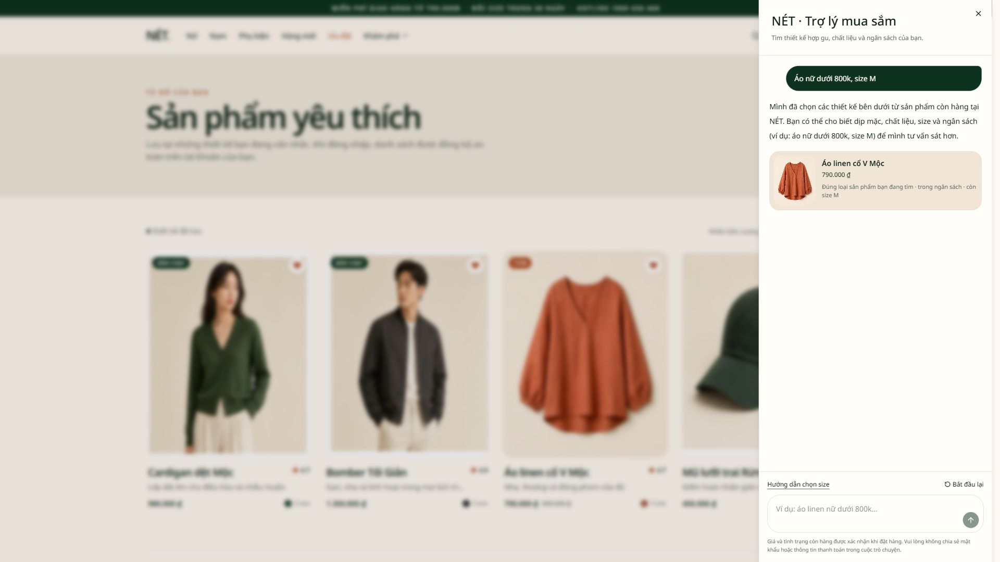

### KH-21 — Tư vấn theo loại chân váy

**Kết quả: Lỗi.**

- Thao tác: Trong cùng cuộc tư vấn, hỏi chân váy nữ dưới 2 triệu.
- Mong đợi: Chỉ gợi ý chân váy phù hợp ngân sách.
- Thực tế: Kết quả lẫn Đầm satin Nắng và Đầm midi Hoa, ngoài Chân váy xếp ly Rêu. Xem L-01.

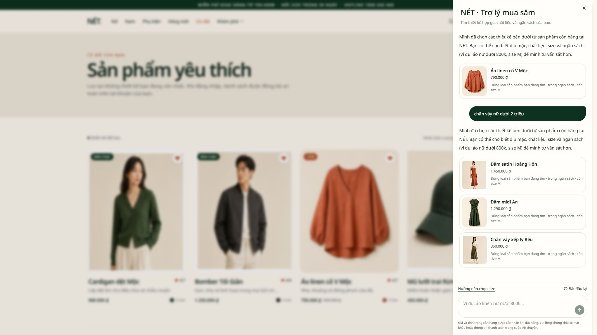

### KH-22 — Gợi ý sản phẩm tự động

**Kết quả: Đạt.**

- Thao tác: Mở giỏ hàng của khách có lịch sử yêu thích.
- Mong đợi: Hiển thị gợi ý và lý do chọn sản phẩm.
- Thực tế: Hiển thị các sản phẩm trong yêu thích và nhóm thiết kế quan tâm. Ảnh cuối ghi lại giỏ đã dọn trống nhưng vẫn có gợi ý.

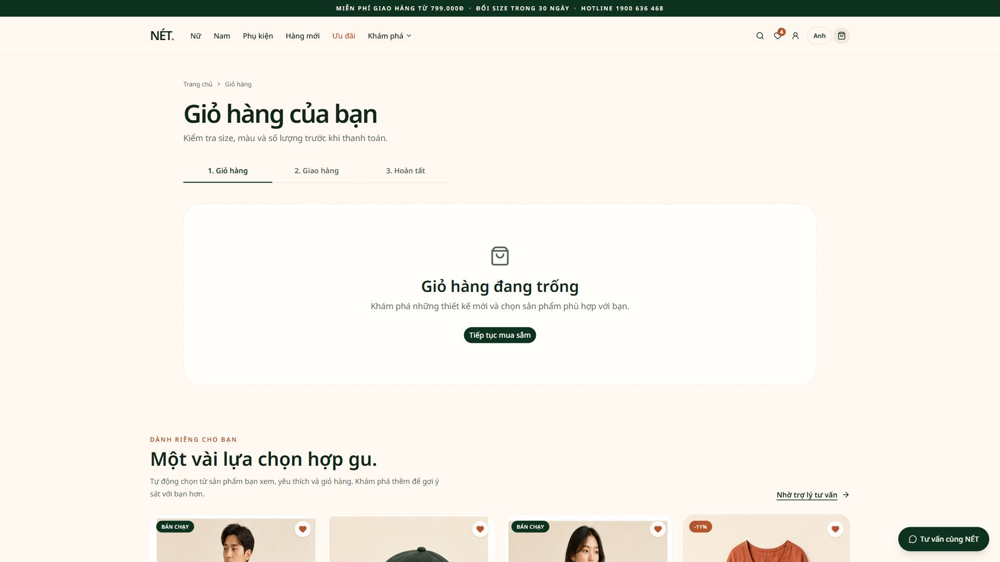

### KH-23 — Hướng dẫn chọn size

**Kết quả: Đạt.**

- Thao tác: Mở Hướng dẫn chọn size.
- Mong đợi: Hiển thị cách đo và bảng kích thước.
- Thực tế: Có 3 bước hướng dẫn và bảng size S/M/L.

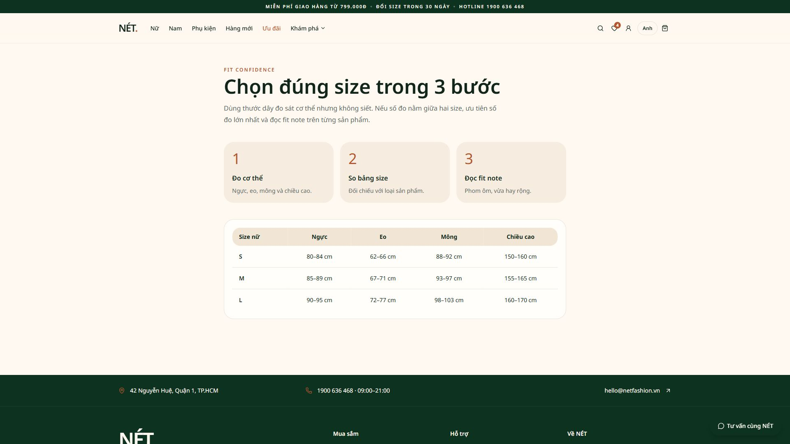

### KH-24 — Câu chuyện thương hiệu

**Kết quả: Đạt.**

- Thao tác: Mở Câu chuyện thương hiệu.
- Mong đợi: Nội dung, hình minh họa và các cam kết hiển thị.
- Thực tế: Trang tải đúng với ảnh thương hiệu và ba nội dung giới thiệu.

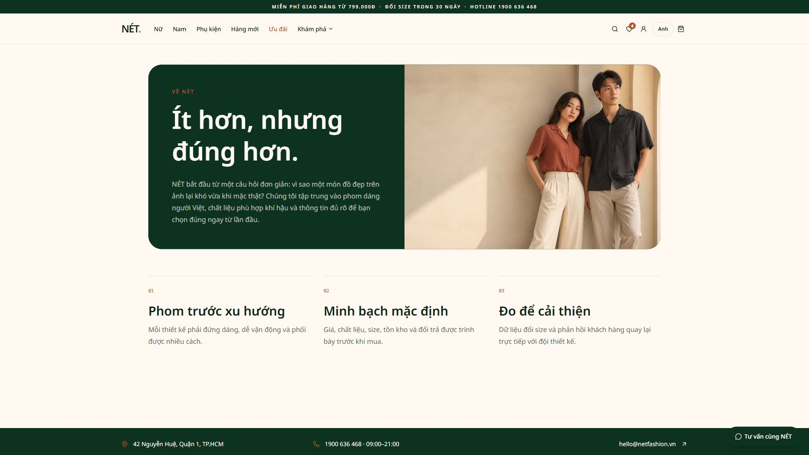

### QT-01 — Tổng quan quản trị

**Kết quả: Một phần.**

- Thao tác: Đăng nhập admin mẫu và mở Tổng quan.
- Mong đợi: KPI và ngày tháng phản ánh dữ liệu hiện tại.
- Thực tế: KPI 30 ngày có 44 đơn, doanh thu 45.120.000 ₫. Ngày tháng, mục tiêu và một số chỉ số ưu tiên vẫn cố định. Xem L-04.

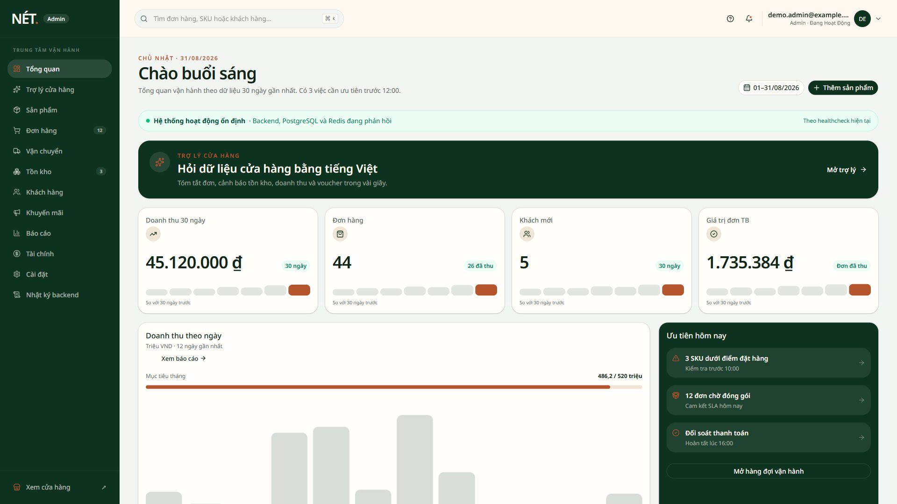

### QT-02 — Danh sách sản phẩm

**Kết quả: Một phần.**

- Thao tác: Mở Sản phẩm và thử nút thao tác của sản phẩm kiểm thử.
- Mong đợi: Danh sách tải; thao tác từng sản phẩm và xuất dữ liệu hoạt động.
- Thực tế: Danh sách tải được. Nút thao tác và Xuất CSV chưa có xử lý trong mã nguồn. Xem L-05.

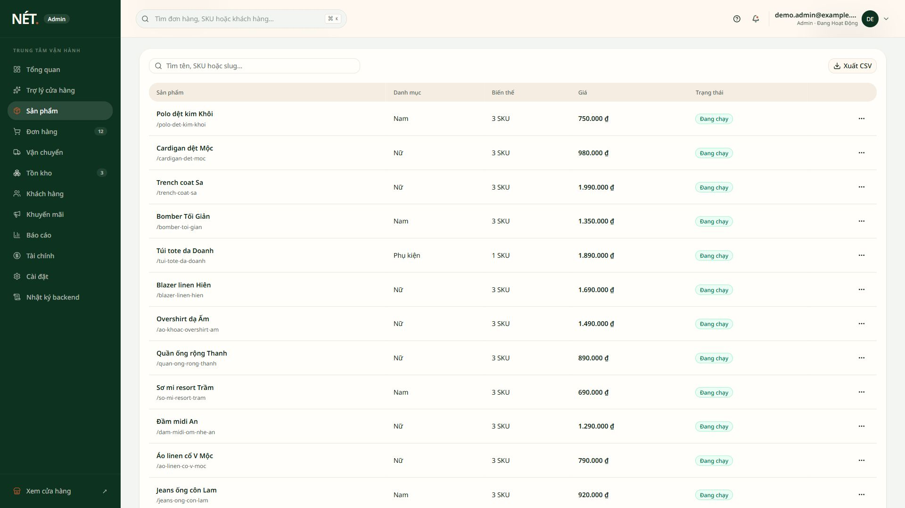

### QT-03 — Tìm sản phẩm trong quản trị

**Kết quả: Lỗi.**

- Thao tác: Nhập linen vào ô tìm tên, SKU hoặc slug.
- Mong đợi: Lọc danh sách theo từ khóa.
- Thực tế: Danh sách vẫn giữ sản phẩm không liên quan; ô nhập không có xử lý lọc. Xem L-02.

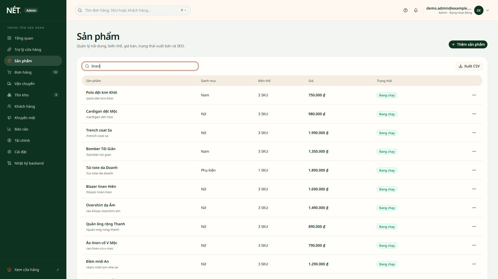

### QT-04 — Tạo sản phẩm nháp

**Kết quả: Một phần.**

- Thao tác: Tạo Áo kiểm thử giao diện 1920, SKU NET-QA1920-M, giá 590.000 ₫, size M, trạng thái Bản nháp, tồn đầu 5 tại HCM-DEMO.
- Mong đợi: Lưu sản phẩm, biến thể và tồn đầu; hiển thị đúng nhãn nháp.
- Thực tế: Cơ sở dữ liệu lưu status=draft và tồn đầu thành công. Danh sách gắn nhãn Đang chạy cho mọi sản phẩm. Ảnh biểu mẫu được mở lại để chụp rõ, không lưu lần thứ hai. Xem L-03.

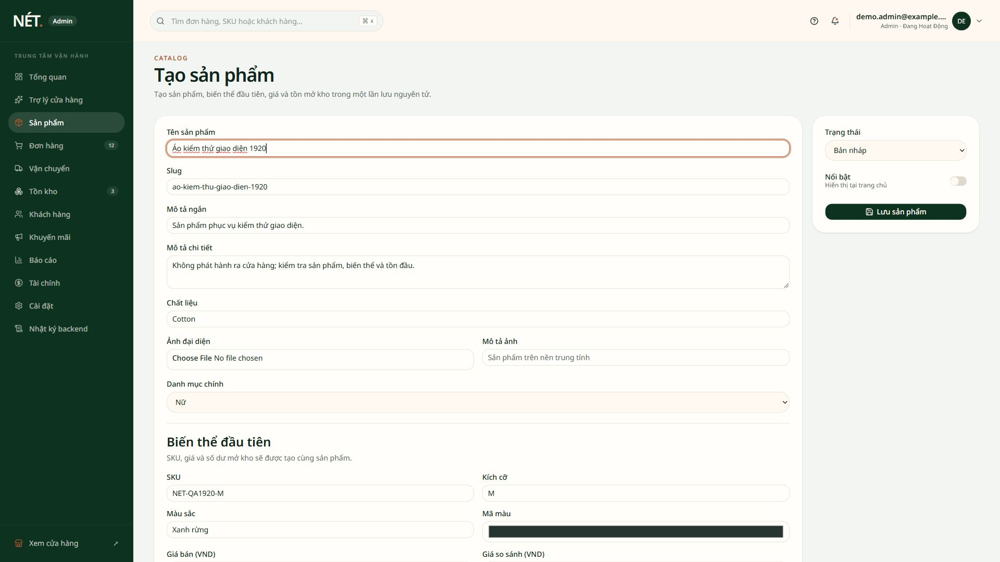

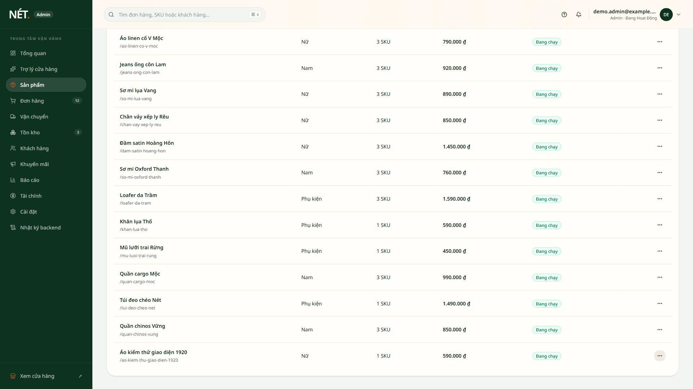

### QT-05 — Danh sách đơn quản trị

**Kết quả: Một phần.**

- Thao tác: Mở Đơn hàng khi dữ liệu có hơn 50 đơn.
- Mong đợi: Xem đầy đủ đơn hoặc có phân trang và tổng số đúng.
- Thực tế: Trang chỉ tải 50 đơn và tính thẻ Tất cả theo 50 dòng này; chưa có phân trang. Đơn mới vẫn truy cập được từ Tổng quan/chi tiết. Xem L-09.

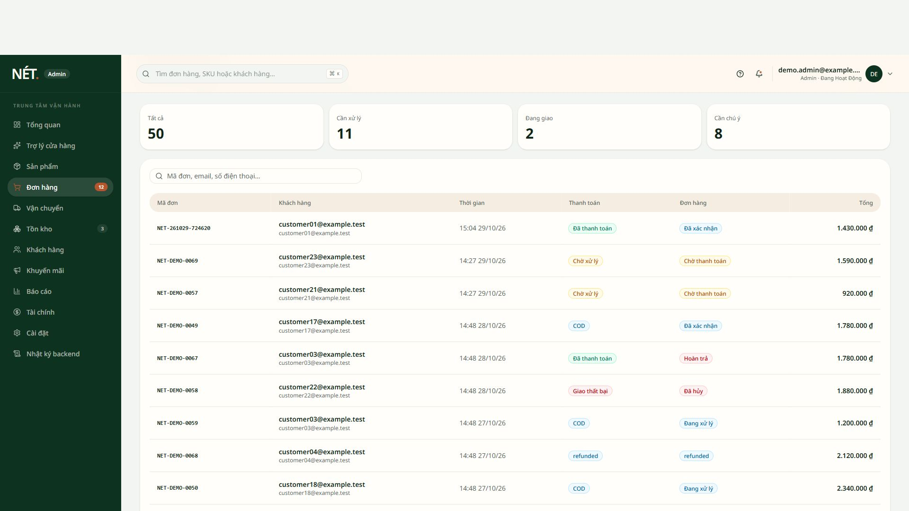

### QT-06 — Chi tiết đơn quản trị

**Kết quả: Đạt.**

- Thao tác: Mở NET-261029-724620.
- Mong đợi: Thông tin khách, sản phẩm, phiếu giao, giữ hàng và tiền khớp.
- Thực tế: Hiển thị 2 áo size M, giảm 150.000 ₫, tổng 1.430.000 ₫ và reservation liên kết.

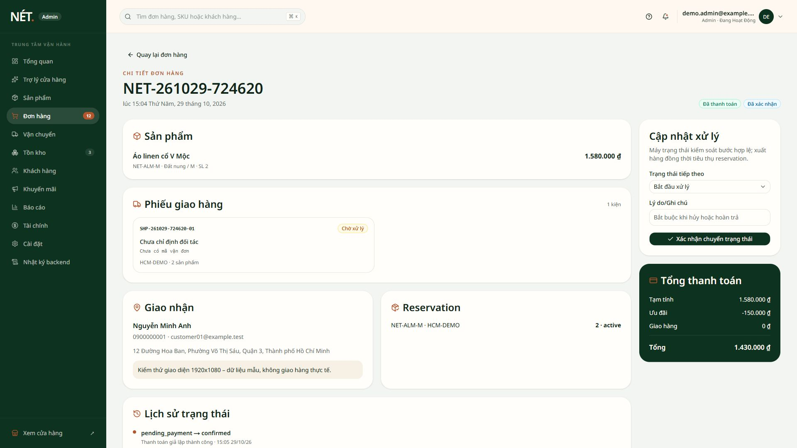

### QT-07 — Cập nhật xử lý đơn

**Kết quả: Đạt.**

- Thao tác: Chuyển đơn đã xác nhận sang Đang xử lý, kèm ghi chú thử nghiệm.
- Mong đợi: Trạng thái đơn/phiếu giao và lịch sử cập nhật.
- Thực tế: Lưu thành công; phiếu giao chuyển sang xử lý và có lịch sử.

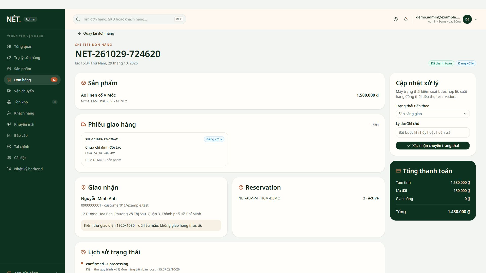

### QT-08 — Hàng đợi vận chuyển

**Kết quả: Đạt.**

- Thao tác: Mở Vận chuyển.
- Mong đợi: Hiển thị các phiếu giao với trạng thái và liên kết chi tiết.
- Thực tế: Danh sách có 73 phiếu giao tại thời điểm chụp, bao gồm đơn thử mới.

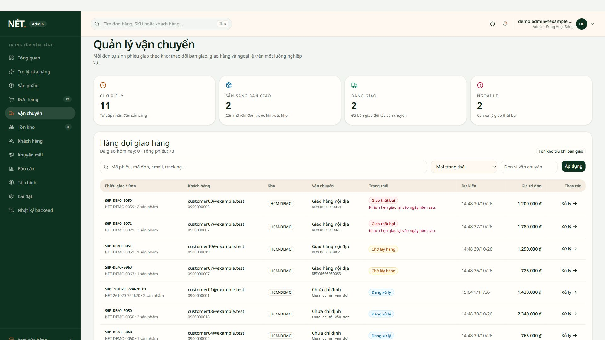

### QT-09 — Chi tiết phiếu giao

**Kết quả: Đạt.**

- Thao tác: Mở SHP-261029-724620-01.
- Mong đợi: Hiển thị kho, người nhận, hàng trong kiện và nhật ký.
- Thực tế: Thông tin đúng đơn thử; ảnh được chụp lại ở trạng thái cuối Đã giao.

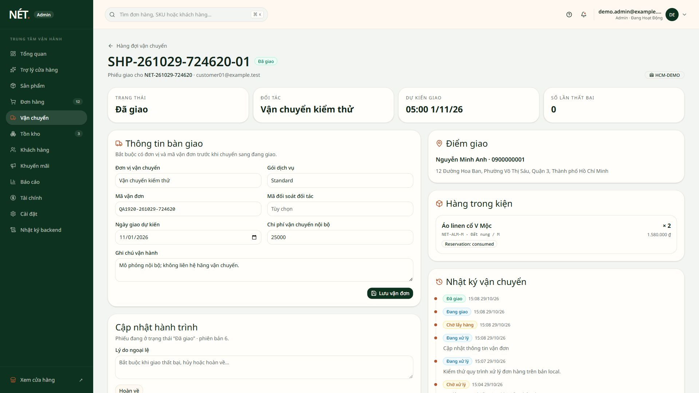

### QT-10 — Lưu thông tin vận đơn

**Kết quả: Đạt.**

- Thao tác: Nhập đối tác Vận chuyển kiểm thử, mã QA1920-261029-724620, phí nội bộ 25.000 ₫ rồi lưu.
- Mong đợi: Thông tin được lưu và xuất hiện trong nhật ký.
- Thực tế: Lưu thành công; tải lại vẫn còn các giá trị. Ảnh chụp lại sau khi hoàn tất giao hàng.

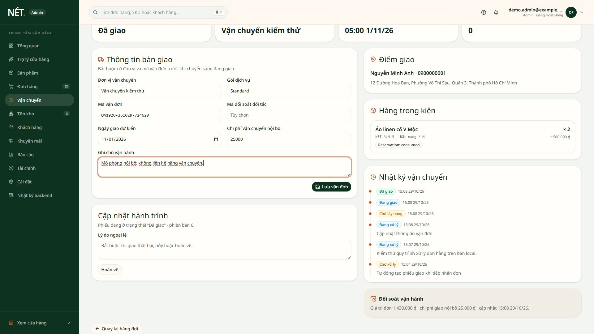

### QT-11 — Chuẩn bị, xuất kho và chuyển đang giao

**Kết quả: Đạt.**

- Thao tác: Chuyển phiếu từ Đang xử lý sang Chờ lấy hàng rồi Đang giao.
- Mong đợi: Ghi nhật ký, trừ tồn và tiêu thụ giữ hàng đúng một lần.
- Thực tế: Nhật ký có các bước; reservation của 2 áo chuyển consumed. Ảnh cho thấy lịch sử sau khi giao xong; đối chiếu DB xác nhận trạng thái.

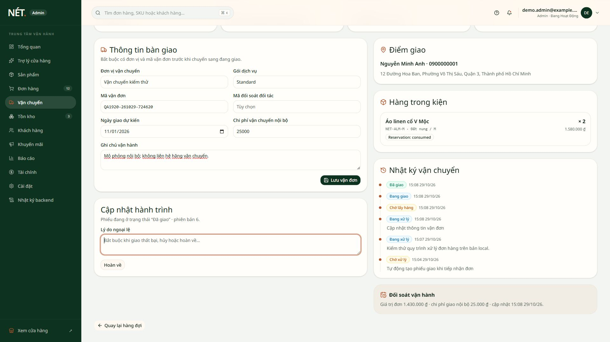

### QT-12 — Giao thành công

**Kết quả: Đạt.**

- Thao tác: Chuyển phiếu từ Đang giao sang Đã giao.
- Mong đợi: Phiếu và đơn hoàn thành; khách thấy trạng thái mới.
- Thực tế: Đơn delivered, payment paid, fulfillment fulfilled; phía khách cũng thấy Đã giao.

### QT-13 — Khách hàng và phân khúc

**Kết quả: Đạt.**

- Thao tác: Mở Khách hàng; chọn phân khúc VIP và áp dụng.
- Mong đợi: Danh sách lọc đúng phân khúc.
- Thực tế: Hiển thị 5 khách VIP trong dữ liệu mẫu. Ảnh dùng danh sách đã lọc.

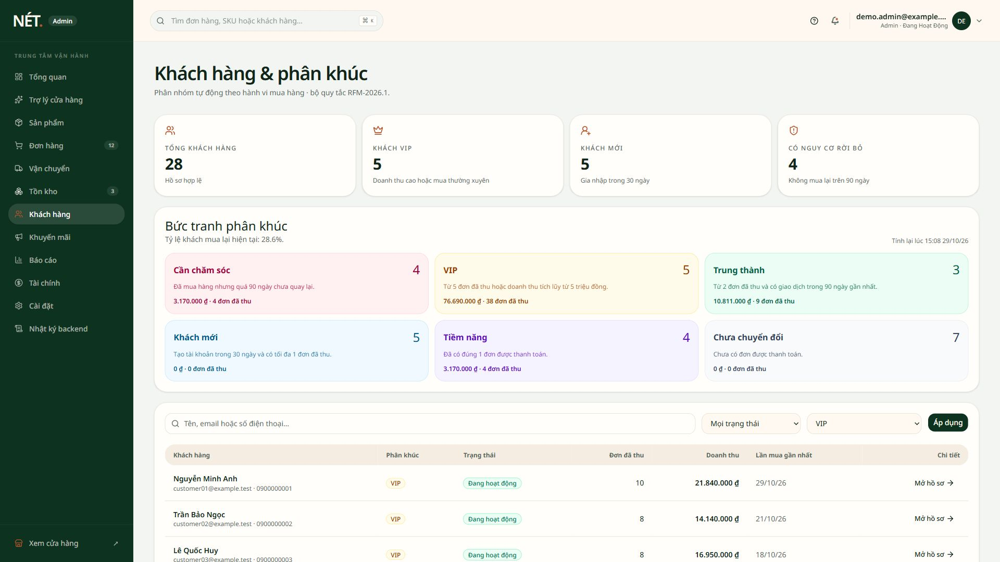

### QT-14 — Hồ sơ khách hàng 360 độ

**Kết quả: Đạt.**

- Thao tác: Mở Nguyễn Minh Anh/customer01.
- Mong đợi: Tổng mua, đơn và lịch sử tương ứng khách được chọn.
- Thực tế: Có 10 đơn đã thanh toán, tổng 21.840.000 ₫, bao gồm đơn thử 1.430.000 ₫.

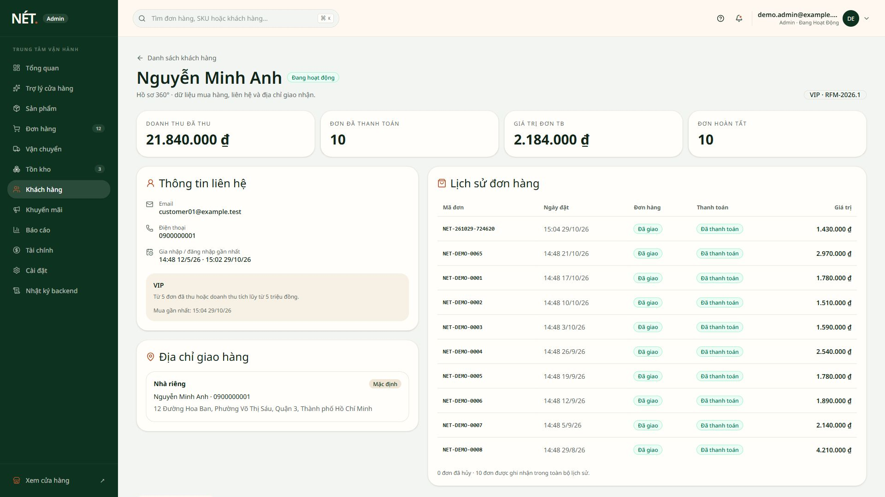

### QT-15 — Tổng hợp tồn kho đa kho

**Kết quả: Đạt.**

- Thao tác: Mở Tồn kho và xem các chỉ số theo kho/SKU.
- Mong đợi: Hiển thị tồn thực, giữ hàng, khả dụng và cảnh báo.
- Thực tế: Hiển thị 3 kho; tìm theo SKU kiểm thử được; có trạng thái hết hàng/sắp hết/an toàn.

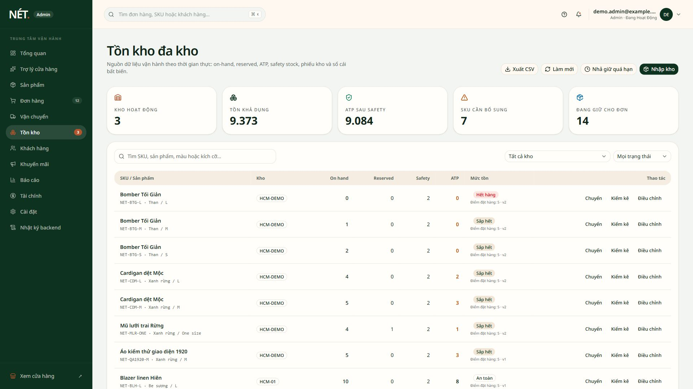

### QT-16 — Nhập kho

**Kết quả: Đạt.**

- Thao tác: Tạo phiếu nhập +10 NET-QA1920-M vào HCM-DEMO, kèm lý do.
- Mong đợi: Tồn từ 5 lên 15 và ghi sổ.
- Thực tế: Phiếu RCV-20261029Z-AA1878 được ghi; tồn lên 15.

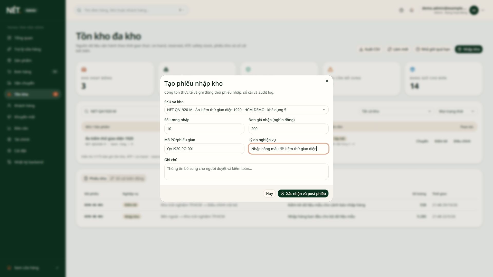

### QT-17 — Chuyển kho

**Kết quả: Đạt.**

- Thao tác: Chuyển 2 NET-QA1920-M từ HCM-DEMO sang HN-01.
- Mong đợi: Kho nguồn giảm 2, kho đích tăng 2.
- Thực tế: Phiếu TRF-20261029Z-5EC781 thành công; nguồn còn 13, đích 2.

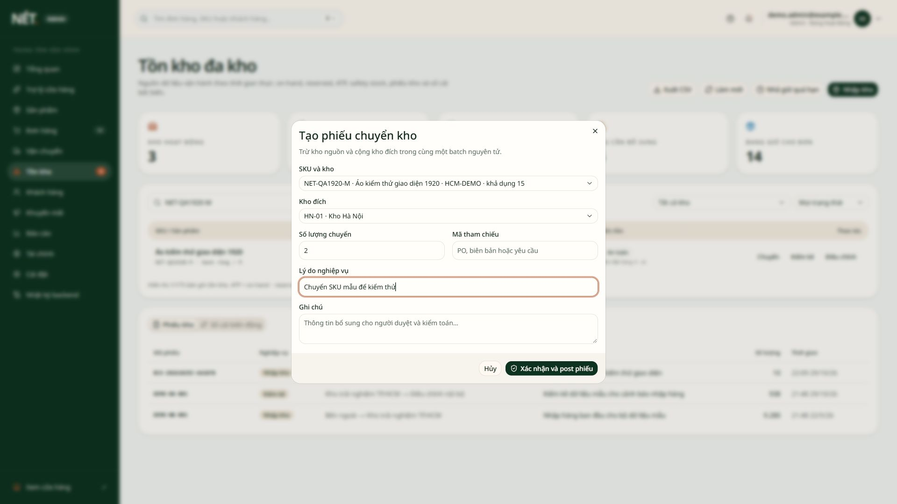

### QT-18 — Kiểm kê

**Kết quả: Đạt.**

- Thao tác: Kiểm kê NET-QA1920-M tại HCM-DEMO với số thực tế 12.
- Mong đợi: Ghi chênh lệch -1 và cập nhật tồn.
- Thực tế: Tồn nguồn từ 13 về 12; lịch sử ghi nhận điều chỉnh kiểm kê.

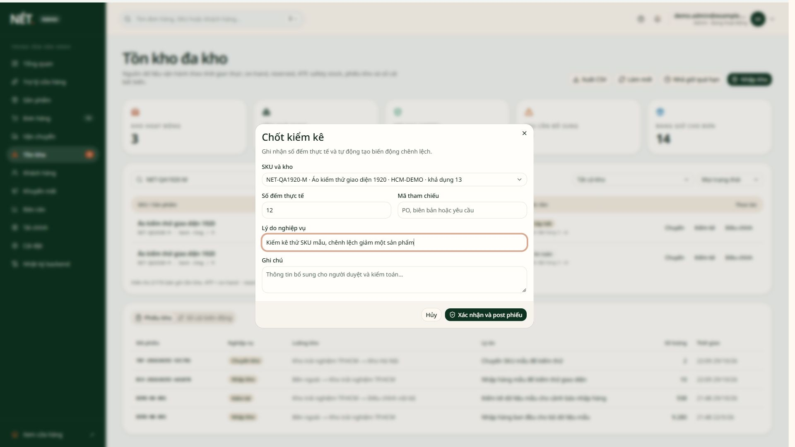

### QT-19 — Điều chỉnh tồn kho

**Kết quả: Đạt.**

- Thao tác: Điều chỉnh +1 NET-QA1920-M tại HCM-DEMO, có lý do.
- Mong đợi: Tồn từ 12 lên 13 và có phiếu điều chỉnh.
- Thực tế: Phiếu ADJ-20261029Z-41EAD4 thành công. Ảnh biểu mẫu được mở lại sau giao dịch để chụp rõ, sau đó hủy, không ghi thêm +1.

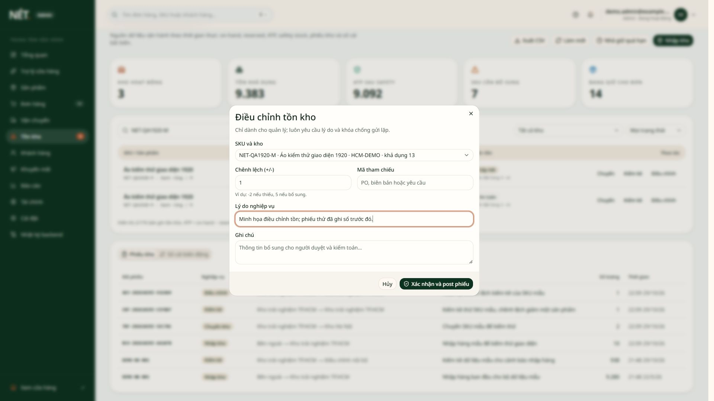

### QT-20 — Sổ cái và đối chiếu số dư

**Kết quả: Đạt.**

- Thao tác: Lọc NET-QA1920-M; xem phiếu và đối chiếu inventory_items với tổng movement.
- Mong đợi: Tồn thực bằng tổng các bút toán; không giữ hàng thừa.
- Thực tế: HCM-DEMO 13, HN-01 2, reserved=0 tại cả hai kho; số dư sổ cái lần lượt 13 và 2.

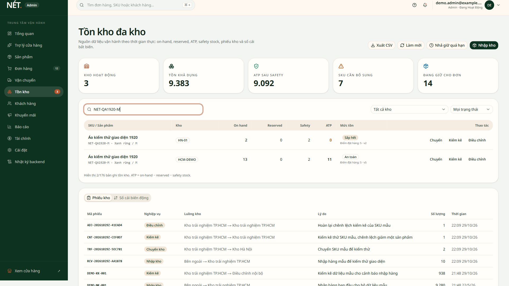

### QT-21 — Danh sách khuyến mãi

**Kết quả: Đạt.**

- Thao tác: Mở Khuyến mãi.
- Mong đợi: Hiển thị mã, giá trị, lượt dùng và thời gian áp dụng.
- Thực tế: DEMO10 có 19 lượt sử dụng sau đơn thử; các chương trình hiển thị đầy đủ. Nhãn expired chưa dịch, xem L-07.

### QT-22 — Tạo voucher

**Kết quả: Đạt.**

- Thao tác: Tạo QA1920: giảm 5%, tối đa 50.000 ₫, giới hạn 1 lượt dùng.
- Mong đợi: Lưu được chương trình và xuất hiện trong danh sách.
- Thực tế: Chương trình Kiểm thử giao diện 1920 xuất hiện, lượt dùng 0/1. Chưa dùng mã này để đặt đơn.

### QT-23 — Báo cáo kinh doanh

**Kết quả: Một phần.**

- Thao tác: Mở Báo cáo; thử Xuất báo cáo.
- Mong đợi: KPI/charts tải đúng và có thể xuất báo cáo.
- Thực tế: KPI tải được; nút xuất chưa có xử lý. Funnel được ghi rõ là minh họa, chưa có tracking phiên. Xem L-04/L-05.

### QT-24 — Tài chính và đối soát

**Kết quả: Một phần.**

- Thao tác: Mở Tài chính; đối chiếu cấu hình nút với mã nguồn.
- Mong đợi: Hiển thị tiền đã thu và các trạng thái; thao tác đối soát/xuất hoạt động.
- Thực tế: Đã thu 45.120.000 ₫, chờ 17.615.000 ₫. Nút Đối soát lại/Xuất CSV chưa gắn xử lý; các thanh phần trăm được gán theo trạng thái. Chưa kiểm thử đối soát thực. Xem L-05.

### QT-25 — Tư vấn vận hành

**Kết quả: Đạt.**

- Thao tác: Chọn Tóm tắt cửa hàng hôm nay.
- Mong đợi: Trả lời từ dữ liệu cửa hàng và có điều hướng liên quan.
- Thực tế: Trả lời 44 đơn, doanh thu 45.120.000 ₫ trong 30 ngày, 10 đơn cần xử lý; có liên kết đơn và tồn kho. Cơ chế dự phòng trả lời được.

### QT-26 — Tạo bản xem trước dashboard

**Kết quả: Đạt.**

- Thao tác: Chọn gợi ý doanh thu/sản phẩm bán chạy 7 ngày; thêm chỉ số Tổng đơn hàng và đổi tên.
- Mong đợi: Đúng khoảng ngày và chỉ số được chọn.
- Thực tế: Khoảng 23–29/10/2026; doanh thu 10.945.000 ₫, 21 đơn, 10 sản phẩm đã bán.

### QT-27 — Lưu, mở lại và làm mới dashboard

**Kết quả: Đạt.**

- Thao tác: Lưu Kiểm thử 1920 – 7 ngày; chuyển dashboard khác; mở lại và làm mới.
- Mong đợi: Dashboard lưu theo tài khoản và giữ cấu hình.
- Thực tế: Danh sách tăng 2 lên 3; mở lại được và số liệu được tải mới.

### QT-28 — Biểu đồ và bảng bán chạy

**Kết quả: Đạt.**

- Thao tác: Mở dashboard đã lưu; chọn cột ngày 29/10.
- Mong đợi: Hiển thị doanh thu theo ngày và bảng sản phẩm bán chạy.
- Thực tế: Cột 29/10 có 1.430.000 ₫; bảng có 2 áo linen của đơn thử. Doanh số dòng hàng 1.580.000 ₫ chưa trừ voucher, đúng chú thích.

### QT-29 — Cài đặt hệ thống

**Kết quả: Một phần.**

- Thao tác: Mở Cài đặt.
- Mong đợi: Xem cấu hình và lưu thay đổi khi chức năng hoàn thiện.
- Thực tế: Trang hiển thị; nút Chưa hỗ trợ lưu bị vô hiệu hóa. Chỉ xác nhận giao diện, không xác nhận khả năng thay đổi cấu hình.

### QT-30 — Nhật ký backend và bộ lọc

**Kết quả: Đạt.**

- Thao tác: Mở Nhật ký backend; nhập inventory; bấm Làm mới.
- Mong đợi: Lọc và tải lại bản ghi liên quan.
- Thực tế: Danh sách còn các yêu cầu inventory; thấy các POST nhập/chuyển/kiểm kê/điều chỉnh trả 200.

## 5. Kiểm tra kỹ thuật bổ sung

### Lệnh đã chạy

Chạy trong thư mục platform của repository:

~~~powershell
docker --context default build --target build -t net-pj1-qa .
$env:BASE_URL='http://localhost:8788'
node ops/smoke-test.mjs
node work/demo-data/check-api-current.mjs
node backend/scripts/seed-demo.mjs --project net-pj1-java --verify
~~~

Docker build đã chạy typecheck, lint, 15 unit tests và production build thành công. Lệnh npm test trực tiếp trên host lúc đầu không chạy do thiếu node_modules/vitest; việc xác minh sau đó thực hiện thành công trong build stage có đầy đủ dependency. Image kiểm tra này không được triển khai đè lên website đang chạy.

API kiểm tra đăng nhập bốn vai trò, đơn, khách hàng, kho, phiếu giao, khuyến mãi, tài chính, báo cáo, trợ lý, dashboard, tài khoản khách và quyền truy cập. Tài khoản manager không đọc được dashboard của admin (404); customer bị chặn danh sách đơn quản trị (403). Staff gọi metrics bị chặn dữ liệu nhưng trả 500 thay vì 403. File kết quả: [Kết quả API và dữ liệu](ket-qua-kiem-thu-1920x1080.json).

### Đối chiếu sau giao dịch

| Đối tượng | Giá trị đã xác nhận |
|---|---|
| Đơn NET-261029-724620 | delivered / paid / fulfilled |
| Tổng đơn | 1.580.000 − 150.000 + 0 = 1.430.000 ₫ |
| Giữ hàng của đơn | consumed, số lượng 2 |
| SKU NET-QA1920-M tại HCM-DEMO | on_hand 13 = tổng movement 13; reserved 0 |
| SKU NET-QA1920-M tại HN-01 | on_hand 2 = tổng movement 2; reserved 0 |
| Sản phẩm ao-kiem-thu-giao-dien-1920 | status draft |
| Bộ dữ liệu mẫu gốc | 24 khách, 3 nhân sự, 72 đơn và 72 phiếu giao; kiểm tra toàn vẹn đạt |

### Dữ liệu phát sinh được giữ lại để xem lại

- 1 đơn thử NET-261029-724620 và phiếu SHP-261029-724620-01; trạng thái cuối đã giao, tổng 1.430.000 ₫. Thanh toán và hãng vận chuyển đều mô phỏng nội bộ.
- 1 sản phẩm nháp Áo kiểm thử giao diện 1920, SKU NET-QA1920-M; tổng tồn hiện tại 15, phân bổ HCM-DEMO 13 và HN-01 2. Có phiếu nhập, chuyển, kiểm kê và điều chỉnh tương ứng.
- 1 voucher QA1920: giảm 5%, trần 50.000 ₫, giới hạn 1 lượt, chưa dùng.
- 1 dashboard Kiểm thử 1920 – 7 ngày của admin mẫu.
- 1 mục yêu thích mới của customer01 là Áo linen cổ V Mộc. Giỏ hàng tái lập để chụp checkout đã được xóa hết sản phẩm sau khi chụp.

## 6. Phạm vi chưa xác nhận

- Đăng ký và xác minh email hoàn chỉnh; gửi thư quên mật khẩu, token hết hạn và đặt mật khẩu mới.
- Thanh toán thật, webhook của nhà cung cấp thật, hoàn tiền thật và kết nối hãng vận chuyển thật.
- Gọi mô hình bên ngoài; đánh giá chất lượng tư vấn trên tập câu hỏi lớn.
- Toàn bộ nhánh hủy, trả hàng, hoàn tiền, gửi lại hàng, đồng thời nhiều người dùng, xử lý gửi lặp và tải lớn.
- Upload ảnh sản phẩm, mọi thao tác sửa/xóa, các nút còn placeholder; bộ lọc/sắp xếp ngoài những lựa chọn nêu rõ trong từng ca.
- Responsive mobile, trình duyệt khác, khả năng truy cập và kiểm thử bảo mật đầy đủ. Lượt này tập trung desktop 1920×1080.

## 7. Cách mở bộ ảnh

Giữ file Markdown cùng thư mục images/kiem-thu-1920x1080 để ảnh nhúng hiển thị khi mở bằng Markdown Preview. Tên ảnh có số thứ tự khớp bảng mục lục. [Manifest ảnh](images/kiem-thu-1920x1080/manifest.json) lưu tên và thời điểm ghi file, kèm URL/thời điểm chụp khi đã ghi nhận; [kiểm tra kích thước](images/kiem-thu-1920x1080/dimensions.json) lưu kích thước thực của từng file.
