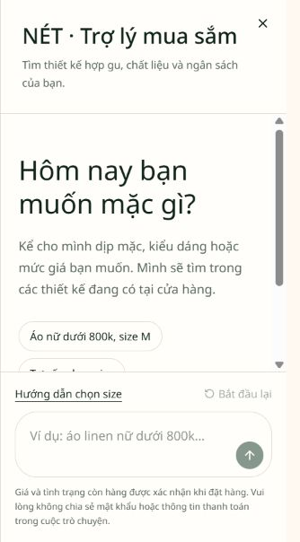
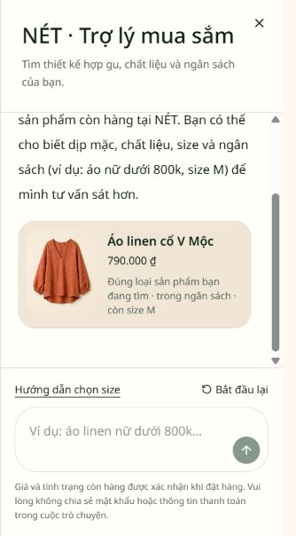
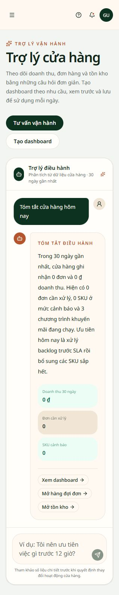
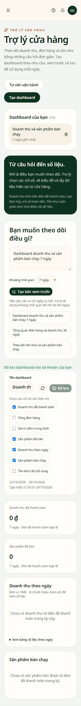

# Hướng dẫn sử dụng trợ lý NÉT

Trợ lý NÉT giúp khách hàng tìm trang phục phù hợp và giúp đội ngũ cửa hàng theo dõi hoạt động kinh doanh. Bạn có thể đặt câu hỏi bằng tiếng Việt, xem các gợi ý liên quan và mở ngay sản phẩm hoặc trang quản lý để tiếp tục thao tác.

## Dành cho khách hàng

### Bắt đầu tư vấn mua sắm

Trên website, chọn **Tư vấn cùng NÉT** ở góc dưới màn hình. Nhập nhu cầu của bạn hoặc chọn một câu hỏi có sẵn:

- **Áo nữ dưới 800k, size M** để tìm sản phẩm theo loại, ngân sách và kích thước.
- **Tư vấn chọn size** để biết thông tin cần chuẩn bị khi chọn kích thước.
- **Chính sách giao hàng và đổi size** để xem hướng dẫn mua sắm.

*Hình 1. Khách hàng có thể chọn câu hỏi gợi ý hoặc nhập nhu cầu riêng.*

### Xem sản phẩm phù hợp

Mô tả càng rõ, lựa chọn càng sát nhu cầu. Ví dụ: **“Áo nữ dưới 800k, size M”**. Mỗi gợi ý hiển thị tên sản phẩm, giá và lý do phù hợp. Chọn thẻ sản phẩm để xem chi tiết, màu sắc, kích thước và thêm vào giỏ hàng.

*Hình 2. Sản phẩm được gợi ý theo ngân sách và size khách hàng yêu cầu.*

Bạn có thể hỏi tiếp **“Còn mẫu nào dưới 600k không?”** để điều chỉnh ngân sách trong cùng cuộc trò chuyện. Chọn **Bắt đầu lại** khi muốn tìm theo nhu cầu khác. Nếu chưa có sản phẩm phù hợp, hãy thử thay đổi loại trang phục, size hoặc mức giá.

Mục **Dành riêng cho bạn** trên cửa hàng cũng giúp khám phá những thiết kế liên quan đến sản phẩm đã xem, yêu thích và giỏ hàng. Giá và tình trạng còn hàng được xác nhận khi đặt hàng. Không chia sẻ mật khẩu hoặc thông tin thanh toán trong cuộc trò chuyện.

## Dành cho đội ngũ cửa hàng

### Hỏi về hoạt động kinh doanh

Sau khi đăng nhập, vào khu vực quản trị và chọn **Trợ lý cửa hàng → Tư vấn vận hành**. Nhập câu hỏi hoặc chọn một trong các gợi ý:

| Nhu cầu | Câu hỏi gợi ý |
| --- | --- |
| Xem tình hình chung | Tóm tắt cửa hàng hôm nay |
| Kiểm tra hàng cần bổ sung | SKU nào sắp hết hàng? |
| Ưu tiên xử lý đơn | Đơn nào đang cần ưu tiên? |
| Xem khuyến mãi | Đánh giá hiệu quả khuyến mãi |
| Theo dõi sản phẩm bán chạy | Sản phẩm nào bán chạy nhất? |

*Hình 3. Câu trả lời tổng hợp số liệu và dẫn tới những trang quản lý liên quan.*

Phần tư vấn vận hành sử dụng số liệu tổng hợp của **30 ngày gần nhất**; các cảnh báo tồn kho phản ánh dữ liệu tại thời điểm xem. Bạn có thể mở đơn hàng, tồn kho hoặc báo cáo từ câu trả lời để kiểm tra chi tiết trước khi quyết định.

### Tạo dashboard theo nhu cầu

Trong **Trợ lý cửa hàng**, chọn **Tạo dashboard**:

1. Nhập nội dung cần theo dõi, chẳng hạn **“Dashboard doanh thu và sản phẩm bán chạy 7 ngày”**.
2. Chọn khoảng thời gian hoặc ghi rõ số ngày trong yêu cầu; hỗ trợ từ **1 đến 90 ngày**.
3. Chọn **Tạo bản xem trước** để xem số liệu và các mục hiển thị.
4. Đặt tên dễ nhận biết, ví dụ **“Doanh thu và sản phẩm bán chạy”**.
5. Chọn các chỉ số cần giữ lại rồi bấm **Lưu dashboard**.

*Hình 4. Dashboard cho phép chọn chỉ số, xem khoảng thời gian và lưu để mở lại.*

Các chỉ số có thể chọn gồm doanh thu đã thanh toán, tổng đơn hàng, giá trị đơn trung bình, sản phẩm đã bán, doanh thu theo ngày, sản phẩm bán chạy và tồn kho cần bổ sung.

Dashboard chỉ được lưu khi bạn bấm **Lưu dashboard**. Mỗi tài khoản có thể lưu tối đa **10 dashboard**; các dashboard này thuộc riêng tài khoản đó. Khi mở lại từ **Dashboard của bạn** hoặc chọn **Cập nhật số liệu dashboard**, hệ thống tải số liệu mới nhất.

Doanh thu được tính từ các đơn đã thanh toán hợp lệ. Khi kỳ được chọn chưa có doanh thu, dashboard hiển thị **0** và thông báo chưa có dữ liệu tương ứng. Ngày chụp trong hình không cố định khoảng thời gian của những lần mở sau.

### Quyền sử dụng

| Người sử dụng | Tư vấn mua sắm | Tư vấn vận hành | Tạo và lưu dashboard |
| --- | --- | --- | --- |
| Khách truy cập, khách hàng | Có | Không | Không |
| Nhân viên cửa hàng | Có | Có | Không |
| Quản lý, quản trị viên | Có | Có | Có |

Các ảnh trong tài liệu được chụp trực tiếp từ giao diện website ngày **29/10/2026**. Giữ file Markdown cùng thư mục `images/tro-ly-cua-hang` khi sao chép hoặc chia sẻ tài liệu để ảnh luôn hiển thị đầy đủ.
