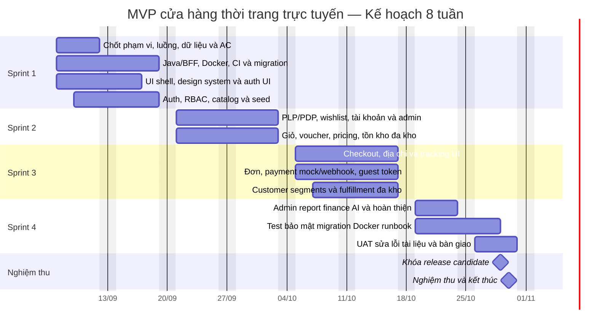

# Kế hoạch triển khai, tiến độ và cột mốc

## 1. Giả định lập kế hoạch

- Tổng thời gian: 8 tuần; 4 sprint × 2 tuần; giai đoạn khám phá được giới hạn thời gian trong Sprint 1 và chạy song song với việc dựng nền tảng.
- Đội cố định 5 người: FE, BE1, BE2, DevOps và PM.
- Baseline chạy từ 07/09/2026 đến hết 30/10/2026, tương đương 40 ngày làm việc
  khi loại cuối tuần; bàn giao và kết thúc nằm trong tuần 8.
- Tiến độ hiện tại là ước lượng sơ bộ; cần chốt lại sau khi đội ước lượng và thống nhất kiến trúc.
- Chỉ các hạng mục Bắt buộc được cam kết; hạng mục Nên có/Có thể có chỉ làm khi còn năng lực.
- Tích hợp thanh toán/hãng vận chuyển thật không nằm trên đường găng; bản đồ án
  dùng payment mock/webhook HMAC và fulfillment thủ công.

## 2. Tiến độ

Ngày trong biểu đồ là baseline theo ngày khởi động 07/09/2026. Không có công
việc tuần 9 trong cam kết 2 tháng. Hỗ trợ sau nghiệm thu, cloud production hoặc
tích hợp provider thật phải được lập thành giai đoạn mới.

## 3. Cột mốc và điều kiện hoàn thành

| Cột mốc | Thời điểm | Điều kiện hoàn thành |
|---|---|---|
| M0 Khởi động | Tuần 1 | Có người phụ trách tuyên bố dự án, đội, lịch làm việc, không gian làm việc và nhật ký RAID. |
| M1 Sẵn sàng nền tảng | Cuối tuần 2 | Chốt phạm vi/luồng, kiến trúc Java/BFF, Docker, auth/RBAC, Flyway và lát cắt catalog. |
| M2 Sẵn sàng duyệt hàng và giỏ | Cuối tuần 4 | Catalog→PDP→variant→wishlist/cart/voucher; account và inventory operations dùng được. |
| M3 Giao dịch xuyên suốt | Cuối tuần 6 | Guest/member checkout, payment mock/COD, order, fulfillment mỗi kho, tracking và customer segments hoạt động. |
| M4 Bắt đầu UAT | Đầu tuần 8 | Must-have code complete; 69 backend tests và 12 frontend tests đạt; build/smoke ổn định. |
| M5 Nghiệm thu đồ án | Cuối tuần 8 | UAT/evidence pack, danh sách giới hạn, bảo mật, Docker runbook và tài liệu được duyệt. |

## 4. Đường găng

Quyết định phạm vi → Java/BFF/Docker/Flyway → auth/catalog → inventory/cart/pricing
→ checkout/order → fulfillment/customer segments → hardening/test → UAT/tài liệu
→ nghiệm thu.

Seed/catalog demo và chính sách mô phỏng phải chuẩn bị song song. Merchant
approval không nằm trên đường găng vì provider thật đã được loại khỏi baseline.

## 5. Mục tiêu từng sprint

| Sprint | Mục tiêu | Kết quả trình diễn |
|---|---|---|
| Sprint 1 (Tuần 1–2) | Giảm rủi ro và dựng nền tảng | Chốt scope/ADR; Docker, Flyway, auth/RBAC và catalog chạy được |
| Sprint 2 (Tuần 3–4) | Khám phá, tài khoản và tồn kho | Khách tìm/xem/lưu SKU; cart/voucher và kho đa kho nhất quán |
| Sprint 3 (Tuần 5–6) | Giao dịch và vận hành | Checkout/order, guest token, customer segments và fulfillment thủ công chạy xuyên suốt |
| Sprint 4 (Tuần 7–8) | Hoàn thiện và nghiệm thu | Report/finance/Copilot, 69+12 tests, Docker smoke, UAT, tài liệu và bàn giao |

## 6. Kiểm soát tiến độ

- Theo dõi biểu đồ hoàn thành theo phạm vi, không chỉ theo vận tốc của sprint.
- Cập nhật dự báo cột mốc hằng tuần dựa trên phần việc còn lại, năng lực và phụ thuộc.
- Bảo vệ thời gian dự phòng và hoàn thiện phát hành; không dùng toàn bộ dự phòng để nhận phạm vi mới.
- Nếu đường găng bị trễ: bỏ trước các hạng mục Có thể có/Nên có, tăng tự động hóa và mức tập trung; chỉ tăng người khi thời gian tiếp nhận không làm dự án chậm hơn.
