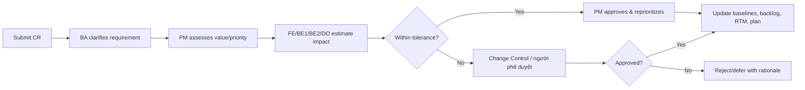

# Quản lý RAID, thay đổi và quyết định

## 1. Chấm điểm rủi ro

Probability (P) và Impact (I): 1–5; Score = P×I. 1–4 Low, 5–9 Medium, 10–15 High, 16–25 Critical.

## 2. Nhật ký RAID ban đầu

| Mã | Loại | Mô tả | Xác suất | Tác động | Điểm | Người phụ trách | Ứng phó/hành động tiếp theo | Điều kiện kích hoạt/hạn |
|---|---|---|---:|---:|---:|---|---|---|
| R-01 | Risk | Người đọc nhầm payment mock/manual shipping là tích hợp production | 3 | 5 | 15 | PM | Gắn nhãn demo, liệt kê known limits, không dùng số liệu giả để cam kết thật | Trước demo/release note |
| R-02 | Risk | Scope creep làm trễ MVP | 4 | 4 | 16 | PM | Baseline MoSCoW; change tolerance; protect hardening | Must effort > capacity |
| R-03 | Risk | Catalog/content/ảnh/size chart trễ | 4 | 4 | 16 | PM | Template + seed demo; weekly readiness; content freeze | <80% ready by cuối W6 |
| R-04 | Risk | Oversell do checkout đồng thời | 3 | 5 | 15 | BE2 | Reservation/locking/idempotency; concurrency test | ATP mismatch in test |
| R-05 | Risk | Webhook trùng/out-of-order gây sai payment/order | 3 | 5 | 15 | BE2 | Event uniqueness, state rules, reconciliation test | Duplicate side effect |
| R-06 | Risk | Mobile performance kém do ảnh/script | 4 | 4 | 16 | FE | Budget ảnh/script, lazy loading và đo theo sprint | LCP budget exceeded |
| R-07 | Risk | Business không đủ thời gian UAT | 3 | 4 | 12 | PM | Book testers W1; scripts/data W6; deputies | Attendance not confirmed W6 |
| R-08 | Risk | Privacy/policy chưa đủ cho production | 3 | 5 | 15 | PM | Checklist W1; ghi rõ chỉ demo local nếu chưa review | Chưa review trước cuối W7 |
| R-09 | Risk | Tracking thủ công nhập sai carrier/mã/ETA hoặc thao tác trạng thái sai | 3 | 4 | 12 | BE2 | Validation, unique carrier+tracking, state machine, expectedVersion và audit | Conflict/duplicate trong UAT |
| R-10 | Risk | Docker log/correlation chưa thay thế metrics/alert tập trung | 3 | 4 | 12 | DO | Healthcheck, correlation; ghi production gap và thiết kế monitoring | Không truy vết được smoke/UAT |
| R-11 | Risk | Đội 5 người không có QA/UX/BA chuyên trách tạo bottleneck và defect escape | 4 | 5 | 20 | PM | Cross-review, automated gates, freeze W7, người phê duyệt phản hồi trong 1 ngày | Must scope không code complete cuối W6 |
| R-12 | Risk | Sửa migration V7 đã áp dụng làm lệch checksum/mất khả năng nâng cấp | 3 | 5 | 15 | BE1/DO | Bất biến V1–V7; mọi schema change mới dùng V8+; test upgrade | Flyway checksum mismatch |
| R-13 | Risk | Nhiều kiện của một đơn cập nhật nhầm reservation hoặc COD paid quá sớm | 3 | 5 | 15 | BE2 | Mapping fulfillment item–reservation; consume theo kiện; COD chỉ paid khi tất cả delivered | Inventory/payment mismatch |
| R-14 | Risk | Copilot bị hiểu là AI sinh nội dung hoặc tự ra quyết định | 3 | 3 | 9 | BE1/PM | Ghi rõ rule engine read-only, hiển thị nguồn số liệu và cảnh báo kiểm tra | Người dùng kỳ vọng action/LLM |
| A-01 | Assumption | Cả 5 thành viên đạt 1 FTE trong 8 tuần | — | — | — | PM | Confirm named people/allocation | W1 |
| A-02 | Assumption | Một fulfillment cho mỗi cặp order–warehouse; có thể có nhiều kho/đơn nhưng chưa split nhiều kiện trong cùng kho | — | — | — | PM/BE2 | Ghi rõ trong AC và UAT | W2 |
| D-01 | Dependency | Docker Desktop/Linux containers để chạy đầy đủ local stack và Testcontainers | — | — | — | DO | Kiểm tra health/context/junction | W1 |
| D-02 | Dependency | Seed catalog, dữ liệu demo và chính sách minh họa | — | — | — | PM | Readiness tracker; không dùng như dữ liệu doanh nghiệp thật | W6 |

## 3. Mẫu nhật ký vấn đề

| Mã | Vấn đề | Tác động | Ngày mở | Người phụ trách | Hành động tiếp theo/ngày | Giải pháp tạm thời | Trạng thái |
|---|---|---|---|---|---|---|---|
| I-### | | | | | | | Open |

Issue là sự kiện đã xảy ra; risk là sự kiện chưa chắc xảy ra. Risk thành hiện thực phải được chuyển/linked sang issue và response được kích hoạt.

## 4. Quy trình yêu cầu thay đổi

## 5. Mẫu yêu cầu thay đổi

| Field | Content |
|---|---|
| CR ID / requester / date | Unique identity |
| Problem/value | Why change is needed |
| Proposed scope & acceptance | What exactly changes |
| Alternatives | Include “do nothing/defer” |
| Impact | Scope, UX, architecture, data, integration, test, ops, security/privacy |
| Estimate | Effort/cost/capacity and confidence |
| Schedule impact | Milestones and critical path |
| Risk/dependency | New/changed RAID items |
| Recommendation | PM + relevant FE/BE1/BE2/DO recommendation |
| Decision | Approve/reject/defer; approver/date/rationale |

## 6. Nhật ký quyết định

| Mã | Quyết định | Baseline | Người phụ trách | Hạn | Trạng thái |
|---|---|---|---|---|---|
| DEC-01 | Platform approach | React/Vinext+BFF, Java Spring Boot, PostgreSQL, Redis, Docker | BE1/DO/PM | W1 | Decided |
| DEC-02 | Payment | COD + mock confirm + webhook HMAC; provider thật ngoài baseline | BE2/PM | W2 | Decided |
| DEC-03 | Shipping | Manual fulfillment tracking; một kiện/kho; provider API ngoài baseline | BE2/PM | W2 | Decided |
| DEC-04 | Inventory reservation | Giữ khi tạo đơn; consume khi shipped; release khi hủy trước ship/hết hạn | BE1/BE2 | W3 | Decided |
| DEC-05 | Return/cancel/refund | Returned chờ kho kiểm định; paid/authorized cancel bị chặn; refund command ngoài baseline | BE2/PM | W3 | Decided |
| DEC-06 | Customer segmentation | Read model theo dữ liệu paid, thứ tự at_risk→vip→loyal→new→potential→prospect | BE1/PM | W5 | Decided |
| DEC-07 | Copilot | Rule engine read-only; không gọi LLM và không tự mutation | BE1/PM | W7 | Decided |

## 7. Quy tắc rà soát RAID

- Review High/Critical hằng tuần và tại mỗi milestone; Critical phải có người
  phê duyệt nhận escalation.
- Mỗi item có một owner, next action, due date và trigger; đóng phải có rationale/evidence.
- Residual risk sau mitigation được chấm lại; risk acceptance cần đúng authority.
