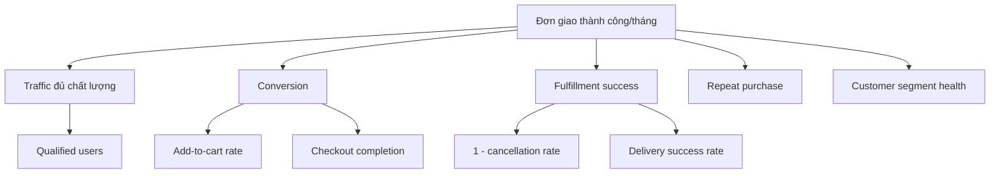

# Lộ trình, KPI và phân tích sản phẩm

**Baseline:** đồ án 02 tháng, 08 tuần, nhóm 05 người  

> Roadmap dưới đây là kế hoạch học thuật và triển khai kỹ thuật. Các KPI kinh doanh là định nghĩa/đích đề xuất; repository chưa có dữ liệu vận hành thật để tuyên bố đã đạt các mức này.

## 1. Lộ trình thực hiện đồ án trong 02 tháng

| Sprint | Tuần | Mục tiêu | Sản phẩm bàn giao chính | Chủ trì |
|---|---:|---|---|---|
| Sprint 1 — Nền tảng | 1–2 | Chốt phạm vi, UX và kiến trúc chạy được | React/Vinext shell, Spring Boot 4.1.1, PostgreSQL 17, Redis 7, Docker; catalog seed | PM, FE, BE1, DevOps |
| Sprint 2 — Mua hàng | 3–4 | Hoàn thành storefront và danh tính | 22 sản phẩm/58 biến thể, search/filter/PDP, giỏ/voucher, đăng ký–xác minh–đăng nhập–reset | FE, BE1 |
| Sprint 3 — Giao dịch | 5–6 | Hoàn thành checkout và vận hành đa kho | Order/payment, reservation; nhập/chuyển/kiểm kê tồn; fulfillment tự tạo theo kho | BE1, BE2, FE |
| Sprint 4 — Quản trị & bàn giao | 7–8 | Hoàn thiện backoffice, kiểm thử và tài liệu | Customer 360°/6 phân khúc, quản lý vận chuyển, Copilot rule-based, hardening, smoke test, báo cáo | Cả nhóm, PM điều phối |

### 1.1 Hướng phát triển sau đồ án

| Giai đoạn | Chủ đề | Hạng mục chưa thuộc baseline |
|---|---|---|
| Sau đồ án 1 | Tích hợp thực tế | Payment/shipping/email production, reconcile, webhook hãng vận chuyển |
| Sau đồ án 2 | Hậu mãi | Self-service return/refund, loyalty, review và notification worker |
| Sau đồ án 3 | Intelligence | Recommendation, thử nghiệm ML/LLM có governance, dự báo nhu cầu, ERP/POS |

## 2. Cây KPI

## 3. Định nghĩa chỉ số

| Chỉ số | Công thức/định nghĩa | Tần suất | Người phụ trách |
|---|---|---|---|
| Conversion rate | Orders created successfully / eligible sessions | Weekly | PO/Growth |
| Checkout completion | Purchase / begin_checkout | Daily/Weekly | PO |
| PDP add-to-cart | Sessions with add_to_cart / sessions with view_item | Weekly | PO/UX |
| AOV | Net merchandise value / non-cancelled orders | Weekly | Finance/PO |
| Payment success | Successful online payments / valid payment attempts | Daily | Finance/Tech |
| Cancellation rate | Cancelled orders / created orders | Weekly | Operations |
| Return rate | Returned units / delivered units | Monthly | Operations/Product |
| Repeat purchase 90d | Customers with ≥2 delivered orders in 90d / customers with delivered order | Monthly | Product |
| WISMO contact rate | Contacts hỏi trạng thái / shipped orders | Weekly | CS |
| Fulfillment lead time | Median created/paid → ready_to_ship | Daily | Operations |
| Oversell count | Đơn hủy/điều chỉnh do ATP sai | Daily | Operations/Tech |
| Fulfillment integrity | Fulfillment/order = số kho có reservation và tổng quantity khớp order item | Mỗi test/release | BE2/PM |
| Segment consistency | Khách có đúng một segment theo `RFM-2026.1` | Mỗi migration/release | BE1/PM |
| Auth lifecycle success | Tỷ lệ kịch bản register→verify→login→refresh→logout/reset pass | Mỗi release | BE1/FE |
| Copilot grounded answer | Câu trả lời khớp snapshot và không tạo mutation | Mỗi release | BE2/PM |

Target số tuyệt đối sẽ được đặt sau 2–4 tuần baseline hoặc dựa trên dữ liệu kênh hiện tại. Không tự đặt vanity target khi chưa có baseline.

## 4. Danh mục sự kiện phân tích

| Event | Trigger | Key properties |
|---|---|---|
| `view_item_list` | PLP/collection hiển thị | list_id, item_ids, sort, filters |
| `search` | Search được thực thi | query_normalized, result_count |
| `view_item` | PDP đủ dữ liệu hiển thị | product_id, variant_availability, price |
| `select_variant` | Chọn size/màu | product_id, variant_id, attributes, available |
| `add_to_cart` | Server xác nhận thêm giỏ | variant_id, quantity, unit_price, cart_value |
| `view_cart` | Mở giỏ | item_count, cart_value, coupon |
| `begin_checkout` | Bắt đầu checkout | cart_id, value, guest/member |
| `add_shipping_info` | Phương thức giao hợp lệ | shipping_method, fee, area |
| `add_payment_info` | Chọn payment method | method; không gửi dữ liệu thẻ |
| `purchase` | Order/payment đạt điều kiện ghi nhận | order_id, value, discount, shipping, items |
| `payment_failed` | Provider trả failure | provider, normalized_reason |
| `view_order_status` | Khách xem tracking | order_id_hash, status, guest/member |
| `sign_up_completed` | Xác minh email thành công | user_id_hash, source; không gửi token |
| `voucher_applied` | Backend chấp nhận voucher | promotion_id, benefit_type, cart_value |
| `customer_segment_viewed` | Quản trị mở dashboard phân khúc | segment_code, rule_version; không gửi PII |
| `fulfillment_status_changed` | Backend commit trạng thái phiếu giao | status_from, status_to, warehouse_id_hash |
| `admin_copilot_asked` | Quản lý gửi câu hỏi hợp lệ | intent, generated_at; không lưu prompt chứa PII không cần thiết |

## 5. Nguyên tắc bảo vệ khi thử nghiệm

- Không A/B test làm mơ hồ giá, consent, policy hoặc bảo mật.
- Một experiment có hypothesis, primary metric, guardrail, sample rule và stop condition.
- Không gửi PII thô vào analytics nếu không có phê duyệt và cơ chế kiểm soát phù hợp.
- Purchase event phải idempotent theo order ID để tránh đếm trùng.
- Không dùng mã phân khúc để suy luận thuộc tính nhạy cảm hoặc tự động từ chối dịch vụ.
- Không đánh giá Copilot bằng độ “tự tin” của câu chữ; phải so câu trả lời với snapshot và luật có thể kiểm tra.

## 6. Tiêu chí đánh giá sản phẩm trong báo cáo đồ án

| Nhóm | Chỉ báo tối thiểu | Evidence |
|---|---|---|
| Độ bao phủ | Storefront, auth, voucher, inventory, customer, fulfillment và admin assistant đều có luồng demo | Ảnh màn hình + RTM + API/schema |
| Tính đúng dữ liệu | 22 sản phẩm/58 biến thể; tồn/reservation/movement khớp; segment/fulfillment không trùng | Seed/migration + integration test |
| An toàn | RBAC, token lifecycle, idempotency và optimistic concurrency hoạt động | Negative test + log/audit |
| Khả năng triển khai | Hai Docker Compose stack start sạch; PostgreSQL/Redis/backend/frontend healthy | How-to-run + smoke output |
| Trung thực nghiên cứu | Mọi số liệu synthetic đều có nhãn và không bị diễn giải như khảo sát thật | Review tài liệu |
