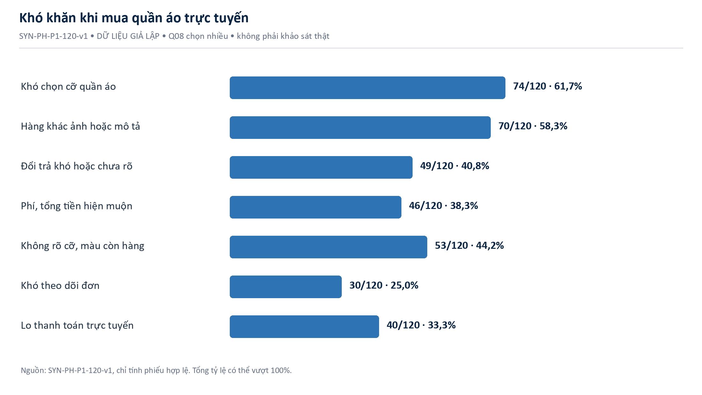
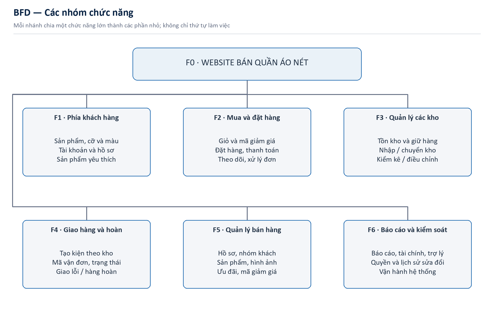
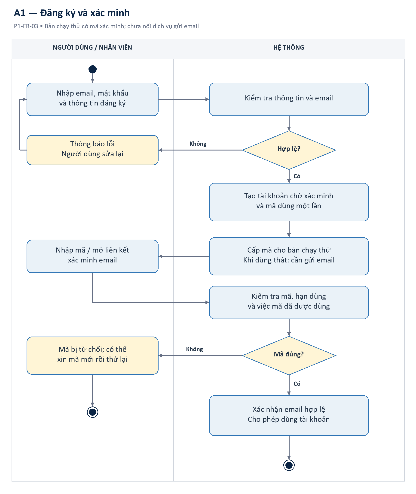
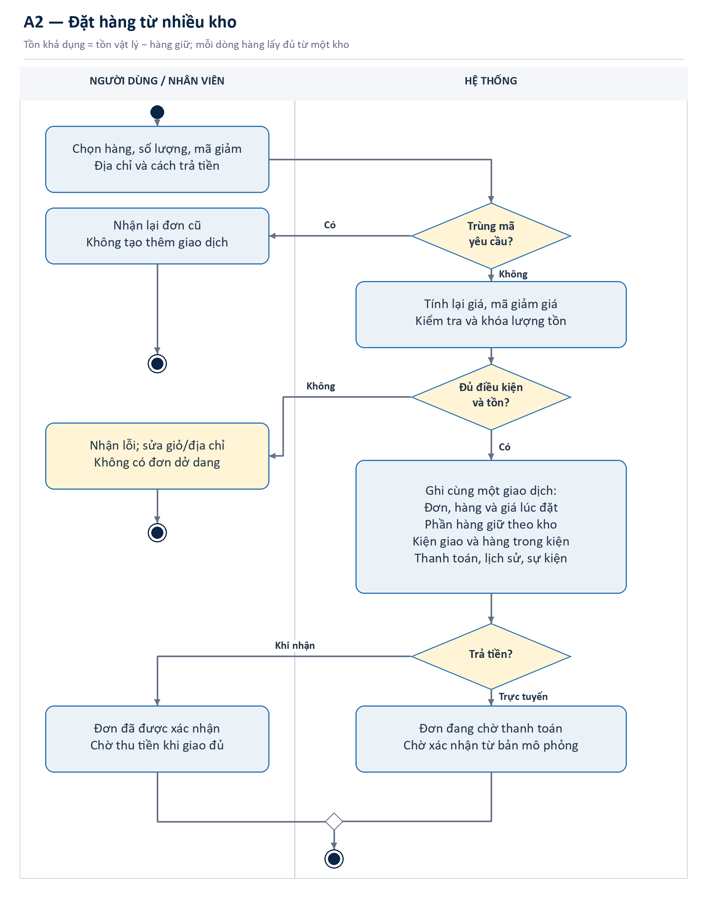
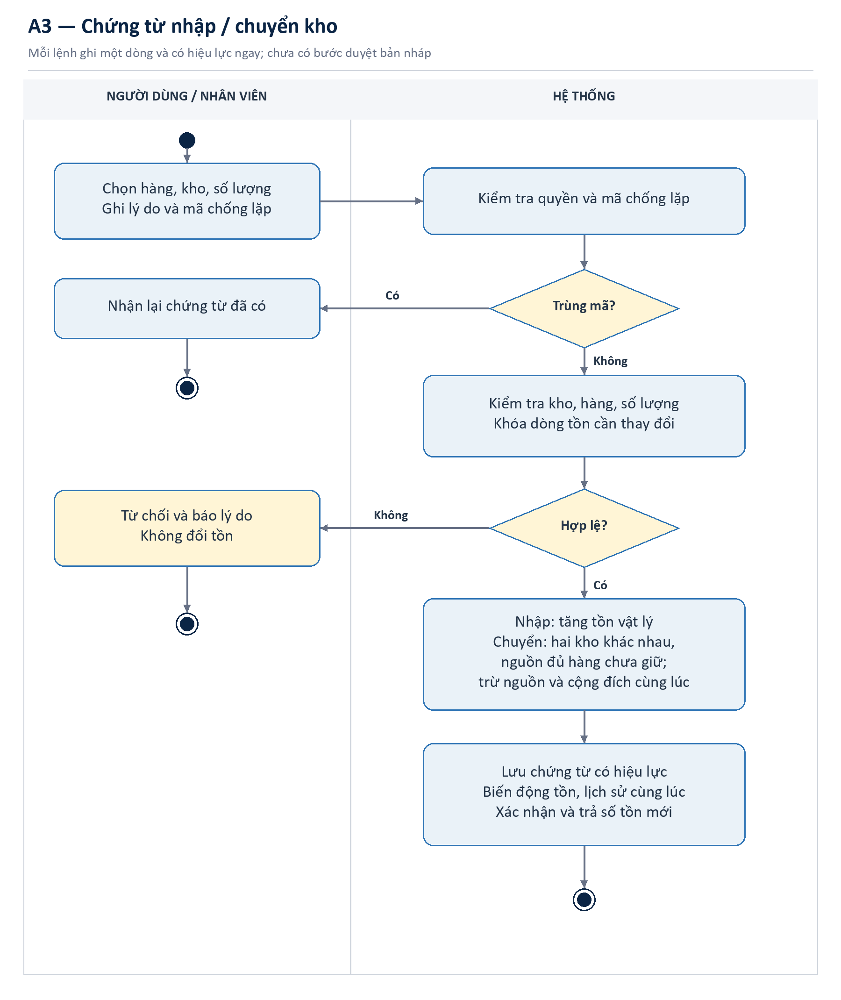
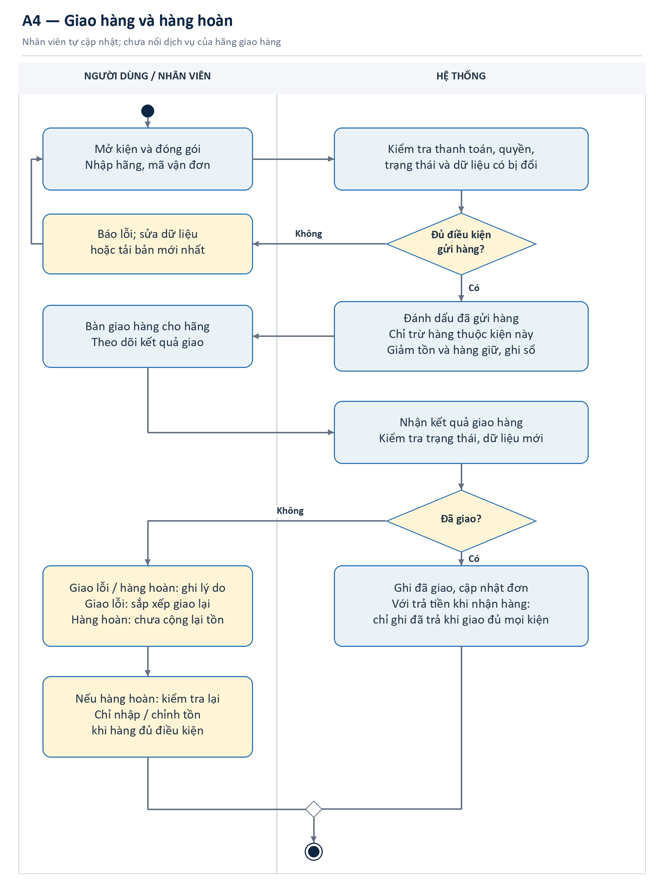
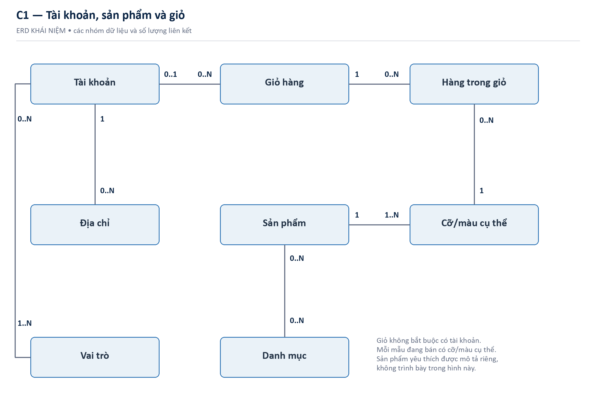
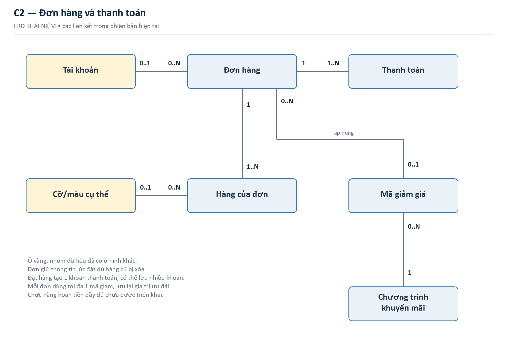
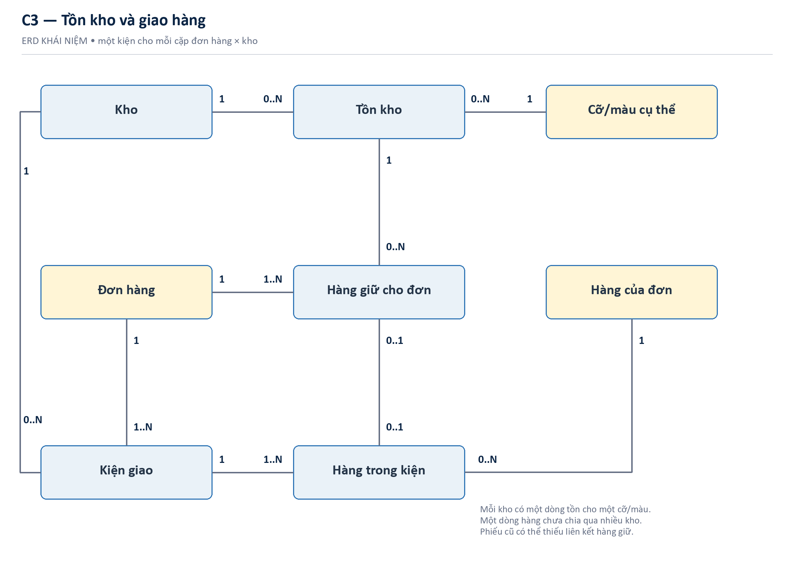

# THÔNG TIN BÁO CÁO VÀ NGUỒN DỮ LIỆU

Báo cáo này trình bày việc khảo sát và tìm hiểu yêu cầu cho website bán quần áo NÉT Commerce trong học phần Project 1. Bản 1.2 giữ nguyên số liệu của bản 1.1 và sửa cách viết để dễ đọc hơn.

> DỮ LIỆU GIẢ LẬP. Toàn bộ phiếu trả lời, phỏng vấn, đơn hàng và số liệu kho do nhóm tạo để làm bài tập. Không có người thật tham gia, không đi khảo sát cửa hàng và không phát sinh giao dịch thật. Nếu học phần yêu cầu khảo sát thật, cần hỏi giảng viên trước khi dùng bộ dữ liệu này thay thế.

<!-- widths: 1.25, 2.85, 2.4 -->
| Nguồn | Nội dung báo cáo | Giới hạn |
|---|---|---|
| SYS — hệ thống | Mã nguồn, tệp thay đổi cơ sở dữ liệu, mô tả chi tiết và kiểm thử hiện có | Mô tả hệ thống; không phải khảo sát người dùng |
| SYN — giả lập | 144 phiếu gốc, 120 hợp lệ; 12 phỏng vấn; 20 đơn và 10 chứng từ | Có bản ghi chi tiết và công thức; không có người/giao dịch thật |
| PLAN — kế hoạch | 02 tuần, 05 thành viên; công cụ phỏng vấn, bảng hỏi, lấy mẫu | Lịch dự kiến, địa điểm chưa xác nhận |
| FIELD — khảo sát thật | Chưa có | Không tạo chữ ký hoặc xác nhận tham gia giả |

## Đối chiếu với yêu cầu học phần

<!-- widths: 2.25, 2.3, 1.95 -->
| Nội dung yêu cầu | Phần đáp ứng | Trạng thái |
|---|---|---|
| Kế hoạch: thời gian, địa điểm, phương pháp, nhân sự | Chương 3 | PLAN 02 tuần / 05 người |
| Tiến hành khảo sát | Chương 4; phụ lục D; Excel dữ liệu | Đã mô phỏng; không phải FIELD |
| Giới thiệu bài toán, thuật ngữ | Chương 1–2 | Đã biên soạn |
| Phỏng vấn, phiếu hỏi, lấy mẫu | Chương 4; phụ lục A–D | Có dữ liệu SYN từng bản ghi |
| Tổng hợp theo nghiệp vụ | Chương 5 và bảng đối chiếu Chương 8 | Có nguồn từ mã và dữ liệu giả lập |
| Yêu cầu chức năng và sơ đồ | Chương 6–7 | Mô tả chi tiết và sơ đồ |
| Yêu cầu phi chức năng; sơ đồ dữ liệu | Chương 6–7 | Mục tiêu cần thử; chưa kết luận đã đạt |

# CHƯƠNG 1. GIỚI THIỆU CHUNG VỀ BÀI TOÁN

## 1.1 Bối cảnh và lý do chọn đề tài

Khi mua quần áo trên mạng, khách không thể thử trực tiếp nên dễ chọn sai cỡ hoặc màu. Cửa hàng cũng cần theo dõi hàng còn trong kho, tiền thanh toán và tình trạng giao hàng. Nếu các thông tin này không khớp, khách và nhân viên sẽ khó xử lý đơn.

Đề tài có các bước quen thuộc: tìm hàng → chọn cỡ, màu → giỏ hàng → đặt đơn → giữ hàng → thanh toán → giao hàng. Nhóm thực hành viết yêu cầu, phân tích lỗi và vẽ sơ đồ. Số liệu giả lập chỉ dùng cho bài tập, không chứng minh việc kinh doanh sẽ thành công.

## 1.2 Câu hỏi khảo sát

- Người mua cần gì để chọn cỡ/màu, hiểu tổng tiền và quyết định đặt hàng?
- Đăng nhập, mã giảm giá, đặt hàng và theo dõi kiện giao có những vướng mắc nào?
- Nhân viên giữ hàng, xuất kho, thu tiền, hủy đơn và nhận hàng hoàn như thế nào?
- Quản lý cần xem số liệu nào, chia nhóm khách ra sao và cần trợ lý giúp việc gì?

## 1.3 Mục tiêu và kết quả cần làm

Bài làm gồm kế hoạch 02 tuần, phiếu hỏi, dữ liệu giả lập, kết quả khảo sát, yêu cầu và sơ đồ hệ thống. Mỗi yêu cầu có nguồn và cách kiểm tra.

## 1.4 Các phần của website

Website gồm trang mua hàng, tài khoản, giỏ hàng, mã giảm giá, đặt đơn khi có hoặc chưa có tài khoản, trả khi nhận hàng, trả trực tuyến giả lập và theo dõi đơn. Trang quản lý có sản phẩm, khách hàng, nhóm khách, nhiều kho, giao hàng, báo cáo và trợ lý chỉ đọc số liệu.

Hệ thống chưa kết nối thanh toán thật, hãng vận chuyển, dịch vụ gửi thư thật hoặc mô hình AI bên ngoài. Chức năng tự yêu cầu hoàn tiền cũng chưa hoàn chỉnh. Đây là các phần có thể làm tiếp.

## 1.5 Những người liên quan

<!-- widths: 1.4, 2.5, 2.6 -->
| Nhóm | Nhu cầu cần khảo sát | Cách tiếp cận dự kiến |
|---|---|---|
| Khách vãng lai/thành viên | Chọn hàng, tổng tiền, thanh toán, theo dõi | Phiếu hỏi; phỏng vấn; quan sát công việc |
| Nhân viên bán hàng, hỗ trợ khách | Tra đơn, giải thích lỗi, xử lý trường hợp khác hoặc lỗi | Phỏng vấn theo câu hỏi gợi ý; mẫu đơn |
| Nhân viên kho | Nhập/chuyển/kiểm kê, giữ hàng và xuất kho | Phỏng vấn; lấy mẫu chứng từ |
| Quản lý cửa hàng | Quyền sử dụng, số liệu cần xem, khách cần chăm sóc | Phỏng vấn; xác nhận yêu cầu |
| Người phụ trách thanh toán | Đối chiếu tiền trả với đơn hàng | Phỏng vấn; mẫu tình huống thanh toán |
| Giảng viên/nhóm đồ án | Tính đầy đủ, đúng mô hình, minh bạch nguồn | Kiểm tra theo yêu cầu và tiêu chí chấm bài |

# CHƯƠNG 2. GIẢI THÍCH TỪ NGỮ

Các từ và mã dưới đây giúp đọc yêu cầu, sơ đồ và dữ liệu kèm theo.

<!-- widths: 1.45, 3.35, 1.7 -->
| Thuật ngữ | Giải thích đơn giản | Ví dụ hoặc lưu ý |
|---|---|---|
| Sản phẩm | Một mẫu quần áo được giới thiệu trên website | Một mẫu áo sơ mi |
| Biến thể, mã hàng (SKU) | Một lựa chọn cụ thể về cỡ và màu của sản phẩm | Áo trắng, cỡ M |
| Giỏ hàng | Danh sách hàng khách chọn trước khi đặt đơn | Chưa giữ hàng |
| Mã giảm giá | Mã giúp giảm tiền nếu đơn đáp ứng điều kiện | Giảm 50.000đ có điều kiện |
| Đơn hàng | Lưu hàng đã mua, số lượng, giá và địa chỉ nhận | Có thể giao nhiều kiện |
| Dữ liệu lúc đặt đơn | Thông tin được lưu tại thời điểm khách đặt hàng | Giá cũ được giữ lại |
| Tồn thực tế | Số hàng đang được ghi nhận trong kho | Chưa trừ giữ chỗ |
| Hàng giữ chỗ | Hàng dành cho đơn đã đặt nhưng chưa xuất kho | Nhả khi hủy hợp lệ |
| Hàng còn để cấp | Tồn thực tế trừ hàng đang giữ chỗ | Dùng khi đặt đơn |
| Tồn dự phòng | Lượng hàng muốn để lại để phòng thiếu hàng | Chưa dùng để chặn bán |
| Số sẵn bán (ATP) | Hàng còn để cấp trừ tồn dự phòng; nhỏ hơn 0 thì lấy 0 | Trên trang quản lý kho |
| Phiếu giữ chỗ | Ghi mã hàng, kho, số lượng và thời hạn giữ | Gắn với hàng trong đơn |
| Kiện giao hàng | Phần hàng được giao từ một kho | Một kiện/kho/đơn |
| Mã vận đơn | Mã dùng để theo dõi giao hàng | Nhân viên nhập tay |
| COD | Thanh toán khi nhận hàng | Chỉ trả khi giao đủ |
| Chống xử lý trùng | Gửi lại cùng yêu cầu không tạo thêm giao dịch | Không tạo hai đơn |
| Phân quyền | Mỗi vai trò chỉ được làm việc được phép | Tùy vai trò |
| Yêu cầu chức năng (FR) | Việc website cần làm được | Đăng nhập, đặt hàng |
| Yêu cầu phi chức năng (NFR) | Yêu cầu về tốc độ, an toàn và cách sử dụng | Tốc độ, bảo mật |
| Sơ đồ chức năng (BFD) | Chia các chức năng thành nhóm | Nhóm các việc cần làm |
| Sơ đồ hoạt động | Mô tả các bước và các trường hợp xử lý | Có bước và nhánh lỗi |
| Sơ đồ dữ liệu (ERD) | Mô tả dữ liệu và quan hệ giữa chúng | Một đơn, nhiều dòng |

Cần có: phần chính; Nên có: có thể làm sau. Đã có: đã thấy trong mã nguồn, chưa phải người dùng thật xác nhận. SYS: mã nguồn; SYN: giả lập; PLAN: kế hoạch; FIELD: khảo sát thật.

# CHƯƠNG 3. KẾ HOẠCH KHẢO SÁT TRONG 02 TUẦN

## 3.1 Thời gian và địa điểm

Kế hoạch đề xuất gồm 10 ngày làm việc trong 02 tuần, từ 07/09/2026 đến 18/09/2026; cuối tuần 12–13/09 dành cho dự phòng tự nguyện, không tính thêm phạm vi. Đây là lịch dự kiến, cần điều chỉnh theo lịch học và sự đồng ý của người tham gia.

Hai tuần chỉ dành cho khảo sát và phân tích yêu cầu; không thay đổi kế hoạch phát triển toàn bộ website 08 tuần đã lập trước đó.

Phiếu hỏi thực hiện trực tuyến; phỏng vấn qua cuộc gọi hoặc trực tiếp tại địa điểm người tham gia đồng ý. Địa chỉ trường, phòng họp và cửa hàng đối tác chưa được cung cấp nên chưa xác nhận. Không tự gán tên doanh nghiệp vào báo cáo.

## 3.2 Phương pháp và quy mô dự kiến

<!-- widths: 1.4, 1.65, 1.85, 1.6 -->
| Phương pháp | Mục tiêu mẫu PLAN | Cách chọn | Kết quả cần lưu |
|---|---|---|---|
| Phỏng vấn người mua | 08 người; 25–35 phút/người | 3 mua thường xuyên, 3 trung bình, 2 ít mua/từng bỏ mua | Sự đồng ý, biên bản không ghi tên, chủ đề |
| Phỏng vấn vận hành | 04 người; 30–45 phút/người | Quản lý, kho, xử lý đơn/Chăm sóc khách hàng, thanh toán | Quy trình, trường hợp khác hoặc lỗi, quy tắc xác nhận |
| Bảng hỏi | 120 phiếu hợp lệ; 7–10 phút/phiếu | Chọn người dễ tiếp cận, chia theo nhóm tuổi, mời khoảng 150–180 người | Phiếu gốc, giải thích mã, lý do loại |
| Thử phiếu | 10 người trước phát phiếu chính | Kiểm tra cách hiểu, thời lượng, logic | Công cụ v2 và ghi chép thay đổi |
| Lấy mẫu hồ sơ | 30 hồ sơ: 20 đơn + 10 chứng từ kho | Chọn có chủ đích theo trạng thái và loại nghiệp vụ | Danh sách hồ sơ mẫu, bản trích ẩn danh |

Người trả lời dự kiến từ 18–44 tuổi, đã mua quần áo trực tuyến trong 06 tháng và đồng ý tham gia. Nhóm đặt số mẫu theo tuổi là 42 người 18–24, 48 người 25–34 và 30 người 35–44. Dữ liệu giả lập được tạo đúng các số này. Đây không phải số người đã hỏi thật và không đại diện cho toàn bộ người mua hàng Việt Nam.

## 3.3 Lịch thực hiện và phân công

<!-- widths: 0.8, 2.95, 1.05, 1.7 -->
| Mốc | Công việc | Chủ trì | Kết quả cần lưu |
|---|---|---|---|
| N1 · 07/09 | Chốt câu hỏi nghiên cứu, phạm vi, tuyển mẫu, sự đồng ý tham gia | PM | Kế hoạch v1; danh sách tiếp cận |
| N2 · 08/09 | Soạn phiếu, hướng dẫn phỏng vấn và mẫu trích hồ sơ | FE, BE1, BE2 | Bộ công cụ v1 |
| N3 · 09/09 | Thử phiếu 10 người, sửa câu khó hiểu và logic rẽ nhánh | FE; PM duyệt | Ghi chép thử phiếu; bản đã sửa |
| N4–N7 · 10–15/09 | Thu phiếu, hỏi người mua; ngừng nhận phiếu trước khi lọc ở N7 | FE, PM | Phiếu và biên bản FIELD nếu có |
| N4–N7 · 10–15/09 | Phỏng vấn vận hành, lấy mẫu 30 hồ sơ | BE1, BE2 | Danh sách hồ sơ; ghi chú quy tắc |
| N7 · 15/09 | Đóng thu thập, ẩn danh, loại phiếu theo quy tắc | DevOps | Phiếu hợp lệ; lý do loại phiếu |
| N8 · 16/09 | Nhóm nhận xét theo chủ đề; tính tần suất; tổng hợp theo nghiệp vụ | Cả nhóm | Bảng kết quả và nhận xét |
| N9 · 17/09 | Chốt FR/NFR; Sơ đồ chức năng, sơ đồ hoạt động, ERD khái niệm | BE1, BE2, FE | Sơ đồ và tiêu chí kiểm tra |
| N10 · 18/09 | Kiểm tra chéo, ghi phần còn thiếu, hoàn thành báo cáo | PM | Báo cáo Word; danh sách kiểm tra |

## 3.4 Trách nhiệm của 05 thành viên

Nhóm gồm một trưởng nhóm (PM), một người làm giao diện (FE), hai người làm máy chủ (BE1, BE2) và một người phụ trách cài đặt, vận hành (DevOps). Bảng lịch dùng các mã ngắn này để dễ theo dõi.

- Trưởng nhóm (PM): sắp xếp việc khảo sát, quản lý sự đồng ý tham gia, phỏng vấn quản lý, xử lý xung đột yêu cầu, duyệt và bàn giao báo cáo.
- Giao diện: thiết kế bảng hỏi, thử phiếu, phỏng vấn người mua và tổng hợp nhu cầu sử dụng trang mua hàng/tài khoản.
- Người làm máy chủ 1: khảo sát tài khoản, giỏ, mã giảm giá, đơn và thanh toán; mô tả chi tiết quy tắc và FR liên quan.
- Người làm máy chủ 2: khảo sát kho, kiện giao, khách hàng; lấy mẫu chứng từ và xây ERD khái niệm.
- Người phụ trách cài đặt và vận hành (DevOps): thiết lập nơi lưu dữ liệu, quyền truy cập, mã ẩn danh, xuất dữ liệu, kiểm tra công thức và quản lý phiên bản.

## 3.5 Kiểm soát chất lượng và bảo vệ dữ liệu

Các quy định sau dùng nếu nhóm đi khảo sát thật. Bộ giả lập không có dữ liệu cá nhân hay ghi âm thật. Lịch dự kiến có 10 người thử phiếu; phần giả lập chỉ có 10 tình huống kiểm tra, không thay cho 10 người.

Nhóm chỉ thu thông tin cần cho mục tiêu nghiên cứu. Không thu mật khẩu, mã truy cập đăng nhập, số thẻ hoặc địa chỉ giao hàng đầy đủ. Mã người tham gia dùng dạng PV-KH-01, PV-VH-01; mã phiếu dùng PH-0001. Danh sách liên hệ tuyển mẫu, nếu có, lưu tách khỏi câu trả lời và chỉ PM truy cập.

Người tham gia được biết mục đích học tập, quyền bỏ qua câu hỏi và dừng bất kỳ lúc nào. Chỉ ghi âm khi có đồng ý riêng. Thời hạn lưu đề xuất là đến 30 ngày sau khi học phần kết thúc, sau đó xóa dữ liệu liên hệ/ghi âm theo quy định của trường; đây là chính sách đề xuất cần được chấp thuận, không phải tuyên bố tuân thủ pháp luật đã được thẩm định.

Phiếu không đủ điều kiện hoặc bị trùng phải ghi rõ lý do loại. Thời gian trả lời khác thường chỉ là dấu hiệu cần xem lại, không tự động loại. Nếu sửa câu hỏi sau khi thử, không gộp phiếu thử vào bộ chính. Khi khảo sát thật mà thiếu mẫu, phải báo số thực thu, không lấy dữ liệu giả để bù.

# CHƯƠNG 4. THỰC HIỆN KHẢO SÁT GIẢ LẬP VÀ PHÂN TÍCH

## 4.1 Thiết kế đợt mô phỏng và nguồn dữ liệu

Bài khảo sát giả lập dùng ba cách theo yêu cầu học phần: phiếu hỏi người mua, phỏng vấn có câu hỏi chuẩn bị trước và xem mẫu đơn hàng, chứng từ. Bộ phiếu được tạo theo Q01–Q17, có mã SYN-PH-P1-120-v1. Phỏng vấn và hồ sơ có mã SYN-P1-QUAL-2026.1. Không lấy bảng 200 mẫu cũ để tạo câu trả lời cho bộ mới.

Chương trình tạo dữ liệu dùng số khởi tạo 20260903 và cách tính mulberry32 để có thể tạo lại đúng bộ phiếu. Số phiếu theo ba nhóm tuổi được đặt trước là 42, 48 và 30. Nhóm cũng đặt một số tình huống hợp lý: người lo tổng tiền hoặc hết hàng có thể bỏ dở đơn; người lo trả trước có thể chọn trả khi nhận hàng. Đây là giả định để làm bài, không phải điều đã quan sát ở khách thật.

N4–N7 chỉ là ngày trong kịch bản. Dữ liệu được soạn ngày 03/09/2026; kế hoạch khảo sát dự kiến từ 07–18/09/2026. Không coi các mốc này là ngày đã đi khảo sát. Câu trả lời đồng ý tham gia cũng chỉ dùng để thử bước lọc phiếu.

<!-- widths: 1.65, 2.7, 2.15 -->
| Bộ dữ liệu | Quy mô và nội dung | Cách dùng |
|---|---|---|
| SYN-PH-001…144 | 144 phiếu Q01–Q17; 120 hợp lệ và 24 bị loại | Tính từ phiếu hợp lệ, giữ nguyên lý do loại |
| SYN-PILOT-01…10 | 10 ca kiểm tra logic công cụ, tách mẫu chính | Không phải kết quả thử với 10 người thật |
| SYN-PV-KH-01…08; VH-01…04 | 08 nhân vật mua hàng và 04 vai trò vận hành; 48 phát hiện giả định | Tìm tình huống và quy tắc; không suy rộng tần suất |
| SYN-HS-DH-01…20; KHO-01…10 | 20 đơn và 10 chứng từ kho; 13 bản ghi thay đổi kho | Kiểm tra quan hệ tiền, tồn, thanh toán và kiện giao |
| SYS-01…05 | Tổng quan; đơn hàng/thanh toán; quản lý kho; kiện giao; tài khoản và đăng nhập/báo cáo và trợ lý quản lý | Đọc mã để đối chiếu, không thay khảo sát thật |

Bản Word trình bày và giải thích kết quả. Bản Excel giữ từng phiếu và công thức tính; các tệp JSON giúp tạo lại bộ dữ liệu. Không đưa các dữ liệu giả này vào ứng dụng để tạo thanh toán hoặc vận đơn thật.

<!-- pagebreak -->

## 4.2 Sàng lọc, làm sạch và thử phiếu giả lập

<!-- widths: 2.1, 1.05, 3.35 -->
| Bước | Số lượng SYN | Quy tắc đối chiếu |
|---|---|---|
| Tiếp cận theo kịch bản | 160 | Chỉ số tổng hợp giả định; không phải danh sách liên hệ |
| Không bắt đầu | 16 | Không tạo câu trả lời cho 16 lượt này |
| Bắt đầu / có bản ghi gốc | 144 | 160 − 16 = 144 |
| Đủ điều kiện | 128 | 144 − 4 không đồng ý − 5 ngoài tuổi − 7 không mua 06 tháng |
| Hoàn tất sau sàng lọc | 124 | 128 − 4 chưa hoàn tất = 124 |
| Hợp lệ dùng phân tích | 120 | 124 − 4 bản ghi phát lại có duplicate_of = 120 |

Tỷ lệ bắt đầu trong kịch bản: 144/160 = 90,0%. Tỷ lệ hợp lệ trên số bắt đầu: 120/144 = 83,3%; trên số đủ điều kiện: 120/128 = 93,8%. Tổng loại 24/144 = 16,7%. Đây không phải tỷ lệ trả lời thu được từ khảo sát thật.

<!-- widths: 2.2, 1.3, 1.3, 1.7 -->
| Ngày mô phỏng | Bắt đầu | Hợp lệ | Không vào mẫu sạch |
|---|---|---|---|
| N4 | 40 | 32 | 8 |
| N5 | 40 | 33 | 7 |
| N6 | 38 | 32 | 6 |
| N7 | 26 | 23 | 3 |

Phiếu được loại theo thứ tự: không đủ điều kiện → thiếu câu bắt buộc → bản trùng do chương trình tạo. Mỗi phiếu có một lý do loại chính. Hai người chọn giống nhau chưa đủ để kết luận phiếu trùng. Ô không được hỏi để trống, không đổi thành câu trả lời “Không”.

Phụ lục D.1 có 10 tình huống thử phiếu: dừng khi không đồng ý, sai nhóm tuổi hoặc chưa mua gần đây; kiểm tra chọn “không gặp vấn đề”; kiểm tra Q09 thuộc Q08, nhánh Q11, tối đa 3 lựa chọn ở Q12 và cách tính tỷ lệ. Đây là thử cách hoạt động của phiếu, không phải thử với 10 người thật.

Thời lượng được gán cho phiếu hợp lệ: 6,4–12,2 phút, trung vị 9,3 phút. Các giá trị chỉ kiểm tra tính hợp lý với phiếu 7–10 phút dự kiến, không chứng minh thời lượng thực tế.

<!-- pagebreak -->

## 4.3 Thông tin mẫu và cách mua hàng giả lập

<!-- widths: 3.5, 1.5, 1.5 -->
| Lựa chọn Q02 — SYN | Số chọn / mẫu số | Tỷ lệ người chọn |
|---|---|---|
| 18–24 | 42/120 | 35,0% |
| 25–34 | 48/120 | 40,0% |
| 35–44 | 30/120 | 25,0% |

Số phiếu theo tuổi khớp kế hoạch vì đã được đặt trước. Bộ mẫu chỉ gồm người giả định 18–44 tuổi đã mua quần áo trên mạng trong 06 tháng. Không dùng bộ này để đại diện cho mọi người mua hàng.

<!-- widths: 3.5, 1.5, 1.5 -->
| Lựa chọn Q05 — SYN | Số chọn / mẫu số | Tỷ lệ người chọn |
|---|---|---|
| Hằng tuần | 6/120 | 5,0% |
| 2–3 lần mỗi tháng | 41/120 | 34,2% |
| Khoảng 1 lần mỗi tháng | 43/120 | 35,8% |
| 1 lần mỗi 2–3 tháng | 24/120 | 20,0% |
| Ít hơn | 6/120 | 5,0% |

Khu vực Q04: TP.HCM 45/120 (37,5%); Hà Nội 26/120 (21,7%); Đà Nẵng 16/120 (13,3%); đô thị khác 20/120 (16,7%); ngoài đô thị 11/120 (9,2%); không muốn trả lời 2/120 (1,7%). Cơ cấu địa lý là giả định, không gắn địa điểm khảo sát thật.

Kênh Q06 cho phép chọn nhiều: sàn thương mại điện tử 102/120 (85,0%); mạng xã hội, nhắn tin 70/120 (58,3%); phát trực tiếp và website thương hiệu cùng 43/120 (35,8%); khác 9/120 (7,5%). Tổng 267 lượt chọn không phải 267 người.

Nhóm giá trị đơn Q07 lớn nhất là từ 300.000đ đến dưới 500.000đ: 37/120 (30,8%). Có 3/120 phiếu không nhớ. Không lấy trung điểm các khoảng để khẳng định giá trị đơn trung bình chính xác, nhất là khoảng mở từ 1.200.000đ trở lên. Bảng đầy đủ từng phương án nằm trong Excel.

<!-- pagebreak -->

## 4.4 Khó khăn khi mua quần áo trực tuyến

<!-- widths: 3.5, 1.5, 1.5 -->
| Lựa chọn Q08 — SYN | Số chọn / mẫu số | Tỷ lệ người chọn |
|---|---|---|
| Không chắc cỡ | 74/120 | 61,7% |
| Khác ảnh-mô tả | 70/120 | 58,3% |
| Đổi trả khó-không rõ | 49/120 | 40,8% |
| Phí hoặc tổng tiền xuất hiện muộn | 46/120 | 38,3% |
| Không biết cỡ-màu còn hàng | 53/120 | 44,2% |
| Thông tin theo dõi đơn chưa rõ | 30/120 | 25,0% |
| Lo thanh toán trực tuyến | 40/120 | 33,3% |
| Không gặp vấn đề nào | 5/120 | 4,2% |
| Khác | 5/120 | 4,2% |

Q08 là câu nhiều lựa chọn; mẫu số 120 người giả lập, tổng 372 lượt chọn. “Không gặp vấn đề nào” được chọn độc lập ở 5 phiếu; các phiếu này bỏ qua Q09. Vì vậy tổng tỷ lệ Q08 có thể vượt 100%, còn mẫu số Q09a là 115.

Trong 115 phiếu có vấn đề, 35/115 (30,4%) chọn khó xác định cỡ là vấn đề ảnh hưởng lớn nhất ở Q09a. Không dùng mẫu số 120 cho tỷ lệ có điều kiện này. Cỡ, ảnh/mô tả và tồn biến thể là các ưu tiên giả định cho trang sản phẩm; đổi trả cần thông tin rõ dù quy trình hoàn tiền đầy đủ chưa nằm trong hiện trạng.

<!-- pagebreak -->

## 4.4.1 Biểu đồ kết quả Q08 — chỉ dữ liệu SYN

Biểu đồ chỉ vẽ 7 khó khăn chính; hai phương án “không gặp” và “khác” được giữ trong bảng đầy đủ, không bị loại khỏi dữ liệu. Độ dài cột là tỷ lệ trên 120 phiếu hợp lệ; không phải phần trăm thị phần hoặc mức hài lòng.

<!-- pagebreak -->

## 4.5 Bỏ dở giỏ hàng, tài khoản và thanh toán

Q10: có bỏ dở trong 03 tháng là 60/120 (50,0%); không 52/120 (43,3%); không nhớ 8/120 (6,7%). Chỉ 60 phiếu trả lời Có được hỏi Q11; 60 phiếu còn lại là không áp dụng, không phải chọn không có lý do.

<!-- widths: 3.5, 1.5, 1.5 -->
| Lựa chọn Q11 — SYN | Số chọn / mẫu số | Tỷ lệ người chọn |
|---|---|---|
| Tổng tiền cao hơn dự kiến | 30/60 | 50,0% |
| Thiếu cỡ-màu | 28/60 | 46,7% |
| Quy trình phức tạp | 26/60 | 43,3% |
| Bắt buộc tạo tài khoản | 18/60 | 30,0% |
| Không tin tưởng thanh toán | 16/60 | 26,7% |
| Thay đổi nhu cầu | 10/60 | 16,7% |
| Lỗi kỹ thuật | 9/60 | 15,0% |
| Khác | 1/60 | 1,7% |

Q11 có 138 lượt chọn trên 60 phiếu trong nhánh. Nhóm ưu tiên minh họa là hiển thị tổng tiền sớm, kiểm tra đúng biến thể còn hàng và giảm bước thừa. 18/60 (30,0%) đề cập bắt buộc tạo tài khoản, tương đương 18/120 (15,0%) toàn mẫu; hai tỷ lệ trả lời hai câu hỏi khác nhau. Không quy mọi lần bỏ dở cho thiết kế website.

Q14: muốn mua không cần đăng nhập 47/120 (39,2%); muốn đăng ký ngay 19/120 (15,8%); tùy lợi ích 48/120 (40,0%); không chắc 6/120 (5,0%). Vì vậy bài thiết kế giữ cả hai cách đặt hàng và giải thích lợi ích của tài khoản như lưu địa chỉ, xem đơn cũ. Đây là lựa chọn giả lập, không phải kết quả mua hàng thực tế.

Q13 hỏi hành vi lần mua gần nhất: COD 68/120 (56,7%); trả trước 43/120 (35,8%); khác 3/120 (2,5%); không nhớ 6/120 (5,0%). Hệ thống hiện có COD và thanh toán trực tuyến mô phỏng. Số liệu SYN không chứng minh cổng thanh toán thật đã được tích hợp hoặc khách đã trả tiền.

<!-- pagebreak -->

## 4.6 Nhu cầu thông tin trước và sau khi đặt hàng

<!-- widths: 3.5, 1.5, 1.5 -->
| Lựa chọn Q12 — SYN | Số chọn / mẫu số | Tỷ lệ người chọn |
|---|---|---|
| Số đo-cỡ | 60/120 | 50,0% |
| Ảnh chi tiết | 42/120 | 35,0% |
| Chất liệu | 36/120 | 30,0% |
| Tồn cỡ-màu | 34/120 | 28,3% |
| Tổng tiền cuối | 47/120 | 39,2% |
| Điều kiện đổi trả | 38/120 | 31,7% |
| Thời gian giao dự kiến | 33/120 | 27,5% |
| Đánh giá người mua | 37/120 | 30,8% |
| Khác | 3/120 | 2,5% |

Q12 cho phép tối đa 3 lựa chọn: tổng 330 lượt ≤ 3 × 120 = 360. Tỷ lệ là số người chọn mỗi thông tin / 120, không chia cho 330. Việc số đo-cỡ đứng đầu trong kịch bản phù hợp với ưu tiên hiển thị bảng cỡ gần lựa chọn biến thể, nhưng chưa xác nhận hiệu quả thiết kế.

Quyết định phạm vi: ưu tiên số đo/ảnh/tổng tiền và tồn SKU trong các FR đã có; thông tin đổi trả cần nêu chính sách rõ. Đánh giá người mua, gợi ý ưu đãi thông minh hoặc tự động hoàn tiền không được mặc nhận đã triển khai chỉ vì có nhu cầu trong phiếu.

<!-- pagebreak -->

## 4.6.1 Theo dõi giao hàng và mức sẵn sàng mua

<!-- widths: 3.5, 1.5, 1.5 -->
| Lựa chọn Q15 — SYN | Số chọn / mẫu số | Tỷ lệ người chọn |
|---|---|---|
| Đơn đã xác nhận | 100/120 | 83,3% |
| Đang chuẩn bị | 72/120 | 60,0% |
| Đã bàn giao | 87/120 | 72,5% |
| Mã vận đơn | 101/120 | 84,2% |
| Thời gian giao dự kiến | 100/120 | 83,3% |
| Trạng thái từng kiện | 57/120 | 47,5% |
| Giao không thành công và cách xử lý | 73/120 | 60,8% |

Q15 có 590 lượt chọn; không giới hạn 3 như Q12. Mã vận đơn, thời gian dự kiến và xác nhận đơn có mức chọn cao trong dữ liệu giả lập. 57/120 (47,5%) cần trạng thái từng kiện là một căn cứ mô phỏng cho màn hình đơn đa kho. Ngày giao chỉ là ước tính và chỉ hiển thị khi có thông tin. Mã vận đơn hiện do nhân viên nhập, chưa lấy từ hãng giao hàng.

<!-- widths: 3.5, 1.5, 1.5 -->
| Lựa chọn Q16 — SYN | Số chọn / mẫu số | Tỷ lệ người chọn |
|---|---|---|
| Rất sẵn sàng | 19/120 | 15,8% |
| Khá sẵn sàng | 55/120 | 45,8% |
| Trung lập | 28/120 | 23,3% |
| Ít sẵn sàng | 15/120 | 12,5% |
| Không sẵn sàng | 3/120 | 2,5% |

Q16 có 74/120 (61,7%) khá hoặc rất sẵn sàng. Đây là mức ý định trong dữ liệu do nhóm tạo, không phải dự báo doanh thu hoặc nguồn thông tin khách sẽ chuyển từ sàn sang NÉT Commerce. Q09b, Q13_reason và Q17 là văn bản giả lập; không ghi như lời nói đã được người thật xác nhận.

<!-- pagebreak -->

## 4.7 So sánh các nhóm và lưu ý khi đọc kết quả

<!-- widths: 1.4, 1.4, 1.7, 2.0 -->
| Tuổi SYN | Số trong nhóm | Gặp khó chọn cỡ | % trong nhóm tuổi |
|---|---|---|---|
| 18–24 | 42 | 26 | 61,9% |
| 25–34 | 48 | 34 | 70,8% |
| 35–44 | 30 | 14 | 46,7% |

Ba nhóm cộng lại 120 phiếu, số gặp khó chọn cỡ cộng lại 74. Mẫu số của mỗi dòng là số người trong nhóm tuổi, không phải 120. Việc nhóm 25–34 có tỷ lệ cao nhất chỉ là một kết quả của bộ giả lập, không dùng để loại bỏ nhóm khác khỏi thiết kế.

<!-- widths: 2.1, 1.3, 1.35, 1.75 -->
| Lựa chọn Q14 | Số trong nhóm | Q10 có bỏ dở | % trong nhóm Q14 |
|---|---|---|---|
| Mua không cần đăng nhập | 47 | 34 | 72,3% |
| Đăng ký ngay | 19 | 5 | 26,3% |
| Tùy lợi ích | 48 | 19 | 39,6% |
| Không chắc | 6 | 2 | 33,3% |

Trong nhóm thích mua không cần đăng nhập, có 34/47 (72,3%) từng bỏ dở đơn theo kịch bản. Nhóm muốn đăng ký ngay có 5/19 (26,3%). Không thể kết luận việc bắt đăng ký gây bỏ dở: mối liên hệ này đã được đặt khi tạo dữ liệu và còn nhiều lý do khác chưa xét. Nhóm không chắc chỉ có 6 phiếu.

Hạn chế của bài: số phiếu theo nhóm tuổi được đặt trước; câu trả lời và thời gian do chương trình tạo; chưa có giao dịch hay ý kiến của người thật. Vì vậy chỉ mô tả bộ dữ liệu này, không dùng phép kiểm định để kết luận cho thị trường. Nếu khảo sát thật, lưu thành bộ riêng và tính lại toàn bộ kết quả, không trộn với dữ liệu giả lập.

<!-- pagebreak -->

## 4.8 Kết quả phỏng vấn giả lập

Có 08 nhân vật người mua và 04 vai trò làm việc tại cửa hàng: quản lý, kho, xử lý đơn và thanh toán. Mỗi biên bản có hoàn cảnh, tình huống, 04 nhận xét và yêu cầu liên quan. Tổng cộng 48 nhận xét không phải 48 người. Phụ lục D.2 ghi từng biên bản; tất cả đều là giả lập.

<!-- widths: 1.45, 3.55, 1.5 -->
| Nhóm nghiệp vụ | Kết quả giả định chính | Yêu cầu liên quan |
|---|---|---|
| D1 — Sản phẩm và tài khoản | Hiện rõ cỡ, màu, chất liệu và số hàng còn. Tài khoản giúp lưu địa chỉ, hàng yêu thích và đơn cũ; phải bảo vệ dữ liệu riêng và có cách lấy lại tài khoản. | P1-FR-01, P1-FR-02, P1-FR-03, P1-FR-04 |
| D2 — Giỏ, mã giảm giá và đặt đơn | Hiện riêng tiền hàng, giảm giá, phí giao và tổng phải trả. Kiểm tra lại mã khi giỏ đổi. Gửi lại cùng yêu cầu không tạo đơn mới; thêm vào giỏ chưa giữ hàng. | P1-FR-05, P1-FR-06, P1-FR-07, P1-FR-10, P1-FR-11 |
| D3 — Thanh toán | Trả trực tuyến chỉ được xác nhận từ thông báo hợp lệ. Trả khi nhận hàng chỉ ghi đã trả khi mọi kiện đã giao. Hoàn hàng khác hoàn tiền. Mẫu hoàn toàn bộ tiền là thông báo giả lập, chưa có nút quản trị để yêu cầu hoàn. | P1-FR-08, P1-FR-09, P1-FR-11, P1-FR-19, P1-FR-23 |
| D4 — Kho và chứng từ | Phân biệt tồn thực tế, giữ chỗ, hàng còn để cấp và số sẵn bán sau dự phòng. Chuyển kho phải trừ nguồn và cộng đích cùng lần. Phiếu nhập, kiểm kê, điều chỉnh hiện xử lý một dòng và ghi nhận ngay. | P1-FR-12, P1-FR-13, P1-FR-14, P1-FR-15, P1-FR-16 |
| D5 — Giao hàng và xử lý lỗi | Mỗi kho tạo một kiện; mã vận đơn nhập tay. Gửi kiện nào thì trừ hàng của kiện đó. Giao lỗi phải có lý do và lịch sử; trạng thái chung của đơn cần được đọc cùng trạng thái từng kiện. | P1-FR-10, P1-FR-17, P1-FR-18, P1-FR-19 |
| D6 — Quản lý và nhóm khách | Xếp nhóm khách theo quy tắc và giao dịch hợp lệ, không dùng tuổi trong dữ liệu khảo sát giả. Trợ lý chỉ đọc số liệu và nêu rõ nguồn, thời điểm; người quản lý tự quyết định thay đổi. | P1-FR-20, P1-FR-21, P1-FR-22, P1-FR-23, P1-FR-24 |

Mỗi nhận xét được ghi chủ đề, mức ưu tiên và tình trạng hệ thống. Ba mã trong dữ liệu gốc là CURRENT (đã có cơ sở trong mã nguồn), PROPOSED (đề xuất thêm), KNOWN_DEFECT (lỗi đã biết). Nhân vật do nhóm tạo nên ý kiến của họ không thay cho xác nhận của khách thật. Không lấy tỷ lệ từ 12 biên bản để kết luận cho nhiều người khác.

<!-- pagebreak -->

## 4.9 Kết quả lấy mẫu hồ sơ nghiệp vụ giả lập

Với cách xem mẫu hồ sơ, nhóm kiểm tra thông tin trong đơn, quan hệ giữa chứng từ và các trường hợp lỗi. Bộ giả lập gồm 20 đơn và 10 chứng từ được chọn để có nhiều tình huống khác nhau. Đây không phải dữ liệu lấy từ ứng dụng đang chạy và không dùng để tính tỷ lệ giao lỗi thực tế.

<!-- widths: 1.65, 2.65, 2.2 -->
| Nhóm tình huống | Phân bổ SYN | Cách đọc |
|---|---|---|
| Thanh toán trong 20 đơn | 10 COD; 10 trực tuyến mô phỏng | Mỗi đơn thuộc đúng một nhóm này |
| Phân bổ kho trong 20 đơn | 10 một kho; 10 hai kho | Giao với nhóm thanh toán, không cộng thành 40 đơn |
| Tình huống trong 20 đơn | 4 đã giao; 7 đang xử lý/giao; 3 hủy; 2 giao lỗi; 4 có hàng hoàn | Là nhóm bao phủ kịch bản, không phải cùng một trường trạng thái mã nguồn |
| 10 chứng từ kho | 3 nhập; 3 chuyển; 2 kiểm kê; 2 điều chỉnh | Có 13 lần tăng, giảm kho vì mỗi chuyển có 2 chiều |

Mỗi hồ sơ ghi một tình huống độc lập; số dư kho của hồ sơ này không nối tiếp hồ sơ khác. Tiền hàng = tổng số lượng × đơn giá. Tổng phải trả = tiền hàng − giảm giá + phí giao. Đơn vị là đồng, không có phần lẻ. Mã SYN-GIAM50 là mã giả định giảm 50.000đ khi tiền hàng từ 500.000đ; không khẳng định mã này có sẵn trong ứng dụng.

Qua các hồ sơ, đơn cần giữ thông tin lúc đặt và tách trạng thái đơn, thanh toán, kiện giao. Hàng được giữ theo mã hàng và kho; chỉ xuất phần thuộc kiện đã gửi. Đơn trả khi nhận hàng chỉ ghi đã thanh toán khi mọi kiện đã giao. Hàng hoàn không tự nhập lại kho. Phụ lục D.3–D.5 có bảng mẫu và ví dụ để kiểm tra từng nhận xét.

Vẫn cần đọc mã nguồn để biết ứng dụng đang làm gì. Các mẫu giả lập không chứng minh bốn lỗi ở mục 5.3 đã được sửa, nhất là thông báo thanh toán đến muộn và xử lý hết hạn giữ hàng. Viết quy trình trong báo cáo cũng không có nghĩa là đã làm xong hoàn tiền hoặc đối chiếu với hãng vận chuyển thật.

# CHƯƠNG 5. TỔNG HỢP KẾT QUẢ THEO NGHIỆP VỤ

## 5.1 Từ kết quả khảo sát đến yêu cầu

Nhóm đối chiếu số liệu giả lập, tình huống phỏng vấn, hồ sơ mẫu và mã nguồn để viết yêu cầu. Mức ưu tiên dựa cả vào việc tránh sai tiền, sai tồn kho và phần việc của đồ án, không chỉ dựa vào số phiếu chọn. Dữ liệu do nhóm tạo không phải nguồn thông tin độc lập rằng thiết kế đã đúng với khách thật.

<!-- widths: 1.0, 2.15, 2.25, 1.1 -->
| Nhóm chức năng | Kết quả tham khảo | Yêu cầu rút ra / giới hạn | Yêu cầu |
|---|---|---|---|
| Sản phẩm | Q08: cỡ 74/120, ảnh 70/120; PV-KH-01/06 | Thông tin cỡ, ảnh và tồn SKU; chưa thử với người dùng | FR-01/02 |
| Tài khoản | Q14: khách chưa đăng nhập 47/120; PV-KH-03/05; SYS-05 | Cho mua có hoặc chưa có tài khoản; bảo vệ dữ liệu riêng | FR-03/04/10 |
| Giỏ / mã giảm giá | Q11: tổng tiền 30/60; PV-KH-04; DH-09 | Hiện rõ tổng tiền và điều kiện mã; máy chủ tính lại | FR-05–07 |
| Thanh toán | Q13: COD 68/120; PV-VH-04; DH-10 | Tách trạng thái; COD chỉ trả khi giao đủ; còn lỗi | FR-08/09/11 |
| Kho | Q08: tồn 53/120; PV-VH-02; KHO-01…10 | Giữ, xuất, trả hàng giữ theo kho; có chứng từ và lịch sử | FR-12–16 |
| Giao hàng | Q15: từng kiện 57/120; PV-VH-03; DH-09/10 | Một kiện mỗi kho; mã vận đơn thủ công; đã hoàn hàng ≠ nhập lại kho | FR-17–19 |
| Khách / quản trị | PV-VH-01; SYS-05 | Xếp nhóm khách; trợ lý chỉ xem số liệu, không tự gửi quảng cáo | FR-20–24 |

Trong bảng, PV là phỏng vấn, DH là đơn hàng, KHO là chứng từ kho giả lập; mã đầy đủ nằm ở Phụ lục D. FR là mã P1-FR. Các phần như đánh giá sản phẩm, tự dự báo ngày giao, duyệt chứng từ nhiều cấp hoặc tự hoàn tiền chỉ làm khi được bổ sung vào yêu cầu.

## 5.2 Các quy tắc cần tuân theo

- BR-P1-01: Máy chủ phải tính lại giá và tổng tiền. Không dùng thẳng số tiền trình duyệt gửi lên.
- BR-P1-02: Khi đặt đơn, hàng còn để cấp = tồn thực tế − hàng giữ chỗ. Trang quản lý còn trừ tồn dự phòng để hiện số sẵn bán; hiện chưa dùng số này để chặn đặt hàng.
- BR-P1-03: Mỗi kho cấp hàng tạo một kiện cho đơn. Một đơn có thể có nhiều kiện và nhiều mã vận đơn.
- BR-P1-04: Khi gửi một kiện, chỉ trừ hàng trong kho và phần giữ chỗ của kiện đó, đồng thời ghi lịch sử xuất kho. Nếu hủy hợp lệ trước khi gửi, trả lại phần hàng đang giữ.
- BR-P1-05: Đơn trả khi nhận hàng chỉ được ghi đã thanh toán khi mọi kiện đã giao. Mã vận đơn nhập tay chưa chứng minh hãng giao đã xác nhận.
- BR-P1-06: Hàng hoàn sau khi gửi không tự tăng tồn. Kho phải kiểm tra hàng rồi lập phiếu nhập hoặc điều chỉnh hợp lệ.
- BR-P1-07: Thành viên chỉ xem đơn của mình. Khách chưa đăng nhập dùng mã truy cập có hạn, gửi trong phần đầu yêu cầu, không đưa vào đường dẫn.
- BR-P1-08: Gửi lại yêu cầu quan trọng không được xử lý hai lần. Khi sửa kiện giao, phải kiểm tra phiên bản dữ liệu để tránh ghi đè thay đổi của người khác.

## 5.3 Các lỗi hiện tại cần xử lý

<!-- widths: 1.05, 3.3, 2.15 -->
| Mã | Vấn đề trong mã nguồn | Việc cần làm |
|---|---|---|
| KD-GUEST-01 | Trang trả trực tuyến của khách chưa đăng nhập gửi mã trong đường dẫn, nhưng máy chủ đọc ở phần đầu yêu cầu | Thống nhất cách gửi; kiểm tra đường dẫn không lộ mã |
| KD-PAY-01 | Thông báo trả tiền thành công đến muộn có thể làm đơn đã hủy bị ghi thành đã trả | Kiểm tra trạng thái đơn; từ chối hoặc đưa vào đối chiếu |
| KD-INV-01 | Công việc hết hạn đã hủy đơn nhưng chưa cập nhật khoản thanh toán đang chờ | Cập nhật đơn và thanh toán cùng lần; kiểm tra lại |
| KD-INV-02 | Hàng giữ cho đơn COD có hạn 30 ngày, nhưng công việc hết hạn chỉ quét đơn chờ trả trực tuyến | Thống nhất cách xử lý COD hết hạn và bổ sung công việc |

Các lỗi này được nhận ra từ mã nguồn, không phải từ khảo sát giả lập. Nhiệm vụ sửa báo cáo chưa sửa các lỗi trên. Sơ đồ trình bày cách xử lý cần có; những phần còn thiếu được ghi riêng để tránh hiểu là hệ thống đã hoàn thiện.

# CHƯƠNG 6. YÊU CẦU CHỨC NĂNG VÀ PHI CHỨC NĂNG

## 6.1 Yêu cầu chức năng

Yêu cầu chức năng cho biết ai sử dụng và website cần làm được việc gì. Bảng dưới đây có 24 yêu cầu. Mỗi yêu cầu có mã riêng để đối chiếu với sơ đồ và bài kiểm tra. Cột cuối ghi tình trạng trong mã nguồn hiện tại, không phải kết quả thử với người dùng thật.

<!-- widths: 0.85, 1.1, 2.85, 1.7 -->
| Mã / mức cần | Người dùng | Việc cần làm được | Tình trạng hiện tại |
|---|---|---|---|
| P1-FR-01 Cần có | Khách | Tìm, lọc và sắp xếp sản phẩm; chỉ hiện hàng được phép bán | Đã có |
| P1-FR-02 Cần có | Khách | Xem ảnh, mô tả, cỡ, màu và giá; không mua vượt số hàng còn lại | Đã có; cần thử với người dùng |
| P1-FR-03 Cần có | Khách, thành viên | Đăng ký, xác minh, đăng nhập, gia hạn phiên, đăng xuất và đặt lại mật khẩu; từ chối mã xác thực sai | Đã có; chưa gửi thư xác minh thật |
| P1-FR-04 Nên có | Thành viên | Sửa hồ sơ, quản lý địa chỉ, lưu hàng yêu thích; chỉ xem dữ liệu của mình | Đã có |
| P1-FR-05 Cần có | Khách | Thêm, đổi số lượng và xóa hàng trong giỏ; máy chủ tính lại tổng tiền | Đã có |
| P1-FR-06 Cần có | Khách | Áp hoặc bỏ mã giảm giá; kiểm tra hạn dùng, mức tiền tối thiểu, số lượt và kiểu giảm | Đã có |
| P1-FR-07 Cần có | Khách | Đặt đơn với địa chỉ hợp lệ; lưu đủ đơn, dòng hàng, giữ chỗ, kiện giao và khoản thanh toán | Đã có cách xử lý chính |
| P1-FR-08 Cần có | Khách | Chọn trả khi nhận hàng hoặc trả trực tuyến giả lập; không coi việc quay lại website là đã trả tiền | Đã có trong bản chạy thử |
| P1-FR-09 Cần có | Hệ thống | Kiểm tra chữ ký thông báo thanh toán, không xử lý trùng và không đổi sai đơn đã kết thúc | Còn lỗi KD-PAY-01 |
| P1-FR-10 Cần có | Khách | Xem đơn và từng kiện; mã truy cập của khách chưa đăng nhập phải gửi đúng nơi và còn hạn | Còn lỗi ở trang trả trực tuyến của khách chưa đăng nhập |
| P1-FR-11 Cần có | Nhân viên | Tra đơn, đổi trạng thái và hủy đúng điều kiện; không hủy trực tiếp đơn đã trả tiền hoặc đã được chấp thuận thanh toán | Đã có kiểm tra chính |
| P1-FR-12 Cần có | Nhân viên kho | Xem tồn thực tế, hàng giữ chỗ, hàng còn để cấp và số sẵn bán theo mã hàng, kho | Đã có; hai số cuối dùng công thức khác nhau |
| P1-FR-13 Cần có | Hệ thống | Giữ, xuất và trả lại phần hàng giữ chỗ đúng đơn, đúng kiện; khi hết hạn phải khớp cả thanh toán | Còn lỗi KD-INV-01/02 |
| P1-FR-14 Cần có | Nhân viên kho | Nhập kho một dòng hàng mỗi lần; gửi lại cùng yêu cầu không ghi tăng kho hai lần | Đã có; nhập nhiều dòng là phần mở rộng |
| P1-FR-15 Cần có | Nhân viên kho | Chuyển kho khi nguồn đủ hàng; ghi cả trừ kho nguồn và cộng kho đích, không chỉ ghi một bên | Đã có |
| P1-FR-16 Cần có | Quản lý, kho | Kiểm kê, điều chỉnh đúng quyền, có lý do và chứng từ; khóa dữ liệu khi cập nhật | Đã có; chưa đối chiếu phiên bản do trình duyệt gửi |
| P1-FR-17 Cần có | Hệ thống, nhân viên | Tạo kiện theo kho; xem hàng và lịch sử riêng của từng kiện | Đã có |
| P1-FR-18 Cần có | Nhân viên | Nhập hãng giao, mã vận đơn, thời gian dự kiến; phải có mã vận đơn trước khi ghi đã gửi | Đã có; nhập bằng tay |
| P1-FR-19 Cần có | Kho, chăm sóc khách | Ghi giao lỗi, hoàn hàng hoặc hủy kèm lý do; hàng hoàn không tự cộng lại vào kho | Đã có cho kiện giao; hoàn tiền chưa đầy đủ |
| P1-FR-20 Nên có | Nhân viên, quản lý | Tìm khách, xem hồ sơ và các đơn; quản trị viên kiểm soát trạng thái tài khoản | Đã có |
| P1-FR-21 Nên có | Quản lý | Xem sáu nhóm khách, tính từ đơn đã thanh toán theo thứ tự ưu tiên | Đã có theo quy tắc định sẵn |
| P1-FR-22 Cần có | Nhân viên, quản lý | Quản lý sản phẩm, cỡ, màu, ảnh và giảm giá theo quyền | Có xem, tạo và thêm ảnh; chưa đủ sửa, xóa |
| P1-FR-23 Nên có | Quản lý | Xem số liệu, báo cáo và sổ thanh toán theo kỳ, biết dữ liệu lấy từ đâu | Đã có; cần kiểm tra các lỗi còn lại |
| P1-FR-24 Nên có | Quản lý | Trợ lý quản lý tóm tắt số liệu, nêu nguồn và thời điểm; không tự sửa dữ liệu | Đã có theo quy tắc; chưa dùng mô hình AI bên ngoài |

## 6.2 Yêu cầu phi chức năng

Yêu cầu phi chức năng nói về chất lượng của website, như tốc độ, bảo mật và khả năng khôi phục dữ liệu. Các mức dưới đây là mục tiêu để kiểm tra, chưa phải kết quả đã đo. Khi thử cần ghi cấu hình máy, lượng dữ liệu và cách đo.

<!-- widths: 0.9, 1.15, 2.85, 1.6 -->
| Mã | Nhóm | Mục tiêu cần kiểm tra | Cách kiểm tra |
|---|---|---|---|
| P1-NFR-01 | Tốc độ | Khi có 100 yêu cầu/giây, ít nhất 95% yêu cầu đọc sản phẩm và giỏ được trả lời trong 500 ms trên cấu hình đã ghi | Tạo nhiều yêu cầu cùng lúc và đo thời gian |
| P1-NFR-02 | Dễ dùng | Chọn cỡ, dùng giỏ và đặt đơn trên màn hình rộng từ 360 px mà không phải cuộn ngang | Thử trên thiết bị và nhờ người dùng làm thử |
| P1-NFR-03 | Dễ tiếp cận | Dùng bàn phím được ở các bước chính; ô nhập có nhãn, vị trí chọn rõ; lỗi có chỉ dẫn sửa | Thử bằng tay và công cụ kiểm tra |
| P1-NFR-04 | Bảo mật | Không lưu mật khẩu dạng đọc được; mã truy cập có hạn và có thể thu hồi; không để mã của khách trong đường dẫn hoặc nhật ký | Xem mã nguồn và thử mã sai, mã hết hạn |
| P1-NFR-05 | Phân quyền | Chặn người không có quyền và không cho xem, sửa dữ liệu của người khác | Thử từng vai trò với từng chức năng |
| P1-NFR-06 | Đúng dữ liệu | Đặt đơn và cập nhật kho phải hoàn tất toàn bộ hoặc không ghi gì; gửi lại không tạo đơn, thay đổi kho, thông báo trùng | Thử gây lỗi và gửi cùng yêu cầu nhiều lần |
| P1-NFR-07 | Cùng thao tác | Nhiều người đặt, sửa cùng lúc không làm vượt tồn; phát hiện dữ liệu đã đổi trước khi ghi đè | Cho nhiều yêu cầu chạy cùng lúc |
| P1-NFR-08 | Riêng tư | Chỉ thu thông tin cần thiết; báo cáo có phân quyền; dữ liệu khảo sát không gắn danh tính | Kiểm tra dữ liệu lưu và quyền truy cập |
| P1-NFR-09 | Khôi phục | Với PostgreSQL, mục tiêu mất tối đa 24 giờ dữ liệu và khôi phục trong 4 giờ nếu có sự cố | Sao lưu, phục hồi thử và ghi kết quả |
| P1-NFR-10 | Dễ sửa | Chia mã theo chức năng; không sửa tệp thay đổi cơ sở dữ liệu đã chạy; có bài kiểm tra quy tắc quan trọng | Kiểm tra mã, tệp dữ liệu và bài kiểm tra tự động |
| P1-NFR-11 | Dễ chạy | Có hướng dẫn chạy bằng Docker, cấu hình mẫu, kiểm tra dịch vụ và thông báo lỗi rõ | Nhờ người khác chạy theo hướng dẫn |
| P1-NFR-12 | Theo dõi lỗi | Giao dịch quan trọng có mã để tra và lịch sử thao tác; trợ lý nêu thời điểm dữ liệu, không tự ghi thay đổi | Đối chiếu nhật ký với dữ liệu và màn hình |

## 6.3 Cách xác nhận yêu cầu

Một yêu cầu cần có nguồn, người sử dụng, điều kiện trước và sau khi làm, ít nhất một trường hợp lỗi và cách kiểm tra. Trưởng nhóm ghi phần thống nhất; người làm giao diện và hai người làm máy chủ kiểm tra khả năng thực hiện. Giảng viên hoặc người vận hành xác nhận nghiệp vụ khi có điều kiện. Phần chưa hỏi người thật vẫn ghi “chờ xác nhận”.

# CHƯƠNG 7. MÔ HÌNH HỆ THỐNG

## 7.1 BFD — phân rã chức năng

Sơ đồ chức năng dưới đây chia website thành sáu nhóm F1–F6. Các đường nối cho biết chức năng thuộc nhóm nào, không biểu diễn thứ tự thực hiện. Mã nhóm được dùng để đối chiếu với yêu cầu chức năng.

<!-- widths: 0.65, 3.5, 2.35 -->
| Nhóm | Các chức năng cấp 2 | Liên hệ FR |
|---|---|---|
| F1 | Khám phá sản phẩm; chọn biến thể; tài khoản; hồ sơ/hàng yêu thích | P1-FR-01–04 |
| F2 | Giỏ; mã giảm giá; đặt hàng; COD/trực tuyến; theo dõi và điều hành đơn | P1-FR-05–11 |
| F3 | Tra tồn; phần hàng giữ chỗ; nhập; chuyển; kiểm kê/điều chỉnh | P1-FR-12–16 |
| F4 | Tạo kiện; nhập mã vận đơn; chuyển trạng thái; xử lý giao lỗi/hoàn | P1-FR-17–19 |
| F5 | Hồ sơ khách; nhóm khách hàng; sản phẩm và chương trình giảm giá | P1-FR-20–22 |
| F6 | Chỉ số theo dõi/tài chính; Trợ lý quản lý; phân quyền/lịch sử thao tác/vận hành | P1-FR-23/24; NFR-04–12 |

<!-- pagebreak -->
## 7.2 Sơ đồ hoạt động A1 — đăng ký và xác minh tài khoản

Theo P1-FR-03, tài khoản mới phải chờ xác minh. Chỉ kích hoạt khi mã xác minh còn hạn và chưa dùng. Bản chạy thử cung cấp mã minh họa, chưa gửi thư xác minh thật. Nhập sai mã không được kích hoạt tài khoản hoặc làm mất hiệu lực mã đúng khác.

<!-- pagebreak -->
## 7.3 Sơ đồ hoạt động A2 — đặt hàng, giữ tồn và tạo kiện

Sơ đồ A2 gắn với P1-FR-05–09, 12/13/17. Nếu địa chỉ không hợp lệ hoặc thiếu hàng, website phải báo để khách sửa. Nếu có lỗi khi lưu, không được để lại đơn hoặc phần giữ hàng dở dang. Thanh toán trực tuyến vẫn là giả lập; lỗi truy cập của khách chưa đăng nhập và thông báo đến muộn được nêu ở mục 5.3.

<!-- pagebreak -->
## 7.4 Sơ đồ hoạt động A3 — nhập và chuyển kho

Trước khi nhập hoặc chuyển kho, hệ thống kiểm tra quyền, kho, mã hàng, số lượng, hàng còn lại và việc gửi trùng. Chuyển kho phải cùng lúc trừ nguồn và cộng đích; lỗi ở một bên thì bỏ toàn bộ thay đổi. Kiểm kê, điều chỉnh cần thêm số đếm, lý do và quyền phù hợp. Hiện mỗi yêu cầu chỉ xử lý một dòng và ghi nhận ngay, chưa có bước lưu nháp rồi duyệt.

<!-- pagebreak -->
## 7.5 Sơ đồ hoạt động A4 — vận chuyển và hàng hoàn

Các bước chính là: chờ xử lý → đang chuẩn bị → sẵn sàng giao → đã gửi → đã giao. Khi giao lỗi, nhân viên có thể sắp xếp giao lại theo các bước được phép. Hàng bị trả về không tự tăng tồn; kho phải kiểm tra rồi nhập lại. Đơn trả khi nhận hàng chỉ ghi đã thanh toán khi mọi kiện đã giao. Hệ thống chưa tự gọi hãng vận chuyển.

<!-- pagebreak -->
## 7.6 ERD khái niệm — cách đọc

Sơ đồ dữ liệu ở mức khái niệm chỉ thể hiện đối tượng và quan hệ. Ký hiệu 1 là đúng một; 0..1 là không có hoặc một; 0..N là không có hoặc nhiều; 1..N là ít nhất một. Số ghi gần đầu nào nói về đối tượng ở đầu đó. Phần này không liệt kê toàn bộ 33 bảng hay kiểu dữ liệu chi tiết; một đối tượng có thể được lưu bằng nhiều bảng.

Giỏ của khách vãng lai không bắt buộc gắn tài khoản. Một dòng giỏ chọn đúng một biến thể, không chọn trực tiếp sản phẩm chung. Sản phẩm đang bán cần có ít nhất một biến thể hợp lệ; danh mục và vai trò là các quan hệ nhiều–nhiều ở mức khái niệm.

<!-- pagebreak -->
## 7.7 ERD khái niệm — đơn hàng và thanh toán

Khách có thể đặt đơn không cần tài khoản, nên phía tài khoản có số 0..1. Mỗi dòng đơn lưu thông tin lúc đặt và chọn một cỡ, màu cụ thể. Liên kết với biến thể cũ có thể trống nếu biến thể bị xóa. Một đơn có ít nhất một dòng, dùng tối đa một mã giảm giá và hiện tạo một khoản thanh toán khi đặt. Mô hình vẫn cho phép nhiều khoản thanh toán cho một đơn. Ô vàng là đối tượng được nhắc lại để đường nối dễ nhìn.

<!-- pagebreak -->
## 7.8 ERD khái niệm — tồn kho và giao hàng

Tồn kho được theo dõi cho từng cặp kho và biến thể. Phiếu giữ chỗ nối hàng trong đơn với đúng kho. Mỗi phiếu giao thuộc một đơn và một kho; từng dòng phiếu giao gắn với hàng trong đơn và phần giữ chỗ tương ứng. Dữ liệu cũ có thể thiếu liên kết giữ chỗ nên quan hệ cho phép 0..1. Mỗi đơn chỉ tạo tối đa một phiếu giao tại mỗi kho.

Tài khoản, địa chỉ, vai trò, danh mục, hàng yêu thích, chứng từ kho và lịch sử thao tác còn được mô tả trong phần thiết kế dữ liệu chi tiết. Các sơ đồ ở đây chỉ chọn quan hệ cần để giải thích bài toán, không có nghĩa là các phần khác không tồn tại.

## 7.9 Những điều cần hỏi lại người dùng

- Một đơn có thể cấp từ nhiều kho, nhưng chưa chia nhiều kiện trong cùng kho.
- Không xóa lịch sử đơn khi thay đổi tên hoặc giá sản phẩm.
- Không đánh đồng phiếu giao đã hoàn hàng với hoàn tiền đã hoàn tất.
- Chính sách bảo vệ tồn dự phòng và xử lý phần hàng giữ chỗ COD hết hạn phải được chốt trước khi mở rộng.

# CHƯƠNG 8. ĐỐI CHIẾU VÀ KẾT LUẬN

## 8.1 Bảng đối chiếu yêu cầu với sơ đồ và cách kiểm tra

<!-- widths: 1.5, 1.75, 1.15, 2.1 -->
| Nguồn/nhu cầu | FR/NFR | Mô hình | Kiểm tra/kết quả |
|---|---|---|---|
| SYN Q08; PV-KH-01/06: cỡ, ảnh, tồn | FR-01/02, NFR-02/03 | BFD F1; C1 | Chọn đúng SKU; kiểm tra hết hàng |
| SYS-05: tài khoản và đăng nhập/quyền sở hữu dữ liệu | FR-03/04/10, NFR-04/05 | A1; C1/C2 | Mã truy cập sai/quá hạn; truy cập chéo bị chặn |
| SYN Q11; DH-09: tổng tiền; SYS-02 | FR-05–07, NFR-06 | A2; C1/C2 | Mã giảm giá sai; đổi giá; gửi lại yêu cầu đặt hàng |
| SYS-02/05: thanh toán | FR-08/09/11, NFR-06 | A2; C2 | Chữ ký sai, gửi trùng, thành công đến muộn |
| SYS-03: chứng từ và giữ tồn | FR-12–16, NFR-06/07 | A2/A3; C3 | Thiếu tồn, nhiều yêu cầu cùng lúc, chuyển kho hủy toàn bộ thay đổi |
| SYS-04: đơn nhiều kho | FR-17–19, NFR-07 | A4; C3 | Một/nhiều kho; hủy/hoàn; COD nhiều kiện |
| SYS-05: quản lý/báo cáo | FR-20–24, NFR-05/12 | BFD F5/F6 | Thứ tự xếp nhóm khách; dữ liệu tại thời điểm ghi nhận; chỉ đọc dữ liệu |

FR/NFR là mã P1-FR/P1-NFR. Tra mã SYN trong Excel và Phụ lục D. Khảo sát thật phải lưu nguồn riêng, không đổi nhãn dữ liệu giả lập.

## 8.2 Điều kiện hoàn thành phần khảo sát học phần

- Có kế hoạch với thời gian, địa điểm, phương pháp và người chịu trách nhiệm.
- Có nguồn thông tin thực hiện ba phương pháp tối thiểu: phỏng vấn, bảng hỏi và lấy mẫu; nếu dùng mô phỏng phải được giảng viên cho phép và ghi rõ.
- Có báo cáo số lượng tiếp cận/hoàn tất/loại/hợp lệ, mẫu số theo từng câu và nhật ký xử lý.
- Có kết quả được nhóm theo lĩnh vực nghiệp vụ, dẫn được về nguồn thông tin.
- Có FR/NFR đo hoặc kiểm tra được, Sơ đồ chức năng, sơ đồ hoạt động và ERD mức khái niệm nhất quán.
- Có kiểm tra chéo, nguồn tham chiếu, giới hạn và vấn đề còn mở; không tự tạo chữ ký kiểm tra và xác nhận.

## 8.3 Kết luận và công việc tiếp theo

Báo cáo đã có 144 phiếu giả lập, trong đó 120 hợp lệ; 10 tình huống thử phiếu; 12 biên bản phỏng vấn; 20 đơn và 10 chứng từ kho. Bài làm còn có kết quả tổng hợp, yêu cầu chức năng, yêu cầu phi chức năng và các sơ đồ. Các kết quả chỉ dùng để học cách khảo sát và phân tích website NÉT Commerce.

Trước khi nộp, điền thông tin lớp, giảng viên, thành viên và hỏi giảng viên về việc dùng dữ liệu giả lập. Nếu khảo sát thật, phải lưu riêng và tính lại kết quả.

# PHỤ LỤC A. BỘ CÔNG CỤ PHỎNG VẤN

## A.1 Lời giới thiệu và xin đồng ý

Công cụ dưới đây dành cho lần khảo sát thật nếu có. Các biên bản SYN tại Phụ lục D không sử dụng lời giới thiệu này để ngụ ý đã có người đồng ý tham gia.

“Nhóm thực hiện đồ án website bán quần áo trực tuyến trong học phần Project 1. Buổi trao đổi dự kiến 25–45 phút nhằm hiểu trải nghiệm hoặc quy trình vận hành, không nhằm bán hàng. Bạn có thể bỏ qua câu hỏi hoặc dừng bất kỳ lúc nào. Câu trả lời được tổng hợp dưới mã ẩn danh. Nhóm chỉ ghi âm khi bạn đồng ý riêng.”

Ghi riêng hai lựa chọn đồng ý: tham gia phỏng vấn; cho phép ghi âm. Nếu không cho ghi âm, chỉ ghi chú sau khi được đồng ý. Không coi im lặng là đồng ý.

## A.2 Câu hỏi cho người mua

1. Lần gần nhất bạn mua quần áo trực tuyến là khi nào và qua kênh nào? Hãy kể từ lúc tìm đến lúc nhận hàng.
2. Bạn quyết định chọn cỡ/màu bằng thông tin nào? Khi thiếu thông tin, bạn làm gì?
3. Có tình huống sản phẩm thực nhận khác kỳ vọng không? Bạn xử lý thế nào?
4. Bạn kiểm tra tổng tiền và ưu đãi ở bước nào? Có thành phần nào xuất hiện muộn?
5. Hãy kể một lần bạn bỏ dở đặt hàng. Điều gì xảy ra ngay trước lúc dừng?
6. Bạn chọn COD hay thanh toán trước trong trường hợp nào? Vì sao?
7. Bạn có muốn tạo tài khoản không? Thông tin hoặc lợi ích nào khiến việc đó hợp lý?
8. Sau khi đặt đơn, bạn muốn biết những mốc nào? Nếu một đơn chia hai kiện thì bạn mong hiển thị ra sao?
9. Nếu cần đổi/hoàn, bạn muốn biết điều kiện và bước thực hiện nào trước khi mua?
10. Trong các khó khăn vừa kể, điều nào quan trọng nhất? Bạn sẽ đánh giá một website giải quyết tốt điều đó bằng dấu hiệu nào?

<!-- pagebreak -->

## A.3 Câu hỏi cho vận hành

1. Một đơn đi qua những người/bộ phận nào? Điều kiện chuyển giao giữa các bước là gì?
2. Khi nào hàng được giữ chỗ, xuất kho và trả lại tồn? Ai được phép thao tác?
3. Nếu một SKU nằm ở nhiều kho, ai quyết định cấp hàng và theo dõi bao nhiêu kiện?
4. Nhân viên xử lý thế nào khi thiếu hàng, sai giá, mã giảm giá không hợp lệ hoặc khách đổi địa chỉ?
5. Đơn được coi là đã thanh toán lúc nào? Xử lý thanh toán thành công sau khi hủy ra sao?
6. Khi giao thất bại hoặc đã hoàn hàng, chứng từ nào được tạo và ai kiểm định hàng?
7. Những trường dữ liệu và báo cáo nào đang được dùng hàng ngày? Xin xem mẫu đã ẩn danh nếu được phép.
8. Thao tác nào bắt buộc có lý do, người duyệt hoặc lịch sử? Quyền Nhân viên, quản lý và quản trị viên khác nhau thế nào?
9. Việc chia nhóm khách hàng và Trợ lý quản lý sẽ hỗ trợ quyết định gì? Quyết định nào không được tự động thực hiện?
10. Hãy xác nhận một ví dụ bình thường và một ví dụ trường hợp khác hoặc lỗi của quy trình vừa mô tả.

## A.4 Mẫu biên bản cần điền sau buổi thật

Mã biên bản: [điền] · Vai trò người tham gia: [điền] · Thời gian/địa điểm thực tế: [điền] · Người hỏi/người ghi: [điền] · Sự đồng ý tham gia/ghi âm: [điền].

Ghi lần lượt: bối cảnh; diễn biến giao dịch; phát biểu hoặc diễn giải có đánh dấu; khó khăn; quy tắc; trường hợp khác hoặc lỗi; tài liệu được cho phép xem; câu hỏi cần xác nhận lại. Cuối biên bản có phần người tham gia kiểm tra nội dung nếu phù hợp, nhưng để trống xác nhận cho đến khi thực sự được duyệt.

# PHỤ LỤC B. PHIẾU KHẢO SÁT NGƯỜI MUA

## B.1 Hướng dẫn và sàng lọc

Mã phiên bản: PH-P1-v1. Thời lượng dự kiến 7–10 phút. Mục đích học tập; không yêu cầu email, số điện thoại, tên thật hoặc tài khoản mua hàng. Người tham gia có thể ngừng trả lời. Các ô trống và lựa chọn sau được dùng để chuyển sang biểu mẫu trực tuyến hoặc in giấy.

Q01. Bạn đồng ý tham gia tự nguyện? Chọn một: Có / Không. Nếu Không, kết thúc phiếu.

Q02. Nhóm tuổi của bạn? Chọn một: Dưới 18 / 18–24 / 25–34 / 35–44 / Trên 44 / Không muốn trả lời. Chỉ tiếp tục mẫu chính khi thuộc 18–44; trường hợp khác báo ngoài phạm vi, không yêu cầu ngày sinh.

Q03. Trong 06 tháng gần đây bạn có mua quần áo trực tuyến không? Chọn một: Có / Không. Nếu Không, kết thúc phiếu chính.

Q04. Khu vực sinh sống hiện tại? Chọn một: TP.HCM / Hà Nội / Đà Nẵng / Đô thị khác / Ngoài đô thị / Không muốn trả lời.

## B.2 Hành vi và khó khăn

Q05. Bạn mua quần áo trực tuyến với tần suất nào? Chọn một: Hằng tuần / 2–3 lần mỗi tháng / Khoảng 1 lần mỗi tháng / 1 lần mỗi 2–3 tháng / Ít hơn.

Q06. Bạn đã mua qua các kênh nào trong 06 tháng? Chọn nhiều: Sàn thương mại điện tử / Mạng xã hội, nhắn tin / Phát trực tiếp / Website thương hiệu / Khác [ghi rõ].

Q07. Giá trị đơn quần áo gần đây thường ở khoảng nào? Chọn một: Dưới 300.000đ / Từ 300.000đ đến dưới 500.000đ / Từ 500.000đ đến dưới 800.000đ / Từ 800.000đ đến dưới 1.200.000đ / Từ 1.200.000đ / Không nhớ.

Q08. Bạn từng gặp vấn đề nào? Chọn nhiều: Không chắc cỡ / Khác ảnh-mô tả / Đổi trả khó-không rõ / Phí hoặc tổng tiền xuất hiện muộn / Không biết cỡ-màu còn hàng / Thông tin theo dõi đơn chưa rõ / Lo thanh toán trực tuyến / Không gặp vấn đề nào / Khác. “Không gặp vấn đề nào” không được chọn cùng lựa chọn khác.

Q09. Trong các vấn đề đã chọn, vấn đề nào ảnh hưởng nhiều nhất? Chọn một từ Q08; nếu chọn “Không gặp” thì bỏ qua. Mô tả ngắn tình huống: [trả lời tự do, không ghi thông tin cá nhân].

Q10. Bạn có bỏ dở đặt quần áo trực tuyến trong 03 tháng gần đây không? Có / Không / Không nhớ. Nếu Có, hỏi Q11; nếu khác, chuyển Q12.

Q11. Lý do lần bỏ dở gần nhất? Chọn nhiều: Tổng tiền cao hơn dự kiến / Thiếu cỡ-màu / Quy trình phức tạp / Bắt buộc tạo tài khoản / Không tin tưởng thanh toán / Thay đổi nhu cầu / Lỗi kỹ thuật / Khác. Mẫu số của câu này chỉ gồm người hợp lệ trả lời Q11.

<!-- pagebreak -->

## B.3 Nhu cầu đối với website

Q12. Ba thông tin quan trọng nhất trước khi mua? Chọn tối đa 3: Số đo-cỡ / Ảnh chi tiết / Chất liệu / Tồn cỡ-màu / Tổng tiền cuối / Điều kiện đổi trả / Thời gian giao dự kiến / Đánh giá người mua / Khác.

Q13. Với đơn gần đây nhất, bạn dùng cách thanh toán nào? COD / Thanh toán trước / Khác / Không nhớ. Lý do lựa chọn: [tự do].

Q14. Nếu website cho phép mua không cần tài khoản, bạn muốn: Mua không cần đăng nhập / Đăng ký ngay / Tùy lợi ích / Không chắc. Không hỏi theo hướng mặc định đăng ký là phiền hoặc tốt hơn.

Q15. Bạn cần thông tin theo dõi nào? Chọn nhiều: Đơn đã xác nhận / Đang chuẩn bị / Đã bàn giao / Mã vận đơn / Thời gian giao dự kiến / Trạng thái từng kiện / Giao không thành công và cách xử lý.

Q16. Bạn sẵn sàng mua trên website thương hiệu ở mức nào? Rất sẵn sàng / Khá sẵn sàng / Trung lập / Ít sẵn sàng / Không sẵn sàng.

Q17. Một cải thiện quan trọng nhất mà bạn mong muốn ở website bán quần áo là gì? [Trả lời tự do].

## B.4 Bảng giải thích mã và quy tắc tính

<!-- widths: 1.2, 1.55, 2.0, 1.75 -->
| Biến | Dạng dữ liệu | Quy tắc | Cách tổng hợp |
|---|---|---|---|
| Q01–Q05, Q07 | Một lựa chọn | Mã chữ không dấu theo bảng giải thích; trống khi chưa hỏi | n và % trên số trả lời hợp lệ |
| Q08, Q06, Q15 | Nhiều lựa chọn | Mỗi lựa chọn một biến 0/1 | % người chọn, tổng có thể >100% |
| Q09a; Q09b, Q17 | Một lựa chọn; văn bản mở | Q09a là vấn đề ưu tiên; Q09b là mô tả tình huống; ẩn danh văn bản | Tần suất Q09a; chủ đề từ phần mở |
| Q10–Q11 | Rẽ nhánh | Q11 chỉ xuất hiện nếu Q10=Có | Mẫu số Q11 không phải toàn mẫu |
| Q12 | Chọn tối đa 3 | Tổng lượt chọn ≤ 3 × số trả lời | Kiểm tra trần trước báo cáo |
| Q13–Q16 | Hành vi/ý định | Không suy ra hành vi thật từ ý định | Tần suất, phân tích chéo nếu đủ mẫu |

Bộ SYN-PH-P1-120-v1 dựa trên phiếu PH-P1-v1. Mã câu trả lời được giải thích trong Excel và dữ liệu gốc. Q09a ghi vấn đề chính, Q09b ghi mô tả; Q13_reason ghi lý do chọn cách trả tiền. Quá trình lọc là 160 → 144 → 128 → 124 → 120, hoàn toàn giả lập. Ô trống có thể do chưa được hỏi, bỏ qua theo nhánh hoặc không trả lời câu mở, không có nghĩa là chọn “Không”. Q13_reason và Q17 không bắt buộc. Khi phân tích câu mở, phải ghi số câu có trả lời và dùng số đó làm mẫu số. Khảo sát thật cần ghi riêng số phiếu và lý do thiếu dữ liệu.

# PHỤ LỤC C. MẪU LẤY HỒ SƠ VÀ DANH MỤC NGUỒN

## C.1 Phiếu trích hồ sơ nghiệp vụ

Mã mẫu: [điền] · Loại: Đơn/nhập/chuyển/kiểm kê/điều chỉnh · Nguồn: FIELD hoặc SYS/DEMO · Người cho phép: [điền hoặc chưa có] · Ngày quan sát: [điền] · Người trích: [điền].

<!-- widths: 2.2, 4.3 -->
| Nhóm thông tin | Nội dung cần ghi |
|---|---|
| Lý do chọn mẫu | Trạng thái, phương thức thanh toán, một/nhiều kho hoặc loại chứng từ |
| Dữ liệu nghiệp vụ | Số dòng SKU, số kho, thành phần tiền/số lượng và mốc thời gian cần thiết |
| Quan hệ chứng từ | Đơn ↔ phần hàng giữ chỗ ↔ kiện ↔ thanh toán; chứng từ kho ↔ lần tăng, giảm kho |
| Quy tắc/trường hợp khác hoặc lỗi | Điều kiện chuyển trạng thái, người thực hiện, lý do và điểm chưa rõ |
| Ẩn danh | Đã bỏ tên, số điện thoại, địa chỉ thật, mã truy cập, thông tin thanh toán nhạy cảm |
| Kết luận | Yêu cầu ứng viên và người cần xác nhận; không suy luận tỷ lệ từ mẫu có chủ đích |

## C.2 Sổ nguồn thông tin và việc cần bổ sung

Dữ liệu giả lập nằm trong docs/project-1/synthetic: survey.json, qualitative.json và qualitative.md. Chưa có hồ sơ khảo sát thật.

Nếu khảo sát thật, ghi mã nguồn, ngày, người phụ trách, tệp lưu, quyền sử dụng, số mẫu, việc ẩn danh và yêu cầu liên quan. Mã mẫu: FIELD-PV-[mã], FIELD-PH-[mã], FIELD-HS-[mã]; chưa điền kết quả khi chưa thực hiện.

Trước khi nộp, bổ sung trường, lớp, giảng viên, tên và mã sinh viên của 05 thành viên. Nếu đi khảo sát thật, thêm lịch, địa điểm, sự đồng ý, phiếu và hồ sơ đã bỏ thông tin cá nhân. Nếu dùng giả lập, giữ nhãn SYN và hỏi giảng viên trước.

## C.3 Nguồn tham chiếu nội bộ

- S0: ảnh yêu cầu học phần Project 1 do người học cung cấp ngày 03/09/2026.
- S1: README.md; docs/00-overview.md; docs/01-glossary.md — phạm vi và thuật ngữ hệ thống.
- S2: docs/ba/01-brd-srs.md; 02-use-cases.md; 03-business-rules.md; 06-traceability.md — mô tả chi tiết và lỗi đã biết.
- S3: docs/ba/05-data-model.md; docs/ba/data-dictionary/ — mô hình vật lý tham chiếu, 33 bảng và một bảng xem dữ liệu.
- S4: docs/project-1/synthetic/survey.json; qualitative.json; qualitative.md — dữ liệu giả lập.
- S5: platform/backend/src/main/java/vn/netfashion/commerce/order/OrderService.java; các phần xử lý thanh toán, kho, giao hàng, tài khoản, khách hàng, báo cáo và trợ lý — đối chiếu hành vi triển khai.
- S6: platform/app/thanh-toan/[id]/online-payment-client.tsx; platform/ops/runbook.md; platform/ARCHITECTURE.md — luồng giao diện, vận hành và giới hạn tích hợp.

Đã đối chiếu mã nguồn ngày 03/09/2026. Khi mã hoặc dữ liệu đổi, cần sửa báo cáo trước khi dùng tiếp.

# PHỤ LỤC D. HỒ SƠ THỰC HIỆN GIẢ LẬP

## D.1 Nhật ký thử phiếu SYN — kiểm tra công cụ

10 tình huống dưới đây dùng để kiểm tra phiếu hỏi, không phải 10 buổi thử với người thật. Không có điểm hài lòng, thời gian quan sát hay chữ ký xác nhận thật. Các tình huống này không nằm trong 144 phiếu gốc hoặc 120 phiếu hợp lệ.

<!-- widths: 0.9, 2.7, 2.9 -->
| Mã | Kịch bản / vấn đề | Cách xử lý trong công cụ |
|---|---|---|
| PILOT-01 | Q01 chọn Không đồng ý. | Kết thúc ngay; không hỏi Q02–Q17. |
| PILOT-02 | Dưới 18, trên 44 hoặc không trả lời tuổi ở Q02. | Chỉ cho ba nhóm 18–24, 25–34, 35–44 tiếp tục; không hỏi ngày sinh. |
| PILOT-03 | Q03 chọn không mua trong 06 tháng. | Nêu rõ 06 tháng gần đây; dừng phiếu nếu chọn Không. |
| PILOT-04 | Q08 cùng chọn Không gặp vấn đề và một khó khăn. | Không cho chọn đồng thời; yêu cầu chọn lại. |
| PILOT-05 | Q08 chọn cỡ hoặc ảnh, nhưng Q09a chọn khó theo dõi đơn. | Q09a chỉ chọn trong các vấn đề đã chọn ở Q08; sửa Q08 thì kiểm tra lại Q09a. |
| PILOT-06 | Q10 chọn Không hoặc Không nhớ. | Bỏ qua Q11, chuyển Q12; không ghi các ô bỏ qua thành câu trả lời Không. |
| PILOT-07 | Chọn bốn thông tin ở Q12. | Giới hạn ba lựa chọn, kiểm tra cả trên phiếu và lúc xử lý dữ liệu. |
| PILOT-08 | Tỷ lệ Q11 dùng sai mẫu số. | Chỉ chia cho số phiếu hợp lệ có Q10=Có; ghi riêng số không được hỏi. |
| PILOT-09 | Đã trả lời câu bắt buộc nhưng bỏ Q17 hoặc lý do Q13. | Đây là câu không bắt buộc. Giữ ô trống và không loại cả phiếu chỉ vì thiếu câu mở. |
| PILOT-10 | Q06 chưa mua ở website thương hiệu nhưng Q16 rất sẵn sàng. | Giữ hai câu riêng: Q06 hỏi việc đã làm, Q16 hỏi mong muốn. |

Các mã PILOT trong bảng có mã đầy đủ bắt đầu bằng SYN-PILOT trong dữ liệu gốc. Đây là ghi chép về cách thiết kế phiếu, không phải kết quả người dùng thật đã thử và xác nhận.

<!-- pagebreak -->

## D.2 Biên bản phỏng vấn SYN — 12 trường hợp

### SYN-PV-KH-01 · Khách mua thường xuyên

Tình huống giả định: người mua 18–24 tuổi; mua 2–3 lần/tháng bằng điện thoại, ngân sách thường 300.000–499.000đ. Tìm áo thun đen cỡ M, so sánh số đo và thử mã giảm trước khi đặt đơn COD một kho. Mốc trong kịch bản: N4. Không có buổi phỏng vấn hay ghi âm thật.

- Chỉ ghi cỡ M chưa đủ; cần có số đo, chất liệu và dáng áo gần chỗ chọn cỡ. → FR-02; Hiện trạng.
- Khi đổi màu để tìm hàng còn, thông báo hết hàng phải đúng cặp màu và cỡ đang chọn. → FR-02, FR-12; Hiện trạng.
- Lọc theo giá, danh mục và sắp xếp giúp tìm hàng. Nếu không có kết quả, cần cho biết bộ lọc nào đang dùng. → FR-01; Hiện trạng.
- Cần phân biệt giá niêm yết với giá sau giảm; giải thích điều kiện dùng mã và tính lại tổng tiền. → FR-05, FR-06; Đề xuất.

Kết luận SYN: Ưu tiên thông tin từng mã hàng và giá rõ ràng. Gợi ý số tiền còn thiếu để dùng mã là phần đề xuất, chưa khẳng định đã có.

### SYN-PV-KH-02 · Khách mua thường xuyên

Tình huống giả định: người mua 25–34 tuổi; mua từ hai lần/tháng, quen COD, thường mua cả bộ. Đặt áo và quần được phân bổ từ hai kho; một kiện đã giao trong khi kiện còn lại đang vận chuyển. Mốc trong kịch bản: N4. Không có buổi phỏng vấn hay ghi âm thật.

- Cần thấy hàng và trạng thái của từng kiện để không hiểu nhầm đơn bị thiếu. → FR-10, FR-17, FR-18; Hiện trạng.
- Một kiện đã giao chưa có nghĩa là cả đơn đã giao; màn hình phải phân biệt hai mức này. → FR-17, FR-18; Hiện trạng.
- Khách giả định muốn biết tiền thu từng kiện. Hệ thống chỉ ghi đơn COD đã trả khi mọi kiện đã giao, chưa có sổ thu riêng từng kiện. → FR-08, FR-18, FR-23; Đề xuất.
- Chia hàng sang nhiều kho không nên làm khách bất ngờ vì phí mới; cần giữ tổng đã xác nhận và nêu rõ chính sách. → FR-05, FR-07; Hiện trạng.

Kết luận SYN: Đã có theo dõi nhiều kiện. Ghi chi tiết tiền COD từng kiện là phần cần làm thêm.

<!-- pagebreak -->

### SYN-PV-KH-03 · Khách mua thường xuyên

Tình huống giả định: người mua 25–34 tuổi; mua hằng tuần, ưu tiên tài khoản và thanh toán trước mô phỏng. Đăng nhập thành viên, chọn địa chỉ đã lưu, xem hàng yêu thích và đặt lại một mẫu từ lịch sử bằng thao tác tìm sản phẩm. Mốc trong kịch bản: N5. Không có buổi phỏng vấn hay ghi âm thật.

- Lưu địa chỉ, hàng yêu thích và đơn cũ giúp tài khoản có ích; lời mời đăng ký nên nói rõ các lợi ích này. → FR-03, FR-04; Hiện trạng.
- Chỉ chủ tài khoản được xem dữ liệu của mình. Sau khi đổi tài khoản, không được còn thấy đơn của người trước. → FR-03, FR-04, FR-10; Hiện trạng.
- Khách cần kiểm tra lại địa chỉ đã lưu. Sửa hồ sơ sau này không được đổi địa chỉ đã ghi trong đơn cũ. → FR-04, FR-07; Hiện trạng.
- Nếu có nút mua lại, vẫn phải kiểm tra giá và tồn mới. Nút mua lại một chạm chưa được xác nhận là đã có. → FR-01, FR-04, FR-05; Đề xuất.

Kết luận SYN: Tài khoản hỗ trợ khách quay lại. Nút mua lại một chạm là đề xuất cho phần phát triển tiếp.

### SYN-PV-KH-04 · Khách mua tần suất trung bình

Tình huống giả định: người mua 25–34 tuổi; khoảng một đơn/tháng, thường mua không đăng nhập. Giỏ có hai SKU; mã SYN-GIAM50 yêu cầu tiền hàng từ 500.000đ, một lần thử chưa đạt ngưỡng rồi bổ sung hàng. Mốc trong kịch bản: N5. Không có buổi phỏng vấn hay ghi âm thật.

- Tiền hàng, giảm giá và phí giao nên đặt cạnh nhau, trước nút đặt đơn. → FR-05, FR-06, FR-07; Hiện trạng.
- Khi xóa hàng sau khi áp mã, phải tính lại tổng và báo nếu mã không còn dùng được. → FR-05, FR-06; Hiện trạng.
- Khách có thể muốn mua trước, tạo tài khoản sau; vẫn cần cách xem đơn an toàn khi chưa đăng nhập. → FR-07, FR-10; Hiện trạng.
- Khi có lỗi, chỉ rõ ô cần sửa và giữ phần đã nhập đúng để khách không phải nhập lại hết. → FR-05, FR-07; Đề xuất.

Kết luận SYN: Ưu tiên tổng tiền rõ và mua không cần đăng nhập. Cách báo lỗi, giữ nội dung đã nhập vẫn cần thử với người dùng thật.

<!-- pagebreak -->

### SYN-PV-KH-05 · Khách mua tần suất trung bình

Tình huống giả định: người mua 35–44 tuổi; mua mỗi tháng, thận trọng với thanh toán trước. Đăng ký tài khoản kiểm tra, thử quên mật khẩu rồi xem cách trả trực tuyến giả lập cho một đơn khách chưa đăng nhập khác. Mốc trong kịch bản: N5. Không có buổi phỏng vấn hay ghi âm thật.

- Quay lại website sau bước trả tiền chưa có nghĩa là đã trả; cần chờ máy chủ xác nhận. → FR-08, FR-09; Hiện trạng.
- Nút trả tiền trong đồ án phải ghi rõ là giả lập và không thu tiền thật. → FR-08; Hiện trạng.
- Khi mã đặt lại mật khẩu hết hạn, cần hướng dẫn xin mã mới; không tiết lộ địa chỉ thư có tài khoản hay chưa. → FR-03; Hiện trạng.
- Trang trả tiền của khách chưa đăng nhập gửi mã chưa đúng nơi theo KD-GUEST-01. Đây là lỗi từ việc đọc mã nguồn, không phải người thật đã gặp. → FR-10; Lỗi trong mã nguồn.

Kết luận SYN: Kỳ vọng giả định giúp giải thích yêu cầu. Lỗi KD-GUEST-01 được ghi từ mã nguồn, không gọi là phát hiện khảo sát thật.

### SYN-PV-KH-06 · Khách mua tần suất trung bình

Tình huống giả định: người mua 18–24 tuổi; khoảng một đơn/tháng, ngân sách dưới 500.000đ, thường dùng màn hình nhỏ. Lọc quần theo giá, chuyển màu/cỡ và kiểm tra tổng tiền trên màn hình rộng 360 px. Mốc trong kịch bản: N6. Không có buổi phỏng vấn hay ghi âm thật.

- Chỗ chọn cỡ, số lượng và nút thêm giỏ phải nhìn được trên màn hình nhỏ; thông báo lỗi không nằm khuất. → FR-01, FR-02, FR-05; Đề xuất.
- Ảnh cần rõ để xem chất liệu và màu, nhưng không cam kết màu trên mọi màn hình giống hoàn toàn hàng thật. → FR-02; Hiện trạng.
- Thêm vào giỏ chưa giữ hàng. Nếu hết mã hàng khi đặt, cần báo và hướng dẫn chọn lại. → FR-02, FR-07, FR-13; Hiện trạng.
- Giảm phí giao và giảm tiền hàng phải có nhãn riêng. Cách giải thích cần được người dùng kiểm tra lại. → FR-05, FR-06; Hiện trạng.

Kết luận SYN: Cần thử mức dễ dùng trên điện thoại. Tình huống giả lập chưa chứng minh đã đạt tiêu chí dễ tiếp cận hoặc người dùng làm xong các bước.

<!-- pagebreak -->

### SYN-PV-KH-07 · Khách mua ít/từng bỏ mua

Tình huống giả định: người mua 35–44 tuổi; một đơn mỗi 2–3 tháng, từng lo ngại đổi cỡ. Xem điều kiện đổi trả trước mua, sau đó diễn tập một đơn COD đã xuất kho bị hoàn toàn bộ. Mốc trong kịch bản: N6. Không có buổi phỏng vấn hay ghi âm thật.

- Trước khi mua, khách cần biết điều kiện, thời hạn và nơi liên hệ đổi trả. Có chính sách chưa có nghĩa là đã tự động xử lý đổi trả. → FR-02, FR-19; Đề xuất.
- Hoàn hàng không có nghĩa là đã hoàn tiền; cần tách trạng thái giao hàng và thanh toán. → FR-09, FR-19, FR-23; Hiện trạng.
- Hàng hoàn phải được kiểm tra trước khi nhập lại. Hồ sơ kiểm tra hiện được quản lý ngoài ứng dụng. → FR-14, FR-19; Đề xuất.
- Khách giả định muốn gửi yêu cầu hoàn tiền trên website, nhưng bản hiện tại chưa có chức năng và bảng dữ liệu riêng cho yêu cầu này. → FR-19, FR-23; Đề xuất.

Kết luận SYN: Giữ nhu cầu đổi, hoàn để tham khảo. Hồ sơ đổi trả, kiểm tra hàng và tự yêu cầu hoàn tiền là phần chưa làm đầy đủ.

### SYN-PV-KH-08 · Khách mua ít/từng bỏ mua

Tình huống giả định: người mua 25–34 tuổi; mua ít hơn mỗi tháng, từng dừng khi kết nối không ổn định. Gửi lại yêu cầu đặt hàng sau hết thời gian chờ mô phỏng, rồi xem lý do một kiện giao thất bại. Mốc trong kịch bản: N6. Không có buổi phỏng vấn hay ghi âm thật.

- Nếu bấm lại khi mạng chậm, cùng mã yêu cầu phải trả về đơn cũ, không tạo đơn thứ hai. → FR-07; Hiện trạng.
- Cần báo đang xử lý rõ ràng. Chỉ xác nhận đã tạo đơn khi máy chủ trả kết quả; cách hiển thị vẫn cần thử thêm. → FR-07, FR-10; Đề xuất.
- Giao thất bại phải có lý do và cách liên hệ. Số lần giao hiện do mô phỏng hoặc nhân viên ghi, chưa lấy từ hãng thật. → FR-18, FR-19; Hiện trạng.
- Trang tra cứu và chăm sóc khách chỉ hiện thông tin cần thiết, không lộ đơn người khác khi nhập sai mã. → FR-10, FR-20; Hiện trạng.

Kết luận SYN: Chống tạo trùng và kiểm tra quyền là yêu cầu hiện tại. Biên bản không chứng minh đã quan sát lỗi mạng hay giao lỗi thật.

<!-- pagebreak -->

### SYN-PV-VH-01 · Quản lý cửa hàng giả định

Tình huống giả định: vai trò tại cửa hàng do PM dùng để khai thác yêu cầu; không đại diện doanh nghiệp cụ thể. Đọc trang tổng hợp, xem khách theo sáu nhóm khách hàng, hỏi Trợ lý quản lý về tồn thấp và thử lập quyết định khuyến mãi. Mốc trong kịch bản: N4. Không có buổi phỏng vấn hay ghi âm thật.

- Cần giải thích phiên bản quy tắc và thứ tự xếp nhóm khách; không gán nhóm từ tuổi, giới tính hoặc sửa nhãn bằng tay. → FR-20, FR-21; Hiện trạng.
- Trợ lý đọc số liệu theo quy tắc có sẵn. Quản lý cần thấy nguồn và thời điểm rồi tự thao tác tại màn hình được phép. → FR-23, FR-24; Hiện trạng.
- Quản lý cần sửa hoặc ngừng bán sản phẩm. FR-22 hiện mới có một phần xem, tạo và thêm ảnh, chưa đủ các thao tác quản lý. → FR-22; Đề xuất.
- Chỉ quản trị viên có quyền phù hợp mới khóa tài khoản khách, kèm lý do và lịch sử. Người quản lý không tự có quyền này. → FR-20; Hiện trạng.

Kết luận SYN: Trợ lý chỉ gợi ý, không tự sửa dữ liệu. Quản lý sản phẩm đầy đủ vẫn là phần cần bổ sung.

### SYN-PV-VH-02 · Nhân viên kho giả định

Tình huống giả định: vai trò tại cửa hàng khảo sát bởi Người làm máy chủ 2; thao tác bằng hồ sơ và số dư giả lập. Nhận hàng, chuyển một SKU giữa hai kho, kiểm kê lệch và đối chiếu giữ chỗ của một đơn đa kho. Mốc trong kịch bản: N5. Không có buổi phỏng vấn hay ghi âm thật.

- Kho cần phân biệt tồn thực tế, giữ chỗ, hàng còn để cấp và số sẵn bán sau dự phòng. Đặt đơn hiện chưa trừ tồn dự phòng để chặn bán. → FR-12, FR-13; Hiện trạng.
- Chuyển kho phải ghi đủ giảm kho nguồn và tăng kho nhận cùng mã tham chiếu; không làm tồn nguồn thấp hơn lượng đã giữ. → FR-15; Hiện trạng.
- Mỗi yêu cầu chứng từ hiện có một dòng và ghi nhận ngay. Nhiều dòng, lưu nháp rồi duyệt là phần mở rộng. → FR-14, FR-16; Đề xuất.
- Hết hạn giữ hàng phải được xử lý và khớp cả đơn lẫn thanh toán; hai lỗi KD-INV-01/02 khiến việc này chưa đầy đủ. → FR-13; Lỗi trong mã nguồn.

Kết luận SYN: Tồn thực tế không được nhỏ hơn lượng giữ chỗ. Thay đổi kho phải ghi đủ, không dở dang. Chưa có bước duyệt chứng từ và còn lỗi xử lý hết hạn.

<!-- pagebreak -->

### SYN-PV-VH-03 · Nhân viên xử lý đơn/Chăm sóc khách hàng giả định

Tình huống giả định: vai trò tại cửa hàng khảo sát bởi Người làm máy chủ 1 và 2; không có nhà vận chuyển thực tham gia. Nhập hãng giao và mã vận đơn giả, ghi đã gửi kiện rồi xử lý giao lỗi hoặc hàng hoàn. Mốc trong kịch bản: N6. Không có buổi phỏng vấn hay ghi âm thật.

- Mỗi kho cấp hàng tạo một kiện. Nhân viên phải thấy đúng hàng và phần giữ chỗ của kiện đang xử lý. → FR-13, FR-17, FR-18; Hiện trạng.
- Trước khi gửi phải có hãng giao và mã vận đơn. Kiểm tra phiên bản dữ liệu để phát hiện hai người cùng sửa. → FR-18; Hiện trạng.
- Hàng hoàn sau khi gửi vẫn ghi phần giữ chỗ đã dùng để xuất, không tự tăng tồn. Kho kiểm tra rồi lập phiếu nhập riêng có mã tham chiếu. → FR-14, FR-19; Hiện trạng.
- Bản hiện tại chặn trường hợp một kiện đã giao còn kiện khác đã hoàn trong cùng đơn. Muốn hỗ trợ cần thiết kế cách đối chiếu tiền và hàng riêng. → FR-18, FR-19, FR-23; Đề xuất.

Kết luận SYN: Hãng giao và mã vận đơn được nhập tay, chưa kết nối hãng thật. Chưa coi giao một phần, hoàn một phần là trường hợp đã hỗ trợ.

### SYN-PV-VH-04 · Người phụ trách thanh toán giả định

Tình huống giả định: vai trò tại cửa hàng khảo sát bởi Người làm máy chủ 1; tất cả thanh toán là giả lập, không thu tiền thật. Đối chiếu đơn hàng/thanh toán, nhận thông báo từ hệ thống thanh toán trùng và muộn, xem COD hai kiện và một khoản hoàn tiền mô phỏng. Mốc trong kịch bản: N7. Không có buổi phỏng vấn hay ghi âm thật.

- Thông báo trả tiền phải có chữ ký hợp lệ, có mã chống trùng và cập nhật cả khoản thanh toán lẫn đơn trong cùng lần lưu. → FR-09, FR-23; Hiện trạng.
- Lỗi KD-PAY-01 khiến thông báo thành công đến muộn có thể ghi đã trả cho đơn đã hủy. Cần quy định từ chối hoặc đối chiếu lại. → FR-09, FR-11, FR-23; Lỗi trong mã nguồn.
- COD chỉ ghi đã trả khi tất cả kiện đã giao. Nếu tất cả hoàn về, khoản thu COD bị hủy, còn đơn ghi đã hoàn hàng. Chưa có sổ thu từng kiện hoặc đối chiếu hãng thật. → FR-08, FR-18, FR-23; Hiện trạng.
- Thông báo giả lập có thể ghi hoàn toàn bộ tiền, nhưng chưa có thao tác quản trị để yêu cầu hoàn. Đơn đã trả cần hoàn tiền trước khi hủy, không sửa trực tiếp ô trạng thái. → FR-09, FR-11, FR-19, FR-23; Hiện trạng.

Kết luận SYN: Không có thanh toán hay đối chiếu tiền thật. Xử lý thông báo đến muộn vẫn là phần cần sửa, chưa được coi là đã đáp ứng.

<!-- pagebreak -->

## D.3 Sổ lấy mẫu 20 đơn SYN

Mã DH trong bảng có mã đầy đủ bắt đầu bằng SYN-HS-DH. Mỗi dòng là tình huống giả lập tại một thời điểm; trả trực tuyến cũng là giả lập. Tổng tiền các đơn mẫu không phải doanh thu thực tế.

<!-- widths: 0.75, 1.05, 3.45, 1.25 -->
| Mã | Cách trả / kho | Tình huống lấy mẫu | Tổng tiền VND |
|---|---|---|---|
| DH-01 | COD / 1 kho | COD một kho đã giao xong; hai chiếc cùng mã hàng nằm trên một dòng. | 530.000đ |
| DH-02 | Trả trước / 1 kho | Trả trước giả lập, dùng mã giảm số tiền cố định và đã giao đủ. | 630.000đ |
| DH-03 | COD / 2 kho | COD hai kho, cả hai kiện đã giao thành công. | 690.000đ |
| DH-04 | Trả trước / 2 kho | Trả trước, hai kiện đã giao đủ; tổng tiền giữ như lúc đặt. | 840.000đ |
| DH-05 | COD / 1 kho | COD vừa đặt, chưa đóng gói; hàng mới được giữ chỗ. | 350.000đ |
| DH-06 | Trả trước / 1 kho | Đơn chờ trả trực tuyến, chưa hết thời hạn giữ hàng hai giờ. | 630.000đ |
| DH-07 | COD / 2 kho | Hai kho đang chuẩn bị hàng; chưa kiện nào xuất kho. | 940.000đ |
| DH-08 | Trả trước / 2 kho | Đã thanh toán, mọi kiện sẵn sàng giao cho đơn vị vận chuyển. | 1.040.000đ |
| DH-09 | COD / 2 kho | COD đã xuất một kiện, kiện còn lại đang chuẩn bị. | 690.000đ |
| DH-10 | COD / 2 kho | COD đã giao một kiện; kiện thứ hai đang vận chuyển. | 840.000đ |
| DH-11 | Trả trước / 2 kho | Trả trực tuyến, hai kiện đã xuất kho nhưng chưa giao xong. | 1.090.000đ |
| DH-12 | COD / 1 kho | Hủy cả đơn COD trước khi xuất kho. | 280.000đ |
| DH-13 | Trả trước / 1 kho | Hủy đơn chưa trả trực tuyến theo yêu cầu; không phải hủy tự động do hết hạn. | 630.000đ |
| DH-14 | Trả trước / 2 kho | Đã trả tiền; nhận thông báo hoàn toàn bộ tiền giả lập rồi mới hủy hai kiện. | 840.000đ |
| DH-15 | COD / 1 kho | COD giao lỗi sau xuất kho, đang sắp xếp giao lại. | 350.000đ |
| DH-16 | Trả trước / 1 kho | Đã trả trước, giao thất bại sau khi xuất kho. | 760.000đ |
| DH-17 | COD / 1 kho | COD đã gửi nhưng hàng hoàn toàn bộ, chưa thu tiền. | 280.000đ |
| DH-18 | Trả trước / 1 kho | Hàng đã hoàn về; hoàn toàn bộ tiền giả lập đã được xác nhận. | 630.000đ |
| DH-19 | COD / 2 kho | COD có hai kiện đều hoàn về; không có kiện đã giao thành công trong đơn này. | 840.000đ |
| DH-20 | Trả trước / 2 kho | Hai kiện đã hoàn về nhưng chưa có thông báo hoàn tiền. | 940.000đ |

<!-- pagebreak -->

## D.4 Sổ lấy mẫu 10 chứng từ kho SYN

Mã KHO có mã đầy đủ bắt đầu bằng SYN-HS-KHO. Mỗi mẫu có lý do, mã hàng, vai trò thao tác, mã chống xử lý trùng và các lần tăng, giảm kho. Chuyển kho ghi hai lần thay đổi; nhập, kiểm kê và điều chỉnh ghi một lần cho mỗi mẫu.

<!-- widths: 0.8, 1.3, 3.0, 1.4 -->
| Mã | Loại / số lượng | Lý do | Lần tăng, giảm kho |
|---|---|---|---|
| KHO-01 | phiếu nhập / 30 | Nhập 30 chiếc từ lô nhà cung cấp giả định. | HN: 20→50 |
| KHO-02 | phiếu nhập / 12 | Nhập bổ sung 12 chiếc cho kho HCM. | HCM: 8→20 |
| KHO-03 | phiếu nhập / 1 | Nhập lại một chiếc hoàn từ SYN-HS-DH-17 sau kiểm định giả định đạt. | HN: 8→9 |
| KHO-04 | phiếu chuyển / 6 | Điều chuyển 6 chiếc để cân bằng nhu cầu giả định giữa hai kho. | HN: 30→24; HCM: 10→16 |
| KHO-05 | phiếu chuyển / 4 | Chuyển 4 chiếc từ HCM về HN cho kế hoạch trưng bày giả định. | HCM: 18→14; HN: 6→10 |
| KHO-06 | phiếu chuyển / 3 | Chuyển 3 chiếc bằng đúng hàng còn để cấp kho nguồn. | HN: 10→7; HCM: 4→7 |
| KHO-07 | phiếu kiểm kê / 48 | Kiểm kê giả định đếm 48 so với sổ 50; chênh lệch thiếu 2. | HN: 50→48 |
| KHO-08 | phiếu kiểm kê / 22 | Kiểm kê giả định đếm 22 so với sổ 20; phát hiện ghi nhận thiếu 2. | HCM: 20→22 |
| KHO-09 | phiếu điều chỉnh / -2 | Loại hai chiếc hỏng khỏi tồn bán được trong tình huống giả định. | HCM: 12→10 |
| KHO-10 | phiếu điều chỉnh / 1 | Sửa chênh lệch nhập liệu được phát hiện trong đối chiếu giả định. | HN: 18→19 |

Ở phiếu nhập và chuyển, số lượng là lượng hàng luân chuyển. Ở phiếu kiểm kê, đó là số đếm thực tế giả định. Ở phiếu điều chỉnh, số âm là giảm, số dương là tăng. Không cộng các cột khác nghĩa này thành một tổng. Kiểm tra: tồn sau = tồn trước + thay đổi; hàng còn để cấp = tồn thực tế − giữ chỗ; số sẵn bán = hàng còn để cấp − dự phòng, nếu âm thì lấy 0.

<!-- pagebreak -->

## D.5 Ba ví dụ phân tích hồ sơ và dữ liệu gốc

### SYN-HS-DH-09 — COD đã xuất một kiện, kiện khác còn soạn.

Áo thun cơ bản · đen · M: 1 × 250.000đ; Quần dài · be · M: 1 × 450.000đ.

Tổng = 700.000đ − 50.000đ + 40.000đ = 690.000đ. SYN-KHO-HN: đã gửi, giữ chỗ đã dùng để xuất kho; SYN-KHO-HCM: đang chuẩn bị, giữ chỗ còn hiệu lực.

Đơn ở trạng thái đã gửi, nhưng mới gửi một phần. Thanh toán của đơn là chờ trả khi nhận hàng; khoản thanh toán vẫn đang chờ. Chỉ hàng của kiện đã gửi bị trừ tồn và giữ chỗ; kiện đang chuẩn bị vẫn giữ hàng.

### SYN-HS-DH-10 — COD nhận một kiện; kiện thứ hai còn vận chuyển.

Áo sơ mi · trắng · L: 1 × 400.000đ; Quần dài · be · M: 1 × 450.000đ.

Tổng = 850.000đ − 50.000đ + 40.000đ = 840.000đ. SYN-KHO-HN: đã giao, giữ chỗ đã dùng để xuất kho; SYN-KHO-HCM: đã gửi, giữ chỗ đã dùng để xuất kho.

Đơn và trạng thái giao hàng chung là đã gửi. Thanh toán của đơn là chờ trả khi nhận hàng; khoản thanh toán vẫn đang chờ. Mới một kiện giao xong nên chưa ghi cả đơn đã thanh toán. Sổ thu tiền thực tế từng kiện chưa nằm trong phạm vi bài.

### SYN-HS-KHO-03 — nhập lại sau kiểm định giả định

Kho nhận lại một chiếc sau khi kiểm tra giả định đạt yêu cầu. Tồn tăng: 8 + 1 = 9; hàng đang giữ cho đơn khác vẫn là 2. Hàng còn để cấp = 9 − 2 = 7; trừ 1 chiếc dự phòng thì số sẵn bán là 6. Đây là phiếu nhập riêng có mã tham chiếu đến kiện; đổi trạng thái hoàn hàng không tự cộng tồn. Việc kiểm tra là giả lập, không có chữ ký hay hồ sơ kiểm tra thật.

### Đọc bộ dữ liệu kèm theo

Excel có hướng dẫn, 144 phiếu gốc, kết quả bằng công thức, bảng giải thích mã, phỏng vấn, đơn hàng, dòng hàng và chứng từ kho. Chỉ phiếu có status=valid (hợp lệ) được tính; mã excluded chỉ phiếu bị loại, có lý do và mã bản gốc nếu trùng. Khi sửa dữ liệu, cần kiểm tra công thức và xuất lại Word vì Word không tự cập nhật theo Excel.

