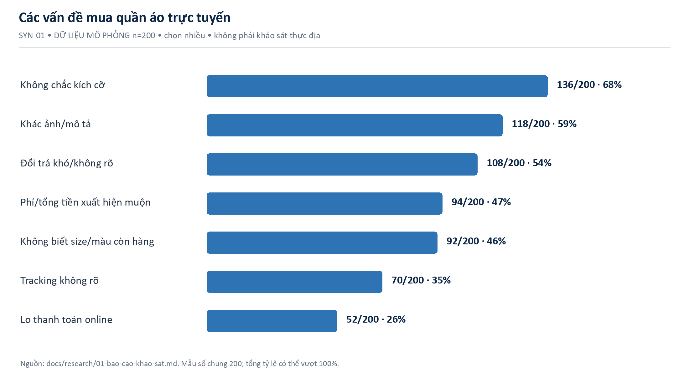
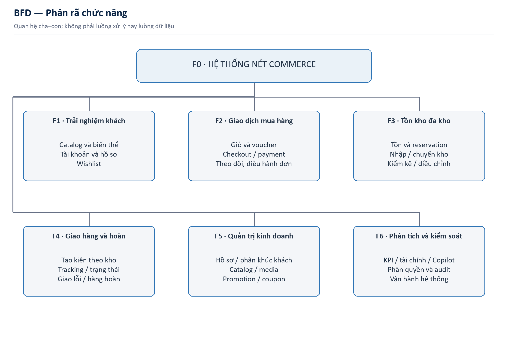
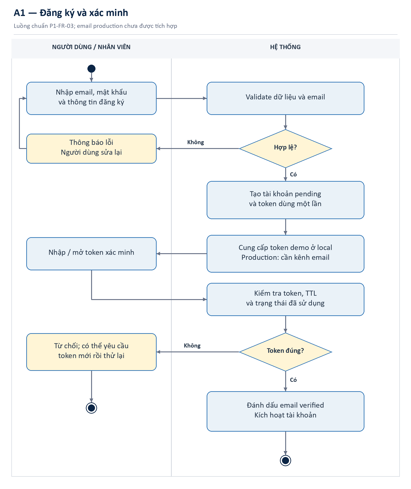
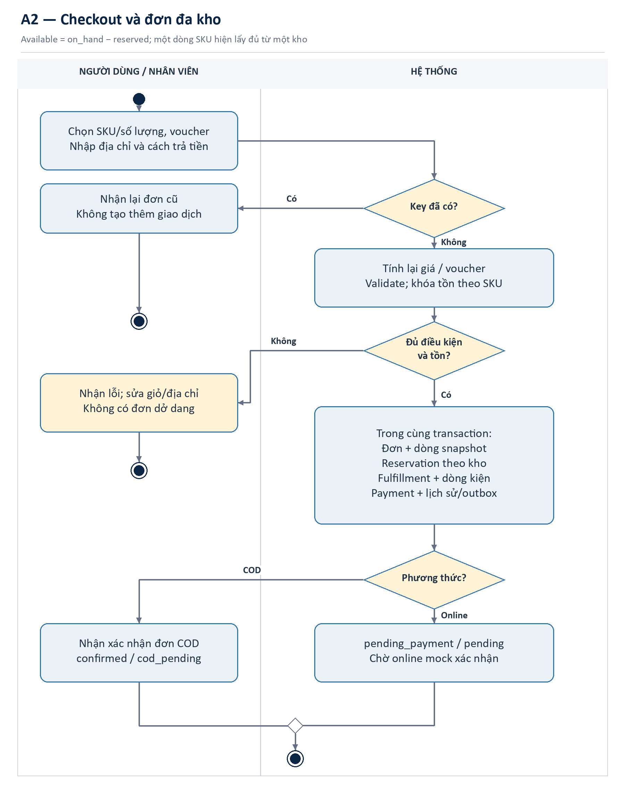
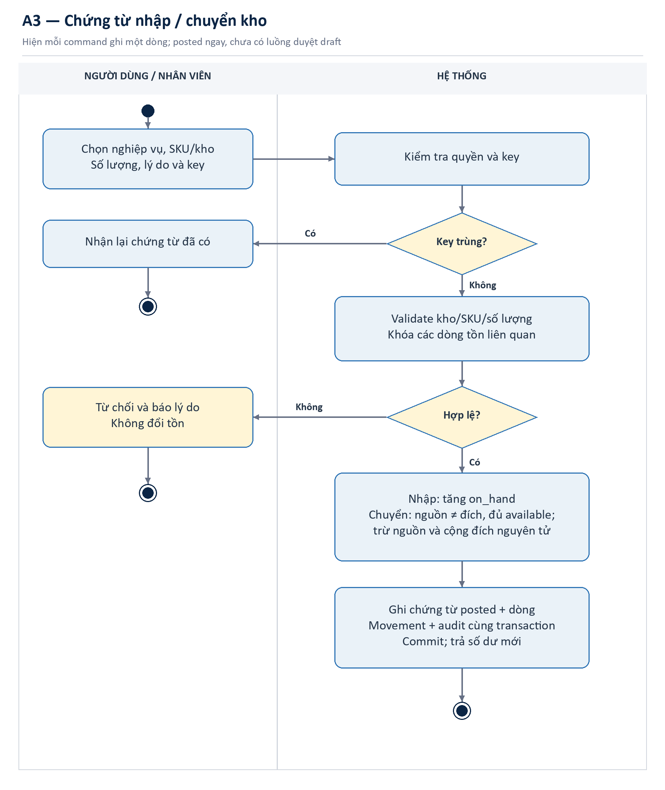
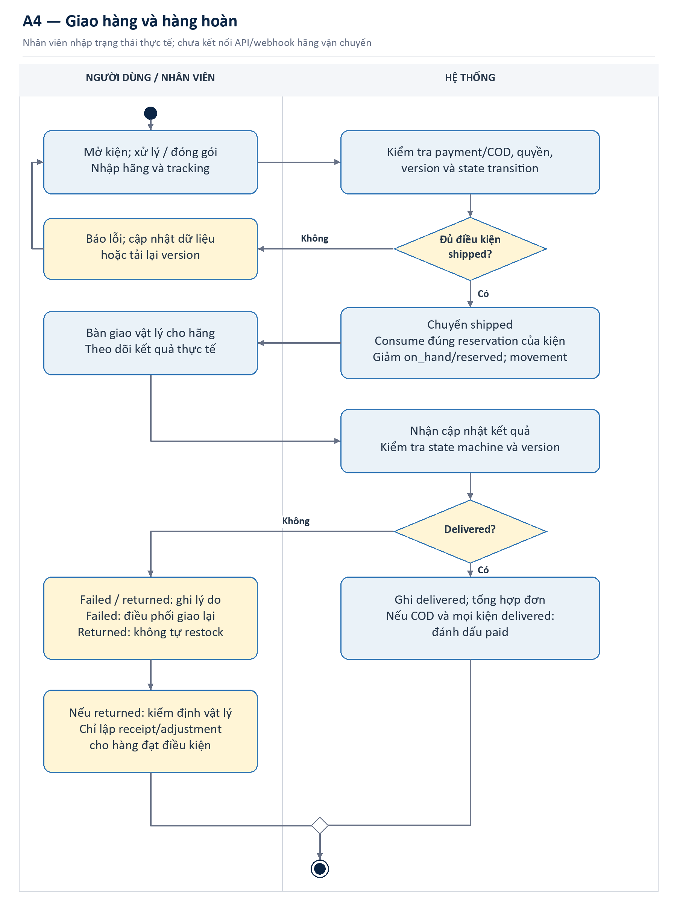
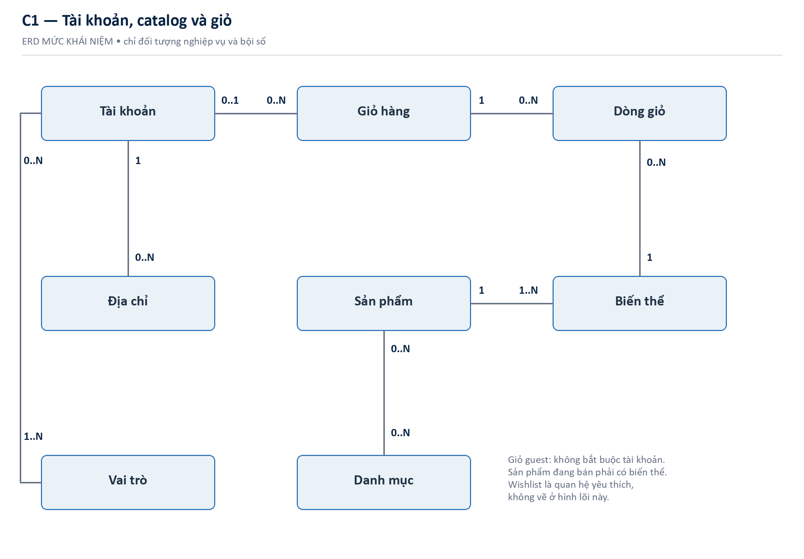
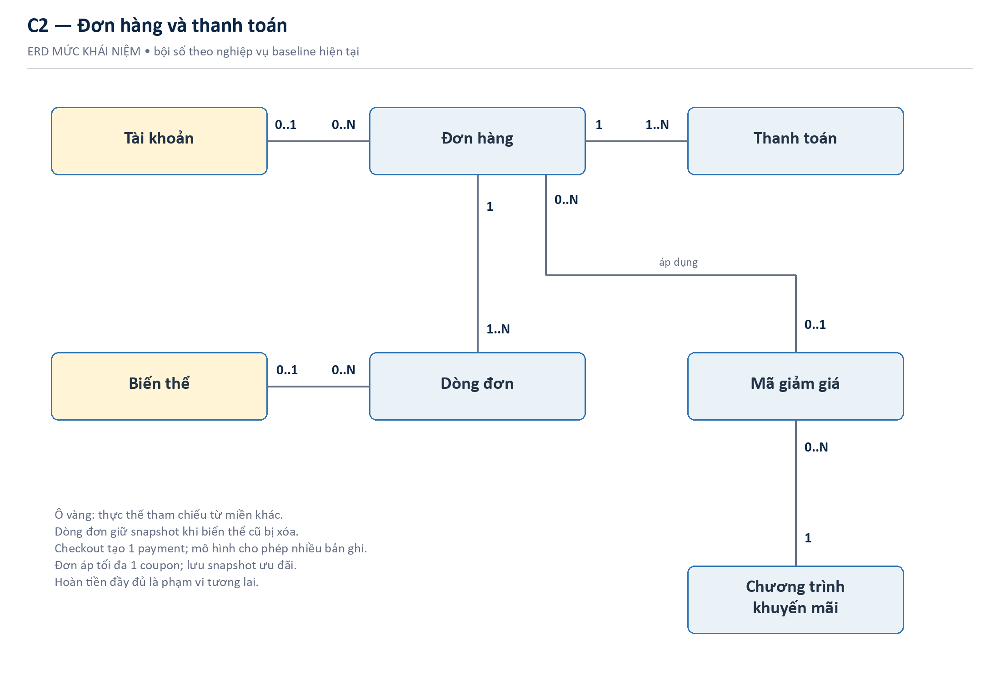
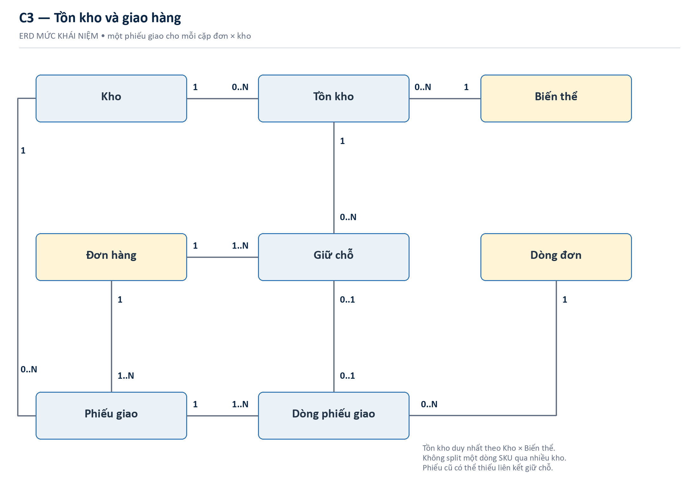

# KIỂM SOÁT TÀI LIỆU VÀ PHẠM VI BẰNG CHỨNG

Báo cáo phục vụ phần khảo sát và phân tích yêu cầu của học phần Project 1, áp dụng cho đề tài website bán quần áo trực tuyến NÉT Commerce. Cấu trúc bám các nội dung trên slide do người học cung cấp: kế hoạch khảo sát, thực hiện thu thập yêu cầu, tổng hợp theo nghiệp vụ và mô hình hệ thống.

> TRẠNG THÁI: Bản 1.0 ngày 03/09/2026 là báo cáo kế hoạch, phân tích tài liệu hiện có và minh họa cách xử lý kết quả. Chưa có phiếu trả lời hoặc biên bản thực địa được cung cấp. Không xem các bảng mô phỏng là bằng chứng đã phỏng vấn hay khảo sát người thật.

<!-- widths: 1.45, 2.75, 2.3 -->
| Nhóm bằng chứng | Có trong báo cáo | Giới hạn sử dụng |
|---|---|---|
| SYS — hệ thống | Mã nguồn, migration, tài liệu và kiểm thử trong repository | Chứng minh thiết kế/hành vi kỹ thuật; không chứng minh nhu cầu thị trường |
| SYN — mô phỏng | Bảng tổng hợp 200 trường hợp giả lập đã có trong hồ sơ nghiên cứu | Chỉ minh họa cách phân tích; không có dữ liệu người trả lời gốc |
| PLAN — kế hoạch | Tuyển mẫu, thời gian, câu hỏi và biểu mẫu thực địa | Chưa phải kết quả thực hiện |
| FIELD — thực địa | Chưa được cung cấp | Chỉ bổ sung sau khi có dữ liệu ẩn danh và bằng chứng đồng ý tham gia |

## Đối chiếu với yêu cầu học phần

<!-- widths: 2.2, 2.9, 1.4 -->
| Nội dung trên slide | Phần đáp ứng | Trạng thái |
|---|---|---|
| Thời gian, địa điểm, phương pháp, nhân sự | Chương 3: kế hoạch 02 tuần, 05 người | Đã lập kế hoạch |
| Tiến hành khảo sát | Chương 4 và phụ lục: quy trình, công cụ, sổ bằng chứng | Chưa có thực địa |
| Giới thiệu bài toán; thuật ngữ | Chương 1–2 | Đã biên soạn |
| Phỏng vấn, bảng/phiếu hỏi, lấy mẫu | Chương 4; phụ lục A–C | Công cụ sẵn dùng; kết quả minh họa tách riêng |
| Tổng hợp theo lĩnh vực nghiệp vụ | Chương 5 | SYS + SYN; chờ xác nhận FIELD |
| Yêu cầu chức năng và BFD/Activity | Chương 6–7 | Đã đặc tả và mô hình hóa |
| Yêu cầu phi chức năng | Chương 6 | Tiêu chí mục tiêu, không mặc nhận đã đạt |
| ERD mức khái niệm | Chương 7 | Thực thể, quan hệ, bội số; không mô tả cột vật lý |

# CHƯƠNG 1. GIỚI THIỆU CHUNG VỀ BÀI TOÁN

## 1.1 Bối cảnh và lý do chọn đề tài

Mua quần áo trực tuyến yêu cầu khách hàng lựa chọn đúng sản phẩm, kích cỡ và màu sắc khi không thể thử trực tiếp. Ở phía vận hành, cùng một mẫu áo có nhiều SKU, được lưu ở nhiều kho và có thể chia thành nhiều kiện giao. Nếu giá bán, mã giảm giá, tồn kho, thanh toán và vận chuyển không liên kết, thông tin hiển thị cho khách và dữ liệu quản trị có thể mâu thuẫn.

Đề tài được chọn vì bao quát một chuỗi nghiệp vụ rõ ràng, phù hợp để thực hành thu thập yêu cầu và mô hình hóa: tìm sản phẩm → chọn biến thể → giỏ hàng → đặt đơn → giữ tồn → thanh toán → giao hàng → theo dõi kết quả. Báo cáo không sử dụng số liệu thị trường chưa kiểm chứng để khẳng định tính khả thi kinh doanh.

## 1.2 Vấn đề nghiên cứu và câu hỏi khảo sát

- Người mua cần thông tin nào để chọn size/màu và quyết định đặt hàng?
- Những điểm nào trong giỏ hàng, voucher, đăng nhập và thanh toán dễ gây hiểu nhầm?
- Nhân viên cần kiểm tra gì trước khi xác nhận, đóng gói và bàn giao đơn?
- Tồn vật lý, tồn giữ chỗ và tồn có thể bán phải được phân biệt như thế nào?
- Một đơn nhiều kho cần theo dõi từng kiện và tổng hợp trạng thái ra sao?
- Quản lý cần báo cáo, phân khúc khách hàng và trợ lý đọc dữ liệu ở mức nào?

## 1.3 Mục tiêu và sản phẩm đầu ra

Mục tiêu của đợt Project 1 là tạo một bộ yêu cầu có thể truy vết từ nguồn thu thập đến mô hình và tiêu chí nghiệm thu. Đầu ra gồm kế hoạch nghiên cứu, bộ công cụ khảo sát, nhật ký bằng chứng, tổng hợp nhu cầu theo nghiệp vụ, danh mục FR/NFR, BFD, Activity Diagram và ERD khái niệm.

Kết quả cần giúp người đọc trả lời được ba câu hỏi: hệ thống giải quyết vấn đề gì; ai sử dụng và thực hiện những chức năng nào; dữ liệu nghiệp vụ nào cần tồn tại và liên hệ với nhau ra sao.

## 1.4 Phạm vi hệ thống tham chiếu

Trong phạm vi hiện tại có storefront, tài khoản, giỏ hàng/voucher, checkout khách vãng lai hoặc thành viên, thanh toán COD và online mô phỏng, theo dõi đơn; cùng quản trị catalog, khách hàng, phân khúc, tồn kho đa kho, giao hàng, báo cáo và AI Copilot chỉ đọc.

Không khẳng định đã có cổng thanh toán thật, API hãng vận chuyển, email production, hoàn tiền tự phục vụ hay LLM bên ngoài. Các tích hợp này là hướng phát triển, không được vẽ như tác vụ đang tự động chạy.

## 1.5 Các bên liên quan

<!-- widths: 1.4, 2.5, 2.6 -->
| Nhóm | Nhu cầu cần khảo sát | Cách tiếp cận dự kiến |
|---|---|---|
| Khách vãng lai/thành viên | Chọn hàng, tổng tiền, thanh toán, theo dõi | Phiếu hỏi; phỏng vấn; quan sát tác vụ |
| Nhân viên bán hàng/CS | Tra đơn, giải thích lỗi, xử lý ngoại lệ | Phỏng vấn bán cấu trúc; mẫu đơn |
| Nhân viên kho | Nhập/chuyển/kiểm kê, giữ và xuất tồn | Phỏng vấn; lấy mẫu chứng từ |
| Quản lý cửa hàng | Quyền thao tác, KPI, ưu tiên chăm sóc khách | Phỏng vấn; xác nhận yêu cầu |
| Người phụ trách thanh toán | Đối soát payment và order | Phỏng vấn; mẫu tình huống thanh toán |
| Giảng viên/nhóm đồ án | Tính đầy đủ, đúng mô hình, minh bạch nguồn | Review theo rubric và checklist |

# CHƯƠNG 2. THUẬT NGỮ VÀ QUY ƯỚC

<!-- widths: 1.45, 3.35, 1.7 -->
| Thuật ngữ | Diễn giải trong bài toán | Ví dụ/ghi chú |
|---|---|---|
| Sản phẩm | Mẫu hàng được giới thiệu chung | Một mẫu áo sơ mi |
| Biến thể/SKU | Đơn vị hàng phân biệt bằng size/màu, có giá và tồn | Áo sơ mi, trắng, M |
| Giỏ hàng | Tập SKU và số lượng trước khi đặt đơn | Chưa phải cam kết giữ tồn |
| Voucher/coupon | Mã được kiểm tra điều kiện của chương trình giảm giá | Giảm tiền, phần trăm, phí giao |
| Đơn hàng | Cam kết mua với dòng hàng và giá tại thời điểm đặt | Một đơn có thể có nhiều kiện |
| Snapshot | Bản chụp dữ liệu khi giao dịch phát sinh | Tên, giá và địa chỉ của đơn |
| On-hand | Số lượng vật lý đang được ghi nhận tại kho | Không đồng nghĩa số được bán |
| Reserved | Số lượng đã giữ chỗ cho đơn, chưa xuất kho | Giảm khi hủy hoặc xuất |
| Available | Số có thể phân bổ trong checkout hiện tại | on_hand − reserved |
| ATP dashboard | Số sẵn bán hiển thị trong quản trị kho | max(available − safety_stock, 0) |
| Reservation | Giữ chỗ một lượng SKU tại kho cho đơn | Có trạng thái và thời hạn |
| Fulfillment | Phiếu/kiện thực hiện giao hàng | Hiện tạo một phiếu cho mỗi kho |
| Tracking | Thông tin hãng và mã vận đơn | Nhập tay ở phiên bản hiện tại |
| COD | Thanh toán khi nhận hàng | Ghi paid khi mọi kiện delivered |
| Idempotency | Gửi lại cùng lệnh không làm giao dịch nhân đôi | Tránh tạo hai đơn khi bấm lại |
| RBAC | Phân quyền theo vai trò tại server | Customer, Staff, Manager, Admin |
| BFD | Sơ đồ phân rã chức năng | Thể hiện làm gì, không thể hiện thứ tự |
| Activity Diagram | Sơ đồ luồng hoạt động và nhánh điều kiện | Thể hiện quy trình làm như thế nào |
| ERD khái niệm | Mô hình thực thể nghiệp vụ và quan hệ | Không phải schema SQL |

## Quy ước sử dụng

P1-FR/P1-NFR là mã riêng của báo cáo này. “Must” thuộc phạm vi cốt lõi; “Should” có thể triển khai sau. “Đã có” là hiện trạng code, không phải nghiệm thu thực địa. Các nhãn SYS/SYN/PLAN/FIELD được định nghĩa ở phần kiểm soát tài liệu.

# CHƯƠNG 3. KẾ HOẠCH KHẢO SÁT TRONG 02 TUẦN

## 3.1 Thời gian và địa điểm

Kế hoạch đề xuất gồm 10 ngày làm việc trong 02 tuần, từ 07/09/2026 đến 18/09/2026; cuối tuần 12–13/09 dành cho dự phòng tự nguyện, không tính thêm phạm vi. Đây là lịch dự kiến, cần điều chỉnh theo lịch học và sự đồng ý của người tham gia.

Hai tuần chỉ dành cho khảo sát và phân tích yêu cầu; không thay đổi kế hoạch phát triển toàn bộ website 08 tuần đã lập trước đó.

Phiếu hỏi thực hiện trực tuyến; phỏng vấn qua cuộc gọi hoặc trực tiếp tại địa điểm người tham gia đồng ý. Địa chỉ trường, phòng họp và cửa hàng đối tác chưa được cung cấp nên chưa xác nhận. Không tự gán tên doanh nghiệp vào báo cáo.

## 3.2 Phương pháp và quy mô dự kiến

<!-- widths: 1.4, 1.65, 1.85, 1.6 -->
| Phương pháp | Mục tiêu mẫu PLAN | Cách chọn | Đầu ra cần lưu |
|---|---|---|---|
| Phỏng vấn người mua | 08 người; 25–35 phút/người | 3 mua thường xuyên, 3 trung bình, 2 ít mua/từng bỏ mua | Consent, biên bản ẩn danh, theme |
| Phỏng vấn vận hành | 04 người; 30–45 phút/người | Quản lý, kho, xử lý đơn/CS, thanh toán | Quy trình, ngoại lệ, rule xác nhận |
| Bảng hỏi | 120 phiếu hợp lệ; 7–10 phút/phiếu | Thuận tiện có quota, mời khoảng 150–180 người | Raw, codebook, cleaning log |
| Pilot | 10 người trước phát phiếu chính | Kiểm tra cách hiểu, thời lượng, logic | Công cụ v2 và change log |
| Lấy mẫu hồ sơ | 30 hồ sơ: 20 đơn + 10 chứng từ kho | Chọn có chủ đích theo trạng thái và loại nghiệp vụ | Sample register, bản trích ẩn danh |

Người trả lời phiếu chính dự kiến từ 18–44 tuổi, từng mua quần áo trực tuyến trong 06 tháng và đồng ý tham gia. Quota tuổi đề xuất 42 người 18–24, 48 người 25–34, 30 người 35–44. Đây là mục tiêu phân bổ chứ không phải số thu được. Mẫu thuận tiện không đại diện toàn bộ người tiêu dùng Việt Nam.

## 3.3 Lịch thực hiện và phân công

<!-- widths: 0.8, 2.95, 1.05, 1.7 -->
| Mốc | Công việc | Chủ trì | Bằng chứng hoàn thành |
|---|---|---|---|
| N1 · 07/09 | Chốt câu hỏi nghiên cứu, phạm vi, tuyển mẫu, consent | PM | Kế hoạch v1; danh sách tiếp cận |
| N2 · 08/09 | Soạn phiếu, guide phỏng vấn và mẫu trích hồ sơ | FE, BE1, BE2 | Bộ công cụ v1 |
| N3 · 09/09 | Pilot 10 người, sửa câu khó hiểu và logic rẽ nhánh | FE; PM duyệt | Pilot log; công cụ v2 |
| N4–N6 · 10–14/09 | Thu phiếu chính, phỏng vấn người mua, theo dõi quota | FE, PM | Phiếu và biên bản FIELD nếu có |
| N4–N7 · 10–15/09 | Phỏng vấn vận hành, lấy mẫu 30 hồ sơ | BE1, BE2 | Sample register; rule notes |
| N7 · 15/09 | Đóng thu thập, ẩn danh, loại phiếu theo quy tắc | DevOps | Clean data; cleaning log |
| N8 · 16/09 | Mã hóa theme; tính tần suất; tổng hợp theo nghiệp vụ | Cả nhóm | Evidence → insight matrix |
| N9 · 17/09 | Chốt FR/NFR; BFD, Activity, ERD khái niệm | BE1, BE2, FE | Mô hình và tiêu chí nghiệm thu |
| N10 · 18/09 | Review chéo, xác nhận khoảng trống, đóng báo cáo | PM | Báo cáo Word; checklist |

## 3.4 Trách nhiệm của 05 thành viên

- PM: điều phối nghiên cứu, quản lý consent, phỏng vấn quản lý, xử lý xung đột yêu cầu, duyệt và bàn giao báo cáo.
- Frontend: thiết kế bảng hỏi, pilot, phỏng vấn người mua và tổng hợp nhu cầu trải nghiệm storefront/tài khoản.
- Backend 1: khảo sát auth, giỏ, voucher, đơn và thanh toán; đặc tả rule và FR liên quan.
- Backend 2: khảo sát kho, fulfillment, khách hàng; lấy mẫu chứng từ và xây ERD khái niệm.
- DevOps: thiết lập nơi lưu dữ liệu, quyền truy cập, mã ẩn danh, xuất dữ liệu, kiểm tra công thức và quản lý phiên bản.

## 3.5 Kiểm soát chất lượng và bảo vệ dữ liệu

Nhóm chỉ thu thông tin cần cho mục tiêu nghiên cứu. Không thu mật khẩu, token đăng nhập, số thẻ hoặc địa chỉ giao hàng đầy đủ. Mã người tham gia dùng dạng PV-KH-01, PV-VH-01; mã phiếu dùng PH-0001. Danh sách liên hệ tuyển mẫu, nếu có, lưu tách khỏi câu trả lời và chỉ PM truy cập.

Người tham gia được biết mục đích học tập, quyền bỏ qua câu hỏi và dừng bất kỳ lúc nào. Chỉ ghi âm khi có đồng ý riêng. Thời hạn lưu đề xuất là đến 30 ngày sau khi học phần kết thúc, sau đó xóa dữ liệu liên hệ/ghi âm theo quy định của trường; đây là chính sách đề xuất cần được chấp thuận, không phải tuyên bố tuân thủ pháp luật đã được thẩm định.

Phiếu thiếu điều kiện tham gia hoặc trùng được loại có lý do. Thời gian trả lời bất thường chỉ là tín hiệu kiểm tra, không tự động loại theo cảm tính. Nếu pilot làm thay đổi câu hỏi, phiếu pilot không gộp vào mẫu chính. Khi chưa đạt quota, báo cáo số thực thu và hạn chế thay vì tạo thêm dữ liệu.

# CHƯƠNG 4. THU THẬP YÊU CẦU VÀ KẾT QUẢ PHÂN TÍCH

## 4.1 Trạng thái thực hiện

Đã thực hiện phân tích tài liệu và mã nguồn có sẵn trong workspace để xác định phạm vi hệ thống và các ràng buộc nghiệp vụ. Chưa có bằng chứng thực địa mới: số phỏng vấn, phiếu hợp lệ và hồ sơ cửa hàng thực nhận đều chưa được ghi nhận. Các phần sau cung cấp công cụ thực hiện và kết quả minh họa có nhãn nguồn.

<!-- widths: 1.3, 2.85, 2.35 -->
| Mã nguồn | Tài liệu hoặc đối tượng | Đã xác nhận được |
|---|---|---|
| SYS-01 | README, tài liệu tổng quan, BA và data dictionary | Phạm vi, vai trò và thuật ngữ hiện tại |
| SYS-02 | OrderService, PaymentService và chính sách trạng thái | Checkout, COD, online mock và ngoại lệ |
| SYS-03 | InventoryService và các migration | Tồn đa kho, reservation, chứng từ kho |
| SYS-04 | Module fulfillment và migration V7 | Một phiếu giao theo mỗi kho; tracking thủ công |
| SYS-05 | Module auth, admincustomer và insights | Auth lifecycle, phân khúc, Copilot chỉ đọc |
| SYN-01 | Báo cáo khảo sát cũ, bảng tổng hợp n=200 | Chỉ dùng các bảng có mẫu số rõ |

## 4.2 Phỏng vấn bán cấu trúc

Mục đích là hiểu quy trình thực tế và nguyên nhân phía sau lựa chọn, không chỉ hỏi người tham gia có thích tính năng hay không. Người phỏng vấn đề nghị kể lại một giao dịch gần đây, hỏi tiếp tình huống ngoại lệ và ghi rõ đâu là lời kể, đâu là suy luận của nhóm.

Một buổi gồm: giới thiệu và xin phép; hỏi bối cảnh; khai thác giao dịch gần nhất; đi sâu khó khăn; kiểm tra cách hiểu; tổng kết và xin phép liên hệ bổ sung. Bộ câu hỏi đầy đủ ở Phụ lục A.

### Cách tổng hợp sau phỏng vấn

Biên bản được gán mã; hai thành viên đọc độc lập một phần mẫu để thống nhất theme. Mỗi theme gồm mô tả, mã người đề cập, tình huống minh chứng và yêu cầu ứng viên. Không biến tần suất theme của mẫu nhỏ thành tỷ lệ đại diện thị trường.

<!-- widths: 1.4, 2.5, 2.6 -->
| Theme minh họa — SYN, không phải lời người thật | Nội dung diễn giải giả định | Yêu cầu cần kiểm chứng |
|---|---|---|
| INT-SYN-01 · Chọn hàng | Người mua cần biết size/màu nào còn trước khi thêm giỏ | P1-FR-01/02: chi tiết biến thể, tồn và mô tả |
| INT-SYN-02 · Tổng tiền | Người mua cần hiểu giảm giá và phí giao trước khi xác nhận | P1-FR-05/06: pricing rõ, tính lại ở server |
| INT-SYN-03 · Vận hành kho | Nhân viên cần phân biệt hàng đang giữ cho đơn với hàng còn tự do | P1-FR-12/13: balance và reservation |
| INT-SYN-04 · Giao hàng | Nhân viên cần xử lý từng kiện nhưng khách vẫn theo dõi một đơn | P1-FR-17/18: fulfillment và tổng hợp trạng thái |

Các diễn giải trên là giả thuyết để kiểm tra, không phải trích dẫn phỏng vấn. Không có tên người trả lời, chữ ký hay ngày phỏng vấn giả được tạo ra.

## 4.3 Bảng/phiếu hỏi

Bảng hỏi ở Phụ lục B dùng các câu sàng lọc, hành vi gần đây, vấn đề gặp phải, nhu cầu thông tin và câu mở. Câu nhiều lựa chọn phải ghi rõ được chọn nhiều. Mẫu số mỗi tỷ lệ là số người hợp lệ đã trả lời câu tương ứng, không mặc định bằng tổng mẫu nếu câu có rẽ nhánh hoặc bị bỏ qua.

Quy trình xử lý: xuất bản gốc chỉ đọc → ẩn danh → rà trùng và điều kiện → ghi cleaning log → tạo bản sạch → tính số lượng và tỷ lệ → review mẫu số → lập bảng insight. Không chỉnh dữ liệu gốc để làm tỷ lệ đẹp hơn.

### Kết quả minh họa từ bộ tổng hợp SYN-01, n=200

<!-- widths: 3.2, 1.25, 0.85, 1.2 -->
| Vấn đề có thể chọn nhiều | Số chọn/mẫu số | Tỷ lệ | Liên hệ yêu cầu |
|---|---|---|---|
| Không chắc kích cỡ | 136/200 | 68% | P1-FR-02 |
| Sản phẩm khác ảnh/mô tả | 118/200 | 59% | P1-FR-02 |
| Đổi trả khó hoặc không rõ | 108/200 | 54% | P1-FR-19; policy |
| Phí/tổng tiền xuất hiện muộn | 94/200 | 47% | P1-FR-05/06 |
| Không biết size/màu còn hàng | 92/200 | 46% | P1-FR-02/12 |
| Theo dõi đơn không rõ | 70/200 | 35% | P1-FR-10/18 |
| Lo thanh toán trực tuyến | 52/200 | 26% | P1-FR-08/09 |

Trong bộ tổng hợp mô phỏng, 136/200 trường hợp được gán vấn đề không chắc kích cỡ; đây là lý do minh họa để ưu tiên thông tin biến thể và hướng dẫn size. Không kết luận rằng 68% khách hàng thật gặp vấn đề này. Tương tự, nhu cầu đổi trả được ghi nhận nhưng quy trình hoàn tiền đầy đủ vẫn ngoài phạm vi code hiện tại.

Không gộp n=200 mô phỏng với mục tiêu 120 phiếu thực địa của đợt này. Không tính khoảng tin cậy, p-value hay mức đại diện cho SYN-01. Bảng ưu tiên tính năng cũ có ràng buộc số lượt chọn chưa nhất quán nên không tái sử dụng trong báo cáo này.

## 4.4 Lấy mẫu hồ sơ nghiệp vụ

“Lấy mẫu” ở đây là một kỹ thuật thu thập riêng, không chỉ là chọn người trả lời bảng hỏi. Nhóm dự kiến chọn 30 hồ sơ đã ẩn danh: 20 đơn hàng và 10 chứng từ kho, để xem trường dữ liệu, chứng từ và ngoại lệ đang được sử dụng.

20 đơn dự kiến phân bổ theo phương thức COD/online; đồng thời bảo đảm có đơn chờ, thành công, hủy và đa kho. Các chiều phân tầng có thể giao nhau nên không cộng các nhóm trạng thái thành những mẫu độc lập. 10 chứng từ gồm 3 nhập, 3 chuyển, 2 kiểm kê và 2 điều chỉnh. Đây là chọn có chủ đích để phủ nghiệp vụ, không phải mẫu ngẫu nhiên để ước tính tỷ lệ lỗi.

Trường cần trích: mã ẩn danh, loại hồ sơ, trạng thái, số dòng SKU, số kho, thành phần tiền, mốc thời gian, lý do thay đổi và liên kết chứng từ. Bỏ tên, điện thoại, địa chỉ đầy đủ và token. Mẫu biểu trích nằm ở Phụ lục C.

### Kết quả đọc mẫu tài liệu kỹ thuật đã có — SYS/DEMO

<!-- widths: 1.0, 2.5, 3.0 -->
| Mã đọc mẫu | Đối tượng đã phân tích | Quy tắc rút ra từ code/tài liệu |
|---|---|---|
| SYS-S01 | Giỏ và checkout | Server tính lại giá, voucher, tồn; giỏ chưa giữ tồn |
| SYS-S02 | Đơn và dòng hàng | Lưu snapshot; tạo reservation trong transaction |
| SYS-S03 | Phiếu nhập/chuyển/kiểm kê | Có chứng từ, dòng chi tiết, movement, lý do và idempotency |
| SYS-S04 | Phiếu giao và lịch sử | Một fulfillment mỗi kho; shipped mới xuất tồn liên quan |
| SYS-S05 | Payment và event | Có HMAC và chống lặp; còn rủi ro event thành công đến muộn |
| SYS-S06 | Hồ sơ và phân khúc khách | Read model từ tài khoản và đơn paid; không suy ra từ khảo sát |

Sáu mục SYS-S01–06 là nhóm tài liệu/mã nguồn được đọc, không phải sáu giao dịch cửa hàng được lấy ngẫu nhiên. Hiện chưa có 30 hồ sơ FIELD theo kế hoạch; cần bổ sung sample register thực tế trước khi tuyên bố hoàn thành lấy mẫu thực địa.

# CHƯƠNG 5. TỔNG HỢP KẾT QUẢ THEO NGHIỆP VỤ

## 5.1 Từ bằng chứng đến yêu cầu

Yêu cầu ứng viên được tạo từ ba hướng: nhu cầu người dùng cần kiểm chứng, quy tắc vận hành giả định và ràng buộc hệ thống đã quan sát. Khi các nguồn mâu thuẫn, nhóm ghi vấn đề mở và nhờ người có thẩm quyền xác nhận; không tự chọn nguồn thuận lợi nhất để kết luận.

<!-- widths: 1.15, 1.85, 2.25, 1.25 -->
| Miền nghiệp vụ | Nguồn và nhu cầu | Kết luận thiết kế | Yêu cầu |
|---|---|---|---|
| Catalog | SYN-01: size, ảnh, tồn | Thông tin sản phẩm gắn biến thể; hiển thị trạng thái hàng | P1-FR-01/02 |
| Tài khoản | SYS-05; cần phỏng vấn xác nhận ma sát đăng nhập | Cho phép guest; account có vòng đời và quyền sở hữu dữ liệu | P1-FR-03/04 |
| Giỏ, voucher | SYN-01: phí muộn; SYS-S01 | Tổng tiền minh bạch, mã giảm giá có điều kiện | P1-FR-05/06 |
| Đơn, payment | SYS-02/05; cần FIELD về đối soát | Tạo đơn nguyên tử; tách trạng thái đơn và payment | P1-FR-07–11 |
| Kho | SYS-03; INT-SYN-03 | Tồn theo SKU/kho; chứng từ và lịch sử không mất | P1-FR-12–16 |
| Giao hàng | SYN-01: tracking; SYS-04 | Theo dõi từng kiện, tổng hợp về đơn; tracking nhập tay | P1-FR-17–19 |
| Khách hàng | SYS-05; cần FIELD quản lý xác nhận | Hồ sơ 360°, phân khúc theo giao dịch hợp lệ | P1-FR-20/21 |
| Quản trị | SYS-01/05; yêu cầu quản lý giả định | Catalog, promotion, báo cáo và Copilot chỉ đọc | P1-FR-22–24 |

## 5.2 Các quy tắc nghiệp vụ cốt lõi

- BR-P1-01: Giá và tổng tiền cuối cùng do server tính lại; dữ liệu gửi từ trình duyệt không phải nguồn giá đáng tin cậy.
- BR-P1-02: Checkout hiện phân bổ theo available = on_hand − reserved. Safety stock chỉ giảm ATP hiển thị trên dashboard; nếu muốn dùng làm ngưỡng chặn bán cần yêu cầu thay đổi riêng.
- BR-P1-03: Một đơn tạo một fulfillment cho mỗi kho được cấp hàng; không đồng nhất “đơn hàng” với “mã vận đơn”.
- BR-P1-04: Khi shipped, chỉ consume reservation của đúng kiện và ghi movement xuất kho. Trước shipped, hủy hợp lệ sẽ nhả phần giữ chỗ tương ứng.
- BR-P1-05: COD chỉ được ghi paid khi mọi kiện đã delivered. Mã tracking do nhân viên nhập không có nghĩa là hãng vận chuyển đã xác nhận.
- BR-P1-06: Returned sau xuất kho không tự tăng tồn bán được; phải kiểm định vật lý rồi lập receipt/adjustment hợp lệ.
- BR-P1-07: Khách thành viên chỉ xem đơn của mình. Khách vãng lai dùng token có hạn và gửi trong header, không đặt token trong URL.
- BR-P1-08: Lệnh quan trọng phải chống lặp; cập nhật trạng thái/tracking fulfillment cần kiểm tra version để tránh ghi đè đồng thời.

## 5.3 Vấn đề còn mở và khoảng cách hiện trạng

<!-- widths: 1.05, 3.3, 2.15 -->
| Mã | Sai lệch hiện tại đã xác nhận từ code | Yêu cầu xử lý/kiểm chứng |
|---|---|---|
| KD-GUEST-01 | Trang online-payment của guest truyền token trong query, API chỉ đọc header | Đồng bộ contract; test URL không lộ token |
| KD-PAY-01 | Webhook thành công muộn có thể ghi paid/succeeded dù order đã cancelled | Reject/reconcile theo chính sách trạng thái terminal |
| KD-INV-01 | Job expiry hủy order nhưng chưa đồng bộ dòng payments đang pending | Cập nhật hai aggregate nguyên tử; test đối soát |
| KD-INV-02 | Reservation COD có TTL 30 ngày nhưng job chỉ quét order pending_payment | Xác nhận chính sách COD và mở rộng xử lý expiry |

Những mục này là sai lệch triển khai, không phải dữ liệu khảo sát và chưa được sửa trong nhiệm vụ làm tài liệu. Sơ đồ mô hình hóa luồng chuẩn cần có; các nhánh chưa hoàn thiện được chỉ rõ, không dùng sơ đồ để che giới hạn.

# CHƯƠNG 6. YÊU CẦU CHỨC NĂNG VÀ PHI CHỨC NĂNG

## 6.1 Yêu cầu chức năng của Project 1

Mỗi yêu cầu dưới đây xác định tác nhân, hành vi quan sát được và điều kiện nghiệm thu. Mã được dùng thống nhất trong BFD, Activity và ma trận truy vết. “Hiện trạng” là kết quả đối chiếu code, chưa thay thế nghiệm thu của giảng viên hoặc người dùng.

<!-- widths: 0.85, 1.1, 2.85, 1.7 -->
| Mã/ưu tiên | Tác nhân | Yêu cầu và điều kiện chấp nhận | Hiện trạng |
|---|---|---|---|
| P1-FR-01 Must | Khách | Tìm, lọc, sắp xếp sản phẩm; kết quả chỉ gồm hàng đang được phép bán | Đã có |
| P1-FR-02 Must | Khách | Xem ảnh, mô tả, size/màu, giá; biến thể hết hàng không được mua vượt tồn | Đã có; cần kiểm tra UX thực địa |
| P1-FR-03 Must | Khách/thành viên | Đăng ký, xác minh, đăng nhập, refresh, logout và đặt lại mật khẩu; token lỗi bị từ chối | Đã có; email production chưa nối |
| P1-FR-04 Should | Thành viên | Quản lý hồ sơ, địa chỉ, wishlist và xem dữ liệu của mình | Đã có |
| P1-FR-05 Must | Khách | Thêm/đổi/xóa SKU trong giỏ; server trả tổng sau mỗi thay đổi | Đã có |
| P1-FR-06 Must | Khách | Áp/bỏ voucher; kiểm tra thời gian, ngưỡng, giới hạn và loại giảm | Đã có |
| P1-FR-07 Must | Khách | Checkout có địa chỉ hợp lệ; order/items/reservations/fulfillments/payment được tạo nhất quán | Đã có luồng chuẩn |
| P1-FR-08 Must | Khách | Chọn COD hoặc online mô phỏng; không tự xác nhận paid từ redirect | Đã có trong local |
| P1-FR-09 Must | Hệ thống | Event thanh toán đúng chữ ký, chống lặp và không làm sai order terminal | Một phần: KD-PAY-01 |
| P1-FR-10 Must | Khách | Theo dõi đơn và kiện; token guest đúng header, quá hạn bị từ chối | Một phần ở online-payment guest |
| P1-FR-11 Must | Nhân viên | Tra đơn, chuyển trạng thái và hủy theo điều kiện; không hủy trực tiếp đơn đã paid/authorized | Đã có kiểm soát luồng chuẩn |
| P1-FR-12 Must | Nhân viên kho | Xem tồn vật lý, giữ chỗ, available và ATP theo SKU/kho | Đã có; phân biệt hai công thức |
| P1-FR-13 Must | Hệ thống | Giữ, consume, release tồn đúng đơn/kiện; expiry không làm lệch payment | Một phần: KD-INV-01/02 |
| P1-FR-14 Must | Nhân viên kho | Nhập kho một dòng mỗi lệnh; retry không tạo movement trùng | Đã có; nhập nhiều dòng/lệnh là mở rộng |
| P1-FR-15 Must | Nhân viên kho | Chuyển kho nguyên tử, nguồn đủ hàng, có cặp movement | Đã có |
| P1-FR-16 Must | Manager/kho | Kiểm kê/điều chỉnh có lý do, quyền, transaction và khóa dòng; lưu chứng từ | Đã có; chưa kiểm tra expectedVersion từ client |
| P1-FR-17 Must | Hệ thống/nhân viên | Tự tạo kiện theo kho; xem dòng hàng và lịch sử riêng từng kiện | Đã có |
| P1-FR-18 Must | Nhân viên | Nhập carrier/tracking/ETA, chuyển trạng thái; shipped cần tracking | Đã có, nhập thủ công |
| P1-FR-19 Must | Kho/CS | Ghi nhận failed/returned/cancelled có lý do; hàng hoàn không tự restock | Đã có ở mức fulfillment; chưa refund đầy đủ |
| P1-FR-20 Should | Nhân viên/quản lý | Tìm khách, xem hồ sơ 360° và đơn; Admin kiểm soát trạng thái account | Đã có |
| P1-FR-21 Should | Quản lý | Xem sáu phân khúc tính từ giao dịch paid theo thứ tự ưu tiên | Đã có rule-based |
| P1-FR-22 Must | Nhân viên/quản lý | Quản lý catalog, variant/media và chương trình giảm giá theo quyền | Một phần: xem/tạo và thêm media; chưa đủ CRUD |
| P1-FR-23 Should | Quản lý | Xem KPI, báo cáo và payment ledger theo kỳ, có nguồn dữ liệu rõ | Đã có, cần đối soát các defect |
| P1-FR-24 Should | Quản lý | Copilot trả tổng hợp theo snapshot, nêu nguồn/thời điểm, không tự sửa dữ liệu | Đã có theo luật; không phải LLM |

## 6.2 Yêu cầu phi chức năng

Các con số sau là mục tiêu đề xuất để kiểm thử trong phạm vi đồ án; chưa có kết quả đo tương ứng trong đợt khảo sát này. Cần chốt cấu hình máy, kích thước dữ liệu, kịch bản tải và cách đo trước khi kết luận đạt/không đạt.

<!-- widths: 0.9, 1.15, 2.85, 1.6 -->
| Mã | Nhóm | Mục tiêu/điều kiện kiểm chứng | Cách kiểm tra |
|---|---|---|---|
| P1-NFR-01 | Hiệu năng | API đọc catalog/cart p95 ≤ 500 ms tại tải mục tiêu 100 request/giây trên cấu hình đã ghi nhận | Load test; log latency |
| P1-NFR-02 | Sử dụng | Hoàn thành các tác vụ chọn biến thể, giỏ, đặt đơn trên màn hình từ 360 px; không cần cuộn ngang | Kiểm tra thiết bị và usability |
| P1-NFR-03 | Tiếp cận | Luồng chính dùng được bằng bàn phím; input có label, focus rõ và lỗi có hướng khắc phục | Manual + công cụ a11y |
| P1-NFR-04 | Bảo mật | Mật khẩu băm; token ngắn hạn/thu hồi; không để guest token trong URL hoặc log | Review auth/BFF; negative test |
| P1-NFR-05 | Phân quyền | API chặn truy cập sai vai trò hoặc tài nguyên của người khác | Ma trận role × endpoint |
| P1-NFR-06 | Toàn vẹn | Checkout/kho nguyên tử; retry không nhân đôi order, movement hoặc event | Transaction/duplicate tests |
| P1-NFR-07 | Đồng thời | Không xuất/giữ vượt tồn; xung đột version bị phát hiện thay vì ghi đè | Concurrent checkout/update |
| P1-NFR-08 | Riêng tư | Chỉ thu dữ liệu cần thiết; phân quyền báo cáo, ẩn danh dữ liệu nghiên cứu | Checklist dữ liệu và truy cập |
| P1-NFR-09 | Khôi phục | Mục tiêu RPO ≤ 24 giờ, RTO ≤ 4 giờ cho PostgreSQL trong kịch bản đồ án | Backup/restore có biên bản |
| P1-NFR-10 | Bảo trì | Module theo miền; migration đã áp dụng không sửa; có test cho rule trọng yếu | Review code/migration/CI |
| P1-NFR-11 | Triển khai | Có hướng dẫn chạy local Docker, cấu hình mẫu, healthcheck và lỗi rõ | Người mới chạy theo runbook |
| P1-NFR-12 | Quan sát | Giao dịch quan trọng có correlation ID, audit; Copilot nêu snapshot và không mutation | Đối chiếu log/audit/UI |

## 6.3 Tiêu chí xác nhận yêu cầu

Một yêu cầu được chốt khi có nguồn, tác nhân, điều kiện trước/sau, ít nhất một luồng lỗi và phương pháp kiểm thử. PM ghi quyết định phạm vi; FE và hai BE kiểm tra khả năng triển khai; người vận hành/giảng viên xác nhận nghiệp vụ khi có điều kiện. Các mục chưa có FIELD được gắn “chờ xác nhận”, không được tự chuyển sang “người dùng đã duyệt”.

# CHƯƠNG 7. MÔ HÌNH HỆ THỐNG

## 7.1 BFD — phân rã chức năng

BFD dưới đây mô tả hệ thống làm gì theo sáu nhóm chức năng. Nhánh cây là quan hệ phân rã, không phải luồng dữ liệu hoặc thứ tự xử lý. Các nhóm được đánh mã F1–F6 để liên hệ với FR.

<!-- widths: 0.65, 3.5, 2.35 -->
| Nhóm | Các chức năng cấp 2 | Liên hệ FR |
|---|---|---|
| F1 | Khám phá catalog; chọn biến thể; tài khoản; hồ sơ/wishlist | P1-FR-01–04 |
| F2 | Giỏ; voucher; checkout; COD/online; theo dõi và điều hành đơn | P1-FR-05–11 |
| F3 | Tra tồn; reservation; nhập; chuyển; kiểm kê/điều chỉnh | P1-FR-12–16 |
| F4 | Tạo kiện; nhập tracking; chuyển trạng thái; xử lý giao lỗi/hoàn | P1-FR-17–19 |
| F5 | Hồ sơ khách; phân khúc; catalog và promotion | P1-FR-20–22 |
| F6 | KPI/tài chính; Copilot; phân quyền/audit/vận hành | P1-FR-23/24; NFR-04–12 |

<!-- pagebreak -->
## 7.2 Activity A1 — đăng ký và xác minh tài khoản

Luồng chuẩn của P1-FR-03: tài khoản mới ở trạng thái chờ, chỉ được kích hoạt khi token hợp lệ và chưa dùng. Bản local cung cấp token demo; gửi email production chưa được tích hợp. Nhánh lỗi không tạo tài khoản active hoặc làm tiêu thụ token hợp lệ khác.

<!-- pagebreak -->
## 7.3 Activity A2 — checkout, giữ tồn và tạo kiện

Luồng A2 liên quan P1-FR-05–09, 12/13/17. Lỗi validation hoặc thiếu tồn phải trả thông báo để khách sửa; transaction không để lại đơn hay giữ tồn dở dang. Mỗi nhánh online payment vẫn chịu giới hạn mock, guest contract và late event được nêu ở mục 5.3.

<!-- pagebreak -->
## 7.4 Activity A3 — nhập và chuyển kho

Lệnh được kiểm tra quyền, kho/SKU, số lượng, idempotency và số dư trước khi ghi. Chuyển kho phải có cả trừ nguồn và cộng đích trong một transaction. Nếu lỗi, toàn bộ thay đổi được rollback. Kiểm kê/điều chỉnh dùng cùng nguyên tắc kiểm soát nhưng có thêm số đếm/lý do và quyền tương ứng. API hiện xử lý một dòng mỗi command và posted ngay, chưa có quy trình draft → phê duyệt.

<!-- pagebreak -->
## 7.5 Activity A4 — vận chuyển và hàng hoàn

Luồng chuẩn đi từ pending → processing → ready_to_ship → shipped → delivered. Failed cho phép điều phối giao lại theo state machine. Returned sau dispatch kết thúc luồng vận chuyển nhưng không tự cộng lại tồn; kiểm định và nhập lại là nghiệp vụ kho riêng. COD chỉ ghi paid sau khi mọi kiện đã delivered. Không có lời gọi hãng vận chuyển tự động trong sơ đồ hiện trạng này.

<!-- pagebreak -->
## 7.6 ERD khái niệm — cách đọc

ERD khái niệm tập trung vào đối tượng nghiệp vụ và bội số. Các sơ đồ dùng 1, 0..1, 0..N, 1..N; nhãn gần đầu nào mô tả số đối tượng ở đầu đó. Không trình bày khóa chính/ngoại, kiểu dữ liệu, index hoặc toàn bộ 33 bảng vật lý. Một thực thể khái niệm có thể ánh xạ sang nhiều bảng trong thiết kế chi tiết.

Giỏ của khách vãng lai không bắt buộc gắn tài khoản. Một dòng giỏ chọn đúng một biến thể, không chọn trực tiếp sản phẩm chung. Sản phẩm đang bán cần có ít nhất một biến thể hợp lệ; danh mục và vai trò là các quan hệ nhiều–nhiều ở mức khái niệm.

<!-- pagebreak -->
## 7.7 ERD khái niệm — đơn hàng và thanh toán

Khách vãng lai giải thích quan hệ Đơn hàng → Tài khoản là 0..1. Dòng đơn lưu snapshot; khi checkout mới, mỗi dòng chọn đúng một biến thể. Tham chiếu catalog có thể trống nếu biến thể cũ bị xóa, nên bội số là 0..1. Một đơn có ít nhất một dòng, hiện áp tối đa một coupon và checkout tạo một payment; mô hình cho phép nhiều payment cho một đơn. Các ô vàng lặp thực thể từ miền khác để tránh kéo đường nối xuyên hình.

<!-- pagebreak -->
## 7.8 ERD khái niệm — tồn kho và giao hàng

Tồn kho là khái niệm kết hợp Kho × Biến thể. Giữ chỗ liên kết một dòng đơn với một vị trí tồn. Phiếu giao thuộc một đơn và một kho; dòng phiếu giao mới gắn với dòng đơn và phần giữ chỗ đã phân bổ. Dữ liệu lịch sử/backfill có thể thiếu liên kết giữ chỗ, nên quan hệ này cho phép 0..1. Mỗi cặp Đơn hàng × Kho tạo tối đa một phiếu giao.

Các thực thể tài khoản, địa chỉ, vai trò, danh mục, wishlist, chứng từ/movement và audit được diễn giải thêm trong mô hình dữ liệu chi tiết. ERD khái niệm này chỉ chọn các quan hệ cần để giải thích bài toán, không khẳng định các miền còn lại không tồn tại.

## 7.9 Ràng buộc cần xác nhận cùng người dùng

- Một đơn có thể cấp từ nhiều kho, nhưng chưa chia nhiều kiện trong cùng kho.
- Không xóa lịch sử đơn khi thay đổi tên hoặc giá sản phẩm.
- Không đánh đồng phiếu giao returned với hoàn tiền đã hoàn tất.
- Chính sách bảo vệ safety stock và xử lý reservation COD hết hạn phải được chốt trước khi mở rộng.

# CHƯƠNG 8. TRUY VẾT, ĐÁNH GIÁ VÀ BÀN GIAO

## 8.1 Ma trận truy vết rút gọn

<!-- widths: 1.5, 1.75, 1.15, 2.1 -->
| Nguồn/nhu cầu | FR/NFR | Mô hình | Kiểm chứng/đầu ra |
|---|---|---|---|
| SYN-01: size, ảnh, tồn | FR-01/02, NFR-02/03 | BFD F1; C1 | Chọn đúng SKU; test hết hàng |
| SYS-05: auth/ownership | FR-03/04/10, NFR-04/05 | A1; C1/C2 | Token sai/quá hạn; truy cập chéo bị chặn |
| SYN-01: tổng tiền; SYS-S01 | FR-05–07, NFR-06 | A2; C1/C2 | Voucher sai; đổi giá; retry checkout |
| SYS-02/05: payment | FR-08/09/11, NFR-06 | A2; C2 | Chữ ký sai, duplicate, late success |
| SYS-03: chứng từ và giữ tồn | FR-12–16, NFR-06/07 | A2/A3; C3 | Thiếu tồn, race, chuyển kho rollback |
| SYS-04: đơn nhiều kho | FR-17–19, NFR-07 | A4; C3 | Một/nhiều kho; hủy/hoàn; COD nhiều kiện |
| SYS-05: quản lý/insight | FR-20–24, NFR-05/12 | BFD F5/F6 | Segment priority; snapshot; read-only |

Trong bảng này FR/NFR là viết tắt của P1-FR/P1-NFR. FIELD sẽ được bổ sung bằng mã phiếu, biên bản và mẫu hồ sơ tương ứng; không thay thế bằng một nhận xét chung “đã khảo sát”.

## 8.2 Điều kiện hoàn thành phần khảo sát học phần

- Có kế hoạch với thời gian, địa điểm, phương pháp và người chịu trách nhiệm.
- Có bằng chứng thực hiện ba phương pháp tối thiểu: phỏng vấn, bảng hỏi và lấy mẫu; nếu dùng mô phỏng phải được giảng viên cho phép và ghi rõ.
- Có báo cáo số lượng tiếp cận/hoàn tất/loại/hợp lệ, mẫu số theo từng câu và nhật ký xử lý.
- Có kết quả được nhóm theo lĩnh vực nghiệp vụ, dẫn được về bằng chứng.
- Có FR/NFR đo hoặc kiểm chứng được, BFD, Activity Diagram và ERD mức khái niệm nhất quán.
- Có review chéo, nguồn tham chiếu, giới hạn và vấn đề còn mở; không tự tạo chữ ký nghiệm thu.

## 8.3 Kết luận và công việc tiếp theo

Báo cáo đã đóng gói cấu trúc và bộ công cụ phù hợp với yêu cầu Project 1, đồng thời diễn giải hệ thống NÉT Commerce đang có. Phần phân tích SYS và các mô hình đã được biên soạn; phần FIELD vẫn cần triển khai thực tế. Các số liệu SYN chỉ giúp minh họa cách chuyển quan sát thành yêu cầu.

Bước tiếp theo là xác nhận lịch/địa điểm và người tham gia, thực hiện pilot rồi thu thập theo kế hoạch. Khi nhận dữ liệu thật, nhóm thay phần minh họa bằng bảng phân tích có nguồn, ghi change log và xem lại ưu tiên FR. Không mặc nhiên giữ nguyên kết luận nếu bằng chứng thực tế khác giả thuyết.

# PHỤ LỤC A. BỘ CÔNG CỤ PHỎNG VẤN

## A.1 Lời giới thiệu và xin đồng ý

“Nhóm thực hiện đồ án website bán quần áo trực tuyến trong học phần Project 1. Buổi trao đổi dự kiến 25–45 phút nhằm hiểu trải nghiệm hoặc quy trình vận hành, không nhằm bán hàng. Bạn có thể bỏ qua câu hỏi hoặc dừng bất kỳ lúc nào. Câu trả lời được tổng hợp dưới mã ẩn danh. Nhóm chỉ ghi âm khi bạn đồng ý riêng.”

Ghi riêng hai lựa chọn đồng ý: tham gia phỏng vấn; cho phép ghi âm. Nếu không cho ghi âm, chỉ ghi chú sau khi được đồng ý. Không coi im lặng là đồng ý.

## A.2 Câu hỏi cho người mua

1. Lần gần nhất bạn mua quần áo online là khi nào và qua kênh nào? Hãy kể từ lúc tìm đến lúc nhận hàng.
2. Bạn quyết định chọn size/màu bằng thông tin nào? Khi thiếu thông tin, bạn làm gì?
3. Có tình huống sản phẩm thực nhận khác kỳ vọng không? Bạn xử lý thế nào?
4. Bạn kiểm tra tổng tiền và ưu đãi ở bước nào? Có thành phần nào xuất hiện muộn?
5. Hãy kể một lần bạn bỏ dở đặt hàng. Điều gì xảy ra ngay trước lúc dừng?
6. Bạn chọn COD hay thanh toán trước trong trường hợp nào? Vì sao?
7. Bạn có muốn tạo tài khoản không? Thông tin hoặc lợi ích nào khiến việc đó hợp lý?
8. Sau khi đặt đơn, bạn muốn biết những mốc nào? Nếu một đơn chia hai kiện thì bạn mong hiển thị ra sao?
9. Nếu cần đổi/hoàn, bạn muốn biết điều kiện và bước thực hiện nào trước khi mua?
10. Trong các khó khăn vừa kể, điều nào quan trọng nhất? Bạn sẽ đánh giá một website giải quyết tốt điều đó bằng dấu hiệu nào?

<!-- pagebreak -->

## A.3 Câu hỏi cho vận hành

1. Một đơn đi qua những người/bộ phận nào? Điều kiện chuyển giao giữa các bước là gì?
2. Khi nào hàng được giữ chỗ, xuất kho và trả lại tồn? Ai được phép thao tác?
3. Nếu một SKU nằm ở nhiều kho, ai quyết định cấp hàng và theo dõi bao nhiêu kiện?
4. Nhân viên xử lý thế nào khi thiếu hàng, sai giá, voucher không hợp lệ hoặc khách đổi địa chỉ?
5. Đơn được coi là đã thanh toán lúc nào? Xử lý payment thành công sau khi hủy ra sao?
6. Khi giao thất bại hoặc returned, chứng từ nào được tạo và ai kiểm định hàng?
7. Những trường dữ liệu và báo cáo nào đang được dùng hàng ngày? Xin xem mẫu đã ẩn danh nếu được phép.
8. Thao tác nào bắt buộc có lý do, người duyệt hoặc lịch sử? Quyền Staff/Manager/Admin khác nhau thế nào?
9. Phân khúc khách hàng và Copilot sẽ hỗ trợ quyết định gì? Quyết định nào không được tự động thực hiện?
10. Hãy xác nhận một ví dụ bình thường và một ví dụ ngoại lệ của quy trình vừa mô tả.

## A.4 Mẫu biên bản cần điền sau buổi thật

Mã biên bản: [điền] · Vai trò người tham gia: [điền] · Thời gian/địa điểm thực tế: [điền] · Người hỏi/người ghi: [điền] · Consent/ghi âm: [điền].

Ghi lần lượt: bối cảnh; diễn biến giao dịch; phát biểu hoặc diễn giải có đánh dấu; khó khăn; quy tắc; ngoại lệ; tài liệu được cho phép xem; câu hỏi cần xác nhận lại. Cuối biên bản có phần người tham gia kiểm tra nội dung nếu phù hợp, nhưng để trống xác nhận cho đến khi thực sự được duyệt.

# PHỤ LỤC B. PHIẾU KHẢO SÁT NGƯỜI MUA

## B.1 Hướng dẫn và sàng lọc

Mã phiên bản: PH-P1-v1. Thời lượng dự kiến 7–10 phút. Mục đích học tập; không yêu cầu email, số điện thoại, tên thật hoặc tài khoản mua hàng. Người tham gia có thể ngừng trả lời. Các ô trống và lựa chọn sau được dùng để chuyển sang biểu mẫu trực tuyến hoặc in giấy.

Q01. Bạn đồng ý tham gia tự nguyện? Chọn một: Có / Không. Nếu Không, kết thúc phiếu.

Q02. Nhóm tuổi của bạn? Chọn một: Dưới 18 / 18–24 / 25–34 / 35–44 / Trên 44 / Không muốn trả lời. Chỉ tiếp tục mẫu chính khi thuộc 18–44; trường hợp khác báo ngoài phạm vi, không yêu cầu ngày sinh.

Q03. Trong 06 tháng gần đây bạn có mua quần áo online không? Chọn một: Có / Không. Nếu Không, kết thúc phiếu chính.

Q04. Khu vực sinh sống hiện tại? Chọn một: TP.HCM / Hà Nội / Đà Nẵng / Đô thị khác / Ngoài đô thị / Không muốn trả lời.

## B.2 Hành vi và khó khăn

Q05. Bạn mua quần áo online với tần suất nào? Chọn một: Hằng tuần / 2–3 lần mỗi tháng / Khoảng 1 lần mỗi tháng / 1 lần mỗi 2–3 tháng / Ít hơn.

Q06. Bạn đã mua qua các kênh nào trong 06 tháng? Chọn nhiều: Sàn thương mại điện tử / Social-chat / Livestream / Website thương hiệu / Khác [ghi rõ].

Q07. Giá trị đơn quần áo gần đây thường ở khoảng nào? Chọn một: Dưới 300.000đ / 300.000–499.000đ / 500.000–799.000đ / 800.000–1.199.000đ / Từ 1.200.000đ / Không nhớ.

Q08. Bạn từng gặp vấn đề nào? Chọn nhiều: Không chắc size / Khác ảnh-mô tả / Đổi trả khó-không rõ / Phí hoặc tổng tiền xuất hiện muộn / Không biết size-màu còn hàng / Tracking không rõ / Lo thanh toán online / Không gặp vấn đề nào / Khác. “Không gặp vấn đề nào” không được chọn cùng lựa chọn khác.

Q09. Trong các vấn đề đã chọn, vấn đề nào ảnh hưởng nhiều nhất? Chọn một từ Q08; nếu chọn “Không gặp” thì bỏ qua. Mô tả ngắn tình huống: [trả lời tự do, không ghi thông tin cá nhân].

Q10. Bạn có bỏ dở đặt quần áo online trong 03 tháng gần đây không? Có / Không / Không nhớ. Nếu Có, hỏi Q11; nếu khác, chuyển Q12.

Q11. Lý do lần bỏ dở gần nhất? Chọn nhiều: Tổng tiền cao hơn dự kiến / Thiếu size-màu / Quy trình phức tạp / Bắt buộc tạo tài khoản / Không tin tưởng thanh toán / Thay đổi nhu cầu / Lỗi kỹ thuật / Khác. Mẫu số của câu này chỉ gồm người hợp lệ trả lời Q11.

## B.3 Nhu cầu đối với website

Q12. Ba thông tin quan trọng nhất trước khi mua? Chọn tối đa 3: Số đo-size / Ảnh chi tiết / Chất liệu / Tồn size-màu / Tổng tiền cuối / Điều kiện đổi trả / Thời gian giao dự kiến / Đánh giá người mua / Khác.

Q13. Với đơn gần đây nhất, bạn dùng cách thanh toán nào? COD / Thanh toán trước / Khác / Không nhớ. Lý do lựa chọn: [tự do].

Q14. Nếu website cho phép mua không cần tài khoản, bạn muốn: Mua guest / Đăng ký ngay / Tùy lợi ích / Không chắc. Không hỏi theo hướng mặc định đăng ký là phiền hoặc tốt hơn.

Q15. Bạn cần thông tin theo dõi nào? Chọn nhiều: Đơn đã xác nhận / Đang chuẩn bị / Đã bàn giao / Mã vận đơn / ETA / Trạng thái từng kiện / Giao không thành công và cách xử lý.

Q16. Bạn sẵn sàng mua trên website thương hiệu ở mức nào? Rất sẵn sàng / Khá sẵn sàng / Trung lập / Ít sẵn sàng / Không sẵn sàng.

Q17. Một cải thiện quan trọng nhất mà bạn mong muốn ở website bán quần áo là gì? [Trả lời tự do].

## B.4 Codebook và quy tắc tính

<!-- widths: 1.2, 1.55, 2.0, 1.75 -->
| Biến | Dạng dữ liệu | Quy tắc | Cách tổng hợp |
|---|---|---|---|
| Q01–Q05, Q07 | Một lựa chọn | Mã số theo thứ tự; missing riêng | n và % trên số trả lời hợp lệ |
| Q08, Q06, Q15 | Nhiều lựa chọn | Mỗi lựa chọn một biến 0/1 | % người chọn, tổng có thể >100% |
| Q09a; Q09b, Q17 | Một lựa chọn; văn bản mở | Q09a là vấn đề ưu tiên; Q09b là mô tả tình huống; ẩn danh văn bản | Tần suất Q09a; theme từ phần mở |
| Q10–Q11 | Rẽ nhánh | Q11 chỉ xuất hiện nếu Q10=Có | Mẫu số Q11 không phải toàn mẫu |
| Q12 | Chọn tối đa 3 | Tổng lượt chọn ≤ 3 × số trả lời | Kiểm tra trần trước báo cáo |
| Q13–Q16 | Hành vi/ý định | Không suy ra hành vi thật từ ý định | Tần suất, phân tích chéo nếu đủ mẫu |

Sổ theo dõi phải có số tiếp cận, bắt đầu, đủ điều kiện, hoàn tất, bị loại theo từng lý do và hợp lệ cuối cùng. Không điền các số này bằng mục tiêu kế hoạch. Bảng SYN-01 trong Chương 4 là ví dụ độc lập, không được mô tả là kết quả chạy phiếu PH-P1-v1 này.

# PHỤ LỤC C. MẪU LẤY HỒ SƠ VÀ DANH MỤC NGUỒN

## C.1 Phiếu trích hồ sơ nghiệp vụ

Mã mẫu: [điền] · Loại: Đơn/nhập/chuyển/kiểm kê/điều chỉnh · Nguồn: FIELD hoặc SYS/DEMO · Người cho phép: [điền hoặc chưa có] · Ngày quan sát: [điền] · Người trích: [điền].

<!-- widths: 2.2, 4.3 -->
| Nhóm thông tin | Nội dung cần ghi |
|---|---|
| Lý do chọn mẫu | Trạng thái, phương thức thanh toán, một/nhiều kho hoặc loại chứng từ |
| Dữ liệu nghiệp vụ | Số dòng SKU, số kho, thành phần tiền/số lượng và mốc thời gian cần thiết |
| Quan hệ chứng từ | Đơn ↔ reservation ↔ kiện ↔ payment; chứng từ kho ↔ movement |
| Quy tắc/ngoại lệ | Điều kiện chuyển trạng thái, người thực hiện, lý do và điểm chưa rõ |
| Ẩn danh | Đã bỏ tên, số điện thoại, địa chỉ thật, token, thông tin thanh toán nhạy cảm |
| Kết luận | Yêu cầu ứng viên và người cần xác nhận; không suy luận tỷ lệ từ mẫu có chủ đích |

## C.2 Sổ bằng chứng và việc cần bổ sung

Mỗi bản ghi gồm: mã evidence, loại nguồn, ngày thực tế, người phụ trách, đường dẫn nội bộ, quyền sử dụng, số mẫu, trạng thái ẩn danh và FR liên quan. Mẫu ghi nhận để trống: FIELD-PV-[mã], FIELD-PH-[mã], FIELD-HS-[mã]. Không cấp trạng thái “hoàn thành” khi chỉ mới có biểu mẫu.

Thông tin cần người học bổ sung trước khi nộp: trường/khoa/lớp, tên và mã sinh viên của 05 thành viên, giảng viên, lịch/địa điểm được xác nhận, consent/biên bản thực địa, số phiếu hợp lệ và mẫu hồ sơ đã ẩn danh. Nếu giảng viên cho phép bài mô phỏng, giữ nguyên nhãn SYN và ghi rõ phạm vi được phép.

## C.3 Nguồn tham chiếu nội bộ

- S0: ảnh slide “F. Áp dụng với học phần Project 1” do người học cung cấp ngày 03/09/2026; dùng làm tiêu chí cấu trúc, không suy đoán tên trường hoặc tác giả.
- S1: README.md; docs/00-overview.md; docs/01-glossary.md — phạm vi và thuật ngữ hệ thống.
- S2: docs/ba/01-brd-srs.md; 02-use-cases.md; 03-business-rules.md; 06-traceability.md — đặc tả và known defects.
- S3: docs/ba/05-data-model.md; docs/ba/data-dictionary/ — mô hình vật lý tham chiếu, 33 bảng và một view.
- S4: docs/research/01-bao-cao-khao-sat.md — bảng tổng hợp SYN-01, n=200; không có FIELD.
- S5: platform/backend/src/main/java/vn/netfashion/commerce/order/OrderService.java; các module payment, inventory, fulfillment, auth, admincustomer và insights — đối chiếu hành vi triển khai.
- S6: platform/app/thanh-toan/[id]/online-payment-client.tsx; platform/ops/runbook.md; platform/ARCHITECTURE.md — luồng frontend, vận hành và giới hạn tích hợp.

Các nguồn code được đối chiếu ở workspace ngày 03/09/2026. Khi code hoặc dữ liệu nghiên cứu thay đổi, cập nhật phiên bản báo cáo và ghi nội dung thay đổi trước khi tái sử dụng.
