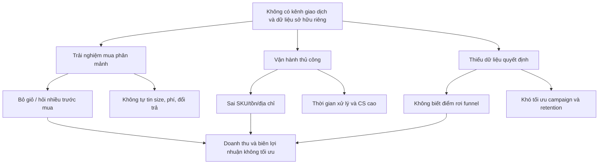
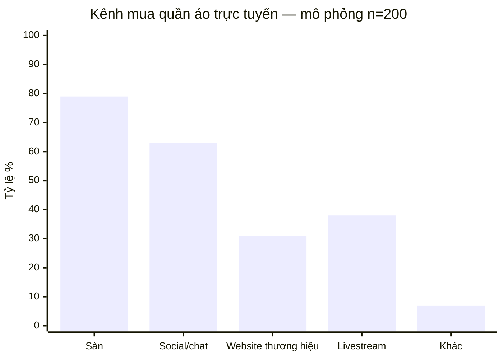

# Báo cáo tổng quan và cơ sở chọn đề tài — Website NÉT Fashion

**Phiên bản:** 2.0  
**Ngày cập nhật:** 02/09/2026  
**Người lập:** PM kiêm PO/BA  
**Trạng thái:** Hồ sơ đồ án — baseline đã hiện thực, chờ nghiệm thu

> **Tuyên bố bằng chứng:** Số liệu thị trường trong báo cáo có nguồn công khai. Số liệu khảo sát người dùng, phỏng vấn và tài chính là **mô phỏng phục vụ thiết kế đồ án**, vì chưa có nghiên cứu/doanh nghiệp thực tế được cung cấp. Những con số này không chứng minh nhu cầu hay hiệu quả kinh doanh. Các tuyên bố về chức năng đã xây dựng được đối chiếu với mã nguồn, migration và cấu hình trong repository.

## 1. Tóm tắt điều hành

Thị trường thương mại điện tử Việt Nam tiếp tục tăng trưởng nhanh. Báo Điện tử Chính phủ dẫn báo cáo thị trường cho biết quy mô thương mại điện tử năm 2025 đạt khoảng **32 tỷ USD**, chiếm gần **12%** tổng doanh thu bán lẻ và tăng trên **20%** so với năm 2024. Báo cáo e-Conomy SEA 2024 của Google, Temasek và Bain ước tính kinh tế số Việt Nam đạt **36 tỷ USD GMV**, với thương mại điện tử là động lực tăng trưởng chính.

Trong bối cảnh đó, đề tài lựa chọn bài toán website bán quần áo vì đây là miền có đủ độ phức tạp để vận dụng phân tích yêu cầu, thiết kế cơ sở dữ liệu, bảo mật, giao dịch đồng thời và triển khai phần mềm: sản phẩm có biến thể size/màu, tồn kho theo kho, voucher, tài khoản, thanh toán, đơn hàng và giao nhận có vòng đời liên kết nhưng độc lập.

Khảo sát mô phỏng 200 người mua quần áo trực tuyến cho thấy các vấn đề nổi bật là không chắc kích cỡ (68%), đổi trả khó/không rõ (54%), sản phẩm khác hình (59%), phí xuất hiện muộn (47%) và không biết size/màu còn hàng (46%). Các nhu cầu ưu tiên gồm hướng dẫn kích cỡ rõ (72%), tổng chi phí minh bạch (71%), chính sách đổi trả dễ hiểu (69%), ảnh thực tế (66%) và tồn kho theo biến thể (61%).

Trong 02 tháng, nhóm 05 người đã chọn kiến trúc modular monolith và xây baseline gồm React 19/Vinext/TypeScript, Java 21/Spring Boot 4.1.1, PostgreSQL 17, Redis 7 và hai Docker Compose stack. Dataset demo có 22 sản phẩm/58 biến thể. Phạm vi bao gồm auth đầy đủ, voucher, inventory đa kho, Customer 360° với sáu phân khúc hành vi, fulfillment tự tạo theo từng kho và NÉT AI Copilot rule-based chỉ đọc.

Kết quả được đánh giá theo ba lớp: (1) độ đầy đủ nghiệp vụ; (2) tính đúng của dữ liệu, phân quyền và trạng thái; (3) khả năng chạy lại bằng Docker và bộ kiểm thử. Khảo sát thật tối thiểu 120 người cùng 8–12 phỏng vấn vẫn là hướng bổ sung nếu muốn biến kết quả mô phỏng thành nghiên cứu thực nghiệm.

## 2. Tổng quan dự án

| Thuộc tính | Nội dung |
|---|---|
| Tên đồ án | NÉT Fashion — Website bán quần áo trực tuyến |
| Loại | Đồ án phân tích, thiết kế và xây dựng hệ thống thương mại điện tử B2C |
| Thị trường | Việt Nam, tiếng Việt, VND |
| Kênh | Responsive web, ưu tiên điện thoại |
| Sản phẩm | Quần áo theo sản phẩm–biến thể size/màu |
| Đội thực hiện | 05 người: PM, Frontend, Backend 1, Backend 2, DevOps |
| Thời gian | 02 tháng, tương đương 08 tuần/04 sprint |
| Công nghệ | React 19/Vinext/TypeScript; Java 21/Spring Boot 4.1.1; PostgreSQL 17; Redis 7; Docker Compose |
| Dữ liệu demo | 22 sản phẩm, 58 biến thể size/màu, nhiều kho và dữ liệu giao dịch mẫu |
| Phạm vi | Storefront, auth, cart/voucher, checkout/payment, account, admin catalog/order/inventory/customer/fulfillment, báo cáo và Copilot rule-based |
| Kết quả mong đợi | Hệ thống demo đầu-cuối, dữ liệu nhất quán, phân quyền đúng, chạy lại được và có tài liệu truy vết |

### 2.1 Phạm vi chức năng đã chọn

| Nhóm | Nội dung baseline |
|---|---|
| Người mua | Trang chủ/catalog/PDP, search/filter, wishlist, giỏ, voucher, checkout guest/member, tra cứu và lịch sử đơn |
| Danh tính | Đăng ký, xác minh email, đăng nhập, refresh token xoay vòng, đăng xuất, quên/đặt lại mật khẩu và RBAC |
| Tồn kho | Tồn theo SKU/kho, reservation, nhập, chuyển, kiểm kê, điều chỉnh, movement và audit |
| Khách hàng | Danh sách/chi tiết 360°, địa chỉ, thống kê và sáu nhóm `at_risk`, `vip`, `loyal`, `new`, `potential`, `prospect` |
| Giao nhận | Checkout nhóm dòng theo kho và tự tạo một fulfillment/kho; tracking, state machine, event log, optimistic version |
| Quản trị hỗ trợ | Copilot rule-based về tồn, đơn, doanh thu và promotion; chỉ đọc, không tự mutation |
| Triển khai | Hai Docker Compose stack cho frontend và backend/data; PostgreSQL 17, Redis 7, healthcheck và smoke test |

## 3. Bối cảnh thị trường

### 3.1 Quy mô và tăng trưởng

| Chỉ báo | Số liệu | Ý nghĩa với dự án | Nguồn |
|---|---:|---|---|
| Quy mô TMĐT Việt Nam 2025 | Khoảng 32 tỷ USD | Kênh trực tuyến đã là thị trường lớn, không còn chỉ là thử nghiệm | [Báo Điện tử Chính phủ](https://baochinhphu.vn/quy-mo-thi-truong-ban-le-viet-nam-dat-khoang-269-ty-usd-102251230111145424.htm) |
| Tỷ trọng TMĐT trong tổng bán lẻ 2025 | Gần 12% | Hành vi mua trực tuyến đã trở thành một phần đáng kể của bán lẻ | [Báo Điện tử Chính phủ](https://baochinhphu.vn/quy-mo-thi-truong-ban-le-viet-nam-dat-khoang-269-ty-usd-102251230111145424.htm) |
| Tăng trưởng TMĐT 2025 | Trên 20% | Cửa sổ tăng trưởng vẫn mở nhưng cạnh tranh tăng | [Báo Điện tử Chính phủ](https://baochinhphu.vn/quy-mo-thi-truong-ban-le-viet-nam-dat-khoang-269-ty-usd-102251230111145424.htm) |
| GMV kinh tế số Việt Nam 2024 | Khoảng 36 tỷ USD | Hệ sinh thái thanh toán, vận chuyển và tiêu dùng số đủ trưởng thành | [Google–Temasek–Bain](https://services.google.com/fh/files/misc/vietnam_e_conomy_sea_2024_report.pdf) |
| GMV TMĐT Việt Nam 2024 theo e-Conomy SEA | Khoảng 22 tỷ USD | TMĐT là động lực chính của kinh tế số Việt Nam | [Google–Temasek–Bain](https://services.google.com/fh/files/misc/vietnam_e_conomy_sea_2024_report.pdf) |
| GMV TMĐT Đông Nam Á 2024 | 159 tỷ USD | Cạnh tranh kênh, video commerce và retention mang tính khu vực | [Temasek](https://www.temasek.com.sg/en/news-and-resources/news-room/news/2024/-e-conomy-sea-2024-report--profitability-push-in-southeast-asia-) |
| Video commerce trong GMV TMĐT SEA 2024 | 20%, từ dưới 5% năm 2022 | Website cần phối hợp social/video, không hoạt động như kênh cô lập | [Temasek](https://www.temasek.com.sg/en/news-and-resources/news-room/news/2024/-e-conomy-sea-2024-report--profitability-push-in-southeast-asia-) |

Các nguồn dùng phương pháp/phạm vi khác nhau nên không so sánh trực tiếp từng con số như cùng một tập dữ liệu. Báo cáo dùng chúng để xác nhận xu hướng, không dùng để dự báo doanh thu riêng của cửa hàng.

### 3.2 Pháp lý và niềm tin

Luật Thương mại điện tử được Quốc hội thông qua ngày 10/12/2025 và có hiệu lực từ 01/07/2026 theo thông tin của Báo Điện tử Chính phủ. Dự án triển khai sau thời điểm hiệu lực nên cần Legal review về thông tin người bán, bảo vệ người tiêu dùng, dữ liệu, quảng cáo, hóa đơn/thuế và trách nhiệm liên quan; tài liệu này không phải tư vấn pháp lý. [Nguồn](https://baochinhphu.vn/luat-thuong-mai-dien-tu-lap-day-khoang-trong-phap-ly-cho-kinh-te-so-bao-ve-nguoi-tieu-dung-102260106142452861.htm)

## 4. Vấn đề nghiệp vụ và vấn đề nghiên cứu

### 4.1 Bối cảnh giả định dùng để hình thành đề tài

- Khách biết thương hiệu qua social nhưng phải nhắn tin để hỏi size, màu, phí giao và tồn.
- Nhân viên kiểm tra nhiều file/chat để xác nhận đơn; dễ sai SKU, địa chỉ và giá.
- Trạng thái payment, order, shipping và refund không có một nguồn sự thật chung.
- Marketing đo được lượt xem/tương tác nhưng khó nối đến doanh thu và mua lại.
- Doanh nghiệp phụ thuộc sàn về traffic, dữ liệu, chính sách và phí.

Các nhận định trên là kịch bản bài toán, không phải mô tả đã được một doanh nghiệp xác nhận. Chúng được dùng để xây tác nhân, use case và business rule; mức độ phổ biến phải được kiểm chứng bằng dữ liệu thực địa.

### 4.2 Cây vấn đề

### 4.3 Tuyên bố vấn đề của đồ án

Người mua cần một cách tự phục vụ để chọn đúng sản phẩm/biến thể, biết tổng chi phí và theo dõi đơn tin cậy; người vận hành cần một hệ thống thống nhất catalog–tồn–đơn–payment–customer–fulfillment. Đồ án nghiên cứu cách mô hình hóa các luồng này trong một hệ thống có phân quyền, bất biến dữ liệu và khả năng triển khai tái lập.

## 5. Nghiên cứu người dùng

### 5.1 Phương pháp đề xuất

| Phương pháp | Mẫu | Mục tiêu | Đầu ra |
|---|---:|---|---|
| Khảo sát định lượng | Tối thiểu 120, mục tiêu 200 | Đo tần suất, pain points, feature preference, payment/return behavior | Tỷ lệ, crosstab, segment |
| Phỏng vấn người mua | 8–12 người | Hiểu động cơ, ngôn ngữ, trust và context mua | Theme, quote, journey |
| Phỏng vấn nội bộ | 5 người | Map quy trình, lỗi, SLA, ngoại lệ | As-is process, business rules |
| Usability test | 5 người/vòng × 2 vòng | Đo task success và lỗi prototype | Findings và design changes |
| Phân tích dữ liệu hiện có | 3–6 tháng | Baseline traffic, order, cancel, CS, return | KPI baseline |

### 5.2 Kết quả khảo sát mô phỏng — n=200

> Đây là dữ liệu synthetic có logic nhất quán để hoàn thiện thiết kế báo cáo. Sai số thống kê không có ý nghĩa đối với dữ liệu mô phỏng. Khi có khảo sát thật, thay toàn bộ bảng và giữ nguyên cấu trúc phân tích.

#### Cơ cấu mẫu

| Thuộc tính | Cơ cấu |
|---|---|
| Tuổi | 18–24: 35%; 25–34: 40%; 35–44: 25% |
| Giới tính | Nữ: 60%; Nam: 37%; Khác/không trả lời: 3% |
| Khu vực | TP.HCM: 40%; Hà Nội: 30%; Đà Nẵng: 15%; đô thị khác: 15% |
| Điều kiện sàng lọc | Đã mua quần áo trực tuyến ít nhất một lần trong 6 tháng gần nhất |

#### Kênh mua trong 6 tháng — chọn nhiều

Website thương hiệu đang ít phổ biến hơn sàn/social trong dữ liệu mô phỏng, nhưng đây là khoảng trống để xây kênh sở hữu riêng, không phải bằng chứng rằng website tự tạo được traffic.

#### Vấn đề khi mua quần áo trực tuyến — chọn nhiều

| Vấn đề | Số người | Tỷ lệ |
|---|---:|---:|
| Không chắc size phù hợp | 136 | 68% |
| Sản phẩm thực tế khác ảnh/mô tả | 118 | 59% |
| Đổi trả khó hoặc không rõ | 108 | 54% |
| Phí giao/tổng tiền xuất hiện muộn | 94 | 47% |
| Không biết size/màu còn hàng | 92 | 46% |
| Theo dõi đơn không rõ | 70 | 35% |
| Lo ngại thanh toán trực tuyến | 52 | 26% |

#### Tính năng làm tăng tự tin mua — chọn nhiều

| Tính năng | Số người | Tỷ lệ | Hàm ý MVP |
|---|---:|---:|---|
| Hướng dẫn size/số đo rõ | 144 | 72% | Must trên PDP |
| Tổng chi phí minh bạch trước đặt | 142 | 71% | Must trong cart/checkout |
| Chính sách đổi trả dễ hiểu | 138 | 69% | Must gần PDP/checkout |
| Ảnh thật/nhiều góc/chất liệu | 132 | 66% | Content gate trước launch |
| Tồn kho theo size/màu | 122 | 61% | Must + concurrency đúng |
| COD | 114 | 57% | Must trong thị trường mục tiêu |
| Theo dõi đơn | 104 | 52% | Must |
| Guest checkout | 96 | 48% | Must |
| Thanh toán trực tuyến | 88 | 44% | Must nhưng có fallback COD |

#### Nguyên nhân bỏ checkout — chọn tối đa 3

| Nguyên nhân | Tỷ lệ |
|---|---:|
| Phí/tổng tiền bất ngờ | 55% |
| Form dài hoặc khó nhập | 42% |
| Thanh toán lỗi/không tin cậy | 38% |
| Trang chậm/lỗi | 36% |
| Bị bắt buộc tạo tài khoản | 31% |
| Mã giảm giá không rõ lỗi | 28% |

### 5.3 Phân tích chéo mô phỏng

| Quan sát | Nhóm A | Nhóm B | Hàm ý cần kiểm chứng thật |
|---|---:|---:|---|
| Dùng social/chat để mua | 18–24: 78% | 35–44: 42% | Social landing và mobile flow quan trọng với người trẻ |
| Lo size không phù hợp | Nữ: 74% | Nam: 56% | Size guide cần nghiên cứu theo category/segment |
| Ưu tiên online payment | Mua ≥2 lần/tháng: 61% | Mua ≤1 lần/2–3 tháng: 28% | Payment preference liên quan mức quen mua online |
| Bỏ vì ép tạo account | Người chưa mua website brand: 38% | Đã mua website brand: 21% | Guest checkout giảm friction cho first-time user |

Không suy luận quan hệ nhân quả hoặc significance từ crosstab mô phỏng.

## 6. Phỏng vấn mô phỏng và insight

### 6.1 Người mua — n=12 mô phỏng

| Theme | Số người đề cập | Insight | Cơ hội |
|---|---:|---|---|
| Size là rủi ro lớn nhất | 9/12 | S/M/L không đủ; muốn số đo cơ thể và phom/model | Size chart theo sản phẩm, model info, cách đo |
| Chỉ tin tổng tiền cuối | 8/12 | Voucher/ship xuất hiện muộn làm cảm giác bị “gài” | Estimate shipping sớm, order review rõ |
| Đổi trả tạo niềm tin | 8/12 | Chính sách khó tìm đồng nghĩa rủi ro cao | Link/policy summary ở PDP và checkout |
| Guest checkout | 7/12 | Không muốn tạo tài khoản trước lần mua đầu | Cho mua guest, mời tạo account sau purchase |
| Ảnh và chất liệu | 7/12 | Ảnh studio đẹp nhưng thiếu texture/phom thực | Ảnh chi tiết, video ngắn, mô tả chất liệu |
| Tracking | 6/12 | Muốn biết đơn đang ở đâu mà không nhắn shop | Timeline và notification |

### 6.2 Nội bộ — 5 vai trò mô phỏng

| Vai trò | Vấn đề hiện tại | Yêu cầu hệ thống |
|---|---|---|
| Chủ cửa hàng | Không có báo cáo funnel/lợi nhuận theo kênh | Dashboard/KPI và source attribution |
| Marketing | Khó nối campaign đến order | UTM, ecommerce events, coupon attribution |
| Vận hành kho | Tồn chat/file lệch, khó ưu tiên đơn | Reservation, movement, order queue, SLA |
| Chăm sóc khách hàng | Hỏi trạng thái/đổi trả lặp lại | Order lookup, notes, policy và audit |
| Tài chính | Payment/refund khó đối soát | Provider reference, reconciliation và refund state |

## 7. Chân dung và nhu cầu ưu tiên

| Persona | Nhu cầu chính | Thước đo thành công |
|---|---|---|
| Người mua nhanh trên mobile | Tìm SKU và checkout ít bước | Task completion, checkout time, conversion |
| Người mua cần tự tin size | Thông tin fit, ảnh, đổi trả | PDP→cart, return reason sai size |
| Khách quay lại | Dùng địa chỉ cũ, lịch sử và mua lại | Repeat purchase, checkout completion |
| Nhân viên vận hành | Queue, trạng thái, tồn và audit | Lead time, oversell, manual touch/order |

## 8. Phân tích và lựa chọn phương án kỹ thuật

### 8.1 Các phương án cho phạm vi đồ án

| Phương án | Mô tả | Giá trị học tập | Rủi ro trong 08 tuần |
|---|---|---|---|
| A — Chỉ làm giao diện tĩnh | Mock storefront/admin, dữ liệu hard-code | Thể hiện UI nhanh | Không chứng minh được transaction, auth, inventory hay fulfillment |
| B — Full-stack JavaScript đơn giản | Frontend/BFF và dữ liệu cùng một runtime | Giảm số công nghệ | Không đáp ứng yêu cầu học tập backend Java; ranh giới nghiệp vụ dễ mờ |
| C — Modular monolith Java + web React/Vinext | React/Vinext làm UI/BFF; Spring Boot làm nguồn nghiệp vụ; PostgreSQL/Redis; Docker | Bao phủ frontend, backend, dữ liệu, security và DevOps; vẫn triển khai như một khối | Khối lượng lớn, cần chia module/ownership rõ và giới hạn tích hợp ngoài |
| D — Microservices | Tách auth/catalog/order/inventory/fulfillment thành nhiều dịch vụ | Minh họa distributed system | Quá nhiều hạ tầng, consistency và observability cho nhóm 05 người |

### 8.2 Tiêu chí lựa chọn

| Tiêu chí | A | B | C | D |
|---|---|---|---|---|
| Hoàn thành đầu-cuối trong 08 tuần | Cao | Cao | Khả thi có kiểm soát | Thấp |
| Đáp ứng backend Java Spring Boot | Không | Không | Có | Có |
| Minh họa transaction/inventory/fulfillment | Không | Một phần | Đầy đủ trong một database | Đầy đủ nhưng phức tạp phân tán |
| Dễ chạy lại khi bảo vệ đồ án | Cao | Trung bình | Cao với Docker Compose | Thấp |
| Phù hợp nhóm 05 người | Có nhưng quá ít chiều sâu | Có | Có nếu phân công rõ | Không |

Đồ án chọn **phương án C**. Backend Java 21/Spring Boot 4.1.1 là write-authority cho nghiệp vụ; PostgreSQL 17 là nguồn dữ liệu; Redis 7 chỉ làm cache/rate limit; frontend React 19/Vinext gọi API qua BFF cùng origin. Kiến trúc modular monolith giữ transaction đơn giản hơn microservices nhưng vẫn tách module Auth, Catalog, Cart, Order, Payment, Inventory, Customer và Fulfillment để có thể phát triển tiếp.

### 8.3 Các quyết định giới hạn phạm vi

- Tích hợp payment/shipping production được thay bằng mô phỏng/sandbox hoặc thao tác quản trị thủ công.
- Một fulfillment được tạo cho mỗi kho; chia nhiều kiện trong cùng một kho là hướng mở rộng.
- Copilot dùng luật và snapshot có cấu trúc, không dùng LLM/ML và không có quyền ghi.
- Dataset 22 sản phẩm/58 biến thể đủ kiểm thử luồng nhưng không đại diện tải production.
- Hai Docker Compose stack ưu tiên khả năng tái tạo môi trường đồ án; HA/Kubernetes không thuộc phạm vi.

## 9. Mục tiêu và KPI

### 9.1 Mục tiêu dự án

1. Hoàn thành website bán quần áo đầu-cuối trong 02 tháng với nhóm 05 người.
2. Xây giao diện storefront/admin bằng React 19/Vinext và API nghiệp vụ bằng Java 21/Spring Boot 4.1.1.
3. Chuẩn hóa catalog–inventory–order–payment–customer–fulfillment trên PostgreSQL 17, dùng Redis 7 đúng vai trò hỗ trợ.
4. Minh họa auth đầy đủ, voucher, inventory đa kho, phân khúc sáu nhóm và fulfillment tự tạo theo kho.
5. Cung cấp Copilot rule-based chỉ đọc để minh họa AI hỗ trợ quản trị có kiểm soát.
6. Đóng gói bằng Docker, có cách chạy, healthcheck, smoke test và tài liệu truy vết.

### 9.2 KPI và cách đặt mục tiêu

| KPI | Định nghĩa | Baseline | Mục tiêu đề xuất | Thời điểm |
|---|---|---|---|---|
| Conversion rate | Orders/session đủ điều kiện | Chưa có | Baseline 4 tuần, sau đó +15% tương đối | 90 ngày |
| Checkout completion | Purchase/begin_checkout | Chưa có | ≥55% hoặc theo baseline thực tế | 90 ngày |
| PDP add-to-cart | Session ATC/session PDP | Chưa có | Theo category baseline; tăng 10% tương đối | 90 ngày |
| Hủy do hết hàng | Order hủy vì ATP | Chưa có | <0,5% order | 30–90 ngày |
| Payment success | Success/valid attempts | Chưa có | ≥95% không tính user cancel, tùy provider | 30 ngày |
| Order→ready-to-ship | Median thời gian | Chưa có | Giảm 30% so với quy trình cũ | 60 ngày |
| WISMO contacts | Hỏi trạng thái/shipped orders | Chưa có | Giảm 30% | 60 ngày |
| Repeat purchase 90d | Khách có ≥2 delivered orders | Chưa có | Đặt sau cohort đầu | 120 ngày |

Không đặt target tuyệt đối cho conversion/AOV nếu chưa có baseline traffic mix thật.

### 9.3 Tiêu chí đánh giá đồ án

| Mục tiêu | Chỉ báo nghiệm thu | Evidence |
|---|---|---|
| Catalog có chiều sâu | Đúng 22 sản phẩm/58 biến thể, lọc/chọn SKU hoạt động | Seed + API/UI test |
| Danh tính an toàn | Register, verify, login, refresh rotation, logout, forgot/reset và RBAC chạy đúng | Integration/negative test |
| Giao dịch nhất quán | Voucher/tổng tiền/order/payment/reservation idempotent theo thiết kế | Test + audit/history |
| Inventory đa kho | Receipt/transfer/stocktake/adjustment không phá bất biến `reserved ≤ on_hand` | Transaction test + movement ledger |
| Customer management | Customer 360°; mỗi khách thuộc đúng một trong 06 nhóm | View/rule test + admin UI |
| Fulfillment | Một fulfillment/kho, item/reservation đúng; state/event/version và order roll-up đúng | Migration + integration/UI test |
| AI có kiểm soát | Copilot trả dữ liệu từ snapshot và không tạo mutation | Engine test + UI warning |
| Khả năng chạy lại | Hai Docker Compose stack healthy và smoke test đạt trên môi trường sạch | Run log/how-to-run |

## 10. Mô hình nguồn lực và tài chính mô phỏng

Phần này là bài tập phân tích độ nhạy nếu hệ thống được đầu tư thật. Các con số không phải chi phí thực tế của sinh viên, không dùng để tính hiệu quả của baseline kỹ thuật và không được trình bày như ngân sách đã duyệt.

### 10.1 Chi phí đầu tư ban đầu

| Hạng mục | Giả định | Chi phí mô phỏng |
|---|---|---:|
| PM | 40 triệu/tháng × 2 | 80 triệu |
| Frontend | 35 triệu/tháng × 2 | 70 triệu |
| Backend 1 | 45 triệu/tháng × 2 | 90 triệu |
| Backend 2 | 45 triệu/tháng × 2 | 90 triệu |
| DevOps | 40 triệu/tháng × 2 | 80 triệu |
| Platform/infra/setup | License, domain, monitoring, email, provider setup | 60 triệu |
| Content/catalog readiness | Ảnh, nội dung, size chart, data cleaning | 40 triệu |
| Dự phòng 15% | Trên các khoản trước | 76,5 triệu |
| **Tổng đầu tư mô phỏng** | | **586,5 triệu VND** |

### 10.2 Chi phí vận hành tháng

Giả định 46 triệu/tháng: hạ tầng 8, email/monitoring 3, maintenance allocation 25, content/ops 10. Chưa gồm payment fee, shipping subsidy, media spend và thuế vì phụ thuộc volume/policy.

### 10.3 Kịch bản cơ sở 12 tháng

Giả định AOV 650.000 VND, contribution margin sau cost biến đổi 30%, một phần đơn chuyển từ marketplace tiết kiệm 8% commission-equivalent và có tiết kiệm vận hành. Đây chỉ là mô hình input.

| Giai đoạn | Đơn tăng thêm/tháng | Contribution | Tiết kiệm kênh | Tiết kiệm vận hành | Chi phí chạy | Lợi ích ròng/tháng |
|---|---:|---:|---:|---:|---:|---:|
| Tháng 1–3 | 150 | 29,25 triệu | 5,2 triệu | 10 triệu | 46 triệu | -1,55 triệu |
| Tháng 4–6 | 250 | 48,75 triệu | 10,4 triệu | 15 triệu | 46 triệu | 28,15 triệu |
| Tháng 7–12 | 350 | 68,25 triệu | 15,6 triệu | 20 triệu | 46 triệu | 57,85 triệu |

Lợi ích vận hành ròng năm đầu theo kịch bản ≈426,9 triệu VND, chưa bù hết đầu tư 586,5 triệu; payback sơ bộ khoảng tháng 15 nếu trạng thái tháng 7–12 duy trì. Kết quả nhạy mạnh với traffic, conversion, contribution margin và tỷ lệ đơn thật sự tăng thêm.

## 11. Rủi ro và phản biện

| Phản biện/rủi ro | Đánh giá | Cách xử lý |
|---|---|---|
| “Có website không có nghĩa có traffic” | Đúng | Có acquisition plan, social/SEO/campaign integration và CAC guardrail |
| Khảo sát mô phỏng không chứng minh nhu cầu thật | Đúng | Duy trì nhãn synthetic; chỉ dùng cho quyết định thiết kế và lập kế hoạch nghiên cứu thật |
| 8 tuần quá ngắn nếu mở rộng không kiểm soát | Cao | Modular monolith, chia module cho 2 BE, cố định baseline và đưa provider production ra ngoài phạm vi |
| Một FE phải làm cả storefront/admin/UX | Cao | Dùng design system/template, giới hạn custom, prototype sớm |
| Không có QA chuyên trách | Cao | Cross-review, automated gates, code freeze W7, business UAT |
| Chi phí sở hữu có thể cao hơn mô hình | Trung bình–cao | TCO sensitivity ±20–30%, vendor quotes và contingency |
| Dữ liệu/pháp lý/return policy chưa chốt | Cao | Owner/hạn W1–3, không go-live khi legal/content gate chưa đạt |
| Dùng từ “AI” khiến người đọc hiểu nhầm là LLM | Trung bình | Ghi rõ rule-based/read-only, công bố intent hỗ trợ và test không mutation |
| Nhầm nhóm khảo sát với phân khúc khách hàng | Trung bình | Tách demographic crosstab khỏi sáu segment tính từ giao dịch |
| Trạng thái order và fulfillment bị cập nhật từ hai nơi | Cao | Fulfillment là write-authority sau checkout; order chỉ nhận trạng thái tổng hợp |

## 12. Kết luận và điều kiện nghiệm thu đồ án

### 12.1 Được xem là hoàn thành baseline khi

- Storefront và admin dùng dữ liệu từ backend Java qua hợp đồng API hiện hành, không phụ thuộc mock cho luồng nghiệm thu chính.
- Dataset 22 sản phẩm/58 biến thể, auth, voucher, inventory đa kho, sáu segment và fulfillment theo kho chạy lại được từ migration/seed.
- Các bất biến tiền/tồn/trạng thái, RBAC, idempotency và optimistic concurrency có test hoặc evidence tương ứng.
- Hai Docker Compose stack khởi động frontend, backend, PostgreSQL 17 và Redis 7; healthcheck/smoke test không lỗi chặn.
- Tài liệu, sơ đồ, ERD, API, use case và RTM đồng bộ với code; mọi số liệu synthetic vẫn có nhãn.

### 12.2 Chưa được tuyên bố sẵn sàng production khi

- Chưa tích hợp/đối soát payment, shipping và email production.
- Chưa có kiểm thử tải, pentest độc lập, backup/restore và quan sát ở điều kiện production.
- Chưa có xác minh pháp lý/content/ảnh thực tế.
- Chưa thu thập nghiên cứu người dùng thật và chưa có KPI vận hành sau triển khai.
- Copilot vẫn là rule-based và không được mô tả như mô hình AI dự đoán/tạo sinh.

## 13. Kế hoạch bổ sung nghiên cứu thực địa trong 10 ngày làm việc

| Ngày | Hoạt động | Owner | Kết quả |
|---:|---|---|---|
| 1 | Chốt giả thuyết, segment, questionnaire | PM | Research brief |
| 2–5 | Thu ≥120 survey responses có quota | PM/Marketing | Raw data + quality log |
| 2–7 | Phỏng vấn 8 người mua + 5 stakeholder | PM/FE | Notes/themes/journey |
| 5–7 | Prototype luồng chính | FE | Clickable prototype |
| 8–9 | Usability test 5 người | PM/FE | Task metrics/findings |
| 10 | Synthesis, cập nhật yêu cầu và giới hạn kết luận | PM/nhóm | Research decision record |

Kế hoạch này chưa được thực hiện tại thời điểm phát hành tài liệu. Nếu không triển khai, báo cáo cuối phải tiếp tục dùng cụm “mô phỏng n=200” và không đưa chỉ số task success giả định vào phần kết quả.

## 14. Tài liệu liên quan

- [Báo cáo khảo sát mô phỏng và kế hoạch khảo sát thật](01-bao-cao-khao-sat.md)
- [Bảng câu hỏi khảo sát](02-bang-cau-hoi-khao-sat.md)
- [Hướng dẫn phỏng vấn](03-huong-dan-phong-van.md)
- [Phân tích đối thủ và khoảng trống](04-phan-tich-doi-thu.md)
- [Mô hình tài chính và sensitivity](05-mo-hinh-tai-chinh.md)
- [Danh mục nguồn và quy tắc sử dụng số liệu](06-nguon-du-lieu.md)
- [PRD](../product/02-prd.md)
- [Project Charter](../pm/01-project-charter.md)
