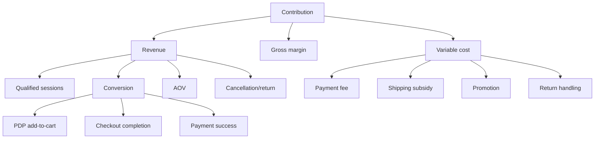

# Mô hình nguồn lực, tài chính mô phỏng và phân tích độ nhạy

**Phạm vi:** phụ lục phương pháp của đồ án 02 tháng, nhóm 05 người  

> Toàn bộ đơn giá, chi phí, doanh thu, AOV, biên lợi nhuận và payback trong tài liệu là **giả định mô phỏng**. Đây không phải chi phí đã phát sinh của nhóm, báo giá nhà cung cấp hoặc dự báo được doanh nghiệp phê duyệt.

## 1. Mục đích

Mô hình minh họa cách một đồ án phần mềm có thể đánh giá nguồn lực và độ nhạy kinh tế nếu được triển khai thật. Nó không dùng để chấm mức hoàn thành kỹ thuật và chỉ có giá trị đầu tư khi toàn bộ input được thay bằng payroll/vendor/order/channel data thật.

## 2. Công thức

```text
Doanh thu tăng thêm = Đơn tăng thêm × AOV
Contribution tăng thêm = Doanh thu tăng thêm × Contribution margin
Tiết kiệm kênh = Đơn chuyển kênh × AOV × Commission-equivalent rate
Lợi ích ròng tháng = Contribution + Tiết kiệm kênh + Tiết kiệm vận hành - Opex website
Payback = Tháng đầu tiên cumulative net benefit ≥ initial investment
```

Không đếm hai lần: đơn “chuyển kênh” không phải đơn tăng thêm; contribution của đơn chuyển kênh chỉ tính phần chênh margin nếu mô hình chi tiết.

## 3. Input cơ sở mô phỏng

| Input | Base | Low | High | Cần nguồn thật |
|---|---:|---:|---:|---|
| Initial investment | 586,5 triệu | 500 | 750 | Payroll/vendor quote |
| Monthly opex | 46 triệu | 35 | 65 | Infra/license/support |
| AOV | 650.000 | 500.000 | 800.000 | Order data |
| Contribution margin | 30% | 20% | 40% | COGS/ship/promo/payment |
| Incremental orders steady | 350/tháng | 180 | 550 | Traffic×conversion model |
| Shifted marketplace orders | 300/tháng | 100 | 450 | Attribution/cohort |
| Commission-equivalent | 8% | 5% | 12% | Contract/promo economics |
| Ops saving steady | 20 triệu/tháng | 5 | 35 | Time study × loaded cost |

Nhân sự mô phỏng tương ứng đúng cơ cấu đồ án: một PM, một Frontend, hai Backend và một DevOps trong 02 tháng. Không cộng thêm QA/BA/PO toàn thời gian; PM kiêm vai trò điều phối yêu cầu và nghiệm thu.

### 3.1 Baseline kỹ thuật dùng để ước lượng phạm vi

| Thành phần | Baseline đồ án | Ảnh hưởng tới mô hình |
|---|---|---|
| Frontend | React 19/Vinext/TypeScript | Một codebase cho storefront và admin; vẫn cần effort UX/a11y. |
| Backend | Java 21/Spring Boot 4.1.1 | Hai backend chia auth/catalog/order và inventory/fulfillment. |
| Data | PostgreSQL 17 + Redis 7 | Có chi phí vận hành/backup/monitoring nếu triển khai thật. |
| Đóng gói | Docker Compose | Giảm ma sát môi trường demo; không thay thế kiến trúc production HA. |
| Dataset | 22 sản phẩm/58 biến thể | Đủ demo luồng, không đại diện chi phí catalog lớn. |
| AI admin | Rule-based, chỉ đọc | Không phát sinh phí LLM trong baseline; không được gán lợi ích tự động hóa chưa đo. |

## 4. Funnel driver tree



## 5. Kịch bản 12 tháng

| Kịch bản | Investment | Steady net benefit/tháng | Payback sơ bộ | Nhận định |
|---|---:|---:|---:|---|
| Thấp | 750 triệu | 5–20 triệu | >30 tháng/có thể không đạt | Không khả thi nếu ngưỡng hoàn vốn <24 tháng |
| Cơ sở | 586,5 triệu | ~57,85 triệu từ tháng 7 | Khoảng tháng 15 | Chỉ xem xét khi input thật và leading metrics được đo |
| Cao | 500 triệu | 100–140 triệu | 6–9 tháng | Cần traffic/conversion/margin mạnh |

Payback không phải tiêu chí duy nhất: website còn tạo data/brand/retention option value, nhưng option value không được dùng để che một unit economics xấu.

## 6. Sensitivity hai biến — steady monthly contribution tăng thêm

Đơn vị: triệu VND; `orders × AOV × margin`.

| Đơn/tháng \ Margin | 20% | 30% | 40% |
|---:|---:|---:|---:|
| 180 | 23,4 | 35,1 | 46,8 |
| 350 | 45,5 | 68,25 | 91,0 |
| 550 | 71,5 | 107,25 | 143,0 |

Nếu AOV giảm từ 650k xuống 500k, contribution giảm 23%; nếu margin từ 30% xuống 20%, contribution giảm 33%. Vì vậy Finance phải xác nhận margin sau promotion/return, không dùng gross margin kế toán đơn giản.

## 7. Chi phí thường bị bỏ sót

- Ảnh/content/size chart và cập nhật catalog liên tục.
- Payment fee, refund fee, chargeback, COD failure.
- Shipping subsidy, return logistics, reship đổi size.
- Security/privacy/legal, monitoring, backup, incident support.
- License tăng theo GMV/order/API, email/SMS, search/CDN.
- Maintenance, dependency upgrade, provider change và data migration.
- Marketing/CAC để tạo traffic cho website riêng.

## 8. Benefits measurement plan

| Lợi ích | Baseline cần thu | Cách đo sau launch | Owner |
|---|---|---|---|
| Đơn tăng thêm | Orders/channel/cohort 3–6 tháng | Incrementality test/holdout khi có thể | PO/Marketing |
| Tiết kiệm commission | Fee thực theo channel | Same-order economics | Finance |
| Giảm manual work | Time study 30–50 orders | Touch time/order × loaded cost | Operations/PM |
| Giảm hủy hết hàng | Cancel reason chuẩn | Orders cancelled for stock | Operations |
| Giảm WISMO | Ticket/contact taxonomy | Contacts/shipped orders | CS |
| Tăng repeat | Customer identity/cohort | 60/90-day delivered repeat | PO |

## 9. Cổng đánh giá nếu chuyển từ đồ án sang triển khai thật

- Gate 1: Finance xác nhận input và không double-count benefit.
- Gate 2: MVP estimate/vendor quote nằm trong investment envelope ±10%.
- Gate 3: Sau 30 ngày, data quality/funnel hợp lệ trước tối ưu marketing.
- Gate 4: Sau 90 ngày, compare actual với scenario; pivot/scale/stop feature spend.

## 10. Tiêu chí không dùng mô hình sai mục đích

- Không đưa 586,5 triệu VND vào phần “chi phí thực tế của đồ án”.
- Không coi dataset seed, đơn test hoặc dashboard demo là doanh thu.
- Không gán khoản tiết kiệm cho Customer Segmentation, fulfillment hoặc Copilot nếu chưa đo quy trình trước/sau.
- Không cộng cả contribution của đơn tăng thêm và toàn bộ doanh thu của đơn chuyển kênh.
- Khi báo cáo học thuật cần nêu đây là ví dụ sensitivity; kết luận chính của đồ án dựa trên phạm vi, tính đúng, kiểm thử và khả năng triển khai.
