# 1. Cách đọc và phạm vi của báo cáo

Tài liệu nguồn là bài giảng **Project 1 - IT1.241.3: Phân tích hệ thống**, người trình bày Nguyễn Đức Dư, gồm 91 trang. Phần giao việc nằm ở **trang PDF 90**; trang 91 là lời cảm ơn. Báo cáo này phân tích mạch kiến thức của tài liệu, sau đó xây dựng một bộ mô hình cho **website bán quần áo trực tuyến NÉT** dựa trên dự án hiện có trong thư mục làm việc.

PDF không chứa đặc tả riêng của NÉT. Các ví dụ ATM, đăng nhập và vay vốn trong bài giảng được dùng để giải thích phương pháp; dữ liệu và quy tắc bán quần áo được đối chiếu với hồ sơ và mã nguồn NÉT. Vì vậy, tên thực thể, ca sử dụng, kiến trúc và công nghệ của NÉT là phần áp dụng, không được gán là nội dung có sẵn trong slide.

**Kết quả:** 17 biểu đồ gồm 3 use case, 5 sequence, 3 class, 3 activity, 1 component, 1 deployment và 1 package; kèm 16 nhóm ca sử dụng, 6 đặc tả trọng tâm, quy tắc nghiệp vụ, kiến trúc, công nghệ, ma trận truy vết và kế hoạch 2 tuần. Các biểu đồ trọng tâm tập trung vào đăng nhập, đặt hàng, giữ tồn, hủy đơn và giao nhiều kiện/COD. Bộ hình không thay thế đặc tả mọi màn hình và mọi API của sản phẩm.

**Cách vẽ theo tài liệu:** nền trắng, hình elip và lớp màu vàng nhạt, đường nối mảnh; sequence dùng biểu tượng tác nhân/biên/điều khiển/thực thể; class chia tên-thuộc tính-phương thức; activity dùng hành động bo tròn, nút quyết định và phân làn. Các hình là vector vẽ mới cho NÉT. Ba sơ đồ component/deployment/package được bổ sung theo yêu cầu trang 90 vì PDF không có ví dụ chi tiết cho chúng.

Số trang trích dẫn là thứ tự trang trong tệp PDF, tránh nhầm với số in cũ ở một số slide phần lớp. Mã UC01-UC16 là mã riêng của báo cáo này; không thay thế mã UC trong hồ sơ BA hiện hữu. Sơ đồ lớp và sequence dùng tên lớp ở mức phân tích; mã hiện tại dùng Controller/Service/JdbcClient nên không có một lớp Java trùng tên cho mọi thực thể.

Các trang hình dùng khổ ngang. Hai sơ đồ lớp lớn dùng khổ rộng hơn để giữ chữ dễ đọc. Có thể dùng ảnh PNG để chèn vào Word/slide hoặc chỉnh vector SVG trong công cụ đồ họa.

# 2. Phân tích chi tiết nội dung PDF
## 2.1. Bố cục và mạch kiến thức

| Trang PDF | Nội dung | Ý nghĩa đối với bài thực hành |
|---|---|---|
| 1-3 | Vị trí của phân tích hệ thống trong Project 1; nội dung bài giảng | Phân tích diễn ra sau xác định yêu cầu và tạo cơ sở cho triển khai, kiểm thử, báo cáo. |
| 4-7 | Khái niệm và ba hoạt động phân tích hệ thống | Thu thập yêu cầu, cấu trúc yêu cầu, đề xuất và chọn chiến lược thiết kế. |
| 8-10 | Hướng cấu trúc, hướng dữ liệu, hướng đối tượng, bản mẫu và Agile | Cần chọn cách mô hình hóa theo vấn đề và kết hợp khảo sát với phản hồi thực tế. |
| 11-17 | Tổng quan hướng đối tượng; đối tượng, lớp, ưu điểm | Đặt nền tảng cho việc tìm thực thể, thuộc tính, hành vi và tương tác. |
| 18-26 | Nguồn gốc, định nghĩa và đặc điểm UML | UML tạo ngôn ngữ giao tiếp chung giữa người dùng và nhóm phát triển. |
| 27-32 | Thành phần, các loại biểu đồ và sử dụng UML theo giai đoạn | Kết hợp góc nhìn cấu trúc với góc nhìn hành vi. |
| 33-45 | Mục đích, ký hiệu và cách xây dựng use case | Xác định phạm vi, tác nhân, mục tiêu sử dụng và quan hệ. |
| 46-51 | Ví dụ ATM và bảng mô tả kịch bản | Đi từ yêu cầu bằng lời đến biểu đồ và đặc tả luồng chính/phụ. |
| 52-59 | Biểu đồ tuần tự và ví dụ đăng nhập | Phân bổ từng bước xử lý cho các đối tượng tham gia. |
| 60-72 | Ký hiệu lớp và các quan hệ | Mô hình hóa dữ liệu, phương thức, bội số và mức sở hữu. |
| 73-82 | Tìm lớp, lọc lớp, thuộc tính, phương thức; ví dụ ATM và vay vốn | Chuyển yêu cầu nghiệp vụ thành cấu trúc lớp có trách nhiệm rõ. |
| 83-89 | Biểu đồ hoạt động và ví dụ thẩm định vay vốn | Thể hiện quy trình, điều kiện, song song và người chịu trách nhiệm. |
| 90-91 | Đầu việc học phần và kết thúc | Hoàn thiện bộ biểu đồ, kiến trúc, công nghệ trong hai tuần. |

## 2.2. Phân tích hệ thống và hướng đối tượng

Trang 4 nhấn mạnh phân tích tập trung vào nghiệp vụ, thủ tục xử lý và giao diện, độc lập với kỹ thuật cài đặt. Vì vậy, bước đầu cần trả lời hệ thống phải giải quyết vấn đề gì, người nào sử dụng, thông tin nào cần lưu và kết quả nào cần cung cấp. Chọn ngôn ngữ lập trình hoặc cơ sở dữ liệu quá sớm sẽ làm mô hình lệ thuộc vào công cụ trước khi yêu cầu được hiểu rõ.

Ba hoạt động tại trang 5-7 hình thành một chuỗi liên tục. Thu thập yêu cầu tìm hiểu chức năng hiện tại, cách thực hiện, dữ liệu đầu vào, báo cáo và cách con người làm việc. Cấu trúc yêu cầu biến thông tin rời rạc thành mô tả có ranh giới, quan hệ và điều kiện. Lựa chọn chiến lược thiết kế xem xét các phương án dựa trên tiêu chí đã thống nhất. Trong bài thực hành, đầu ra tương ứng là phạm vi hệ thống, danh sách yêu cầu và bộ mô hình có thể giải thích được.

Trang 8 phân biệt hướng cấu trúc lấy quá trình làm trung tâm, kỹ thuật thông tin ưu tiên mô hình dữ liệu và hướng đối tượng kết hợp dữ liệu với xử lý. Trang 9 bổ sung bản mẫu tìm hiểu và kỹ thuật đảo ngược. Giá trị thực hành là có thể dùng một giao diện mẫu để làm rõ yêu cầu rồi cập nhật mô hình, thay vì coi yêu cầu ban đầu là bất biến.

Đối tượng ở trang 13 được mô tả qua định danh, trạng thái và hành vi. Ví dụ, hai tài khoản cùng số dư vẫn là hai đối tượng nếu có định danh khác nhau; số dư là trạng thái, còn ghi nợ là hành vi. Lớp ở trang 15 khái quát nhóm đối tượng có đặc điểm chung. Khi phân tích cần phân biệt loại đối tượng với một cá thể, đồng thời xác định hành vi thuộc trách nhiệm của ai. Việc tập hợp các danh từ thành bảng dữ liệu mới giải quyết một phần bài toán hướng đối tượng.

Trang 17 nêu tái sử dụng, mô hình hóa trực quan và khả năng xử lý hệ thống lớn. Những lợi ích này là mục tiêu thiết kế, không phải kết quả tự động chỉ vì dùng lớp. Chúng phụ thuộc vào ranh giới trách nhiệm và mức phụ thuộc giữa các phần của hệ thống.

## 2.3. Vai trò của UML và liên kết giữa các biểu đồ

Trang 18-22 giới thiệu sự hình thành UML; trang 21 xác định các mục đích đặc tả, trực quan hóa, xây dựng và lập tài liệu. Trang 23-26 nhấn mạnh chia nhỏ vấn đề và thống nhất cách hiểu. Bài học cốt lõi là hình vẽ phải diễn đạt một ý nghĩa rõ, để người đọc có thể kiểm tra mô hình cùng người phân tích.

Trang 28 liệt kê các biểu đồ; trang 29-30 phân biệt cấu trúc tĩnh và hành vi động. Trang 31 giải thích phần tử mô hình và quan hệ. Một lớp xuất hiện trong nhiều góc nhìn vẫn phải mang cùng ý nghĩa. Nếu tên “Tài khoản” dùng cho tài khoản ngân hàng ở biểu đồ lớp nhưng lại dùng cho thông tin đăng nhập ở biểu đồ tuần tự, cần đổi tên hoặc định nghĩa rõ để tránh hiểu nhầm.

Trang 32 gắn UML với vòng đời phát triển. Use case và activity hỗ trợ xác định yêu cầu; class thể hiện cấu trúc; sequence mô tả tương tác; component và deployment phục vụ thiết kế. Chuỗi kiểm tra hữu ích là: mỗi yêu cầu chức năng có ca sử dụng tương ứng; mỗi ca quan trọng có kịch bản; bước trong kịch bản xuất hiện trong sequence hoặc activity; đối tượng nhận thông điệp có trách nhiệm tương ứng trong thiết kế; các lớp và dịch vụ thuộc những thành phần có thể triển khai. Yêu cầu chất lượng được truy vết sang ràng buộc, kiến trúc và kiểm thử.

## 2.4. Biểu đồ ca sử dụng: trang 33-51

Use case trả lời hai câu hỏi: ai tương tác và hệ thống cung cấp kết quả gì cho họ. Actor tại trang 36-37 có thể là người hoặc hệ thống khác. Cần xác định actor theo vai trò đối với phạm vi đang xét. Chẳng hạn, cùng một người có thể vừa là khách hàng vừa là nhân viên, nhưng hai vai trò này có mục tiêu và quyền khác nhau.

Ca sử dụng ở trang 38-39 là chuỗi hành động tạo kết quả quan sát được. Tên nên diễn đạt một mục tiêu như “Rút tiền”, “Cập nhật giấy đề nghị vay vốn”. Những thao tác như mở hộp thoại hoặc bấm nút thường thuộc kịch bản, không nhất thiết trở thành mục tiêu độc lập trên biểu đồ.

Trang 40-44 trình bày bốn quan hệ. Association nối tác nhân với ca họ tham gia. Include chỉ phần xử lý được sử dụng bắt buộc trong ca bao hàm; mũi tên hướng đến ca được bao hàm. Extend hướng từ ca bổ sung đến ca gốc. Generalization hướng bằng tam giác rỗng đến actor hoặc use case tổng quát hơn. Khi chọn quan hệ, phải giải thích ý nghĩa nghiệp vụ, tránh thêm include/extend chỉ để tăng số lượng đường nối.

Ví dụ ATM ở trang 46 yêu cầu đăng ký dịch vụ tại ngân hàng, gửi tiền, rút tiền, kiểm tra số dư, xác thực PIN và in kết quả. Riêng rút tiền cần kiểm tra số dư và xử lý yêu cầu vượt số tiền có trong tài khoản. Đây là phạm vi minh họa có thể dùng để dựng một bài mẫu nhất quán, nhưng chưa quy định đầy đủ hạn mức, mệnh giá, số lần nhập PIN sai, tiền còn trong máy hoặc xử lý lỗi thiết bị. Nếu bổ sung các trường hợp đó phải ghi là giả định thiết kế.

Trang 49-51 cung cấp mẫu bảng đặc tả gồm tên ca, tác nhân, điều kiện đầu vào, luồng chính, luồng phụ và kết quả. Bảng này quan trọng ngang hình vẽ vì đường nối không nói rõ thứ tự và trường hợp thất bại. Bản thực hành nên đánh số bước, nêu chính xác điều kiện chuyển sang nhánh lỗi và mô tả trạng thái sau khi thành công hoặc thất bại.

Hai bảng đăng ký và đăng nhập có nhãn tác nhân “Nhân viên” nhưng một số câu lại nói “khách hàng”. Đây là chỗ cần thống nhất khi chuyển thành bài thực hành. Bảng cập nhật giấy đề nghị vay vốn thuộc một quy trình khác, có nhân viên tín dụng và điều kiện đã đăng nhập; không phải phần tiếp nối mặc định của ví dụ ATM.

## 2.5. Biểu đồ tuần tự: trang 52-59

Sequence giải thích một kịch bản được các đối tượng phối hợp thực hiện như thế nào. Trang 52 nhấn mạnh thứ tự tương tác. Trang 53-56 dùng cách tổ chức tác nhân, lớp biên, lớp điều khiển và lớp thực thể. Lớp biên tiếp nhận thao tác, lớp điều khiển phối hợp nghiệp vụ, lớp thực thể biểu diễn thông tin cần quản lý. Đây là cách phân bổ trách nhiệm phù hợp để bám theo phong cách bài giảng.

Trang 57 phân biệt thông điệp đồng bộ, không đồng bộ và trả về. Khi gọi đồng bộ, bên gửi chờ kết quả; khi gửi không đồng bộ, bên gửi tiếp tục hoạt động. Không nên biến mọi đường giao tiếp thành cùng một kiểu mũi tên nếu cần thể hiện sự khác biệt này.

Quy trình tại trang 58 bắt đầu từ kịch bản use case, tìm đối tượng và xác định thông điệp. Trục ngang sắp xếp các bên tham gia; trục dọc thể hiện thứ tự từ trên xuống. Với đăng nhập ở trang 59, hình cần có yêu cầu nhập thông tin, gửi dữ liệu, kiểm tra tài khoản và trả kết quả. Để đặc tả đầy đủ, nên phân biệt thành công với sai thông tin và chỉ tạo trạng thái đăng nhập khi kiểm tra thành công.

Một sequence tốt phải cho biết ai chịu trách nhiệm cho mỗi bước. Không nên để actor gửi trực tiếp yêu cầu đọc dữ liệu đến lớp thực thể trong khi đã chọn mẫu biên-điều khiển-thực thể. Đồng thời, cách tổ chức của bài giảng cần được hiểu là quy ước thiết kế đang áp dụng, không phải điều kiện bắt buộc cho mọi phần mềm dùng UML.

## 2.6. Biểu đồ lớp: trang 60-82

Trang 60-62 trình bày lớp bằng hình chữ nhật ba ngăn: tên, thuộc tính và phương thức. Tên lớp diễn tả khái niệm; thuộc tính biểu diễn thông tin; phương thức biểu diễn hành vi. Có thể dùng ký hiệu phạm vi truy cập và kiểu dữ liệu để bản vẽ rõ hơn. Tuy nhiên, biểu đồ lớp phân tích cần giữ trọng tâm nghiệp vụ; không cần liệt kê toàn bộ getter/setter hoặc chi tiết thư viện.

Trang 63-72 giới thiệu các quan hệ. Association biểu diễn liên hệ giữa các đối tượng; bội số cho biết số lượng được phép ở mỗi đầu. Các giá trị 1, 0..1, 0..*, 1..* phải có căn cứ trong yêu cầu. Chẳng hạn, “mỗi khách hàng có đúng một tài khoản” và “mỗi khách hàng có nhiều tài khoản” tạo ra hai thiết kế khác nhau, không thể tự chọn chỉ vì hình vẽ dễ bố trí.

Aggregation biểu diễn toàn thể-bộ phận bằng hình thoi rỗng; composition dùng hình thoi đặc để thể hiện sở hữu mạnh. Bài giảng minh họa công ty-nhân viên và công ty-mã số thuế. Đây là bài tập suy luận theo giả thiết đã cho; khi làm hệ thống thật phải khảo sát vòng đời dữ liệu. Không nên suy ra rằng xóa một khách hàng phải xóa cả lịch sử giao dịch, vì yêu cầu lưu trữ có thể cần bảo tồn lịch sử.

Dependency có mũi tên nét đứt hướng đến phần được sử dụng. Generalization phù hợp khi có quan hệ khái quát-chuyên biệt. Việc có thuộc tính trùng tên chưa đủ để kết luận cần kế thừa; cần xem lớp con có giữ được ý nghĩa và trách nhiệm của lớp cha hay không.

Trang 73-78 hướng dẫn tìm lớp từ danh từ trong yêu cầu, biểu mẫu, kịch bản, hệ thống tương tự và chuyên gia. Sau đó loại lớp trùng, ngoài phạm vi hoặc không rõ trách nhiệm. Danh từ là đầu mối tìm kiếm, không phải quy tắc “mỗi danh từ là một lớp”. Một thông tin có thể phù hợp hơn khi làm thuộc tính, vai trò hoặc kiểu dữ liệu.

Trang 76 tìm thuộc tính từ thông tin thực sự cần quản lý. Trang 77 tìm phương thức từ động từ và thông điệp trong sequence. Đây là điểm nối quan trọng: nếu sequence gọi kiểm tra hợp lệ, ghi nợ hoặc lưu hồ sơ, mô hình thiết kế phải thể hiện nơi thực hiện các trách nhiệm đó.

Trang 79 đề xuất các lớp ATM gồm khách hàng, tài khoản, thẻ, giao dịch, ngân hàng và máy ATM. Chính slide cũng nói ngân hàng chỉ trở thành đối tượng cần quản lý khi phạm vi có nhiều ngân hàng. Trang 80-82 chuyển sang mô hình nhận và thẩm định hồ sơ vay vốn mua ô tô, kèm chi tiết giấy đề nghị vay vốn. Hai ví dụ giúp học cách tìm lớp ở các ngữ cảnh khác nhau; chúng không tạo thành một sơ đồ lớp chung mặc định.

## 2.7. Biểu đồ hoạt động: trang 83-89

Activity mô tả dòng nghiệp vụ gồm tuần tự, điều kiện và song song. Trang 84-87 giới thiệu điểm đầu, điểm cuối, hành động, luồng, nút quyết định, thanh đồng bộ và phân tuyến trách nhiệm. Trang 88 yêu cầu xuất phát từ bản mô tả các bước thực hiện. Trang 89 minh họa quy trình nhận và thẩm định hồ sơ vay vốn mua ô tô.

Điểm cần thể hiện rõ là người thực hiện và điều kiện chuyển bước. Phân tuyến giúp thấy hồ sơ đang ở khách hàng, nhân viên tiếp nhận hay bộ phận thẩm định. Nút quyết định cần nhãn điều kiện đủ cụ thể, chẳng hạn “[hồ sơ đầy đủ]” và “[hồ sơ thiếu]”. Nhánh sai phải đi đến sửa đổi, bổ sung, từ chối hoặc kết thúc có nghĩa.

Phải phân biệt chọn một nhánh với thực hiện nhiều nhánh song song. Decision phù hợp cho kết quả đạt/không đạt; fork phù hợp khi hai công việc cùng được khởi động. Join chỉ được sử dụng khi bước sau cần đợi các nhánh liên quan hoàn tất. Một lỗi thường gặp là dùng thanh đồng bộ để ghép hai nhánh loại trừ nhau, khiến ý nghĩa trở thành chờ một nhánh không bao giờ chạy.

## 2.8. Những điểm cần đọc thận trọng

Một số phát biểu được giản lược để giảng dạy. Trang 8 mô tả phân tích hướng cấu trúc lấy quá trình làm trung tâm, trong khi trang 12 lại nói phương pháp hướng cấu trúc “chỉ tập trung vào dữ liệu”; hai câu không nhất quán. Trang 15 ghi “2 yếu tố” nhưng liệt kê ba nội dung. Trang 28 trộn tên biểu đồ thuộc nhiều giai đoạn phát triển UML; không nên lấy danh sách này làm bảng phân loại duy nhất.

Ví dụ extend ở trang 43 dễ bị hiểu thành một dạng kế thừa. Extend thực chất bổ sung hành vi tại điểm mở rộng; ca gốc có nghĩa độc lập. Cần phân biệt với generalization. [Tài liệu chính thức Enterprise Architect về Extend](https://sparxsystems.com/enterprise_architect_user_guide/17.1/modeling_languages/extend.html).

Các câu về aggregation/composition ở trang 68-70 không nên đọc thành quy tắc luôn sinh cùng lúc. Sở hữu tại một thời điểm và trách nhiệm vòng đời mới là điểm cần làm rõ. [Đặc tả UML của OMG, phần Property](https://www.omg.org/spec/UML/2.5/PDF).

Trang 84 quy ước một điểm bắt đầu phù hợp bài tập này; UML cho phép nhiều initial node. Khi bám slide, dùng một điểm đầu giúp luồng đơn giản, nhưng không gọi đó là giới hạn tuyệt đối của UML. [Đặc tả UML do OMG công bố, phần InitialNode](https://www.omg.org/spec/UML/ISO/19505-2/PDF).

## 2.9. Diễn giải nhiệm vụ ở trang 90

| Nội dung phải hoàn thành | Bằng chứng cần có trong bài nộp |
|---|---|
| Use Case Diagram | Ranh giới hệ thống; tác nhân; mục tiêu sử dụng; quan hệ có giải thích; kịch bản cho các ca quan trọng. |
| Sequence Diagram | Các đối tượng và thông điệp bám kịch bản; luồng thành công và thất bại; thứ tự rõ ràng. |
| Class Diagram | Tên lớp, thuộc tính, phương thức, quan hệ, bội số; đối chiếu với dữ liệu và tương tác. |
| Activity Diagram | Quy trình, phân tuyến, điều kiện, điểm kết thúc; song song chỉ khi nghiệp vụ có yêu cầu. |
| Component Diagram | Các thành phần phần mềm, trách nhiệm, giao diện và phụ thuộc. |
| Deployment Diagram | Các nút chạy hệ thống, môi trường thực thi, phần mềm triển khai và kết nối. |
| Package Diagram | Các gói tổ chức mô hình hoặc mã nguồn và chiều phụ thuộc giữa chúng. |
| Kiến trúc hệ thống | Giải thích cách chia lớp/tầng/thành phần, đường đi của một yêu cầu và nơi lưu dữ liệu. |
| Công nghệ/kỹ thuật | Nêu lựa chọn và lý do phù hợp với phạm vi, kiến trúc, thời gian, khả năng triển khai. |
| Thời gian hai tuần | Kế hoạch cho phân tích, dựng hình, rà soát tính nhất quán và hoàn thiện báo cáo. |

Dấu “/” trong Component/Deployment/Package Diagram chưa giải thích đây là lựa chọn thay thế hay cả ba. Vì người dùng yêu cầu đầy đủ ba loại, bài thực hành nên cung cấp cả ba và phân biệt rõ phần mềm gồm gì, chạy ở đâu và được tổ chức thế nào. Nội dung kiến trúc và công nghệ cần được bổ sung riêng: chỉ có các hình UML chưa hoàn tất toàn bộ đầu việc ở trang 90.

# 3. Phạm vi và yêu cầu hệ thống NÉT

## 3.1. Bài toán cần giải quyết

NÉT cho phép khách tìm quần áo, chọn màu/size, quản lý giỏ và đặt hàng; phía cửa hàng quản lý catalog, hàng tồn theo kho, đơn, kiện giao và khách hàng. Mục tiêu phân tích là làm rõ việc chọn đúng biến thể, tính giá đáng tin cậy, không giữ/xuất hàng lặp, lưu lịch sử và giới hạn thao tác theo quyền.

Mô hình chính dùng thanh toán COD và vận chuyển cập nhật thủ công. Nhánh online là mô phỏng có hỗ trợ webhook kiểm thử, chưa phải cổng thanh toán thương mại thật. Website có thể nhận khách vãng lai; không được đặt Đăng nhập thành bước bắt buộc của mọi giao dịch mua.

## 3.2. Tác nhân và quyền

| Tác nhân | Mục tiêu và quyền | Điểm cần phân biệt |
|---|---|---|
| Người mua | Duyệt, chọn hàng, giỏ, đặt và tra cứu đơn | Actor khái quát của khách vãng lai và thành viên |
| Khách vãng lai | Mua không đăng nhập; tra cứu đơn bằng token được cấp khi đặt | Không được xem toàn bộ đơn của người khác |
| Thành viên | Mua hàng; xem đơn thuộc tài khoản, hồ sơ và địa chỉ | Quan hệ với Người mua là tổng quát hóa actor |
| Staff | Vận hành đơn, tồn kho nghiệp vụ, kiện và khách | Không có mọi quyền quản trị catalog/báo cáo |
| Manager | Thêm quản lý catalog, promotion, điều chỉnh tồn, báo cáo | Quyền kiểm tra tại backend |
| Admin | Các chức năng quản lý và trạng thái tài khoản khách | UC16 dành cho Admin; không suy ra có UI cấp vai trò tổng quát |

“Nhân viên cửa hàng” ở UC-D02 là cách gom các vai trò nội bộ để đọc tổng quan. Bảng này quy định quyền thực tế. Cơ sở dữ liệu, Redis, BFF và dịch vụ tồn kho nằm trong hệ thống, không là actor của use case. Đơn vị vận chuyển tham gia quy trình vật lý; người nhập trạng thái vào NÉT là nhân viên.

## 3.3. Danh mục 16 nhóm ca sử dụng

| Mã | Ca sử dụng | Tác nhân / kết quả |
|---|---|---|
| UC01 | Xem, tìm và lọc sản phẩm | Người mua tìm đúng mẫu và biến thể |
| UC02 | Đăng ký và xác minh tài khoản | Người mua tạo tài khoản có thể đăng nhập |
| UC03 | Đăng nhập | Thành viên/nhân sự nhận phiên và quyền phù hợp |
| UC04 | Quản lý giỏ hàng | Người mua thêm/sửa/xóa dòng, chưa giữ tồn |
| UC05 | Áp mã giảm giá | Người mua nhận tổng tiền sau kiểm tra voucher |
| UC06 | Đặt hàng | Khách/thành viên tạo đơn, giữ hàng, sinh kiện theo kho |
| UC07 | Tra cứu đơn | Thành viên theo sở hữu; guest dùng token đúng đơn |
| UC08 | Quản lý sản phẩm và khuyến mãi | Manager/Admin cập nhật catalog/promotion |
| UC09 | Quản lý tồn kho | Staff/Manager/Admin ghi chứng từ nhập/chuyển/kiểm kê; điều chỉnh cần Manager/Admin |
| UC10 | Xử lý đơn hàng | Nhân sự theo dõi và chuyển trạng thái hợp lệ |
| UC11 | Hủy đơn hàng | Nhân sự hủy toàn đơn trước xuất, chưa thu tiền |
| UC12 | Quản lý giao hàng | Kiện được sinh ở UC06; nhân viên cập nhật theo từng kho |
| UC13 | Ghi nhận kết quả COD | Hệ thống xử lý trong UC12 khi mọi kiện đã giao |
| UC14 | Quản lý khách hàng | Nhân sự tra cứu hồ sơ, phân khúc theo luật |
| UC15 | Xem báo cáo | Manager/Admin xem báo cáo vận hành/tài chính |
| UC16 | Quản lý trạng thái tài khoản | Admin bật/tắt tài khoản theo điều kiện và lưu audit |

Đây là các nhóm mục tiêu; mỗi nhóm có thể phân rã tiếp khi thiết kế chi tiết. Hồ sơ, địa chỉ và yêu thích thuộc phạm vi tài khoản thành viên hiện có; không được hiểu bảng 16 nhóm là danh sách endpoint đầy đủ. UC13 là xử lý nội bộ do hành động giao hàng khởi phát, không phải một nút “thu COD” độc lập.

## 3.4. Quy tắc nghiệp vụ làm nền cho mọi biểu đồ

| Mã | Quy tắc | Hệ quả đối với mô hình |
|---|---|---|
| R01 | SKU xác định một màu/size cụ thể; quantity sau gom theo SKU từ 1 đến 10 trong checkout hiện tại | Giỏ và dòng đơn liên kết biến thể |
| R02 | available = on_hand - reserved; thêm giỏ không giữ tồn | Giữ tồn ở checkout; không ở UC04 |
| R03 | Một SKU của đơn phải được một kho cấp đủ; các SKU khác nhau có thể từ nhiều kho | Mỗi kho cấp hàng sinh một phiếu giao |
| R04 | Máy chủ tính lại giá, phí và voucher; lưu bản chụp tại thời điểm mua | DongDonHang lưu giá/SKU/tên, DonHang lưu người nhận |
| R05 | Cùng idempotencyKey trong cùng phạm vi trả kết quả đã có | Không tạo đơn, kiện hoặc giữ tồn lần hai |
| R06 | Giữ tồn tăng reserved; shipped mới giảm cả on_hand và reserved | TonKho và GiuTon tách trách nhiệm số dư/lượt giữ |
| R07 | Hủy toàn đơn trước xuất chỉ giảm reserved, không tăng on_hand | Hủy đơn, mọi kiện, payment chưa thu và lịch sử phải đồng bộ |
| R08 | COD mới: order confirmed / payment_status cod_pending; payment row pending | Trạng thái đơn khác trạng thái thanh toán |
| R09 | Mọi kiện delivered mới ghi order paid và payment succeeded | Giao một kiện không hoàn tất cả đơn |
| R10 | Returned không tự cộng tồn hoặc tự hoàn tiền | Kiểm định ngoài hệ thống; receipt riêng nếu hàng bán lại được |
| R11 | Guest token chỉ dùng đúng đơn; member phải sở hữu đơn | Kiểm tra quyền ở server, không chỉ ẩn nút UI |
| R12 | Cập nhật tồn/trạng thái dùng giao dịch, khóa và kiểm version phù hợp | Rollback không để đơn hoặc giữ tồn dở dang |

Safety stock có trong chỉ số ATP ở trang quản trị nhưng checkout hiện dùng available, chưa trừ safety stock. Không vẽ quy tắc bảo vệ safety stock như chức năng checkout đã hoàn thiện. Các lỗ hổng hiện trạng liên quan hết hạn giữ hàng và payment được tách riêng ở phần kiểm tra.

## 3.5. Yêu cầu chất lượng và tiêu chí nghiệm thu

Yêu cầu cần kiểm chứng gồm tính nhất quán đơn-tồn-thanh toán, bảo vệ dữ liệu tài khoản/đơn, thao tác có quyền, truy vết biến động và khả năng triển khai lặp lại. Không suy ra từ biểu đồ rằng hệ thống đã đạt một ngưỡng tải cụ thể. Chỉ tiêu số lượng người dùng đồng thời hoặc thời gian đáp ứng phải được chốt và đo riêng trong giai đoạn kiểm thử.

Ví dụ nghiệm thu quan trọng: hai người đặt SKU cuối cùng không cùng giữ thành công; gửi lặp một yêu cầu không phát sinh đơn thứ hai; hủy trước xuất không tăng hàng vật lý; giao 1/2 kiện không đánh dấu COD đã thu; tài khoản khác không đọc được đơn không thuộc mình.

# 4. Use case diagram và đặc tả kịch bản

## 4.1. Cách xác định và đọc biểu đồ

Theo trang 37-45, bắt đầu từ tác nhân và mục tiêu sử dụng, sau đó đặt use case trong ranh giới NÉT. Đường liền nối người dùng với chức năng; đường đứt include/extend chỉ dùng khi có ý nghĩa nghiệp vụ rõ. UC06 include kiểm thông tin, tính tổng và giữ tồn vì luôn cần; UC05 extend UC06 tại bước nhập ưu đãi vì khách có thể không dùng mã.

Đăng nhập được biểu diễn độc lập. Với tác vụ nội bộ, đã đăng nhập và có quyền là tiền điều kiện; không cần vẽ lại include Đăng nhập cho từng ellipse. Xem lịch sử đơn thành viên là phần chuyên biệt của UC07. Các đường của UC-D02 không thay thế ma trận phân quyền.

Sáu bảng đặc tả ở mục 4.2-4.7 trình bày theo mẫu slide 49-50: **Tên ca sử dụng, Tác nhân, Điều kiện đầu vào, Các luồng sự kiện, Kết quả trả về**. Trong hàng Các luồng sự kiện, tách luồng chính và luồng phụ; các nhánh ghi **Luồng 1, Luồng 2...**, có dẫn chiếu từ bước chính. Mẫu trong slide minh họa Đăng ký/Đăng nhập; nội dung các bảng dưới đây áp dụng cho NÉT.

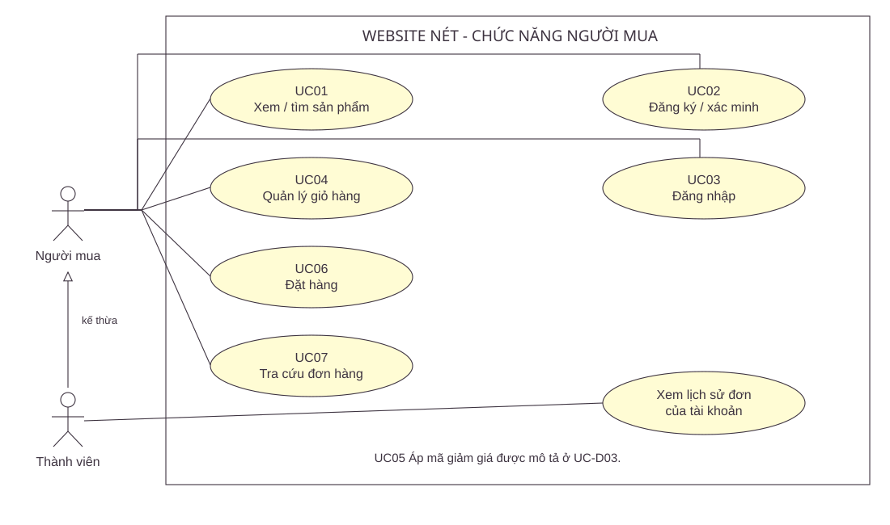

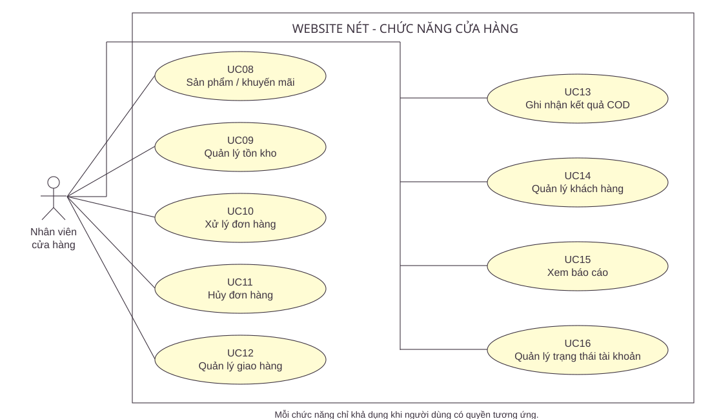

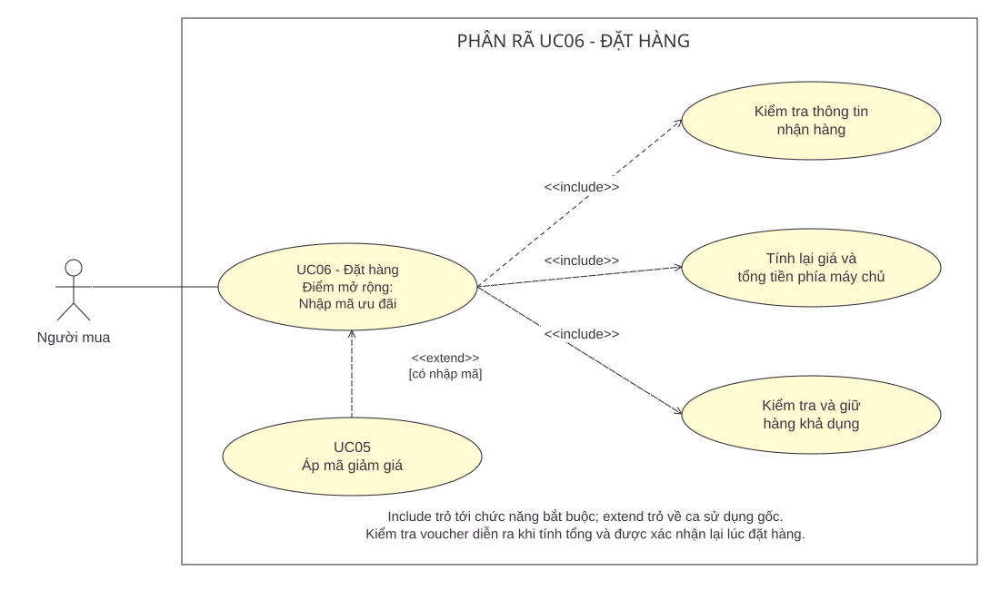

## 4.2. UC03 - Đăng nhập

| Mục mô tả | Nội dung |
|---|---|
| Tên ca sử dụng | UC03 - Đăng nhập |
| Tác nhân | Thành viên hoặc nhân sự cửa hàng có tài khoản. |
| Điều kiện đầu vào | Chức năng đăng nhập khả dụng; người dùng chưa có phiên đăng nhập hợp lệ. Tài khoản, mật khẩu và quyền được kiểm tra trong quá trình xử lý. |
| Các luồng sự kiện | **Luồng sự kiện chính:** 1. Người dùng chọn chức năng Đăng nhập. 2. Hệ thống hiển thị biểu mẫu yêu cầu email và mật khẩu. 3. Người dùng nhập thông tin và gửi yêu cầu. Nếu thiếu hoặc sai định dạng, thực hiện luồng phụ 1. 4. Hệ thống kiểm tra giới hạn số lần đăng nhập. Nếu vượt giới hạn, thực hiện luồng phụ 2. 5. Hệ thống kiểm tra email và mật khẩu. Nếu không khớp, thực hiện luồng phụ 3. 6. Hệ thống kiểm tra tình trạng xác minh email và trạng thái tài khoản. Nếu chưa đủ điều kiện, thực hiện luồng phụ 4 hoặc 5. 7. Hệ thống tạo phiên, ghi nhận lần đăng nhập và hiển thị các chức năng theo quyền của tài khoản. **Luồng sự kiện phụ:** **Luồng 1:** Thông tin nhập không hợp lệ: thông báo trường cần sửa và quay lại bước 3. **Luồng 2:** Vượt giới hạn số lần đăng nhập: tạm từ chối, yêu cầu thử lại sau. **Luồng 3:** Email hoặc mật khẩu không đúng: thông báo chung, không cấp phiên và cho phép nhập lại. **Luồng 4:** Email chưa được xác minh: yêu cầu hoàn thành xác minh rồi đăng nhập lại. **Luồng 5:** Tài khoản đang bị khóa hoặc không hoạt động: từ chối đăng nhập và thông báo trạng thái phù hợp. |
| Kết quả trả về | Thành công: người dùng được đăng nhập và sử dụng chức năng đúng quyền. Thất bại: không cấp phiên mới; dữ liệu tài khoản được bảo vệ. |

**Ghi chú áp dụng:** NÉT đối chiếu mật khẩu đã băm, không lưu mật khẩu dạng rõ. Backend tiếp tục kiểm tra quyền ở từng thao tác. Mẫu bảng theo slide 49-50; nội dung áp dụng cho NÉT.

## 4.3. UC06 - Đặt hàng

| Mục mô tả | Nội dung |
|---|---|
| Tên ca sử dụng | UC06 - Đặt hàng |
| Tác nhân | Khách vãng lai hoặc thành viên. |
| Điều kiện đầu vào | Giỏ có hàng; khách mở chức năng đặt hàng. Đăng nhập không bắt buộc. Giá, thông tin nhận hàng, số lượng và tồn kho phải được kiểm tra lại khi gửi đơn. |
| Các luồng sự kiện | **Luồng sự kiện chính:** 1. Khách kiểm tra giỏ, nhập người nhận và địa chỉ, chọn COD; có thể nhập mã giảm giá. Nếu chọn thanh toán mô phỏng, thực hiện luồng phụ 1. 2. Khách chọn Đặt hàng. Hệ thống kiểm tra phiên, dữ liệu nhập và số lượng; không hợp lệ thì thực hiện luồng phụ 2. 3. Hệ thống kiểm tra mã chống gửi lặp của yêu cầu. Nếu đã có đơn tương ứng, thực hiện luồng phụ 3. 4. Hệ thống tính lại giá, phí và mã giảm giá. Nếu mã không hợp lệ, thực hiện luồng phụ 4. 5. Hệ thống chọn một kho cấp đủ cho từng mã hàng và giữ tồn. Nếu thiếu hàng hoặc có xung đột, thực hiện luồng phụ 5. 6. Hệ thống lưu đơn, từng dòng hàng, thanh toán và một phiếu giao cho mỗi kho cấp hàng. Nếu ghi lỗi, thực hiện luồng phụ 6. 7. Hệ thống hoàn tất giao dịch dữ liệu, làm trống giỏ tương ứng và trả mã đơn; khách vãng lai nhận thêm token tra cứu. **Luồng sự kiện phụ:** **Luồng 1:** Thanh toán online mô phỏng: tiếp tục kiểm tra ở bước 2-6; khi hợp lệ, lưu đơn chờ thanh toán và giữ hàng 2 giờ. Sau bước 7 mở màn thanh toán thử nghiệm. **Luồng 2:** Phiên hết hạn hoặc dữ liệu sai: yêu cầu xử lý phiên/sửa dữ liệu; số lượng mỗi SKU sau gom phải từ 1 đến 10. **Luồng 3:** Yêu cầu đã được xử lý: trả đơn đã có và kết thúc; không tạo đơn hoặc giữ tồn lần hai. **Luồng 4:** Mã giảm giá sai, hết hạn hoặc hết lượt: báo lỗi để sửa/bỏ mã; không tạo đơn. **Luồng 5:** Không kho nào cấp đủ một SKU hoặc tồn thay đổi: hủy các thay đổi của giao dịch, báo thiếu hàng để kiểm tra giỏ. **Luồng 6:** Lỗi lưu dữ liệu: hủy toàn bộ thay đổi của giao dịch; không để đơn hoặc lượng giữ hàng dở dang. |
| Kết quả trả về | Đặt COD thành công: đơn confirmed, trạng thái thanh toán tổng hợp cod_pending, bản ghi thanh toán pending; reserved tăng, on_hand chưa giảm. Khi lỗi: không có đơn mới hoặc giữ tồn dở dang. |

**Ghi chú áp dụng:** Mỗi SKU lấy đủ tại một kho; các SKU khác nhau có thể từ nhiều kho. Giá và người nhận được lưu thành bản chụp. Token tra cứu guest có hạn 7 ngày; đây không phải thanh toán thương mại thật.

## 4.4. UC09 - Quản lý tồn kho

| Mục mô tả | Nội dung |
|---|---|
| Tên ca sử dụng | UC09 - Quản lý tồn kho |
| Tác nhân | Nhân viên, quản lý hoặc quản trị viên; điều chỉnh tồn trực tiếp chỉ dành cho quản lý/quản trị viên. |
| Điều kiện đầu vào | Người dùng đã đăng nhập, truy cập chức năng kho và chọn hàng cần xử lý. Quyền, kho, số lượng và điều kiện số dư được kiểm tra trước khi ghi nhận. |
| Các luồng sự kiện | **Luồng sự kiện chính:** 1. Nhân viên mở chức năng kho và chọn Nhập hàng. Nghiệp vụ khác theo luồng phụ 1, 2 hoặc 3; vẫn áp dụng kiểm tra ở bước 3-4 và xử lý lỗi ở luồng phụ 4-6. 2. Nhân viên chọn đúng kho, mã hàng, nhập số lượng nhận, lý do và thông tin tham chiếu. 3. Hệ thống kiểm tra quyền và dữ liệu. Nếu không hợp lệ, thực hiện luồng phụ 4. 4. Hệ thống kiểm tra mã chống gửi lặp. Nếu chứng từ đã tồn tại, thực hiện luồng phụ 5. 5. Hệ thống khóa số dư cần cập nhật, tạo chứng từ nhập đã ghi sổ và dòng chứng từ. 6. Hệ thống tăng lượng hàng thực có, giữ nguyên lượng đã giữ; ghi biến động và nhật ký. Nếu ghi lỗi, thực hiện luồng phụ 6. 7. Hệ thống hoàn tất giao dịch và hiển thị chứng từ cùng số dư mới. **Luồng sự kiện phụ:** **Luồng 1:** Chuyển kho: kiểm tra kho nguồn/đích khác nhau; trừ nguồn và cộng đích cùng giao dịch. Số dư nguồn phải còn đủ lượng đã giữ. **Luồng 2:** Kiểm kê: nhập số lượng thực tế; hệ thống tính chênh lệch. Số thực tế không được thấp hơn lượng đã giữ. **Luồng 3:** Điều chỉnh: quản lý/quản trị viên nhập chênh lệch và lý do; không để số dư âm hoặc thấp hơn lượng đã giữ. **Luồng 4:** Không có quyền, sai kho/mã hàng/số lượng hoặc nguồn thiếu hàng: từ chối và yêu cầu kiểm tra lại. **Luồng 5:** Yêu cầu trùng: trả chứng từ đã có; không cộng hoặc trừ tồn thêm lần nữa. **Luồng 6:** Lỗi ghi số dư, chứng từ hoặc nhật ký: hủy toàn bộ thay đổi của giao dịch. |
| Kết quả trả về | Thành công: số dư, chứng từ và lịch sử biến động nhất quán. Thất bại: số dư và chứng từ không thay đổi. Nhập hàng không làm đổi reserved. |

**Ghi chú áp dụng:** Mọi nghiệp vụ đều ghi chứng từ, biến động và nhật ký trong cùng giao dịch. Bản hiện tại ghi sổ ngay, chưa có bước duyệt nháp. Hàng hoàn chỉ nhập lại sau kiểm định, không tự tăng tồn khi đổi trạng thái returned.

## 4.5. UC11 - Hủy đơn hàng trước xuất kho

| Mục mô tả | Nội dung |
|---|---|
| Tên ca sử dụng | UC11 - Hủy đơn hàng trước xuất kho |
| Tác nhân | Nhân viên, quản lý hoặc quản trị viên có quyền xử lý đơn. |
| Điều kiện đầu vào | Nhân sự đã đăng nhập và chọn một đơn cần hủy. Khách hàng chưa có chức năng tự hủy trong bản hiện tại. Điều kiện hủy được kiểm tra trên dữ liệu mới nhất. |
| Các luồng sự kiện | **Luồng sự kiện chính:** 1. Nhân viên mở chi tiết đơn, chọn Hủy đơn và nhập lý do. 2. Hệ thống kiểm tra lý do và trạng thái đơn. Nếu không hợp lệ, thực hiện luồng phụ 1. 3. Hệ thống kiểm tra thanh toán. Nếu đơn đã thu tiền hoặc đã được cho phép thu, thực hiện luồng phụ 2. 4. Hệ thống kiểm tra mọi phiếu giao. Nếu có kiện đã xuất kho, thực hiện luồng phụ 3; nếu dữ liệu xung đột, thực hiện luồng phụ 4. 5. Hệ thống giải phóng các phần giữ hàng còn hiệu lực, giảm reserved tại đúng kho; không tăng on_hand. 6. Hệ thống hủy đơn, mọi phiếu giao và các bản ghi thanh toán chưa hoàn tất; ghi lịch sử và nhật ký. Nếu ghi lỗi, thực hiện luồng phụ 5. 7. Hệ thống hoàn tất giao dịch và thông báo hủy đơn thành công. **Luồng sự kiện phụ:** **Luồng 1:** Thiếu lý do hoặc trạng thái không cho phép hủy: từ chối và yêu cầu kiểm tra lại. **Luồng 2:** Đơn có payment_status paid/authorized: từ chối; cần quy trình hoàn tiền phù hợp, không tự hoàn tiền ở chức năng này. **Luồng 3:** Có kiện đã từng xuất kho: từ chối hủy trước xuất; xử lý qua quy trình giao lỗi hoặc hàng hoàn phù hợp. **Luồng 4:** Phiếu giao không đồng bộ hoặc có cập nhật đồng thời: yêu cầu tải lại dữ liệu và kiểm tra. **Luồng 5:** Lỗi cập nhật tồn, thanh toán hoặc lịch sử: hủy toàn bộ thay đổi của giao dịch. |
| Kết quả trả về | Thành công: đơn và mọi phiếu giao cancelled; phần giữ hàng được giải phóng đúng một lần, thanh toán chưa thu được hủy. on_hand giữ nguyên. Thất bại: dữ liệu giữ nguyên. |

**Ghi chú áp dụng:** Hủy đơn là thay đổi trạng thái có lịch sử, không xóa bản ghi. Việc khách yêu cầu nhân viên hủy là quy trình ngoài phần mềm; không tự bổ sung quyền hủy đơn cho khách.

## 4.6. UC12 - Tạo và cập nhật phiếu giao hàng

| Mục mô tả | Nội dung |
|---|---|
| Tên ca sử dụng | UC12 - Tạo và cập nhật phiếu giao hàng |
| Tác nhân | Nhân viên, quản lý hoặc quản trị viên cập nhật kiện. Hệ thống sinh phiếu giao khi đặt hàng ở UC06. |
| Điều kiện đầu vào | Đơn đã được cấp hàng và có phiếu giao theo kho. Nhân sự đăng nhập, chọn kiện cần xử lý; trạng thái, phiên bản dữ liệu và điều kiện thanh toán được kiểm tra khi cập nhật. |
| Các luồng sự kiện | **Luồng sự kiện chính:** 1. Nhân viên tra cứu và mở phiếu giao đã được tạo trong UC06; kiểm tra kho và hàng trong kiện. 2. Nhân viên chọn trạng thái tiếp theo, nhập hãng vận chuyển/mã vận đơn khi cần. Giao lỗi hoặc hoàn hàng theo luồng phụ 3 hoặc 4; hủy lẻ không hợp lệ theo luồng phụ 5. 3. Hệ thống kiểm tra phiên bản dữ liệu, trạng thái và điều kiện thanh toán. Không hợp lệ thì thực hiện luồng phụ 1 hoặc 2. 4. Nếu chuyển sang shipped lần đầu, hệ thống tiêu thụ phần giữ của kiện, giảm cả on_hand/reserved đúng một lần. Dữ liệu không khớp thì thực hiện luồng phụ 6. 5. Hệ thống tổng hợp trạng thái đơn; khi ghi delivered, kiểm tra COD theo UC13. Kết quả không thể đối soát thì thực hiện luồng phụ 5. 6. Hệ thống ghi trạng thái, lịch sử, nhật ký và tăng phiên bản. Nếu ghi lỗi, thực hiện luồng phụ 6. 7. Hệ thống hoàn tất giao dịch của lần cập nhật và hiển thị kết quả. Lần đổi trạng thái sau thực hiện lại từ bước 1. **Luồng sự kiện phụ:** **Luồng 1:** Phiên bản dữ liệu cũ hoặc có người cập nhật đồng thời: từ chối và yêu cầu tải lại. **Luồng 2:** Thiếu hãng/mã vận đơn, thanh toán chưa sẵn sàng hoặc chuyển trạng thái sai: từ chối thao tác. **Luồng 3:** Giao thất bại: nhập failed và lý do; xử lý giao lại theo các bước chuyển trạng thái được phép. **Luồng 4:** Hàng hoàn: nhập returned và lý do; không tự tăng tồn. Nhập lại sau kiểm định thuộc UC09. **Luồng 5:** Các kiện vừa delivered vừa returned, hoặc hủy lẻ khi còn kiện khác hoạt động: từ chối; đối soát/hủy toàn đơn theo quy trình phù hợp. **Luồng 6:** Thiếu phần giữ hàng, dữ liệu không khớp hoặc ghi lỗi: hủy toàn bộ thay đổi của lần cập nhật. |
| Kết quả trả về | Phiếu giao có trạng thái và lịch sử mới; toàn đơn được tổng hợp đúng. Chỉ shipped mới trừ tồn; giao lại không trừ lần hai. Khi cập nhật thất bại, dữ liệu giữ nguyên. |

**Ghi chú áp dụng:** Mỗi lần đổi trạng thái là một giao dịch riêng. Phiếu giao sinh theo kho ở checkout; nhân viên cập nhật thủ công. Hủy đơn đã paid/authorized không được thay bằng hủy lẻ kiện.

## 4.7. UC13 - Ghi nhận kết quả COD khi mọi kiện đã giao

| Mục mô tả | Nội dung |
|---|---|
| Tên ca sử dụng | UC13 - Ghi nhận kết quả COD khi mọi kiện đã giao |
| Tác nhân | Nhân viên, quản lý hoặc quản trị viên khởi phát gián tiếp khi cập nhật kết quả giao hàng trong UC12. |
| Điều kiện đầu vào | Đang cập nhật kết quả giao cho đơn COD có thanh toán chờ thu (cod_pending). Bản ghi thanh toán COD chưa hoàn tất; hệ thống kiểm tra lại trạng thái trước khi ghi. |
| Các luồng sự kiện | **Luồng sự kiện chính:** 1. Nhân viên ghi nhận delivered cho kiện vừa giao thành công trong UC12. Nếu phiên bản hoặc trạng thái không hợp lệ, thực hiện luồng phụ 1. 2. Hệ thống đọc trạng thái mọi kiện của đơn. Nếu còn kiện chưa giao xong, thực hiện luồng phụ 2; nếu kết quả không thể đối soát, thực hiện luồng phụ 3. 3. Hệ thống xác nhận mọi kiện đều delivered và đơn vẫn có trạng thái thanh toán cod_pending. 4. Hệ thống chuyển đúng một bản ghi thanh toán COD pending sang succeeded và ghi thời điểm. Nếu không cập nhật được, thực hiện luồng phụ 4. 5. Hệ thống cập nhật toàn đơn thành delivered/fulfilled/paid và ghi lịch sử. 6. Hệ thống hoàn tất cùng giao dịch cập nhật kiện cuối ở UC12; giao diện hiển thị giao hàng và COD đã hoàn tất. **Luồng sự kiện phụ:** **Luồng 1:** Phiên bản hoặc trạng thái kiện xung đột: UC12 từ chối trước khi ghi nhận COD; không ghi nhận tiền lặp. **Luồng 2:** Còn kiện chờ, đang xử lý, đang giao hoặc giao thất bại: giữ cod_pending và tiếp tục xử lý các kiện còn lại. **Luồng 3:** Kết quả giữa các kiện trộn delivered/returned: chặn cập nhật để đối soát; không coi COD toàn đơn đã hoàn tất. **Luồng 4:** Không cập nhật được đúng một thanh toán COD đang chờ: hủy thay đổi của lần cập nhật, kể cả chuyển trạng thái kiện cuối. |
| Kết quả trả về | Khi mọi kiện đã giao: đơn delivered, fulfillment_status fulfilled, payment_status paid; bản ghi thanh toán succeeded. Chưa đủ điều kiện thì không đánh dấu đã thu. Không thay đổi tồn ở bước này. |

**Ghi chú áp dụng:** Đây là xử lý tự động trong UC12, không có nút xác nhận COD riêng và không là đối soát tiền thực tế với hãng vận chuyển. Nếu toàn bộ kiện bị hủy qua UC11, thanh toán chưa hoàn tất chuyển cancelled, không paid.

# 5. Sequence diagram

## 5.1. Từ kịch bản đến thông điệp

Các hình giữ trật tự tác nhân, boundary, control, entity như trang 58-59. Đường sống đi xuống; hình chữ nhật mảnh là khoảng hoạt động; mũi tên liền biểu thị lời gọi đồng bộ, đường đứt biểu thị trả kết quả. Khung alt biểu diễn các nhánh loại trừ nhau, loop là lặp; critical đánh dấu vùng tương tác cần bảo vệ trước xen kẽ. Transaction của cơ sở dữ liệu là ràng buộc thiết kế được ghi riêng, không phải ý nghĩa mặc định của critical.

DonHangUI là lớp biên khái quát cho màn đặt hàng và các màn vận hành đơn/giao hàng. DonHangControl trong mô hình phân tích điều phối cả thao tác đơn và kiện; ở mã hiện tại trách nhiệm này được tách cho AdminOrderService và AdminFulfillmentService. Các thông điệp không liệt kê tất cả truy vấn SQL hoặc response trung gian, nhưng giữ thứ tự nghiệp vụ quyết định.

SQ-01 mô tả UC03. SQ-02 và SQ-02B kết hợp mô tả UC06 thành công, giao dịch và lỗi. SQ-03 mô tả UC11. SQ-04 mô tả UC12/UC13, trong đó mỗi kiện phải được xuất trước khi có thể ghi giao xong. COD được cập nhật trong cùng giao dịch delivered cuối; hình sắp thông điệp theo trách nhiệm phân tích, không có lệnh thu COD riêng sau commit.

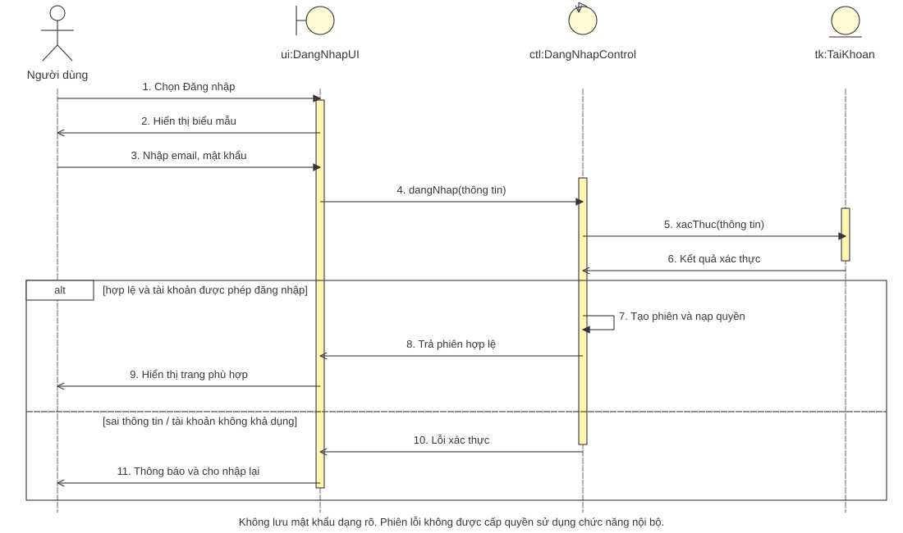

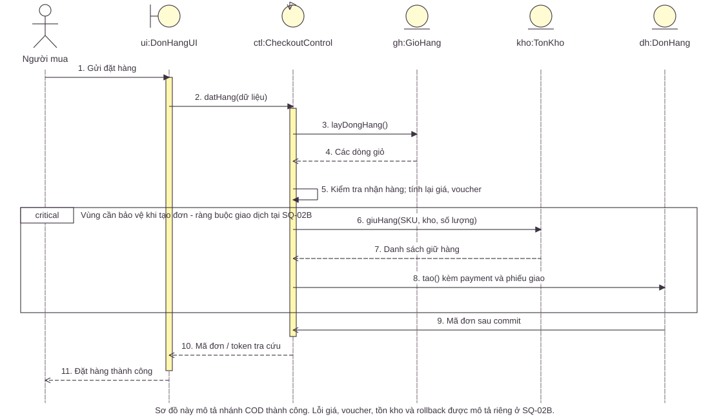

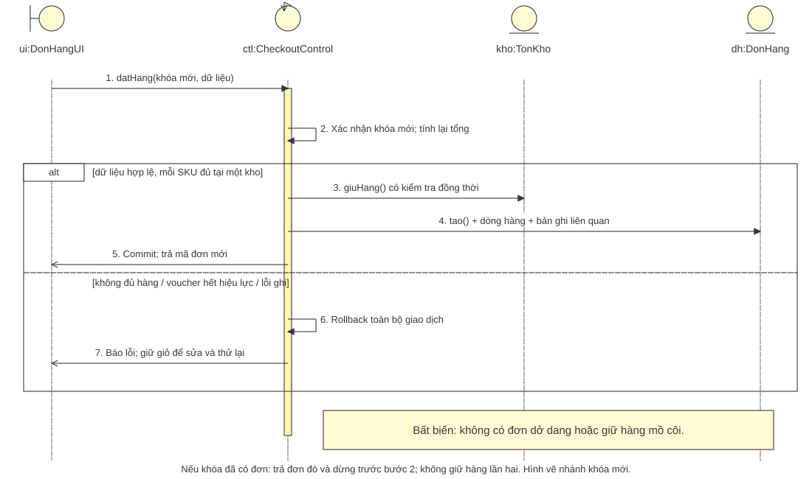

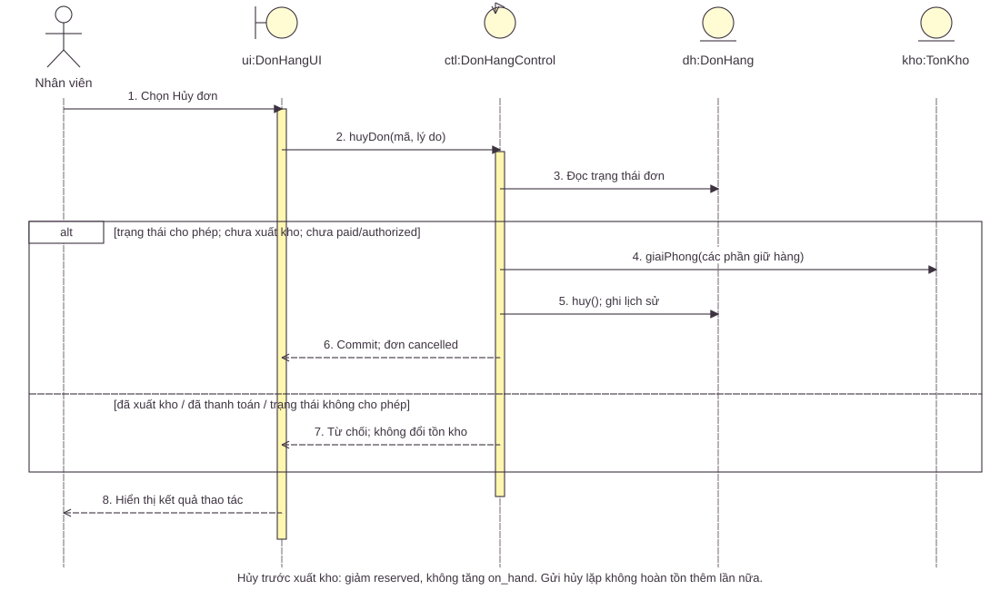

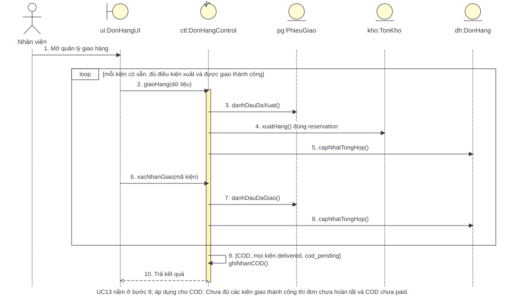

# 6. Class diagram

## 6.1. Tìm và thanh lọc lớp theo trang 73-78

Từ câu “khách chọn biến thể, thêm giỏ và đặt đơn; hệ thống giữ tồn tại kho và giao từng kiện”, các ứng viên gồm tài khoản, sản phẩm, biến thể, giỏ, dòng giỏ, đơn, dòng đơn, kho, tồn, giữ tồn, phiếu giao, dòng giao và thanh toán. Mỗi ứng viên cần thông tin và trách nhiệm riêng; màu và size được giữ làm thuộc tính biến thể, không tách thành lớp độc lập trong mô hình rút gọn.

“Admin/Manager/Staff” là vai trò sử dụng, không buộc phải thành ba lớp con của TaiKhoan. Mã nguồn hiện dùng tài khoản-vai trò. “Nhấn nút đặt hàng” là hành động của UI; “tạo đơn” là trách nhiệm điều phối; “số lượng đặt” là dữ liệu dòng đơn. Phân biệt này tránh trộn màn hình, nghiệp vụ và bảng dữ liệu.

| Nhóm lớp | Vì sao cần | Hành vi chính |
|---|---|---|
| SanPham, BienThe, DanhMuc | Một mẫu có nhiều SKU; phân loại nhiều-nhiều | Đọc biến thể, giá hiện tại, nhóm sản phẩm |
| TaiKhoan, GioHang, DongGioHang | Hỗ trợ mua có tài khoản và mua guest | Xác thực, đọc giỏ, sửa số lượng |
| DonHang, DongDonHang | Lưu giao dịch và bản chụp tại thời điểm đặt | Tạo, hủy, tổng hợp, tính thành tiền |
| Kho, TonKho, GiuTon | Tách nơi chứa, số dư và lần giữ cho đơn | Giữ, nhả, tiêu thụ/xuất |
| PhieuGiao, DongPhieuGiao | Theo dõi phần hàng từng kho và số lượng từng dòng | Xem kiện, đánh dấu xuất/giao |
| ThanhToan | Lưu phương thức, trạng thái và kết quả | Ghi nhận COD khi đủ điều kiện |
| UI, Control | Phân bổ tương tác và điều phối use case | Tiếp nhận, kiểm tra, phối hợp, trả kết quả |

## 6.2. Cách đọc bội số và vòng đời

Một DonHang có 1..* DongDonHang; một dòng chỉ thuộc một đơn. Một giỏ có thể rỗng, vì vậy GioHang-DongGioHang dùng 0..*. DanhMuc-SanPham là nhiều-nhiều. Một biến thể có tồn ở nhiều kho, nhưng cặp biến thể-kho phải duy nhất. Guest khiến liên kết chủ tài khoản của đơn là 0..1.

CL-02 thể hiện dữ liệu có thể lưu lịch sử: khi SKU bị xóa, dòng đơn vẫn tồn tại và variant_id có thể null; một số FK kho/reservation của dữ liệu cũ cũng tùy chọn. Với checkout mới, hệ thống vẫn gán đúng biến thể, kho và reservation. Không được đọc bội số 0..1 thành cho phép tạo đơn mới không rõ hàng/kho.

Hình thoi đặc nằm ở đầu toàn thể, dùng cho đơn-dòng đơn hoặc kiện-dòng kiện. Quan hệ sở hữu nghiệp vụ không phải lệnh xóa cascade trong cơ sở dữ liệu; hủy đơn là đổi trạng thái và ghi lịch sử. CL-01 đến CL-03 là ba góc nhìn của cùng mô hình, không phải ba cơ sở dữ liệu khác nhau.

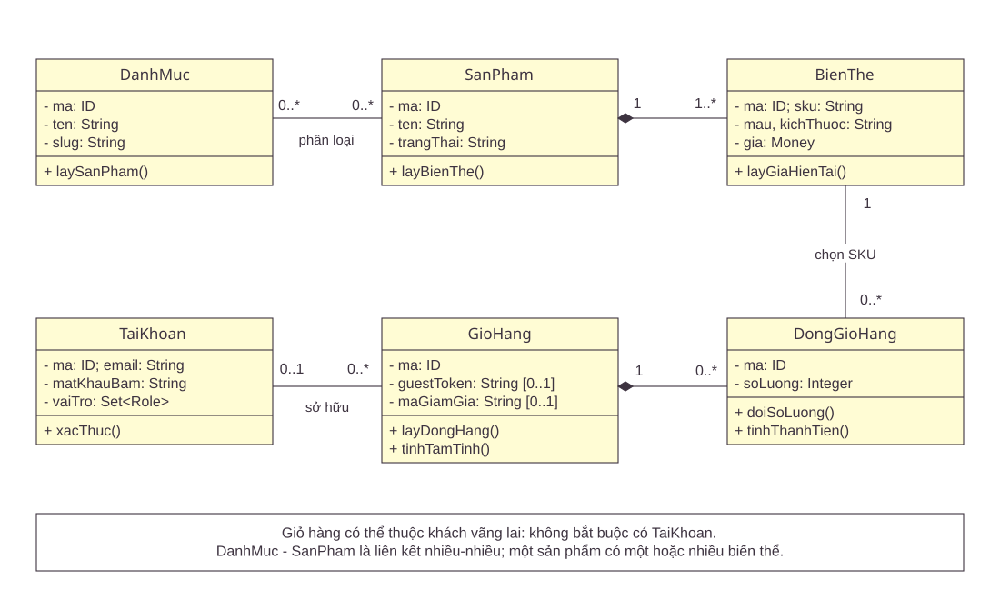

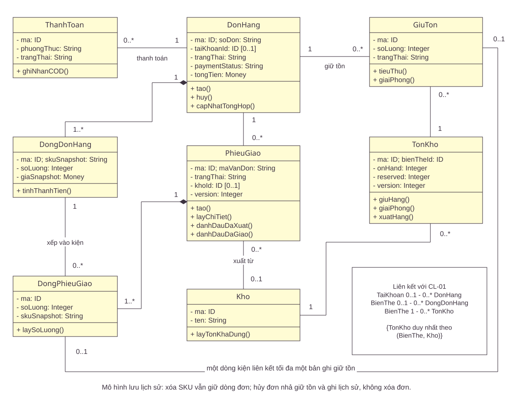

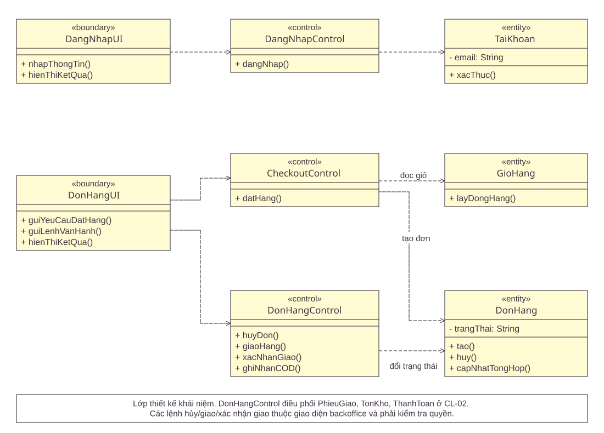

# 7. Activity diagram

AD-01 theo dõi việc mua và tạo đơn COD qua ba phân làn: người mua, hệ thống và kho/dữ liệu. Các hình thoi nhỏ trước hành động gom nhánh quay lại, tránh nhầm việc sửa dữ liệu với chờ hai nhánh chạy đồng thời. Nếu dữ liệu sai thì sửa; nếu thiếu hàng thì rollback và chọn lại. Đặt thành công chỉ khi giao dịch lưu đơn, payment, giữ hàng và kiện đã commit.

AD-02 biểu diễn nhánh vận hành COD: bắt đầu từ đơn confirmed, nhân sự có thể hủy đủ điều kiện hoặc tiếp tục giao. Sau khi xuất từng kiện, hệ thống trừ on_hand/reserved đúng một lần. Mô hình vẽ trình tự từng kiện để dễ đọc; thực tế các kiện có thể giao xen kẽ. Giao thất bại hoặc hoàn không được nhập nhằng với delivered; chúng theo ngoại lệ của UC12.

AD-03 minh họa thêm fork/join như trang 86. Hai công việc lấy/đóng hàng và chuẩn bị vận đơn có thể được tổ chức song song; bước đối chiếu đợi cả hai. Đây là **phương án nghiệp vụ đề xuất**, không khẳng định NÉT đã có hai tác vụ nền tự động. Mô hình không dùng fork/join để biểu diễn transaction.

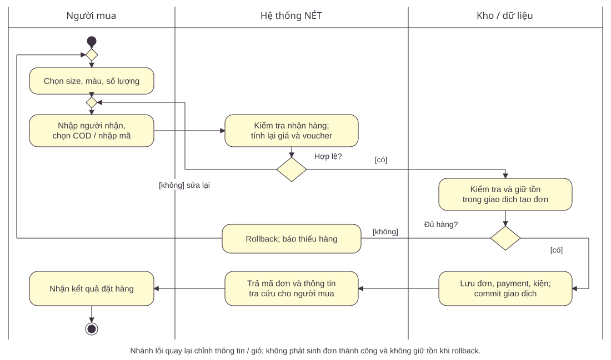

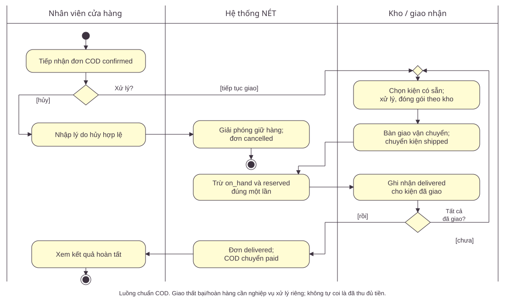

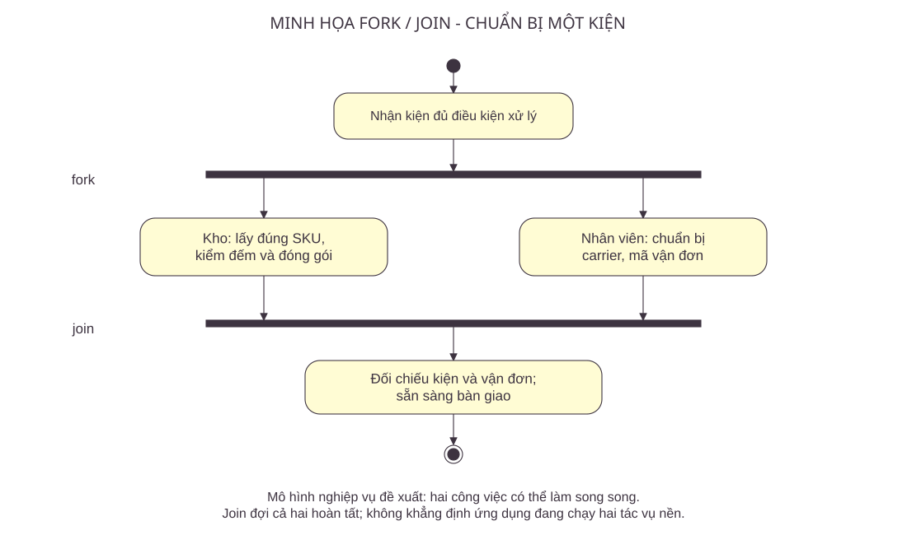

# 8. Component, deployment và package diagram

## 8.1. Ba câu hỏi khác nhau

Component cho biết hệ thống gồm những thành phần phần mềm nào và chúng dùng giao diện gì. Deployment cho biết phần mềm chạy ở đâu, trong môi trường nào, kết nối qua cổng/giao thức nào. Package cho biết các lớp/mô-đun được tổ chức và phụ thuộc ra sao. Cùng một API có thể là một component, chứa nhiều package và được triển khai trong một container; ba khái niệm này không đồng nhất.

## 8.2. Kiến trúc có căn cứ từ dự án

NÉT dùng ứng dụng web React/Vinext gồm storefront, backoffice và BFF cùng origin. Luồng trình duyệt gửi yêu cầu đến BFF; BFF chuyển HTTP/JSON đến API Java. API xử lý quyền và nghiệp vụ rồi làm việc với PostgreSQL, Redis hoặc kho media. Server Components có thể gọi API ở phía server. BFF không đọc PostgreSQL trực tiếp trong kiến trúc hiện tại.

Backend là một ứng dụng Spring Boot chia mô-đun nghiệp vụ, không phải mỗi mô-đun là một microservice. Thiết kế này cho phép xử lý checkout gồm đơn, tồn, payment và kiện trong cùng giao dịch dữ liệu, phù hợp phạm vi đồ án và quy mô nhóm hiện tại. Việc tách dịch vụ chỉ nên xem xét nếu có yêu cầu độc lập vận hành/tải, không phải để làm sơ đồ phức tạp hơn.

Hai Compose stack local được vẽ theo cấu hình có trong workspace. Frontend công bố cổng 8787; backend công bố API 8080, PostgreSQL và Redis ở mạng backend. Frontend gọi API qua host.docker.internal:8080 vì đây là hai stack. Đường local dùng HTTP; sơ đồ không khẳng định có HTTPS/CDN/cloud cluster production đã triển khai.

Package diagram phân biệt các gói Boundary/Control/Entity ở mức phân tích với namespace Java thực. Các package order, cart, catalog, account có thật và một phần import được vẽ. Đọc chung bảng dữ liệu không có nghĩa package order import inventory; OrderService hiện dùng JdbcClient trực tiếp cho các bảng liên quan. Biểu đồ gói là tập con cần thiết để giải thích, không khẳng định toàn code là đồ thị không có chu trình.

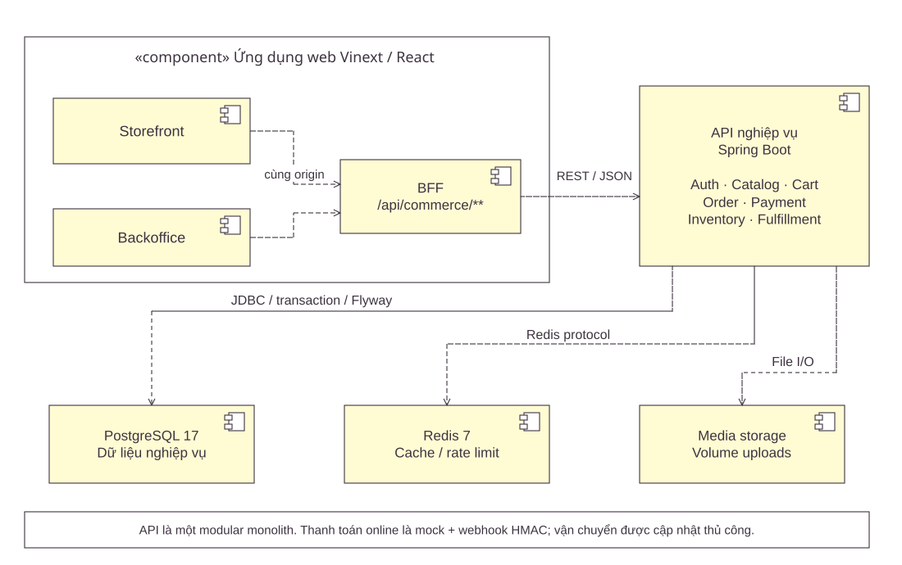

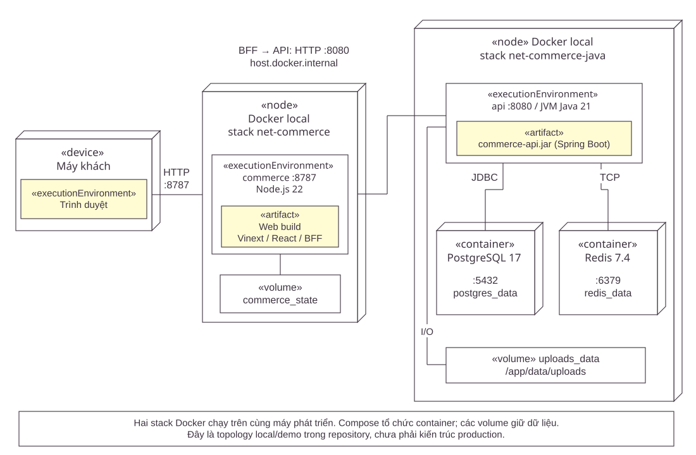

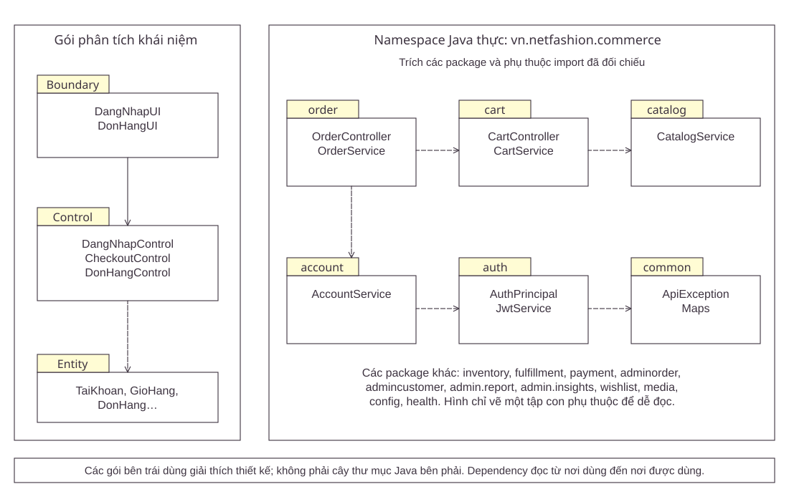

# 9. Công nghệ và kỹ thuật xây dựng

| Thành phần | Công nghệ hiện có | Vai trò và lý do phù hợp |
|---|---|---|
| Giao diện và BFF | React 19, Vinext, TypeScript; Node 22 trong container | Storefront/backoffice, biểu mẫu và trung gian cùng origin |
| API | Java 21, Spring Boot, Spring Security | Chia controller/service, kiểm tra vai trò và xử lý nghiệp vụ |
| Dữ liệu | PostgreSQL 17, JdbcClient, Flyway | Giao dịch, khóa, ràng buộc, truy vấn và migration có phiên bản |
| Cache/giới hạn tần suất | Redis 7; image backend 7.4-alpine | Cache catalog và giới hạn đăng nhập; không thay PostgreSQL lưu đơn |
| Media | Filesystem/volume uploads | Lưu tệp tải lên gắn với API trong bản demo |
| Đóng gói | Dockerfile và Docker Compose, hai stack local | Tái lập môi trường, quản lý cổng và volume |
| Xác thực | BCrypt, access JWT, refresh token hash, cookie HttpOnly | Kiểm mật khẩu và phiên; quyền vẫn kiểm ở backend |
| Nhất quán | Transaction, idempotency key, khóa dữ liệu, expectedVersion | Chống gửi lặp, mất cập nhật và xuất kho trùng |
| Truy vết | History, audit, movement, outbox | Ghi lại thay đổi nghiệp vụ và làm căn cứ đối soát |

Các lựa chọn trên được mô tả theo mã/cấu hình hiện hữu, không phải đề xuất thay stack. Outbox có bản ghi nhưng chưa có bộ phát production hoàn chỉnh; email, cổng thanh toán thật và API hãng vận chuyển không được vẽ như tích hợp đã vận hành. Báo cáo này không chạy lại ứng dụng hoặc thay đổi mã triển khai.

# 10. Ma trận truy vết yêu cầu và mô hình

| Yêu cầu / UC | Use case | Sequence | Class | Activity / kiến trúc |
|---|---|---|---|---|
| UC01 xem/tìm | UC-D01 | Chưa tách sequence riêng | CL-01 | Ngữ cảnh chọn hàng ở AD-01 |
| UC02 đăng ký/xác minh | UC-D01 | Chưa tách sequence riêng | TaiKhoan ở CL-01 | Chưa tách activity riêng |
| UC04-UC05 giỏ/voucher | UC-D01, UC-D03 | Giỏ/voucher trong SQ-02 | CL-01 | AD-01 |
| UC03 đăng nhập | UC-D01 | SQ-01 | CL-01, CL-03 | CP-01, PK-01 |
| UC06 đặt hàng và giữ tồn | UC-D01, UC-D03 | SQ-02, SQ-02B | CL-01, CL-02, CL-03 | AD-01 |
| UC07 tra cứu đơn | UC-D01 | Chưa tách sequence riêng; contract token nêu ở đặc tả/phạm vi | CL-02 | CP-01 |
| UC08-UC09 catalog/tồn | UC-D02 | Tác động giữ/nhả/xuất trong SQ-02/03/04 | CL-01, CL-02 | AD-01, AD-02 |
| UC10-UC11 xử lý/hủy | UC-D02 | SQ-03 | CL-02, CL-03 | AD-02 |
| UC12-UC13 giao và COD | UC-D02 | SQ-04 | CL-02, CL-03 | AD-02, AD-03 |
| UC14-UC16 khách/báo cáo/tài khoản | UC-D02 | Chưa tách sequence riêng | Lược lớp hỗ trợ khỏi mô hình trọng tâm | CP-01, PK-01 |
| Thành phần và giao diện | - | Luồng UI/API nhất quán | CL-03 | CP-01 |
| Nơi chạy và kết nối | - | - | - | DP-01 |
| Tổ chức mô hình/mã | - | - | CL-01 đến CL-03 | PK-01 |

Các ô chưa tách hình riêng là giới hạn phân rã có chủ ý của báo cáo trọng tâm, không phải tuyên bố các ca đó không cần thiết kế. Mỗi loại biểu đồ trong trang 90 đã có đầu ra; các ca rủi ro về dữ liệu và dòng tiền được đặc tả sâu hơn. Tên lớp/đối tượng và ràng buộc nhất quán quan trọng hơn việc lặp mọi chi tiết trên mọi hình.

# 11. Kế hoạch thực hiện trong 2 tuần

Thời gian 02 tuần ở trang 90 được diễn giải thành 10 ngày làm việc cho giai đoạn phân tích và hoàn thiện mô hình. Đây là kế hoạch đề xuất; không phải báo cáo rằng nhóm đã làm xong 10 ngày và không thay thế kế hoạch toàn dự án 8 tuần trong README.

| Ngày | Công việc | Chủ trì đề xuất | Đầu ra kiểm tra |
|---|---|---|---|
| 1 | Đọc đề, chốt phạm vi và nguồn | PM/BA + cả nhóm | Ranh giới, giả định, actor |
| 2 | Chuẩn hóa UC và quy tắc | PM/BA + Backend 1 | Danh mục UC, R01-R12 |
| 3 | Vẽ use case; đặc tả luồng chính/phụ | PM/BA + Frontend | UC-D01-03, 6 đặc tả |
| 4 | Activity và trao đổi trách nhiệm | Frontend + Backend 2 | AD-01-03; điều kiện/nhánh lỗi |
| 5 | Sequence đăng nhập/checkout | Backend 1 + Frontend | SQ-01/02/02B |
| 6 | Sequence hủy/giao/COD | Backend 2 + Backend 1 | SQ-03/04; kiểm tồn/tiền |
| 7 | Tìm lớp, thuộc tính, phương thức, bội số | Backend 1 + Backend 2 | CL-01-03; mapping thông điệp |
| 8 | Kiến trúc, thành phần, triển khai, gói | DevOps + Backend 1 | CP-01, DP-01, PK-01; công nghệ |
| 9 | Rà soát chéo và các kịch bản biên | Cả 5 thành viên | Ma trận truy vết; danh sách sửa |
| 10 | Chỉnh hình, đóng gói, luyện trình bày | PM/BA + cả nhóm | PDF, SVG/PNG, nội dung thuyết trình |

Nhóm đề xuất gồm 5 người: PM/BA, Frontend, Backend 1, Backend 2 và DevOps. Cuối tuần 1 chốt ca sử dụng và các luồng; cuối tuần 2 chốt cấu trúc và kiến trúc. Khi thay đổi một quy tắc, người phụ trách cập nhật các hình liên quan qua ma trận truy vết trước khi đóng báo cáo.

# 12. Kiểm tra tính đúng và giới hạn hiện trạng

## 12.1. Tình huống kiểm tra nghiệp vụ đề xuất

| Tình huống | Kết quả phải giữ |
|---|---|
| Hai yêu cầu mua cùng SKU cuối | Chỉ yêu cầu giữ hàng thành công mới có đơn; tồn không âm |
| Gửi lại checkout cùng khóa | Trả đúng đơn cũ, không tăng reserved lần hai |
| Giá/voucher thay đổi trước đặt | Máy chủ tính lại, báo lỗi khi không hợp lệ |
| Một SKU cần 3, mỗi kho chỉ còn 2 | Từ chối theo chính sách một kho/SKU hiện tại |
| Hủy COD chưa xuất | Mọi kiện cancelled; reserved giảm, on_hand giữ nguyên |
| Hủy đơn đã paid hoặc đã ship | Từ chối; không tự hoàn tiền hoặc nhập hàng trở lại |
| Một trong hai kiện delivered | Giữ COD cod_pending; không coi toàn đơn đã hoàn tất |
| Kiện delivered cuối cùng | Order delivered/paid; payment succeeded trong cùng transaction |
| Shipped lặp hoặc cập nhật version cũ | Không xuất tồn thêm; conflict nếu phiên bản không khớp |
| Hàng returned sau shipped | Không tự tăng on_hand; cần receipt sau kiểm định |
| Guest token sai hoặc member khác chủ | Không lộ chi tiết đơn |

Các tình huống trên là tiêu chí và ca kiểm tra được suy ra từ mô hình, không phải kết quả chạy test ở lượt xây dựng báo cáo này. Kiểm tra thực hiện cho tài liệu là đối chiếu nguồn, rà nội dung và kiểm bản render của PDF/biểu đồ.

## 12.2. Sai lệch đã ghi trong hồ sơ hiện hữu

| Mã trong hồ sơ | Sai lệch cần phân biệt với mô hình mong muốn |
|---|---|
| KD-GUEST-01 | Trang thanh toán guest còn gửi token qua query, khác contract header của luồng theo dõi |
| KD-PAY-01 | Webhook success đến muộn có thể làm payment paid khi order đã cancelled |
| KD-INV-01 | Expiry cập nhật aggregate payment_status nhưng chưa đồng bộ đầy đủ dòng payment |
| KD-INV-02 | COD có hạn giữ 30 ngày nhưng scheduler chỉ quét pending_payment |

Bảng này lấy từ hồ sơ BA và kết quả đọc mã, chưa tái hiện runtime trong lượt này. Không khẳng định các quy tắc vòng đời ngoài các luồng đã vẽ đều được triển khai hoàn chỉnh. Các sai lệch là đầu việc cải tiến riêng; yêu cầu hiện tại tập trung vào phân tích và biểu đồ.

## 12.3. Đối chiếu trực tiếp trang 90

| Yêu cầu cuối bài giảng | Đầu ra của báo cáo |
|---|---|
| Use Case Diagram | UC-D01, UC-D02, UC-D03 và 6 đặc tả |
| Sequence Diagram | SQ-01, SQ-02, SQ-02B, SQ-03, SQ-04 |
| Class Diagram | CL-01, CL-02, CL-03 |
| Activity Diagram | AD-01, AD-02, AD-03 |
| Component/Deployment/Package | CP-01, DP-01, PK-01; có đủ cả 3 loại |
| Kiến trúc hệ thống | Phần 8, quan hệ UI-BFF-API-dữ liệu |
| Công nghệ/kỹ thuật | Phần 9, giải thích stack và kỹ thuật dữ liệu |
| Thời gian 02 tuần | Phần 11, 10 ngày và đầu ra từng ngày |

# 13. Nguồn tham khảo và cách sử dụng tệp

**Nguồn bài giảng:** Project 1-Bai 3- Phan tich he thong.pdf, Nguyễn Đức Dư, 91 trang, tệp người dùng cung cấp. Tham chiếu hình: use case tr.35-48; mẫu đặc tả tr.49-51; sequence tr.53-59; class tr.60-82; activity tr.83-89; yêu cầu học phần tr.90.

**Nguồn NÉT đọc tại workspace ngày 14/09/2026:** README.md; platform/README.md; platform/ARCHITECTURE.md; docs/ba/02-use-cases.md; docs/ba/03-business-rules.md; docs/ba/04-diagrams.md; docs/ba/05-data-model.md; platform/docker-compose.yml; platform/backend/docker-compose.yml; các controller/service auth, order, adminorder, fulfillment, inventory; migration Flyway V1 và V7. Các tham chiếu là đường dẫn tương đối từ thư mục dự án online-store.

**Nguồn chuẩn UML dùng để giải thích điểm giản lược:** [OMG UML 2.5, phần Property](https://www.omg.org/spec/UML/2.5/PDF); [OMG UML ISO/19505-2, phần InitialNode](https://www.omg.org/spec/UML/ISO/19505-2/PDF); [Enterprise Architect: Extend](https://sparxsystems.com/enterprise_architect_user_guide/17.1/modeling_languages/extend.html). Các quy tắc thực hành được đối chiếu với phong cách giảng dạy của PDF, không chép nguyên những cách diễn đạt dễ gây nhầm.

PDF là bản đọc và in. Tệp Markdown giữ nội dung để sửa và chuyển định dạng. Thư mục net-uml chứa SVG vector, PNG độ phân giải cao và JSON mô tả từng hình. Dùng tên mã hình để tìm nhanh; khi sửa nghiệp vụ, kiểm lại ma trận truy vết. Gói ZIP chứa các tệp này và bản PDF, không chứa dữ liệu riêng của ứng dụng hoặc bản sao mã nguồn toàn dự án.
